

<h2 data-ke-size="size26">DIVA(Damn Insecure and Vulnerable App)</h2>

DIVA(Damn insecure and vulnerable App)은 학습을 위해 의도적으로 취약하게 설계된 안드로이드 앱입니다.

안드로이드 앱 취약점 입문을 위해 풀었습니다.

 

DIVA는 다음 주소에서 다운 받을 수 있습니다.

<a href="https://github.com/payatu/diva-android" rel="noopener noreferrer" target="_blank">https://github.com/payatu/diva-android</a>

<figure contenteditable="false" data-ke-align="alignCenter" data-ke-type="opengraph" data-og-description="DIVA Android - Damn Insecure and vulnerable App for Android - payatu/diva-android" data-og-host="github.com" data-og-image="/assets/img/and-lab/01/og-01.png" data-og-source-url="https://github.com/payatu/diva-android" data-og-title="GitHub - payatu/diva-android: DIVA Android - Damn Insecure and vulnerable App for Android" data-og-type="object" data-og-url="https://github.com/payatu/diva-android" id="og_1789736444962"><a data-source-url="https://github.com/payatu/diva-android" href="https://github.com/payatu/diva-android" rel="noopener" target="_blank">

 

GitHub - payatu/diva-android: DIVA Android - Damn Insecure and vulnerable App for Android

DIVA Android - Damn Insecure and vulnerable App for Android - payatu/diva-android

github.com

</a></figure>

 

DIVA에는 다음과 같은 앱 취약점들이 존재합니다.

<ol data-ke-list-type="decimal" style="list-style-type: decimal; background-color: #ffffff; color: #1f2328; text-align: start;">
<li>Insecure Logging</li>
<li>Hardcoding Issues – Part 1</li>
<li>Insecure Data Storage – Part 1</li>
<li>Insecure Data Storage – Part 2</li>
<li>Insecure Data Storage – Part 3</li>
<li>Insecure Data Storage – Part 4</li>
<li>Input Validation Issues – Part 1</li>
<li>Input Validation Issues – Part 2</li>
<li>Access Control Issues – Part 1</li>
<li>Access Control Issues – Part 2</li>
<li>Access Control Issues – Part 3</li>
<li>Hardcoding Issues – Part 2</li>
<li>Input Validation Issues – Part 3</li>
</ol>

안드로이드가 처음이기도 하고, java에 익숙한 것도 아니라 필요한 개념은 그때그때 검색해가며 풀었습니다.

<h3 data-ke-size="size23">실습 환경</h3>
<ul data-ke-list-type="disc" style="list-style-type: disc;">
<li>Android Studio</li>
<li>AOSP Android 8 (API 26)</li>
</ul>
<h3 data-ke-size="size23">1. Insecure Logging</h3>

첫 번째 취약점은 검증되지 않은 로깅입니다.

검증되지 않은 로깅이란, 애플리케이션이 민감한 데이터를 로그에 그대로 기록하여 중요 정보가 노출되는 것을 말합니다.

 

코드는 다음과 같습니다.

<pre class="java" data-ke-language="java" data-ke-type="codeblock" id="code_1789836956748"><code class="hljs">public class LogActivity extends AppCompatActivity {

    @Override
    protected void onCreate(Bundle savedInstanceState) {
        super.onCreate(savedInstanceState);
        setContentView(R.layout.activity_log);
    }

    public void checkout(View view) {
        EditText cctxt = (EditText) findViewById(R.id.ccText);
        try {
            // Assuming we do some HTTP requests credit card validation and processing
            //Everything seems fine and then we hit some unforseen error
            processCC(cctxt.getText().toString());
        } catch (RuntimeException re) {
            Log.e("diva-log", "Error while processing transaction with credit card: " + cctxt.getText().toString());
            Toast.makeText(this, "An error occured. Please try again later", Toast.LENGTH_SHORT).show();
        }
    }

    private void processCC(String ccstr) {
        // Do some important processing and throw if there is any error
        RuntimeException e = new RuntimeException();
        throw e;
    }
}</code></pre>

문제명에 Logging이라는 단어가 들어가서 Log.e() 부분이 중요할 거 같았습니다.

<pre class="java" data-ke-language="java" data-ke-type="codeblock" id="code_1789863343966"><code class="hljs">catch (RuntimeException re) {
            Log.e("diva-log", "Error while processing transaction with credit card: " + cctxt.getText().toString());
            Toast.makeText(this, "An error occured. Please try again later", Toast.LENGTH_SHORT).show();
        }</code></pre>

 

검색해보니 Log.e()는 프로그램 실행 중 발생한 예외나 오류를 기록하기 위한 에러 로그 출력 메서드라고 합니다.

Logcat이라는 창에서 확인할 수 있습니다.

<figure class="imageblock alignCenter" data-ke-mobilestyle="widthOrigin" data-origin-height="48" data-origin-width="106">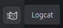<figcaption>안드로이드 스튜디오 왼쪽 하단에 있는 Logcat</figcaption>
</figure>

 

Log.e(String tag, String msg) 형태로 사용됩니다.

tag : 로그를 출력하는 클래스나 메서드 이름 등 식별자

msg : 출력할 상세 에러 메시지

 

이때 cctxt.getText().toString() 때문에 사용자가 입력한 값이 에러 로그에 그대로 드러나게 됩니다.

 

Android Studio에서 

Emulator로 검증해봤습니다.

<figure class="imageblock alignCenter" data-ke-mobilestyle="widthOrigin" data-origin-height="771" data-origin-width="374">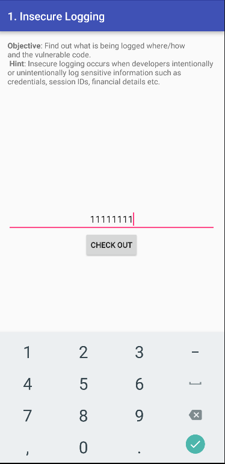</figure>

11111111를 입력한 후 CHECK OUT 버튼을 누른 후 Logcat을 보면

<figure class="imageblock alignCenter" data-ke-mobilestyle="widthOrigin" data-origin-height="22" data-origin-width="526">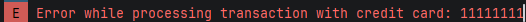</figure>

위와 같이 에러 메시지와 함께 제가 입력한 값이 문자 그대로 출력되는 걸 알 수 있습니다.

 

<h3 data-ke-size="size23">2. Hardcoding Issues - Part 1</h3>

두 번째 취약점은 하드코딩 취약점입니다.

 

하드코딩이란 코드 내부에 데이터 또는 값을 리터럴 형태로 직접 고정하는 개발 방식을 말합니다.

따라서, 비밀번호 같은 정보가 코드 내에 입력되어 있으면 사용자의 권한을 탈취하거나 악용하는 등의 문제가 발생할 수 있습니다.

 

취약 코드는 다음과 같습니다.

<pre class="java" data-ke-language="java" data-ke-type="codeblock" id="code_1789736724161"><code class="hljs">public class HardcodeActivity extends AppCompatActivity {
    @Override
    protected void onCreate(Bundle savedInstanceState) {
        super.onCreate(savedInstanceState);
        setContentView(R.layout.activity_hardcode);
    }

    public void access(View view) {
        EditText hckey = (EditText) findViewById(R.id.hcKey);

        if (hckey.getText().toString().equals("vendorsecretkey")) {
            Toast.makeText(this, "Access granted! See you on the other side :)", Toast.LENGTH_SHORT).show();
        }
        else {
            Toast.makeText(this, "Access denied! See you in hell :D", Toast.LENGTH_SHORT).show();
        }
    }
}</code></pre>

 

if 문을 보니 사용자가 입력한 값이 "vendorsecretkey" 라는 문자열과 일치하면 된다고 생각했습니다.

 

생각한 바가 맞는지 Emulator로 검증해봤습니다.

 

입력칸에 "vendorsecretkey"를 입력한 후 ACCESS 버튼을 누르면 성공했다는 메시지가 뜹니다.

<figure class="imageblock alignCenter" data-ke-mobilestyle="widthOrigin" data-origin-height="857" data-origin-width="407">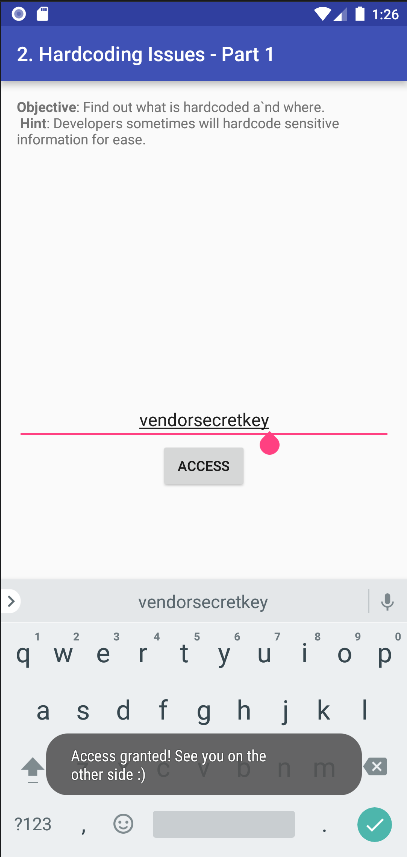</figure>

코드 내에 "vendorsecretkey"라는 문자열이 직접 삽입되어 있기 때문에 하드코딩 취약점이라고 할 수 있습니다.

 

<h3 data-ke-size="size23">3. Insecure Data Storage - Part 1</h3>

세 번째부터 여섯 번째까지는 안전하지 않은 데이터 저장소 취약점입니다.

안전하지 않은 데이터 저장소 취약점은 중요 정보가 내/외부 저장소에 평문으로 저장될 때 발생하는 취약점입니다.

 

코드는 다음과 같습니다.

<pre class="java" data-ke-language="java" data-ke-type="codeblock" id="code_1789837676461"><code class="hljs">public class InsecureDataStorage1Activity extends AppCompatActivity {

    @Override
    protected void onCreate(Bundle savedInstanceState) {
        super.onCreate(savedInstanceState);
        setContentView(R.layout.activity_insecure_data_storage1);
    }

    public void saveCredentials(View view) {
        SharedPreferences spref = PreferenceManager.getDefaultSharedPreferences(this);
        SharedPreferences.Editor spedit = spref.edit();
        EditText usr = (EditText) findViewById(R.id.ids1Usr);
        EditText pwd = (EditText) findViewById(R.id.ids1Pwd);

        spedit.putString("user", usr.getText().toString());
        spedit.putString("password", pwd.getText().toString());
        spedit.commit();

        Toast.makeText(this,"3rd party credentials saved successfully!", Toast.LENGTH_SHORT).show();
    }
}</code></pre>

 

다음 코드에서 SharedPreferences는 데이터를 키-값 형태로 저장하는 클래스입니다. 이 데이터는 앱 내부의 xml 파일에 저장된다고 합니다.

 

다음 코드를 보면 사용자명과 비밀번호를 putString()으로 입력 받습니다.

<pre class="java" data-ke-language="java" data-ke-type="codeblock" id="code_1789839145577"><code class="hljs">public void saveCredentials(View view) {
        SharedPreferences spref = PreferenceManager.getDefaultSharedPreferences(this);
        SharedPreferences.Editor spedit = spref.edit();
        EditText usr = (EditText) findViewById(R.id.ids1Usr);
        EditText pwd = (EditText) findViewById(R.id.ids1Pwd);

        spedit.putString("user", usr.getText().toString());
        spedit.putString("password", pwd.getText().toString());
        spedit.commit();</code></pre>

putString()은 키-값 형태로 데이터를 저장할 수 있으므로

user-&lt;사용자입력값&gt;

password-&lt;사용자입력값&gt;

형태로 저장되게 됩니다.

 

이때 사용자명과 비밀번호는 암호화 없이 사용자가 입력한 문자열 그대로 내부 저장소에 저장됩니다.

내부 저장소가 뭔가 싶어서 검색해보니 data/data/&lt;패키지명&gt; -&gt; 여기가 내부 저장소라고 합니다.

안드로이드 앱의 패키지명을 어떻게 알 수 있나 싶어 검색하니 AndroidManifest.xml 파일에서 패키지명을 확인할 수 있다고 합니다.

 

AndroidManifest.xml 파일을 통해 알아보니 DIVA의 패키지명은 jakhar.aseem.diva입니다. 다른 문제를 풀 때도 자주 쓰이니 꼭 알고 있어야 합니다.

<figure class="imageblock alignCenter" data-ke-mobilestyle="widthOrigin" data-origin-height="79" data-origin-width="563">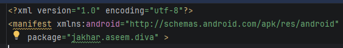</figure>

 

Emulator를 통해 검증해봤습니다.

사용자명과 비밀번호를 입력 후 SAVE를 눌렀습니다.

<figure class="imageblock alignCenter" data-ke-mobilestyle="widthOrigin" data-origin-height="764" data-origin-width="376">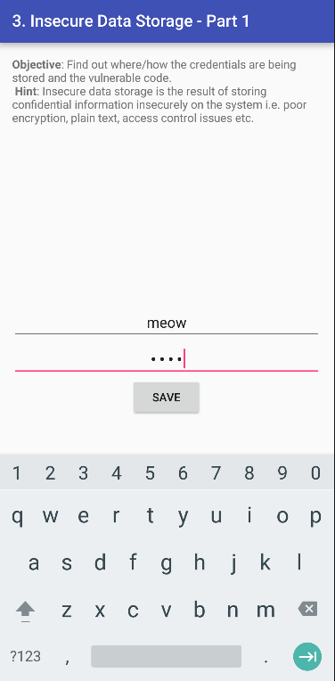</figure>

 

내부 저장소에 제가 입력한 문자열이 그대로 저장되었는지 확인해보겠습니다.

 

SharedPreferences로 저장된 파일은 data/data/&lt;패키지명&gt;/shared_prefs/에 있다고 합니다.

diva 패키지명을 넣으면 data/data/jakhar.aseem.diva/shared_prefs/에 있습니다.

 

해당 경로는 Device Explorer를 통해 쉽게 찾을 수 있습니다. View-&gt;Tools Windows -&gt; Device Explorer

<figure class="imageblock alignCenter" data-ke-mobilestyle="widthOrigin" data-origin-height="649" data-origin-width="573">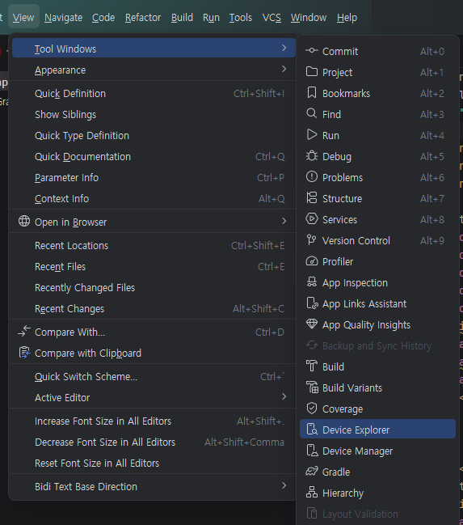</figure>

data/data/jakhar.aseem.diva/shared_prefs/ 경로에 있는 .xml 파일을 열어봤습니다.

<figure class="imageblock alignCenter" data-filename="스크린샷 2026-09-20 025043.png" data-ke-mobilestyle="widthOrigin" data-origin-height="838" data-origin-width="1382">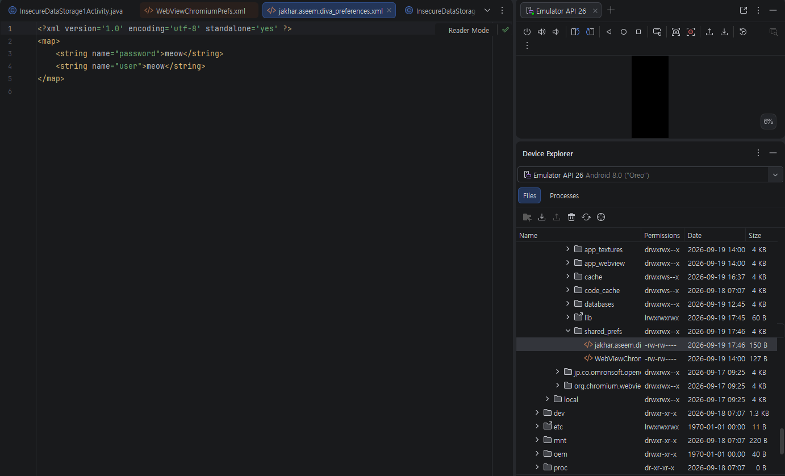</figure>

.xml 파일에 제가 입력한 값이 그대로 보이는 걸 알 수 있습니다.

<h3 data-ke-size="size23">4. Insecure Data Storage - Part 2</h3>

코드는 다음과 같습니다.

<pre class="java" data-ke-language="java" data-ke-type="codeblock" id="code_1789837843655"><code class="hljs">public class InsecureDataStorage2Activity extends AppCompatActivity {

    private SQLiteDatabase mDB;
    @Override
    protected void onCreate(Bundle savedInstanceState) {
        super.onCreate(savedInstanceState);
        try {
            mDB = openOrCreateDatabase("ids2", MODE_PRIVATE, null);
            mDB.execSQL("CREATE TABLE IF NOT EXISTS myuser(user VARCHAR, password VARCHAR);");
        }
        catch(Exception e) {
            Log.d("Diva", "Error occurred while creating database: " + e.getMessage());
        }

        setContentView(R.layout.activity_insecure_data_storage2);
    }

    public void saveCredentials(View view) {
        EditText usr = (EditText) findViewById(R.id.ids2Usr);
        EditText pwd = (EditText) findViewById(R.id.ids2Pwd);
        try {
            mDB.execSQL("INSERT INTO myuser VALUES ('"+ usr.getText().toString() +"', '"+ pwd.getText().toString() +"');");
            mDB.close();
        }
        catch(Exception e) {
            Log.d("Diva", "Error occurred while inserting into database: " + e.getMessage());
        }
        Toast.makeText(this, "3rd party credentials saved successfully!", Toast.LENGTH_SHORT).show();
    }
}</code></pre>

 

위에서 봤던 거랑 비슷합니다.

다만, 3번 문제와 다른 점은 3번 문제에선 SharedPreferences 클래스로 데이터를 키-값 형태로 저장했다면, 이 문제는 SQLite를 사용해 데이터베이스에 사용자 입력값을 저장합니다.

이때 저장된 SQLite 파일은 /data/data/&lt;패키지명&gt;/databases/ 에 저장된다고 합니다.

 

핵심 코드는 다음과 같습니다.

<pre class="java" data-ke-language="java" data-ke-type="codeblock" id="code_1789869556621"><code class="hljs">try {
            mDB.execSQL("INSERT INTO myuser VALUES ('"+ usr.getText().toString() +"', '"+ pwd.getText().toString() +"');");
            mDB.close();
        }</code></pre>

사용자명과 비밀번호를 그대로 입력 받아 데이터베이스 테이블에 저장합니다.

또한 문제에서 요구하는 건 아니지만 사용자 입력을 SQL 문에 직접 연결하므로 SQL Injection으로까지 이어질 수 있습니다.

 

 

Android Studio에서 사용자 입력값이 문자열 그대로 저장되었는지 확인해봤습니다.

diva 실행 후 4번 문제에서 문자열을 입력하고 SAVE를 눌러 저장합니다.

<figure class="imageblock alignCenter" data-ke-mobilestyle="widthOrigin" data-origin-height="718" data-origin-width="337">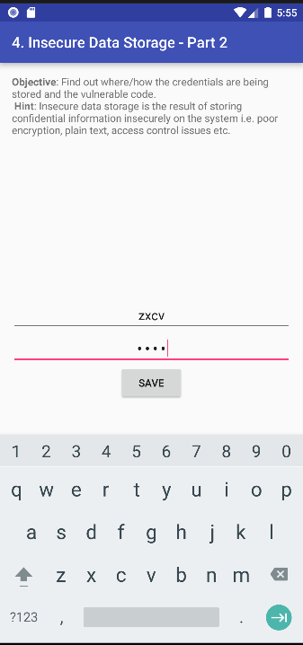</figure>

 

이때 사용자 입력값은 data/data/jakhar.aseem.diva/database/에 저장됩니다.

코드상에 적힌 데이터베이스 이름을 보면 ids2이므로 data/data/jakhar.aseem.diva/database/ids2에 제가 입력한 값이 존재할 거라고 유추했습니다.

 

3번에서 했던 방법처럼 Device Explorer로 저장된 파일을 열어보려 했는데 데이터베이스 파일이라 열리지 않았습니다.

데이터베이스 파일을 열람하는 방법에 대해 검색해보니 View-&gt;Tool Windows -&gt; App Inspection을 누르면 안드로이드 스튜디오 하단에 다음처럼 데이터베이스 파일들이 뜨는 걸 볼 수 있습니다.

<figure class="imageblock alignCenter" data-ke-mobilestyle="widthOrigin" data-origin-height="346" data-origin-width="1161">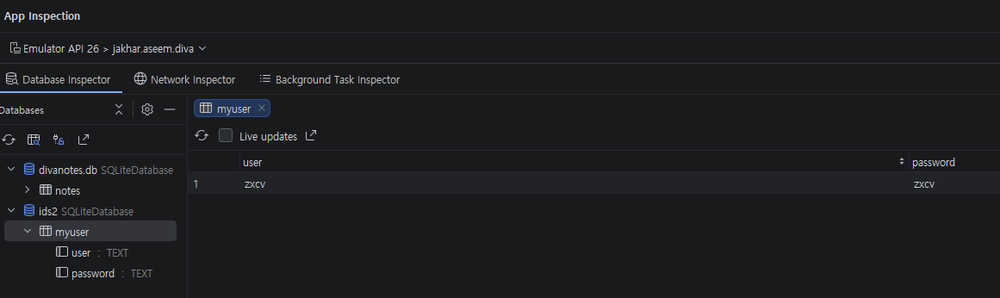</figure>

제가 입력한 값 또한 암호화되지 않고 평문으로 저장되었음을 확인할 수 있습니다.

 

<h3 data-ke-size="size23">5. Insecure Data Storage - Part 3</h3>

코드는 다음과 같습니다.

<pre class="java" data-ke-language="java" data-ke-type="codeblock" id="code_1789837926018"><code class="hljs">public class InsecureDataStorage3Activity extends AppCompatActivity {

    @Override
    protected void onCreate(Bundle savedInstanceState) {
        super.onCreate(savedInstanceState);
        setContentView(R.layout.activity_insecure_data_storage3);
    }

    public void saveCredentials(View view) {
        EditText usr = (EditText) findViewById(R.id.ids3Usr);
        EditText pwd = (EditText) findViewById(R.id.ids3Pwd);

        File ddir =  new File(getApplicationInfo().dataDir);

        try {
            File uinfo = File.createTempFile("uinfo", "tmp", ddir);
            uinfo.setReadable(true);
            uinfo.setWritable(true);
            FileWriter fw = new FileWriter(uinfo);
            fw.write(usr.getText().toString() + ":" + pwd.getText().toString() + "\n");
            fw.close();
            Toast.makeText(this, "3rd party credentials saved successfully!", Toast.LENGTH_SHORT).show();
            // Now you can read the temporary file where ever the credentials are required.
        }
        catch (Exception e) {
            Toast.makeText(this, "File error occurred", Toast.LENGTH_SHORT).show();
            Log.d("Diva", "File error: " + e.getMessage());
        }
    }
}</code></pre>

 

getApplacationInfo().dataDir에 대해 검색해보니 현재 애플리케이션의 내부 데이터 저장 경로를 문자열(/data/data/&lt;패키지명&gt;)로 반환하는 속성이라고 합니다.

 

따라서, ddir에는 /data/data/jakhar.aseem.diva라는 경로가 들어있을 것으로 예상됩니다.

 

<pre class="java" data-ke-language="java" data-ke-type="codeblock" id="code_1789870573582"><code class="hljs">public void saveCredentials(View view) {
        EditText usr = (EditText) findViewById(R.id.ids3Usr);
        EditText pwd = (EditText) findViewById(R.id.ids3Pwd);

        File ddir =  new File(getApplicationInfo().dataDir);</code></pre>

 

다음 try문에 있는 코드를 보면 File.createTempFile라는 메서드가 있습니다. 이 메서드는 지정된 장소에 임시 파일을 생성하는 메서드입니다.

File.createTempFile()의 인자는 다음과 같습니다.

첫 번째 인자 : 파일 이름 앞에 붙을 문자열 (최소 3글자)

두 번째 인자 : 파일 이름 뒤에 붙는 문자열 (.이 붙으면 확장자로서 기능. 이 코드에선 . 없음. 그냥 문자열.)

세 번째 인자 : 임시 파일이 생성될 디렉토리

<pre class="java" data-ke-language="java" data-ke-type="codeblock" id="code_1789875989782"><code class="hljs">try {
            File uinfo = File.createTempFile("uinfo", "tmp", ddir);
            uinfo.setReadable(true);
            uinfo.setWritable(true);
            FileWriter fw = new FileWriter(uinfo);
            fw.write(usr.getText().toString() + ":" + pwd.getText().toString() + "\n");
            fw.close();
            Toast.makeText(this, "3rd party credentials saved successfully!", Toast.LENGTH_SHORT).show();
            // Now you can read the temporary file where ever the credentials are required.
        }</code></pre>

File.createTempFile(&lt;prefix&gt;, &lt;suffix&gt;, &lt;dir&gt;) 를 통해 생성된 파일명은 &lt;prefix&gt;&lt;임의의숫자&gt;&lt;suffix&gt; 형태로 저장된다고 합니다. 중간에 임의의 숫자가 들어가는 이유는 기존에 존재하는 파일과의 충돌을 막기 위함입니다.

 

또한 앞서 봤던 것과 같이 이번에도 fw.write(usr.getText().toString() + ":" + pwd.getText().toString() + "\n"); 라는 코드가 있는 걸 보아 사용자명과 비밀번호를 평문으로 쓰고, 저장합니다.

 

안드로이드 스튜디오에서 확인해보겠습니다.

 

5번 문제에 들어가서 아무 값이나 입력 후 SAVE를 눌렀습니다.

<figure class="imageblock alignCenter" data-ke-mobilestyle="widthOrigin" data-origin-height="852" data-origin-width="403">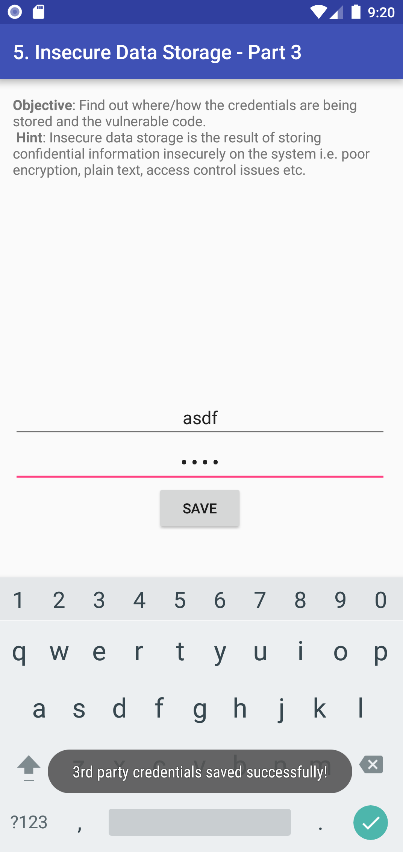</figure>

Device Explorer에서 /data/data/jakhar.aseem.diva/ 경로 안에 있는 uinfo&lt;임의의숫자&gt;tmp 파일을 발견했습니다.

<figure class="imageblock alignCenter" data-ke-mobilestyle="widthOrigin" data-origin-height="283" data-origin-width="491">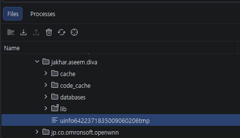</figure>

파일을 열어보니 다음과 같이 제가 입력한 값이 평문 그대로 노출되어 있었습니다.

<figure class="imageblock alignCenter" data-ke-mobilestyle="widthOrigin" data-origin-height="97" data-origin-width="175">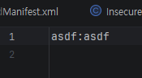</figure>

 

여기까지 풀어보니 사용자가 입력한 민감 정보를 평문 그대로 파일에 저장한다는 것엔 변함 없지만 사용자 입력값을 어느 형식으로 저장하는지가 살짝씩 다른 거 같습니다.

 

이 문제는 내부 저장소에 민감 정보를 평문으로 저장하는 취약점이었습니다.

<h3 data-ke-size="size23">6. Insecure Data Storage - Part 4</h3>

코드는 다음과 같습니다.

<pre class="java" data-ke-language="java" data-ke-type="codeblock" id="code_1789838047404"><code class="hljs">public class InsecureDataStorage4Activity extends AppCompatActivity {

    @Override
    protected void onCreate(Bundle savedInstanceState) {
        super.onCreate(savedInstanceState);
        setContentView(R.layout.activity_insecure_data_storage4);
    }

    public void saveCredentials(View view) {
        EditText usr = (EditText) findViewById(R.id.ids4Usr);
        EditText pwd = (EditText) findViewById(R.id.ids4Pwd);

        File sdir = Environment.getExternalStorageDirectory();

        try {
            File uinfo = new File(sdir.getAbsolutePath() + "/.uinfo.txt");
            uinfo.setReadable(true);
            uinfo.setWritable(true);
            FileWriter fw = new FileWriter(uinfo);
            fw.write(usr.getText().toString() + ":" + pwd.getText().toString() + "\n");
            fw.close();
            Toast.makeText(this, "3rd party credentials saved successfully!", Toast.LENGTH_SHORT).show();
            // Now you can read the temporary file where ever the credentials are required.
        }
        catch (Exception e) {
            Toast.makeText(this, "File error occurred", Toast.LENGTH_SHORT).show();
            Log.d("Diva", "File error: " + e.getMessage());
        }
    }
}</code></pre>

 

처음 코드를 보고 5번 문제와 상당히 비슷한 문제라고 생각했습니다.

 

다음 부분을 보면 Environment.getExternalStorageDirectory() 함수는 외부 저장소의 루트 경로를 반환합니다.

API 29부터 사용이 중단되었다고 하는데 제 실습 환경은 API 26이라 상관 없을 거 같습니다.

<pre class="java" data-ke-language="java" data-ke-type="codeblock" id="code_1789895408845"><code class="hljs">public void saveCredentials(View view) {
        EditText usr = (EditText) findViewById(R.id.ids4Usr);
        EditText pwd = (EditText) findViewById(R.id.ids4Pwd);

        File sdir = Environment.getExternalStorageDirectory();</code></pre>

외부 저장소라길래 usb나 sd카드 같은 걸 생각했습니다. 검색해보니 안드로이드에서 외부 저장소는 외장 장치뿐만 아니라 앱들이 공유해서 사용할 수 있는 저장 공간이라고 합니다.

 

API 26에선 이 외부 저장소의 루트 경로가 /storage/emulated/0이라고 합니다.

 

다음 코드에서 File uinfo = new File(sdir.getAbsolutePath() + "/.uinfo.txt") 라는 부분이 있어 /storage/emulated/0/.uinfo.txt 에 값이 저장될 거라 생각했습니다.

<pre class="java" data-ke-language="java" data-ke-type="codeblock" id="code_1789900052496"><code class="hljs">try {
            File uinfo = new File(sdir.getAbsolutePath() + "/.uinfo.txt");
            uinfo.setReadable(true);
            uinfo.setWritable(true);
            FileWriter fw = new FileWriter(uinfo);
            fw.write(usr.getText().toString() + ":" + pwd.getText().toString() + "\n");
            fw.close();
            Toast.makeText(this, "3rd party credentials saved successfully!", Toast.LENGTH_SHORT).show();
            // Now you can read the temporary file where ever the credentials are required.
        }</code></pre>

 

검증해보려고 에뮬레이터에서 아무 값이나 입력 후 SAVE를 눌렀는데 File error occurred라는 오류가 나왔습니다...

<figure class="imageblock alignCenter" data-ke-mobilestyle="widthOrigin" data-origin-height="823" data-origin-width="403">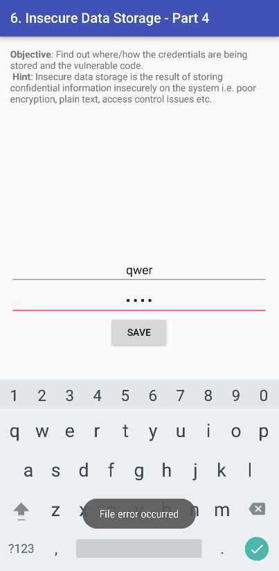</figure>

 

왜 에러가 났는지 확인하기 위해 로그캣을 열어보니 Permission denied라고 떴습니다. 뭔지는 모르겠지만 문제가 저장소에 관한 취약점이니 저장소 접근 권한 문제라고 생각했습니다.

<figure class="imageblock alignCenter" data-ke-mobilestyle="widthOrigin" data-origin-height="26" data-origin-width="535">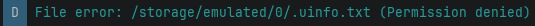</figure>

일단 저장소 권한을 허용하여 다시 시도했습니다.

저장소 권한은 안드로이드 스튜디오 상단 바의 "app" 클릭 후 Edit Configurations -&gt; Android App -&gt; app -&gt; General 탭의 Installation Options에서 Install Flags에 -g 옵션을 주면 된다고 합니다.

<figure class="imageblock alignCenter" data-ke-mobilestyle="widthOrigin" data-origin-height="346" data-origin-width="590">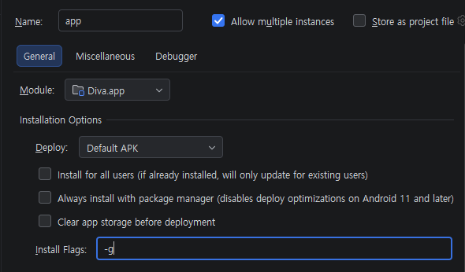</figure>

근데 그러려면 재설치를 해야 된다고 해서 diva를 다시 설치했습니다...

 

-g 옵션을 주고 재설치 후 다시 시도해봤습니다.

<figure class="imageblock alignCenter" data-ke-mobilestyle="widthOrigin" data-origin-height="834" data-origin-width="392">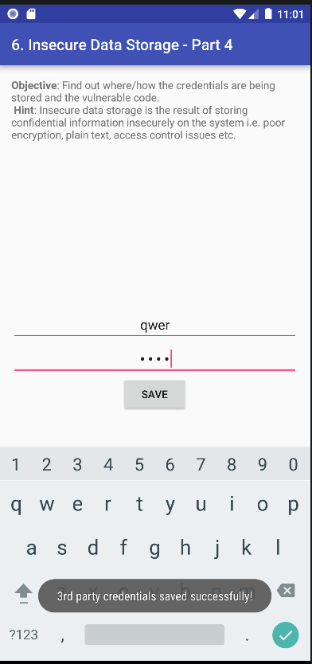</figure>

 

제가 추측한 바가 틀렸습니다...

/storage/emulated/ 에 .uinfo.txt 파일이 저장되어 있을 줄 알았는데 아니었고, /sdcard/Ringtones/ 안에 .uinfo.txt 파일이 존재했습니다.

따라서 최종 경로는 /sdcard/Ringtones/.uinfo.txt입니다.

<figure class="imageblock alignCenter" data-ke-mobilestyle="widthOrigin" data-origin-height="664" data-origin-width="550">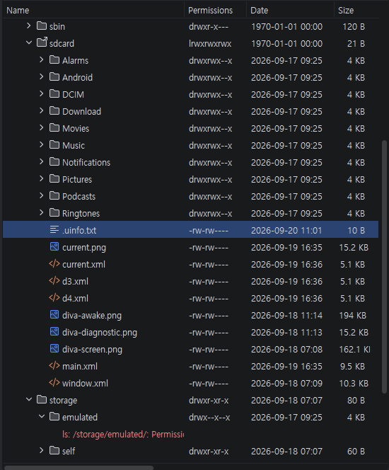</figure>

제가 입력한 값이 다음과 같이 평문으로 노출되었습니다.

<figure class="imageblock alignCenter" data-ke-mobilestyle="widthOrigin" data-origin-height="95" data-origin-width="152">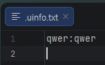</figure>

이 문제는 다시 공부하고 풀어봐야겠습니다...

<h3 data-ke-size="size23">7. Input Validation Issues - Part 1</h3>

7번째 취약점은 입력값 검증 부재 취약점입니다.

입력값 검증 부재 취약점이란, 앱이 사용자나 다른 앱으로부터 전달받은 데이터를 검증하지 않을 때 발생하는 취약점입니다.

 

주어진 코드는 다음과 같습니다.

<pre class="java" data-ke-language="java" data-ke-type="codeblock" id="code_1789824259274"><code class="hljs">public class SQLInjectionActivity extends AppCompatActivity {

    private SQLiteDatabase mDB;

    @Override
    protected void onCreate(Bundle savedInstanceState) {
        super.onCreate(savedInstanceState);

        try {
            mDB = openOrCreateDatabase("sqli", MODE_PRIVATE, null);
            mDB.execSQL("DROP TABLE IF EXISTS sqliuser;");
            mDB.execSQL("CREATE TABLE IF NOT EXISTS sqliuser(user VARCHAR, password VARCHAR, credit_card VARCHAR);");
            mDB.execSQL("INSERT INTO sqliuser VALUES ('admin', 'passwd123', '1234567812345678');");
            mDB.execSQL("INSERT INTO sqliuser VALUES ('diva', 'p@ssword', '1111222233334444');");
            mDB.execSQL("INSERT INTO sqliuser VALUES ('john', 'password123', '5555666677778888');");
        }
        catch(Exception e) {
            Log.d("Diva-sqli", "Error occurred while creating database for SQLI: " + e.getMessage());
        }
        setContentView(R.layout.activity_sqlinjection);
    }

    public void search(View view) {
        EditText srchtxt = (EditText) findViewById(R.id.ivi1search);
        Cursor cr = null;
        try {
            cr = mDB.rawQuery("SELECT * FROM sqliuser WHERE user = '" + srchtxt.getText().toString() + "'", null);
            StringBuilder strb = new StringBuilder("");

            if ((cr != null) &amp;&amp; (cr.getCount() &gt; 0)) {
                cr.moveToFirst();
                do {
                    strb.append("User: (" + cr.getString(0) + ") pass: (" + cr.getString(1) + ") Credit card: (" + cr.getString(2) + ")\n");
                } while (cr.moveToNext());
            }
            else {
                strb.append("User: (" + srchtxt.getText().toString() +") not found");
            }
            Toast.makeText(this, strb.toString(), Toast.LENGTH_SHORT).show();
        }
        catch(Exception e) {
            Log.d("Diva-sqli", "Error occurred while searching in database: " + e.getMessage());
        }
    }
}</code></pre>

 

위 코드에서 취약점이 발생하는 코드는 다음과 같습니다.

<pre class="java" data-ke-language="java" data-ke-type="codeblock" id="code_1789834876514"><code class="hljs">        try {
            cr = mDB.rawQuery("SELECT * FROM sqliuser WHERE user = '" + srchtxt.getText().toString() + "'", null);
            StringBuilder strb = new StringBuilder("");</code></pre>

rawQuery로 데이터베이스를 조회하는 코드입니다. 이때, srctxt.getText().toString()으로 사용자 입력값을 직접 받게 됩니다.

만약 사용자가 입력값으로 ' or '1'='1' -- ' 라는 값을 입력하게 된다면

WHERE user = '' or '1'='1' -- ' 라는 SQL문이 실행되어 모든 행에 대해 조건이 참이 됩니다. -&gt; SQL Injection 발생

따라서 조회된 행에 대한 사용자의 정보가 노출되게 됩니다.

 

Emulator로 검증해보겠습니다.

<figure class="imageblock alignCenter" data-ke-mobilestyle="widthOrigin" data-origin-height="792" data-origin-width="382">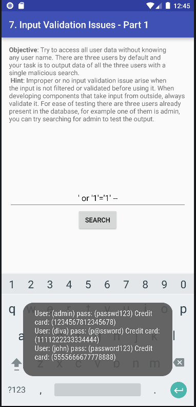</figure>

입력칸에 ' or '1'='1' -- 를 입력 후 SEARCH를 클릭하니 데이터베이스에 저장된 사용자 정보가 노출됐습니다.

<h3 data-ke-size="size23" style="color: #000000; text-align: start;">8. Input Validation Issues - Part 2</h3>

코드는 다음과 같습니다.

<pre class="java" data-ke-language="java" data-ke-type="codeblock" id="code_1789838192302"><code class="hljs">public class InputValidation2URISchemeActivity extends AppCompatActivity {

    @Override
    protected void onCreate(Bundle savedInstanceState) {
        super.onCreate(savedInstanceState);

        setContentView(R.layout.activity_input_validation2_urischeme);
        WebView wview = (WebView) findViewById(R.id.ivi2wview);
        WebSettings wset = wview.getSettings();
        wset.setJavaScriptEnabled(true);

    }

    public void get(View view) {
        EditText uriText = (EditText) findViewById(R.id.ivi2uri);
        WebView wview = (WebView) findViewById(R.id.ivi2wview);

        wview.loadUrl(uriText.getText().toString());
    }
}</code></pre>

 

 

다음 코드에서 사용자가 입력한 주소를 검증하지 않고 바로 loadUrl() 함수로 넘깁니다.

<pre class="java" data-ke-language="java" data-ke-type="codeblock" id="code_1789897169489"><code class="hljs">wview.loadUrl(uriText.getText().toString());</code></pre>

 

사용자 입력값을 검증하지 않으므로 http, https 뿐 아니라 file 스킴을 사용해 내부 저장소에 있는 로컬 파일에 접근할 수 있습니다.

 

에뮬레이터에서 검증해보겠습니다.

아까 풀었던 5번 문제의 uinfo6422371835009060206tmp 파일을 file 스킴으로 가져와보겠습니다.

8번 문제에 들어가 file:///data/data/jakhar.aseem.diva/uinfo6422371835009060206tmp를 입력하여 VIEW를 누릅니다.

<figure class="imageblock alignCenter" data-ke-mobilestyle="widthOrigin" data-origin-height="851" data-origin-width="401">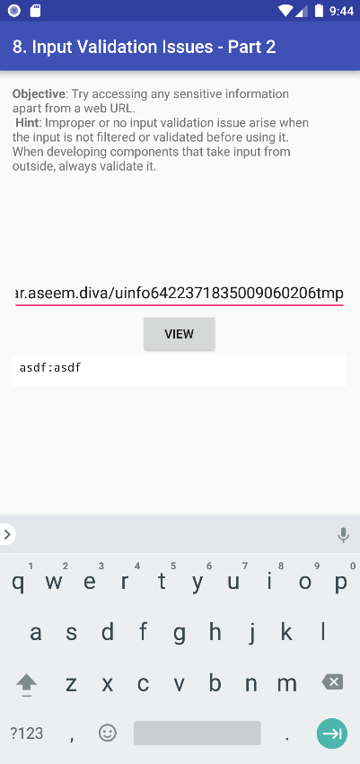</figure>

uinfo6422371835009060206tmp 파일 안의 내용이 노출됩니다.

 

<h3 data-ke-size="size23">9. Access Control Issues - Part 1</h3>

9번 문제는 접근 제어 부재 취약점입니다.

접근 제어 부재 취약점은 안드로이드 앱의 컴포넌트에 대한 접근 권한 절차가 부족하거나 누락되어 외부(타 앱이나 시스템 등)에서 접근 가능할 때 발생하는 취약점입니다.

 

코드는 다음과 같습니다.

<figure class="imageblock alignCenter" data-ke-mobilestyle="widthOrigin" data-origin-height="403" data-origin-width="736">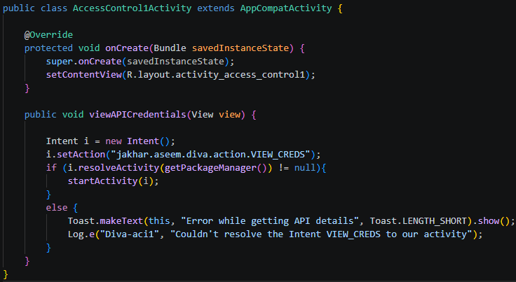</figure>

 

다음 부분에서 Intent를 생성하고, VIEW_CREDS 라는 작업을 setAction 함수를 통해 할 것을 지시합니다.

if 문에선 현재 인텐트의 조건을 처리할 수 있는 액티비티가 존재하는지 resolveActivity로 찾고, 있으면 startActivity로 실행합니다.

<figure class="imageblock alignCenter" data-filename="blob" data-ke-mobilestyle="widthOrigin" data-origin-height="100" data-origin-width="424">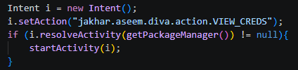</figure>

생성된 인텐트는 암시적 인텐트로 VIEW_CREDS 라는 작업을 수행할 수 있는 액티비티를 찾아 실행하라는 뜻입니다.

 

여기서 인텐트란 안드로이드 앱 컴포넌트에서 컴포넌트 간 통신 또는 전환을 돕는 매개체입니다.

 

인텐트와 관련된 정보는 AndroidManifest.xml에서 더 볼 수 있습니다.

다음 코드는 AndroidManifest.xml의 일부입니다.

<figure class="imageblock alignCenter" data-ke-mobilestyle="widthOrigin" data-origin-height="288" data-origin-width="567">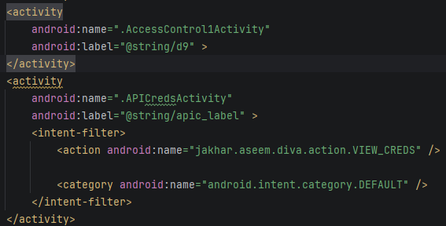</figure>

이 코드에서 APICredsActivity가 문제 코드에서 요청한 VIEW_CREDS라는 작업을 수행할 수 있다고 intent-filter 안에 명시해놨습니다.

 

따라서 VIEW_CREDS 작업을 수행할 액티비티는 APICredsActivity라고 이해했습니다.

 

APICredsActivity.java 파일도 보겠습니다.

<figure class="imageblock alignCenter" data-ke-mobilestyle="widthOrigin" data-origin-height="282" data-origin-width="797">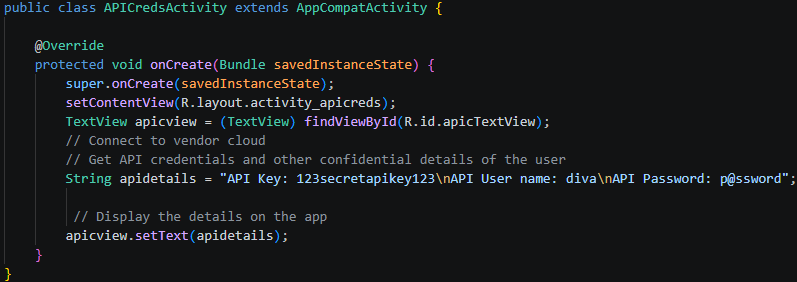</figure>

이 코드는 API 인증 정보를 표시하고 있습니다.

그러나 민감 정보인 API 인증 정보를 표시하는 액티비티에 접근할 때 접근 권한 제어를 하고 있지 않습니다.

즉, 앱 내에서 접근하는 것이 아닌 외부 앱에서도 접근이 가능합니다.

 

안드로이드 스튜디오에서 검증해보겠습니다.

 

에뮬레이터로 diva 실행 후 터미널을 열어 다음 명령어를 입력합니다.

<pre class="bash" data-ke-language="bash" data-ke-type="codeblock" id="code_1790160589891"><code class="hljs">adb shell am start -a jakhar.aseem.diva.action.VIEW_CREDS</code></pre>

adb shell am start -a &lt;ACTION&gt; 꼴의 명령어는 특정 action의 인텐트를 보내 액티비티를 실행할 수 있는 명령어입니다.

문제 환경에 맞게 위와 같이 터미널에 입력하였습니다.

<figure class="imageblock alignCenter" data-ke-mobilestyle="widthOrigin" data-origin-height="46" data-origin-width="1208">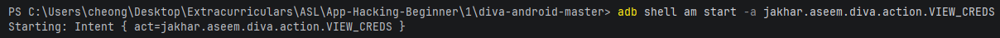</figure>
<figure class="imageblock alignCenter" data-ke-mobilestyle="widthOrigin" data-origin-height="551" data-origin-width="298">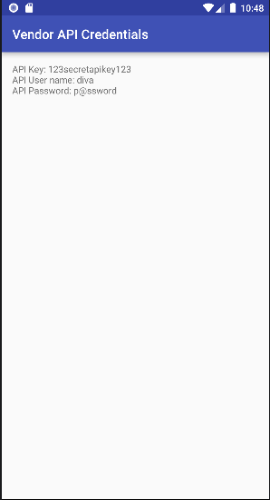</figure>

명령어 입력 시, 에뮬레이터 상에서 VIEW API CREDENTIALS 버튼을 클릭하지 않아도 API 정보 화면으로 넘어간 것을 확인할 수 있습니다.

 

<h3 data-ke-size="size23">10. Access Control Issues - Part 2</h3>

같은 취약점의 다른 문제입니다.

 

코드는 다음과 같습니다.

<figure class="imageblock alignCenter" data-ke-mobilestyle="widthOrigin" data-origin-height="513" data-origin-width="801">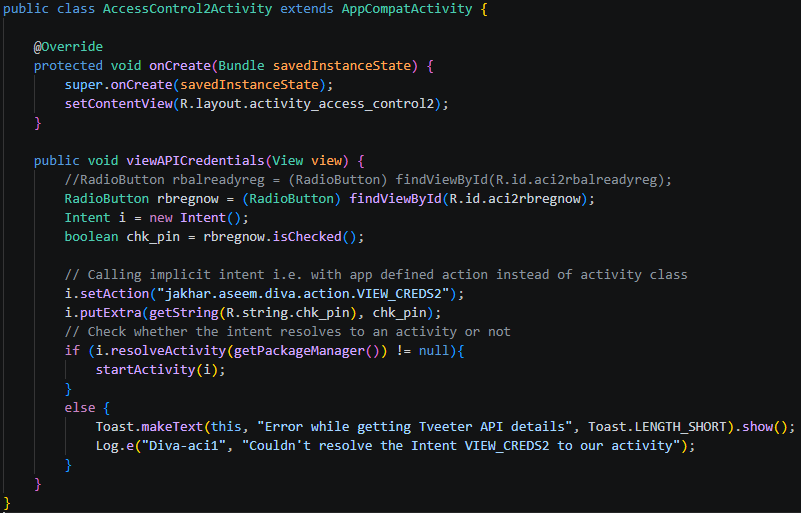</figure>

 

다음 부분에서 i라는 암시적 인텐트를 생성하고, boolean 타입의 chk_pin을 만듭니다.

그 후 setAction 함수를 통해 VIEW_CREDS라는 작업을 수행하는 인텐트를 생성합니다.

<figure class="imageblock alignCenter" data-filename="blob" data-ke-mobilestyle="widthOrigin" data-origin-height="199" data-origin-width="461">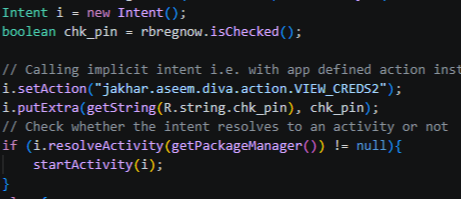</figure>

 

Manifest.xml에는 아까 풀었던 문제(AccessControlActivity-Part 1)와 같은 형식으로 적혀있습니다.

<figure class="imageblock alignCenter" data-ke-mobilestyle="widthOrigin" data-origin-height="282" data-origin-width="567">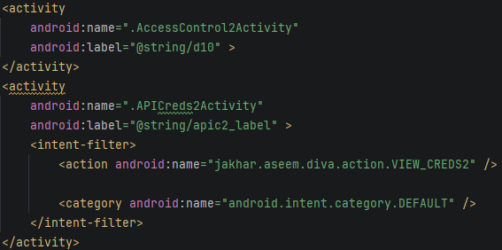</figure>

 

APICreds2Activity 코드는 다음과 같습니다.

<figure class="imageblock alignCenter" data-ke-mobilestyle="widthOrigin" data-origin-height="644" data-origin-width="919">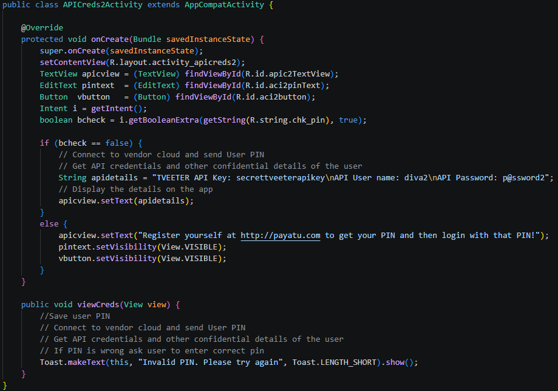</figure>

 

전체 코드를 해석하자면, 에뮬레이터에 나타나는 버튼은 두 가지가 있습니다.

여기서 왼쪽 버튼을 클릭하면 true이고, 오른쪽 버튼을 클릭하면 false가 됩니다.

<figure class="imageblock alignCenter" data-ke-mobilestyle="widthOrigin" data-origin-height="132" data-origin-width="395">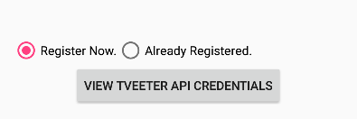</figure>

위 코드에선 false일 때 API 정보들을 출력합니다.

 

저희가 해야 할 건, diva 내에서 버튼을 클릭하여 API 정보를 노출시키는 것이 아닌 외부에서 UI 조작 없이 API 정보들을 노출시켜야 합니다.

 

명령어는 전 문제에서 입력한 거에서 --ez check_pin false를 추가해 check_pin 값을 false로 만들어주면 됩니다.

<pre class="bash" data-ke-language="bash" data-ke-type="codeblock" id="code_1790166936304"><code class="hljs">adb shell am start -a jakhar.aseem.diva.action.VIEW_CREDS2 --ez check_pin false</code></pre>

<figure class="imageblock alignCenter" data-ke-mobilestyle="widthOrigin" data-origin-height="45" data-origin-width="1383">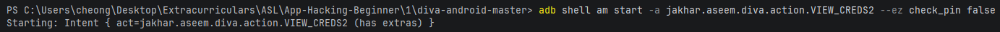</figure>

이 명령어가 실행되면 다음과 같이 외부에서 API 정보를 노출시킬 수 있습니다.

<figure class="imageblock alignCenter" data-ke-mobilestyle="widthOrigin" data-origin-height="228" data-origin-width="267">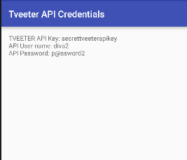</figure>

 

<h3 data-ke-size="size23">11. Access Control Issues - Part 3</h3>

코드는 다음과 같습니다.

 

이 코드는 사용자로부터 비밀번호를 입력 받는 것이 핵심 기능입니다.

<figure class="imageblock alignCenter" data-ke-mobilestyle="widthOrigin" data-origin-height="815" data-origin-width="1009">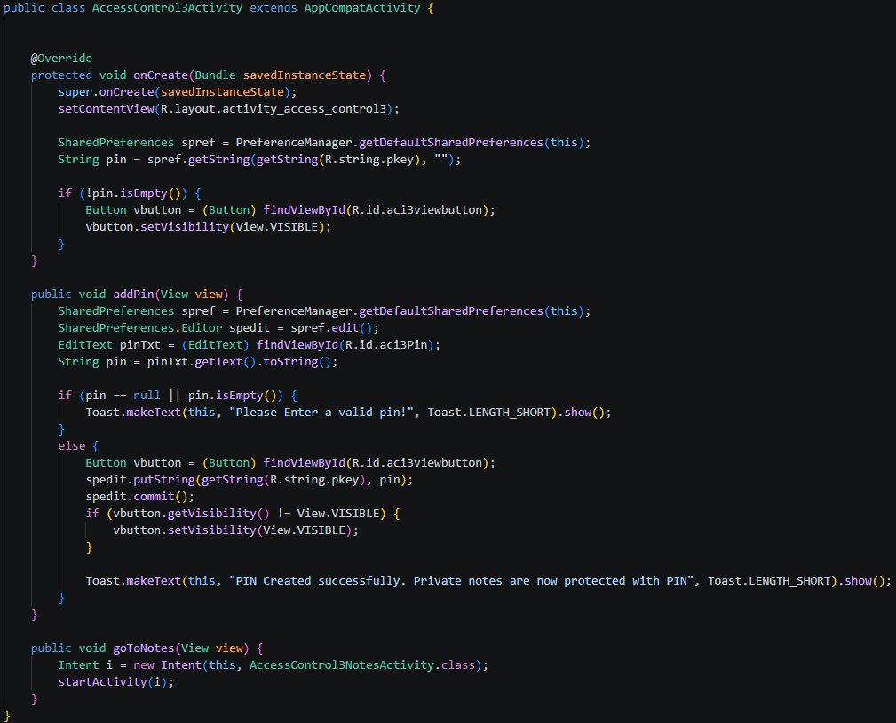</figure>

 

코드의 마지막인 이 부분은 명시적 인텐트로 AccessControl3NotesActivity로 이동하라는 뜻입니다.

<figure class="imageblock alignCenter" data-filename="blob" data-ke-mobilestyle="widthOrigin" data-origin-height="100" data-origin-width="556">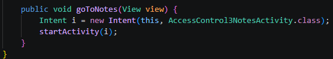</figure>

 

에뮬레이터에서 pin을 입력해보겠습니다.

아무 값도 입력하지 않고 CREATE/CHANGE PIN 버튼을 클릭하면 Please Enter a valid pin!을 출력하고, 값을 입력했다면 성공적으로 생성됐다는 문구가 뜹니다.

<figure class="imageblock alignCenter" data-ke-mobilestyle="widthOrigin" data-origin-height="851" data-origin-width="403">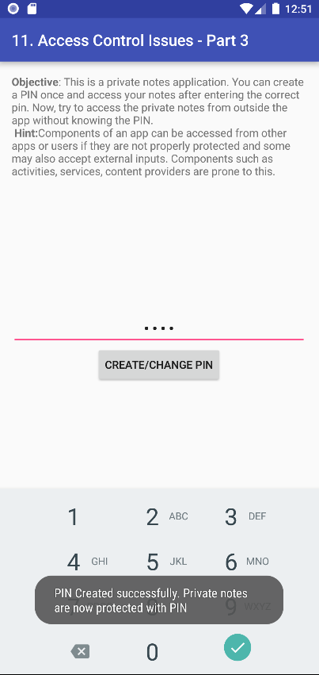</figure>

 

다음 코드는 사용자가 본인의 private notes에 접근하기 위해 본인의 비밀번호를 입력하고, 사용자의 정보가 출력되는 내용입니다.

<figure class="imageblock alignCenter" data-ke-mobilestyle="widthOrigin" data-origin-height="668" data-origin-width="1049">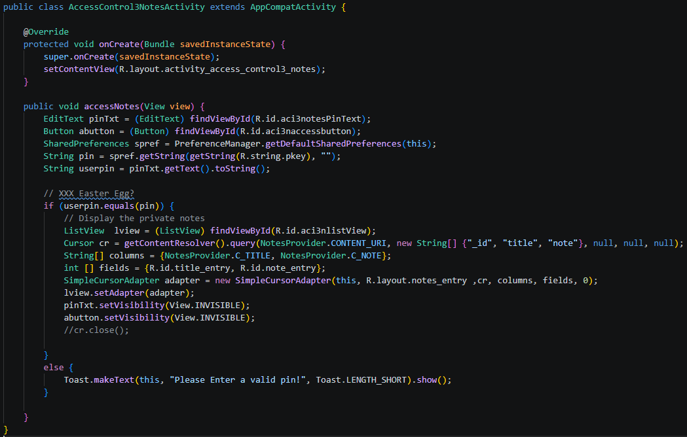</figure>

 

다음 부분을 보면 사용자의 비밀번호가 입력한 값과 일치했을 때 NotesProvier가 노트 정보를 출력합니다.

<figure class="imageblock alignCenter" data-filename="blob" data-ke-mobilestyle="widthOrigin" data-origin-height="99" data-origin-width="956">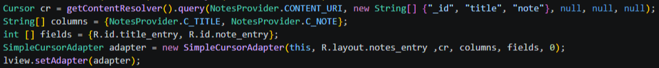</figure>

여기서 노트 정보는 NotesProvider.CONTENT_URI를 통해 가져옵니다. 이때, CONTENT.URI는 Content Provider에 저장된 특정 데이터 테이블 또는 리소스에 접근하기 위한 주소입니다. 이 주소는 content:// 스키마로 시작합니다.

 

AndroidManifest.xml 파일을 보면, NotesProvider와 관련된 다음과 같은 내용이 있습니다.

<figure class="imageblock alignCenter" data-ke-mobilestyle="widthOrigin" data-origin-height="129" data-origin-width="538">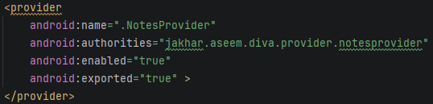</figure>

여기서 android:exported="true"로 설정되어 있으므로 외부에서 NotesProvider에 접근할 수 있습니다.

 

즉, 외부에서 사용자의 민감 정보에 접근할 수 있습니다.

 

notes의 정확한 위치는 strings.xml에서 확인할 수 있습니다.

<figure class="imageblock alignCenter" data-ke-mobilestyle="widthOrigin" data-origin-height="371" data-origin-width="1116">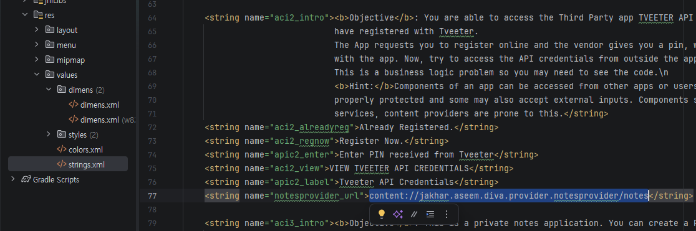</figure>

content://jakhar.aseem.diva.provider.ontesprovider/notes입니다.

 

안드로이드 스튜디오에서 검증해보겠습니다.

 

터미널에 다음과 같이 입력하면 됩니다.

<pre class="bash" data-ke-language="bash" data-ke-type="codeblock" id="code_1790170085471"><code class="hljs">adb shell content query --uri content://jakhar.aseem.diva.provider.notesprovider/notes</code></pre>

adb shell content query --uri [콘텐츠_URI] 형식입니다.

 

다음과 같이 notes에 저장된 사용자 정보가 출력됩니다.

<figure class="imageblock alignCenter" data-ke-mobilestyle="widthOrigin" data-origin-height="138" data-origin-width="1434">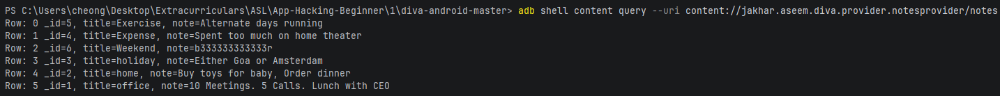</figure>

 

<h3 data-ke-size="size23" style="color: #000000; text-align: start;">12. Hardcoding Issues - Part 2</h3>

두 번째로 풀었던 하드코딩 취약점과 같은 취약점입니다.

 

주어진 코드는 다음과 같습니다.

<pre class="java" data-ke-language="java" data-ke-type="codeblock" id="code_1789835764016"><code class="hljs">public class Hardcode2Activity extends AppCompatActivity {

    private DivaJni djni;

    @Override
    protected void onCreate(Bundle savedInstanceState) {
        super.onCreate(savedInstanceState);
        setContentView(R.layout.activity_hardcode2);

        djni = new DivaJni();
    }

    public void access(View view) {
        EditText hckey = (EditText) findViewById(R.id.hc2Key);

        if (djni.access(hckey.getText().toString()) != 0) {
            Toast.makeText(this, "Access granted! See you on the other side :)", Toast.LENGTH_SHORT).show();
        }
        else {
            Toast.makeText(this, "Access denied! See you in hell :D", Toast.LENGTH_SHORT).show();
        }
    }
}</code></pre>

 

조건문을 보니 어떤 값과 사용자 입력값을 비교한다는 건 알겠는데 하드코딩된 값이 위 코드엔 나와있지 않았습니다. 다른 파일에 하드코딩 된 값이 숨어 있지 않을까 추측했습니다.

 

여기서 djni.access()에 사용자 입력값을 전달하고, 반환값이 0이 아니면 접근에 성공하는 것 같았습니다.

<pre class="java" data-ke-language="java" data-ke-type="codeblock" id="code_1789901246830"><code class="hljs">if (djni.access(hckey.getText().toString()) != 0) {
            Toast.makeText(this, "Access granted! See you on the other side :)", Toast.LENGTH_SHORT).show();
        }</code></pre>

 

djni는 문제 코드 위에 private DivaJni djni가 있기에 djni가 DivaJni 타입의 변수임을 알 수 있습니다.

 

문제 파일과 같은 경로에 있는 파일 중 DivaJni.java 라는 파일이 있길래 한 번 열어봤습니다.

<pre class="java" data-ke-language="java" data-ke-type="codeblock" id="code_1789899086209"><code class="hljs">package jakhar.aseem.diva;

/**
 * Created by diva on 17/11/15.
 */
public class DivaJni {

    private static final String soName =  "divajni";

    static
    {
        System.loadLibrary(soName);
    }
    // Jni function
    // Returns 1 if the key specified by user is valid, 0 otherwise
    public native int access(String key);
    public native int initiateLaunchSequence(String code);
}</code></pre>

 

다음 코드에서 native란 자바 코드에서 C나 C++ 같은 외부 언어로 작성된 저수준의 네이티브 코드를 호출할 수 있게 하는 제어자라고 합니다.

<pre class="processing" data-ke-language="java" data-ke-type="codeblock" id="code_1789901567512" style="background-color: #f8f8f8; color: #383a42;"><code class="hljs java">    public native int access(String key);
    public native int initiateLaunchSequence(String code);</code></pre>

 

System.loadLibrary()는 C나 C++ 로 작성된 네이티브 라이브러리를 메모리에 로드하여 자바에서 사용할 수 있게 해주는 메서드라고 합니다.

다음 코드에 대입하여 생각하면 divajni라는 네이티브 라이브러리를 불러오는 코드라고 생각할 수 있습니다.

<pre class="java" data-ke-language="java" data-ke-type="codeblock" id="code_1789901543447"><code class="hljs">public class DivaJni {

    private static final String soName =  "divajni";

    static
    {
        System.loadLibrary(soName);
    }</code></pre>

 

코드만 보니 제대로 와닿지 않아서 일단 diva 파일을 뒤져보았습니다.

 

\diva-android-master\app\src\main에 jni 폴더가 있어서 여기서 c나 c++로 작성된 파일이 있을 거 같았습니다.

<figure class="imageblock alignCenter" data-ke-mobilestyle="widthOrigin" data-origin-height="130" data-origin-width="201">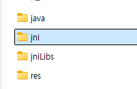</figure>

divajni.c 라는 이름의 c 파일이 존재했습니다.

<figure class="imageblock alignCenter" data-ke-mobilestyle="widthOrigin" data-origin-height="159" data-origin-width="124">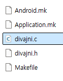</figure>

c 코드 일부분입니다.

<pre class="java" data-ke-language="java" data-ke-type="codeblock" id="code_1789901873042"><code class="hljs">#include &lt;jni.h&gt;
#include &lt;string.h&gt;
#include "divajni.h"

#define VENDORKEY   "olsdfgad;lh"
#define CODE        ".dotdot"
#define CODESIZEMAX 20
/*
 * Verify the key for access
 *
 * @param  jkey   The key input by user
 *
 * @return 1 if jkey is valid, 0 otherwise. In other words
 @         if the user key matches our key return 1, else return 0.
 */
JNIEXPORT jint JNICALL Java_jakhar_aseem_diva_DivaJni_access(JNIEnv * env, jobject jobj, jstring jkey) {

    const char * key = (*env)-&gt;GetStringUTFChars(env, jkey, 0);

    return ((strncmp(VENDORKEY, key, strlen(VENDORKEY)))?0:1);
}</code></pre>

 

다음 코드를 보면 "olsdfagd;lh" 라는 문자열이 코드 내부에 하드코딩 되어 있는 걸 알 수 있습니다.

<pre class="java" data-ke-language="java" data-ke-type="codeblock" id="code_1789901945287"><code class="hljs">#define VENDORKEY   "olsdfgad;lh"</code></pre>

 

다음 부분에선 사용자 입력값과 VENDORKEY를 비교합니다.

<pre class="java" data-ke-language="java" data-ke-type="codeblock" id="code_1789902022447"><code class="hljs">JNIEXPORT jint JNICALL Java_jakhar_aseem_diva_DivaJni_access(JNIEnv * env, jobject jobj, jstring jkey) {

    const char * key = (*env)-&gt;GetStringUTFChars(env, jkey, 0);

    return ((strncmp(VENDORKEY, key, strlen(VENDORKEY)))?0:1);
}</code></pre>

 

에뮬레이터로 확인해봤습니다.

 

12번 문제로 들어가 olsdfgad;lh를 입력한 후 ACCESS를 눌렀습니다.

<figure class="imageblock alignCenter" data-ke-mobilestyle="widthOrigin" data-origin-height="799" data-origin-width="388">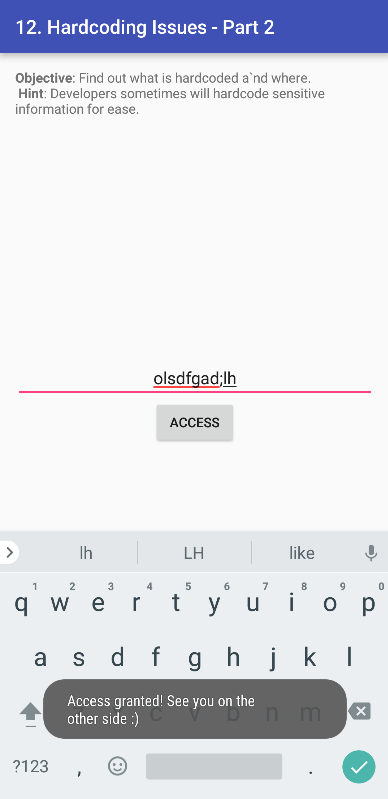</figure>

 

<h3 data-ke-size="size23">13. Input Validation Issues - Part 3</h3>

코드는 다음과 같습니다.

<figure class="imageblock alignCenter" data-ke-mobilestyle="widthOrigin" data-origin-height="461" data-origin-width="677">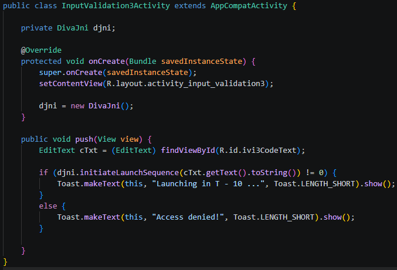</figure>

위 코드에서 눈에 띄는 취약점은 보이지 않았지만, private DivaJni djni;나 djni = new DivaJni(); 가 있는 걸 보아 12번째 문제인 하드코딩2 문제에서 네이티브 코드인 divajni.c 코드에서 힌트를 얻을 수 있을 거 같았습니다.

 

divajni.c 코드를 열어보니 위 문제 코드의 initiateLaunchSequence() 함수가 구현되어 있었습니다.

<figure class="imageblock alignCenter" data-ke-mobilestyle="widthOrigin" data-origin-height="549" data-origin-width="939">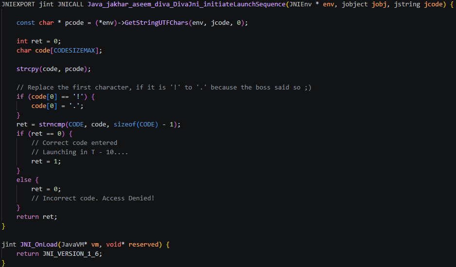</figure>

 

다음 부분을 보면, code 문자열에 대해 CODESIZEMAX(상수값으로 크기는 20)라는 크기가 주어졌으나, strcpy() 함수는 입력되는 문자열 길이를 검사하지 않고 복사합니다. 이때 마지막 배열에는 \n이 들어와야 하므로 사용자가 입력할 수 있는 값은 19자가 최대입니다.

<figure class="imageblock alignCenter" data-filename="blob" data-ke-mobilestyle="widthOrigin" data-origin-height="138" data-origin-width="498">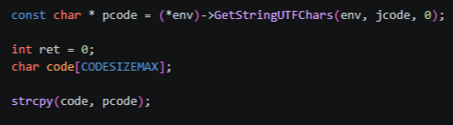</figure>

따라서 code 문자열에 20자 이상을 입력하면 BOF가 발생할 가능성이 생깁니다.

 

에뮬레이터에서 BOF를 발생시켜보겠습니다.

충분히 많은 값을 입력한 후 PUSH THE RED BUTTON을 클릭합니다.

<figure class="imageblock alignCenter" data-ke-mobilestyle="widthOrigin" data-origin-height="890" data-origin-width="408">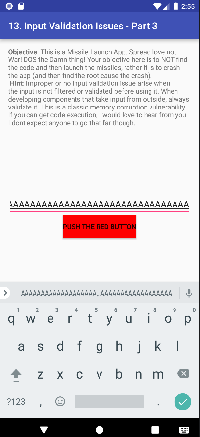</figure>

버튼을 클릭하니 앱이 꺼졌습니다.

<figure class="imageblock alignCenter" data-ke-mobilestyle="widthOrigin" data-origin-height="881" data-origin-width="403">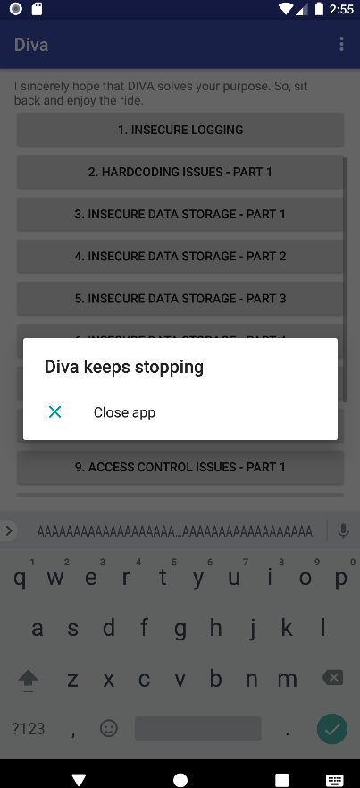</figure>

<h2 data-ke-size="size26">후기</h2>

안드로이드 앱 해킹 입문을 위해 DIVA 워게임을 풀었습니다.

java를 잘 모르다보니 푸는 데 상당히 많은 시간이 걸렸습니다. 학업과 병행하며 풀었을 때 일주일 정도 걸린 거 같습니다.

 

안드로이드를 공부하려면 java와 kotlin, C/C++를 적어도 읽고 해석할 수준은 되어야 하다보니 벅차게 느껴집니다...

 

java만 주구장창 보다가 마지막 두 문제에서 C 코드를 보니 살 거 같았습니다... 절차 지향 만세~

좋아하는 것만 할 수 없는 노릇이니 java와 kotlin도 다른 문제들을 풀어보며 공부해야겠습니다.

 

아예 안드로이드에 대한 베이스가 없는 상태에서 푼 거라 부족한 점/틀린 점이 있을 거 같습니다.

추후에 어느정도 코드를 읽고 수월하게 분석할 수 있는 수준이 된다면 다시 한 번 더 DIVA를 풀어보고 싶습니다.


