

<h2 data-ke-size="size26">PIVAA(Purposefully Insecure and Vulnerable Android Application)</h2>

PIVAA는 의도적으로 취약하게 설계된 안드로이드 앱입니다.

지난 포스트인 DIVA에 이어 풀게 됐습니다.

 

PIVAA는 다음 주소에서 다운 받을 수 있습니다.

<a href="https://github.com/HTBridge/pivaa" rel="noopener noreferrer" target="_blank">https://github.com/HTBridge/pivaa</a>

<figure contenteditable="false" data-ke-align="alignCenter" data-ke-type="opengraph" data-og-description="Created by High-Tech Bridge, the Purposefully Insecure and Vulnerable Android Application (PIVAA) replaces outdated DIVA for benchmark of mobile vulnerability scanners. - HTBridge/pivaa" data-og-host="github.com" data-og-image="/assets/img/and-lab/02/og-01.png" data-og-source-url="https://github.com/HTBridge/pivaa" data-og-title="GitHub - HTBridge/pivaa: Created by High-Tech Bridge, the Purposefully Insecure and Vulnerable Android Application (PIVAA) repla" data-og-type="object" data-og-url="https://github.com/HTBridge/pivaa" id="og_1790175846456"><a data-source-url="https://github.com/HTBridge/pivaa" href="https://github.com/HTBridge/pivaa" rel="noopener" target="_blank">

 

GitHub - HTBridge/pivaa: Created by High-Tech Bridge, the Purposefully Insecure and Vulnerable Android Application (PIVAA) repla

Created by High-Tech Bridge, the Purposefully Insecure and Vulnerable Android Application (PIVAA) replaces outdated DIVA for benchmark of mobile vulnerability scanners. - HTBridge/pivaa

github.com

</a></figure>

 

PIVAA에 있는 문제는 다음과 같습니다.

<ol data-ke-list-type="decimal" style="list-style-type: decimal;">
<li>Usage of weak Initialization Vector</li>
<li>Possible Man-In-The-Middle Attack</li>
<li>Remote URL load in WebView</li>
<li>Object deserialization found</li>
<li>User-supplied input in SQL queries</li>
<li>Missing tapjacking protection</li>
<li>Enabled Application Backup</li>
<li>Enabled Debug Mode</li>
<li>Weak encryption</li>
<li>Hardcoded encryption keys</li>
<li>Dynamic load of code</li>
<li>Creation of world readable or writable files</li>
<li>Usage of unencrypted HTTP protocol</li>
<li>Weak hashing algorithms</li>
<li>Predictable Random Number Generator</li>
<li>Exported Content Providers with insufficient protection</li>
<li>Exported Broadcast Receivers</li>
<li>Exported Services</li>
<li>JS enabled in a WebView</li>
<li>Deprecated setPluginState in WebView</li>
<li>Temporary file creation</li>
<li>Hardcoded data</li>
<li>Untrusted CA acceptance</li>
<li>Usage of banned API functions</li>
<li>Self-signed CA enabled in WebView</li>
<li>Path Traversal</li>
<li>Cleartext SQLite database</li>
</ol>

DIVA보다 훨씬 더 다양하고 많은 문제들이 있는 거 같습니다...

 

(21번부터 끝까지 작성한 내용이 날아가서 추후에 수정하도록 하겠습니다...)

<h3 data-ke-size="size23">실습 환경</h3>
<ul data-ke-list-type="disc" style="list-style-type: disc;">
<li>Android Studio</li>
<li>AOSP Android 8 API 26</li>
</ul>

 

여러 파일들을 열어보는데 vulnerabilities.json 파일에 각 문제에 대한 힌트들이 있었습니다. (깃허브에도 나와있는 내용입니다. 그것도 모르고 이거 발견하고 유레카를 외쳤던...)

<figure class="imageblock alignCenter" data-ke-mobilestyle="widthOrigin" data-origin-height="1006" data-origin-width="1710">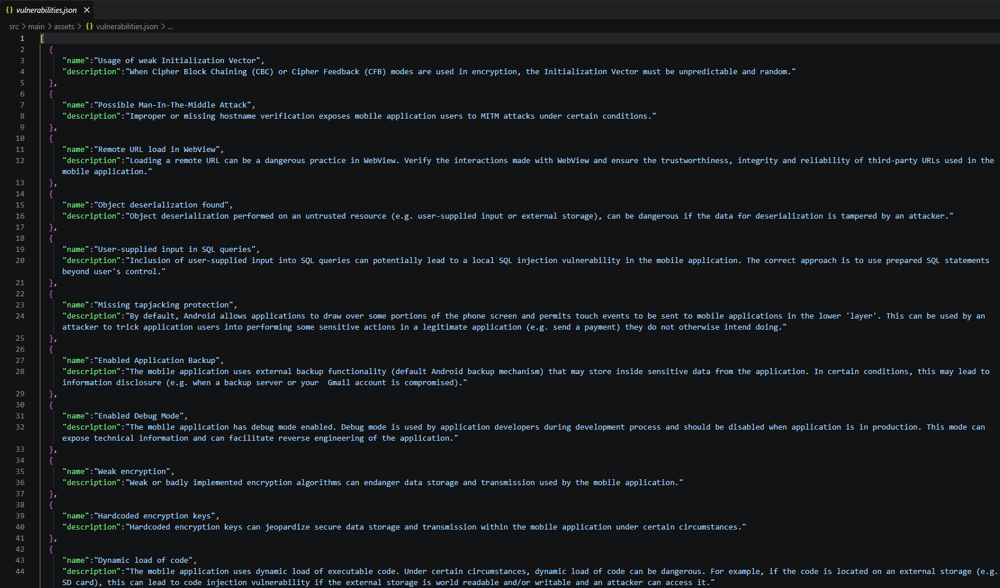</figure>

에뮬레이터로 실행했을 때도 동일한 텍스트가 UI 상에 드러나는 거 같습니다.

<figure class="imageblock alignCenter" data-ke-mobilestyle="widthOrigin" data-origin-height="678" data-origin-width="390">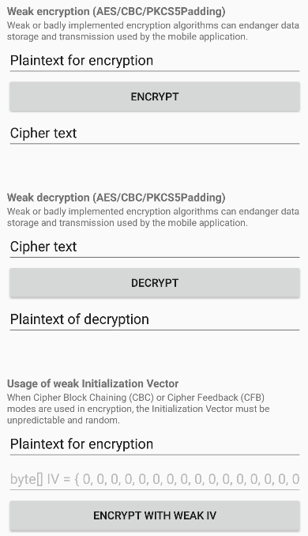</figure>

<h3 data-ke-size="size23">1. Useage of week Initialization Vector</h3>

diva처럼 각 문제에 관련된 파일명이 그대로 명시되어 있는 것이 아니라 처음부터 애먹었습니다...

 

이 문제에 대한 description은 다음과 같습니다.

When Cipher Block Chaining (CBC) or Cipher Feedback (CFB) modes are used in encryption, the Initialization Vector must be unpredictable and random.

해석 : 암호화에 CBC(Cipher Block Chaining) 또는 CFB(Cipher Feedback) 모드를 사용할 때, 초기화 벡터(Initialization Vector)는 예측 불가능하고 무작위여야 합니다.

 

초기화 벡터(Initialization Vector)는 블록 암호에서 첫 블록을 암호화할 때 사용되는 값입니다. iv는 매 암호화 시마다 고유해야 합니다. 즉, 무작위성이 존재해야 합니다.

만약 iv에 무작위성이 존재하지 않고 예측 가능하면 평문의 내용을 유추할 수 있습니다. iv가 동일하기 때문에 같은 평문을 암호화 했을 시 타인이 암호문을 보고 평문을 유추할 수 있습니다.

 

그러나 Encryption.java 코드를 보면, iv가 전부 0으로 되어 있는 것을 볼 수 있습니다.

<figure class="imageblock alignCenter" data-ke-mobilestyle="widthOrigin" data-origin-height="515" data-origin-width="710">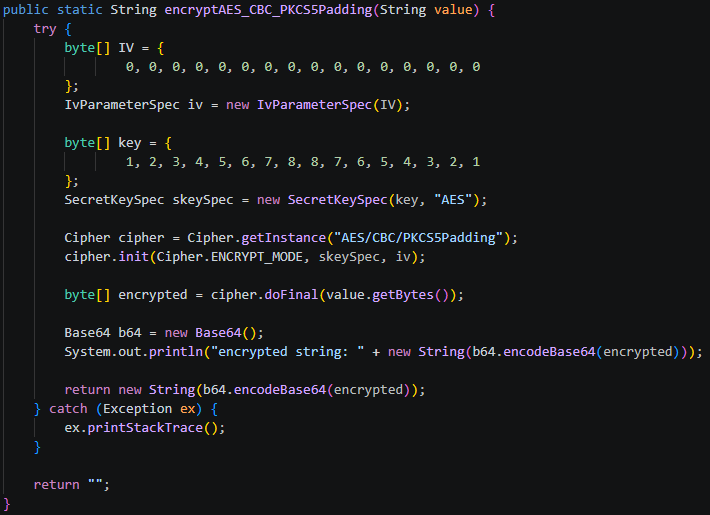</figure>

이는 에뮬레이터 상에도 드러나는 내용입니다.

우선 에뮬레이터를 실행하고 우측 상단 ... 을 눌러 문제 카테고리별로 묶은 듯한 메뉴들을 확인할 수 있습니다. Encryption을 눌러 이동했습니다.

<figure class="imageblock alignCenter" data-ke-mobilestyle="widthOrigin" data-origin-height="480" data-origin-width="199">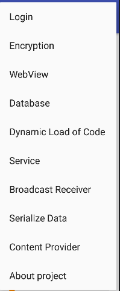</figure>

화면 스크롤을 내리면 해당 문제인 Usage of weak Initialization Vector가 있습니다.

iv가 고정된 값이라는 게 화면 상에도 표시되어 있습니다.

<figure class="imageblock alignCenter" data-filename="blob" data-ke-mobilestyle="widthOrigin" data-origin-height="200" data-origin-width="389">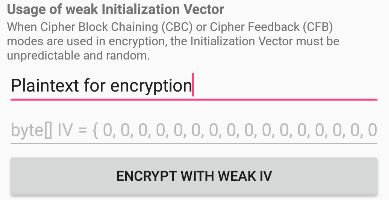</figure>

iv가 동일하기 때문에 암호문 또한 같은 평문을 여러번 암호화 해도 동일합니다.

<figure class="imageblock alignCenter" data-ke-mobilestyle="widthOrigin" data-origin-height="180" data-origin-width="384">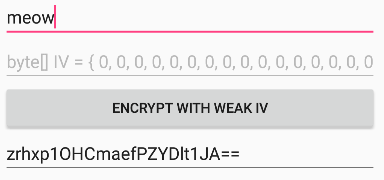</figure>

<h3 data-ke-size="size23">2. Possible Man-In-The-Middle Attack</h3>

2번 문제에 대한 description은 다음과 같습니다.

Improper or missing hostname verification exposes mobile application users to MITM attacks under certain conditions.

해석 : 호스트 이름 검증이 부적절하거나 누락된 경우, 특정 조건에서 모바일 애플리케이션 사용자가 MITM 공격에 노출될 수 있습니다.

 

MITM(Man In The Middle)이란, 통신하는 두 개체 사이에서 공격자가 데이터를 위변조하거나 가로채는 공격입니다.

 

문제 설명에서 hostname verification이라는 내용이 있어 호스트명에 관련된 내용을 코드에서 찾아봐야겠다고 생각했습니다.

찾는 중 다음 코드를 발견했습니다.

<figure class="imageblock alignCenter" data-ke-mobilestyle="widthOrigin" data-origin-height="102" data-origin-width="458">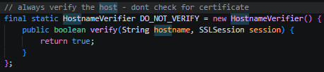</figure>

주석은 호스트를 항상 확인하지만 인증서는 확인하지 말라는 내용입니다.

통신하는 두 개체 사이 인증서 확인이 누락되면 MITM 공격이 발생할 수 있습니다.

 

코드를 보면 verify 함수에 대한 반환값이 true입니다.

 

서치 중 찾은 안드로이드 공식 문서입니다.

이 공식 문서에서도 HostnameVerifier는 MITM 공격에 취약할 수 있다고 경고합니다.

<a href="https://developer.android.com/privacy-and-security/risks/unsafe-hostname?hl=ko" rel="noopener noreferrer" target="_blank">https://developer.android.com/privacy-and-security/risks/unsafe-hostname?hl=ko</a>

<h3 data-ke-size="size23">3. Remote URL load in WebView</h3>

3번 문제에 대한 description은 다음과 같습니다.

Loading a remote URL can be a dangerous practice in WebView. Verify the interactions made with WebView and ensure the trustworthiness, integrity and reliability of third-party URLs used in the mobile application.

해석 : WebView에서 원격 URL을 로드하는 것은 위험한 작업이 될 수 있습니다. WebView와의 상호작용을 검증하고, 모바일 애플리케이션에서 사용되는 타사 URL의 신뢰성, 무결성 및 안정성을 확인하십시오.

 

WebView란 안드로이드 앱 내에서 표시되는 웹 페이지입니다.

 

WebView 관련 문제라 WebviewActivity.java를 보면 될 거라 생각했습니다.

다음과 같은 부분이 있었습니다.

<figure class="imageblock alignCenter" data-filename="blob" data-ke-mobilestyle="widthOrigin" data-origin-height="194" data-origin-width="581">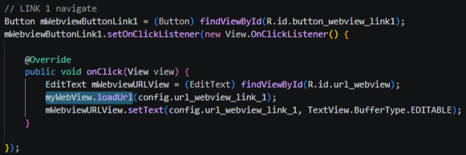</figure>

사진 상에 표시한 부분을 보면 사용자가 입력한 URL 주소에 대해 검증 절차를 거치지 않고, 바로 로드하는 것을 알 수 있습니다.

file:// 스킴과 같은 주소에 민감 정보가 있는 주소에 접근 가능할 거라 생각했습니다.

 

에뮬레이터에서 WebView 메뉴에 들어가면 총 세 개의 Link가 있는 걸 볼 수 있습니다.

<figure class="imageblock alignCenter" data-ke-mobilestyle="widthOrigin" data-origin-height="629" data-origin-width="412">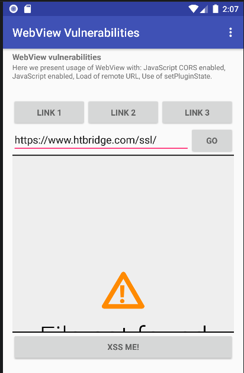</figure>

나머지 두 링크에 대해서도 해당 주소가 안전한 주소인지 검증하는 절차 없이 바로 로드합니다.

 

LINK 1을 클릭했을 때 나오는 화면입니다.

<figure class="imageblock alignCenter" data-ke-mobilestyle="widthOrigin" data-origin-height="257" data-origin-width="404">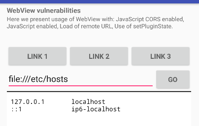</figure>

허용하는 스킴에 대한 화이트리스트가 없으므로 사용자가 입력한 주소가 적절한 검증 절차 없이 로드되어 화면에 노출됩니다.

<h3 data-ke-size="size23">4. Object deserialization found</h3>

4번 문제에 대한 description은 다음과 같습니다.

Object deserialization performed on an untrusted resource (e.g. user-supplied input or external storage), can be dangerous if the data for deserialization is tampered by an attacker.

해석 : 신뢰할 수 없는 리소스(예: 사용자가 제공한 입력값이나 외부 저장소)를 대상으로 객체 역직렬화를 수행할 때, 역직렬화할 데이터가 공격자에 의해 변조되었다면 위험할 수 있습니다.

 

직렬화(serialization)란 메모리에 생성된 객체(object)를 연속된 바이트 형식으로 변환하여 다른 컴포넌트로 전달하거나 파일 및 네트워크로 전송할 수 있게 만드는 기술이라고 합니다.

역직렬화(deserialization)는 이 과정을 반대로 하는 기술입니다. 즉 연속된 바이트 형식의 데이터를 메모리에서 사용 가능한 객체로 변환하는 것입니다. 이때 문제 설명에도 나와있듯이 데이터를 역직렬화할 때 변조되었다면 위험할 수 있습니다.

 

diva와 pivaa를 풀어봤을 때, 핵심 기능 수행 시 검증이 누락되어 있어 취약한 부분이 많았기에 이번에도 역직렬화 수행 시 역직렬화 할 데이터에 대해 검증이 누락되었는지 확인해야겠다고 생각했습니다.

 

SerializeActivity.java와 ObjectSerialization.java 코드를 봤습니다.

SerializeActivity 코드의 다음 부분에서 serializable.dat 파일을 저장할 경로를 지정합니다.

<figure class="imageblock alignCenter" data-ke-mobilestyle="widthOrigin" data-origin-height="92" data-origin-width="635">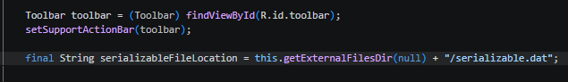</figure>

그리고 다음 부분에서 객체에 대해 직렬화를 진행한 후 데이터를 위 코드에서 본 serializable.dat 파일에 저장하는 거 같습니다.

<figure class="imageblock alignCenter" data-ke-mobilestyle="widthOrigin" data-origin-height="243" data-origin-width="554">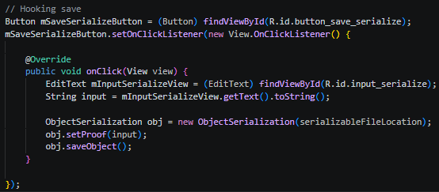</figure>

다음 코드는 save한 객체 직렬화 파일을 load하는 부분입니다.

<figure class="imageblock alignCenter" data-ke-mobilestyle="widthOrigin" data-origin-height="208" data-origin-width="473">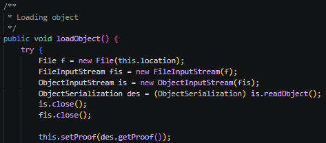</figure>

역직렬화 시 위 코드에서 보는 파일은 load할 파일에 들어있는 데이터뿐입니다.

load할 파일에 들어있는 데이터가 직렬화 후 저장한 파일 데이터와 같을 거란 보장이 없는데도 아무 검증 과정 없이 역직렬화하여 불러옵니다.

 

에뮬레이터에서 해보겠습니다.

Seialize 화면에 adb push로 시작하는 명령어가 있습니다.

adb push 명령어는 pc에 있는 파일을 안드로이드 기기에 복사할 때 사용하는 명령어라고 합니다.

adb pull이라는 명령어도 있는데 이 명령어는 안드로이드 기기에 있는 파일을 pc에 복사하는 명령어입니다.

<figure class="imageblock alignCenter" data-ke-mobilestyle="widthOrigin" data-origin-height="437" data-origin-width="411">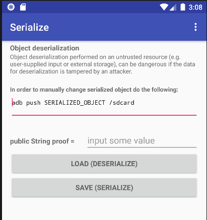</figure>

먼저 사용자 입력을 받는 칸에 AAAA라는 문자열을 입력하고 save를 클릭했습니다.

<figure class="imageblock alignCenter" data-filename="스크린샷 2026-09-25 135844.png" data-ke-mobilestyle="widthOrigin" data-origin-height="424" data-origin-width="408">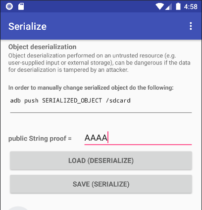</figure>

직렬화된 파일이 어디 저장되어 있을까 싶었는데 명령어 예시를 보니 /sdcard라는 경로 안에 .dat 파일이 저장되어 있을 거 같았습니다.

 

Device Explorer로 열어보니 .dat 파일이 존재했습니다.

경로는 /sdcard/Android/data/com.htbridge.pivaa/files/serializable.dat입니다.

<figure class="imageblock alignCenter" data-ke-mobilestyle="widthOrigin" data-origin-height="411" data-origin-width="281">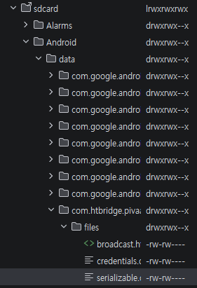</figure>

adb pull /sdcard/Android/data/co<a href="http://m.htbridge.pivaa/files/serializable.dat" rel="noopener noreferrer" target="_blank">m.htbridge.pivaa/files/serializable.dat</a> . 명령어로 현재 작업 경로에 serializable.dat 파일을 불러와 파일 내용 변조 후 push해보도록 하겠습니다.

<figure class="imageblock alignCenter" data-filename="blob" data-ke-mobilestyle="widthOrigin" data-origin-height="100" data-origin-width="1270">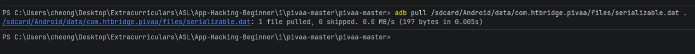</figure>

 

현재 작업 경로에 serializable.dat 파일이 있습니다.

<figure class="imageblock alignCenter" data-filename="blob" data-ke-mobilestyle="widthOrigin" data-origin-height="172" data-origin-width="579">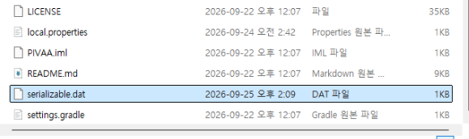</figure>

 .dat 파일이므로 텍스트 에디터로 열면 데이터가 깨져 나오기 때문에 HxD로 변조하겠습니다.

 

HxD로 열어보니 마지막에 제가 입력한 문자열인 AAAA가 있었습니다.

<figure class="imageblock alignCenter" data-filename="blob" data-ke-mobilestyle="widthOrigin" data-origin-height="233" data-origin-width="574">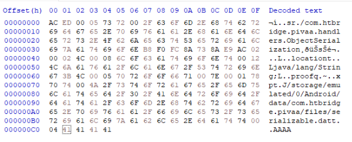</figure>

이 문자열을 MEOW로 바꿔 저장하겠습니다.

<figure class="imageblock alignCenter" data-filename="blob" data-ke-mobilestyle="widthOrigin" data-origin-height="224" data-origin-width="581">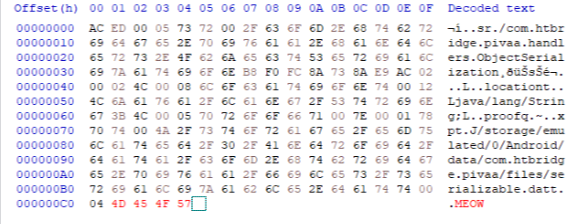</figure>

 

저장 후 안드로이드 스튜디오의 터미널에 adb push serializable.dat /sdcard/Android/data/co<a href="http://m.htbridge.pivaa/files/serializable.dat" rel="noopener noreferrer" target="_blank">m.htbridge.pivaa/files/serializable.dat</a> 명령어를 입력하여 변조한 파일을 가져오겠습니다.

<figure class="imageblock alignCenter" data-ke-mobilestyle="widthOrigin" data-origin-height="81" data-origin-width="1515">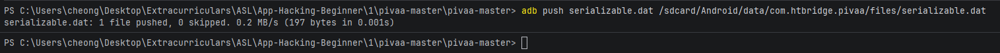</figure>

그 후 에뮬레이터에서 LOAD 버튼을 클릭했습니다.

<figure class="imageblock alignCenter" data-filename="blob" data-ke-mobilestyle="widthOrigin" data-origin-height="721" data-origin-width="323">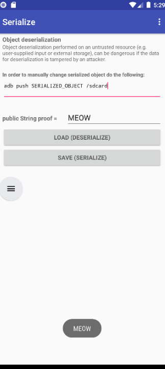</figure>

입력한 값은 AAAA인데 load 하니 MEOW가 나왔습니다.

<h3 data-ke-size="size23">5. User-supplied input in SQL queries</h3>

5번 문제에 대한 description은 다음과 같습니다.

Inclusion of user-supplied input into SQL queries can potentially lead to a local SQL injection vulnerability in the mobile application. The correct approach is to use prepared SQL statements beyond user's control.

해석 : 사용자가 제공한 입력을 SQL 쿼리에 포함하면 모바일 애플리케이션에서 로컬 SQL 인젝션 취약점이 발생할 수 있습니다. 올바른 접근 방식은 사용자가 제어할 수 없는 준비된 SQL 문(prepared SQL statements)을 사용하는 것입니다.

 

DatabaseActivity.java에 다음과 같은 부분이 있습니다.

<figure class="imageblock alignCenter" data-ke-mobilestyle="widthOrigin" data-origin-height="302" data-origin-width="553">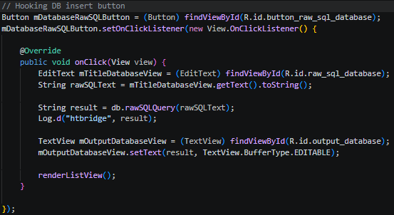</figure>

String rawSQLText = mTitleDatabaseView.getText().toString();

String result = db.rawSQLQuery(rawSQLText);

이 부분에서 사용자가 입력한 문자열 전체를 SQL문으로 실행합니다.

 

select * from data 라는 문자열이 미리보기로도 나와있습니다.

한 번 그대로 입력한 후 QUERY 버튼을 클릭해보겠습니다.

<figure class="imageblock alignCenter" data-ke-mobilestyle="widthOrigin" data-origin-height="343" data-origin-width="407">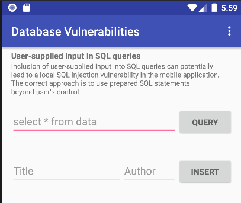</figure>

데이터베이스의 data 테이블에 있는 모든 행의 값이 조회되었습니다.

<figure class="imageblock alignCenter" data-ke-mobilestyle="widthOrigin" data-origin-height="852" data-origin-width="404">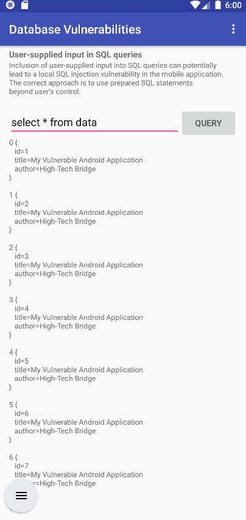</figure>

<h3 data-ke-size="size23">6. Missing tapjacking protection</h3>

6번 문제에 대한 description은 다음과 같습니다.

By default, Android allows applications to draw over some portions of the phone screen and permits touch events to be sent to mobile applications in the lower 'layer'. This can be used by an attacker to trick application users into performing some sensitive actions in a legitimate application (e.g. send a payment) they do not otherwise intend doing.

해석 : 기본적으로 안드로이드는 애플리케이션이 휴대폰 화면의 일부 영역 위에 내용을 표시할 수 있도록 허용하며, 더 낮은 '계층(layer)'에 있는 모바일 애플리케이션으로 터치 이벤트를 전달하는 것도 허용합니다. 공격자는 이러한 특성을 악용하여, 사용자가 의도하지 않은 민감한 작업(예: 결제 실행 등)을 정상적인 애플리케이션 내에서 수행하도록 유도할 수 있습니다.

 

즉 tapjacking이란, 민감한 기능을 수행하는 버튼 위를 가짜 UI로 덮어 사용자가 의도하지 않은 작업을 수행하도록 유도하는 것입니다.

 

탭재킹 보호 기법은 안드로이드 공식 문서에도 나와있듯이 View.setFilterTouchesWhenObscured(true) 이나 android:filterTouchesWhenObscured="true" 를 설정하여 방지한다고 합니다. 

<a href="https://developer.android.com/privacy-and-security/risks/tapjacking?hl=ko" rel="noopener noreferrer" target="_blank">https://developer.android.com/privacy-and-security/risks/tapjacking?hl=ko</a>

 

pivaa 파일 내에 해당 보호 기법이 적용되어 있는지 살펴봤습니다.

 

vscode에서 pivaa 문제 폴더를 연 후 파일 전체 내용 대상으로 touch를 검색해봤는데 문제 설명이 적혀있는 json 파일 외엔 touch라는 단어가 포함된 코드가 없었습니다.

<figure class="imageblock alignCenter" data-ke-mobilestyle="widthOrigin" data-origin-height="154" data-origin-width="141">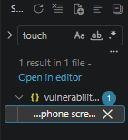</figure>

따라서, 탭재킹에 대한 검증이 누락되어있다고 판단했습니다.

<h3 data-ke-size="size23">7. Enabled Application Backup</h3>

7번 문제에 대한 description은 다음과 같습니다.

The mobile application uses external backup functionality (default Android backup mechanism) that may store inside sensitive data from the application. In certain conditions, this may lead to information disclosure (e.g. when a backup server or your  Gmail account is compromised).

해석 : 이 모바일 애플리케이션은 애플리케이션 내의 민감한 데이터를 저장할 수 있는 외부 백업 기능(기본 Android 백업 메커니즘)을 사용합니다. 특정 상황(예: 백업 서버나 사용자의 Gmail 계정이 침해되는 경우)에서는 이로 인해 정보가 유출될 수 있습니다.

 

pivaa 폴더 내에서 backup 문자열을 검색해봤습니다.

<figure class="imageblock alignCenter" data-ke-mobilestyle="widthOrigin" data-origin-height="88" data-origin-width="255">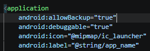</figure>

AndroidManifest.xml에 android:allowBackup이 true로 설정되어 있습니다.

 

android:allowBackup="true"라고 해서 취약하다고 할 수 없지만, 안드로이드 공식 문서에서는 앱이 민감한 정보를 처리할 경우 false로 처리해야 한다고 합니다.

<figure class="imageblock alignCenter" data-ke-mobilestyle="widthOrigin" data-origin-height="420" data-origin-width="805">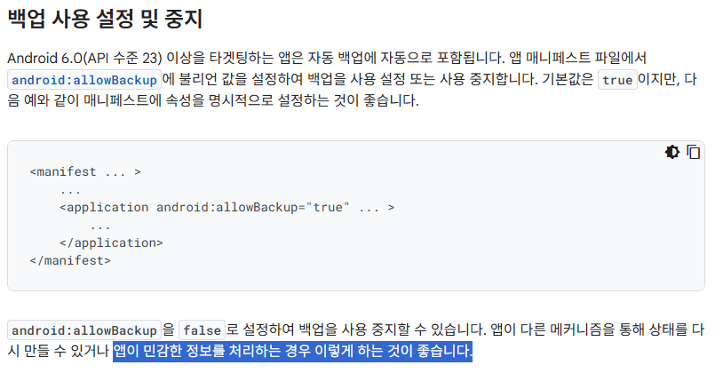</figure>

<a href="https://developer.android.com/identity/data/autobackup?hl=ko" rel="noopener noreferrer" target="_blank">https://developer.android.com/identity/data/autobackup?hl=ko</a>

<h3 data-ke-size="size23">8. Enabled Debug Mode</h3>

8번 문제에 대한 description입니다.

The mobile application has debug mode enabled. Debug mode is used by application developers during development process and should be disabled when application is in production. This mode can expose technical information and can facilitate reverse engineering of the application.

해석 : 해당 모바일 애플리케이션은 디버그 모드가 활성화된 상태입니다. 디버그 모드는 개발 과정에서 개발자가 사용하는 기능으로, 실제 운영 환경(프로덕션)에서는 비활성화되어야 합니다. 이 모드는 기술적 정보를 노출할 수 있으며, 애플리케이션에 대한 리버스 엔지니어링을 용이하게 할 수 있습니다.

 

설명을 보니 이 앱은 디버그 모드가 활성화되어 있다고 합니다.

AndroidManifest.xml에서 확인해봤습니다.

<figure class="imageblock alignCenter" data-ke-mobilestyle="widthOrigin" data-origin-height="123" data-origin-width="392">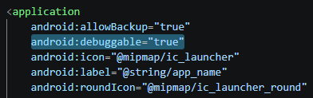</figure>

debuggable이 true인 것을 알 수 있습니다.

<h3 data-ke-size="size23">9. Weak encryption</h3>

9번 문제에 대한 description은 다음과 같습니다.

Weak or badly implemented encryption algorithms can endanger data storage and transmission used by the mobile application.

해석 : 취약하거나 부실하게 구현된 암호화 알고리즘은 모바일 애플리케이션이 사용하는 데이터 저장 및 전송을 위태롭게 할 수 있습니다.

 

암호화 구현을 취약하게 하여 발생하는 문제를 다루는 거 같습니다.

 

안드로이드 공식 문서를 보면 다음과 같은 암호 알고리즘을 권장합니다.

<figure class="imageblock alignCenter" data-ke-mobilestyle="widthOrigin" data-origin-height="408" data-origin-width="867">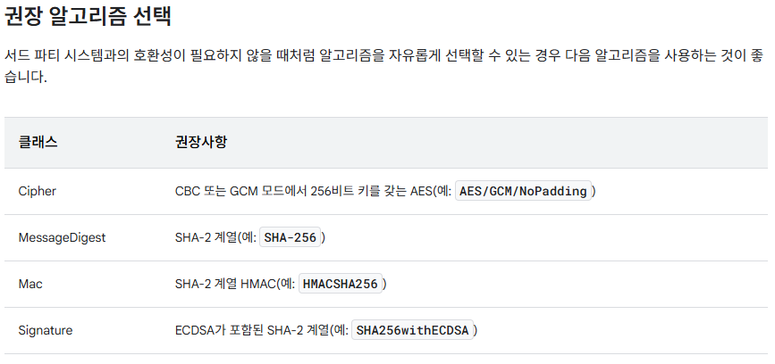</figure>

Encryption.java의 encryptAES_ECB_PKCS55Padding 함수부입니다.

<figure class="imageblock alignCenter" data-ke-mobilestyle="widthOrigin" data-origin-height="352" data-origin-width="588">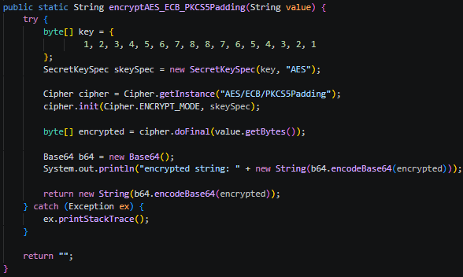</figure>

공식 문서에 따르면, ECB 모드는 권장하지 않는다는 걸 유추할 수 있습니다.

 

AES의 ECB 모드는 동일한 키에서 같은 평문이 같은 암호문 블록으로 변환된다고 합니다.

따라서, 평문 패턴이 노출될 위험이 있습니다.

<h3 data-ke-size="size23">10. Hardcoded encryption keys</h3>

10번 문제에 대한 descryption입니다.

Hardcoded encryption keys can jeopardize secure data storage and transmission within the mobile application under certain circumstances.

해석 : 코드에 직접 삽입된(하드코딩된) 암호화 키는 특정 상황에서 모바일 애플리케이션 내의 안전한 데이터 저장 및 전송을 위태롭게 할 수 있습니다.

 

Encryption.java 코드를 봤습니다.

다음과 같이 암호화 키가 하드코딩되어 있습니다.

<figure class="imageblock alignCenter" data-ke-mobilestyle="widthOrigin" data-origin-height="123" data-origin-width="504">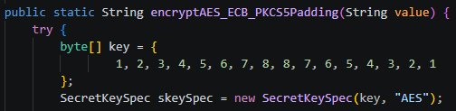</figure>

<h3 data-ke-size="size23">11. Dynamic load of code</h3>

The mobile application uses dynamic load of executable code. Under certain circumstances, dynamic load of code can be dangerous. For example, if the code is located on an external storage (e.g. SD card), this can lead to code injection vulnerability if the external storage is world readable and/or writable and an attacker can access it.

해석 : 해당 모바일 애플리케이션은 실행 가능한 코드를 동적으로 로드하는 방식을 사용합니다. 특정 상황에서 이러한 코드의 동적 로드는 위험을 초래할 수 있습니다. 예를 들어, 코드가 외부 저장소(예: SD 카드)에 위치해 있고 해당 저장소가 누구나 읽거나 쓸 수 있는 상태여서 공격자가 접근할 수 있는 경우, 코드 주입(code injection) 취약점으로 이어질 수 있습니다.

 

즉, 앱에서 앱 외부 코드를 동적으로 로드할 때 코드에 대한 무결성 검사를 진행하지 않으면 공격자가 접근 가능하여 공격 코드가 실행될 수 있는 취약점입니다.

 

공식 문서에서도 동적 코드를 로드할 땐 출처를 검증하고 무결성 검사를 시행하라고 합니다.

<figure class="imageblock alignCenter" data-ke-mobilestyle="widthOrigin" data-origin-height="421" data-origin-width="795">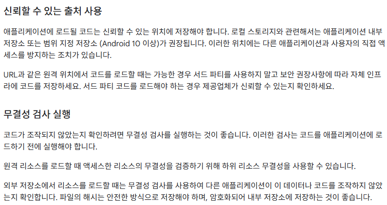</figure>

<a href="https://developer.android.com/privacy-and-security/risks/dynamic-code-loading?hl=ko#java" rel="noopener noreferrer" target="_blank">https://developer.android.com/privacy-and-security/risks/dynamic-code-loading?hl=ko#java</a>

<figure contenteditable="false" data-ke-align="alignCenter" data-ke-type="opengraph" data-og-description="Google은 AI 기술을 사용하여 콘텐츠를 사용자의 기본 언어로 번역합니다. AI 번역에는 오류가 있을 수 있습니다. 동적 코드 로드 컬렉션을 사용해 정리하기 내 환경설정을 기준으로 콘텐츠를 저장" data-og-host="developer.android.com" data-og-image="/assets/img/and-lab/02/og-02.png" data-og-source-url="https://developer.android.com/privacy-and-security/risks/dynamic-code-loading?hl=ko#java" data-og-title="동적 코드 로드  |  Security  |  Android Developers" data-og-type="website" data-og-url="https://developer.android.com/privacy-and-security/risks/dynamic-code-loading?hl=ko" id="og_1790344106542"><a data-source-url="https://developer.android.com/privacy-and-security/risks/dynamic-code-loading?hl=ko#java" href="https://developer.android.com/privacy-and-security/risks/dynamic-code-loading?hl=ko#java" rel="noopener" target="_blank">

 

동적 코드 로드  |  Security  |  Android Developers

Google은 AI 기술을 사용하여 콘텐츠를 사용자의 기본 언어로 번역합니다. AI 번역에는 오류가 있을 수 있습니다. 동적 코드 로드 컬렉션을 사용해 정리하기 내 환경설정을 기준으로 콘텐츠를 저장

developer.android.com

</a></figure>

 

코드상에서 동적 코드 로드 시 출처를 검증하는지, 무결성 검사를 시행하는지를 보면 될 거라 생각했습니다.

 

LoadCode.java에 다음과 같은 부분이 있습니다.

assets 안의 .jar 파일에 접근하는 거 같습니다.

이때 jar 파일은 java 클래스와 관련된 것들을 하나의 파일로 묶은 것입니다.

<figure class="imageblock alignCenter" data-ke-mobilestyle="widthOrigin" data-origin-height="293" data-origin-width="483">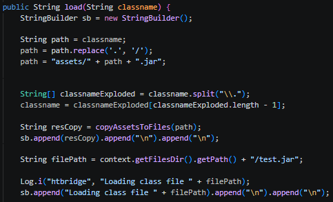</figure>

 

<figure class="imageblock alignCenter" data-filename="blob" data-ke-mobilestyle="widthOrigin" data-origin-height="197" data-origin-width="620">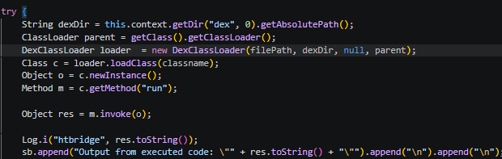</figure>

LoadCodeActivity.java에 코드를 로드하는 내용으로 보이는 부분이 있었습니다.

<figure class="imageblock alignCenter" data-ke-mobilestyle="widthOrigin" data-origin-height="212" data-origin-width="669">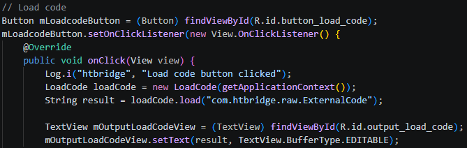</figure>

ExternalCode라는 클래스를 load로 불러오는 거 같습니다.

ExternalCode.java는 다음과 같은 내용입니다.

<figure class="imageblock alignCenter" data-ke-mobilestyle="widthOrigin" data-origin-height="182" data-origin-width="357">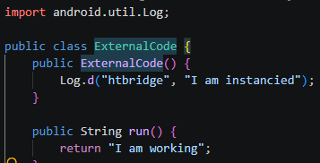</figure>

뭔가 액션을 취하면 I am working이라는 문자열이 출려될 거 같습니다.

 

에뮬레이터에서 LOAD CODE 버튼을 누르니 다음과 같은 내용이 출력됐습니다.

<figure class="imageblock alignCenter" data-ke-mobilestyle="widthOrigin" data-origin-height="418" data-origin-width="391">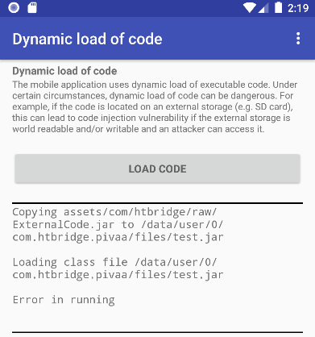</figure>

I am working이 뜨지 않고 Error in running 문자열이 출력됐습니다.

 

로그캣에서도 ExternalCode라는 클래스를 경로에서 찾을 수 없다고 떴습니다...

<figure class="imageblock alignCenter" data-ke-mobilestyle="widthOrigin" data-origin-height="125" data-origin-width="1484">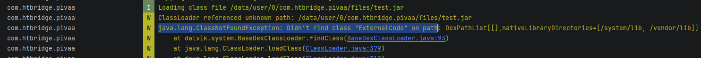</figure>

원래라면 동적 코드 로드에 성공하여 I am working이 떠야 하는데 어떤 부분이 문제인지 파악하지 못했습니다...

 

추후 원인을 발견했을 때 추가하도록 하겠습니다.

<h3 data-ke-size="size23">12. Creation of world readable or writable files</h3>

The mobile application creates files with world readable or writable permissions. Such  files can be accessed and modified by other applications, including malicious ones, thus imperiling the application's data integrity.

해석 : 모바일 애플리케이션은 모든 사용자가 읽기 또는 쓰기 권한을 가진 파일을 생성합니다. 이러한 파일은 악성 애플리케이션을 포함한 다른 애플리케이션에서 접근 및 수정할 수 있으므로 애플리케이션의 데이터 무결성을 위협합니다.

 

readable, writable 키워드를 코드 상에서 찾아봤습니다.

 

Authentication.java 코드에 다음과 같은 내용이 있었습니다.

 

취약 부분은 다음 부분입니다.

<figure class="imageblock alignCenter" data-ke-mobilestyle="widthOrigin" data-origin-height="237" data-origin-width="625">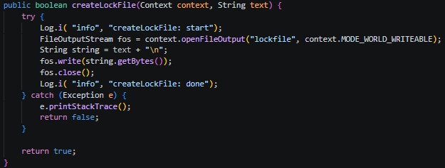</figure>

createLockFile 함수에서 MODE_WORLD_WRITEABLE로 lockfile을 열람합니다.

MODE_WORLD_WRITEABLE 모드는 앱 내부에서 생성된 파일을 외부에서도 편집 가능하게 하므로 무결성이 보장되지 않는데 이 코드에선 무결성 검증을 수행하지 않습니다.

<h3 data-ke-size="size23">13. Usage of unencrypted HTTP protocol</h3>

The mobile application uses HTTP protocol to send or receive data. The design of HTTP protocol does not provide any encryption of the transmitted data, which can be easily intercepted if an attacker is located in the same network or has access to data channel of the victim.

해석 : 해당 모바일 애플리케이션은 데이터 송수신에 HTTP 프로토콜을 사용합니다. HTTP 프로토콜은 전송되는 데이터에 대한 암호화 기능을 제공하지 않으므로, 공격자가 동일한 네트워크에 있거나 피해자의 데이터 채널에 접근할 수 있는 경우 데이터가 쉽게 가로채질 수 있습니다.

 

즉, http 프로토콜은 암호화 기능이 없으므로 http 프로토콜 사용 시 전송 중인 정보가 공격자에 의해 도청 및 변조될 수 있습니다.

 

pivaa 코드 내에서 http를 사용하는 부분이 있는지 찾아봤습니다.

초반에 봤던 코드인 WebviewActivity.java 코드를 보니 http://로 시작하는 주소를 불러오는 부분이 있습니다.

<figure class="imageblock alignCenter" data-ke-mobilestyle="widthOrigin" data-origin-height="168" data-origin-width="544">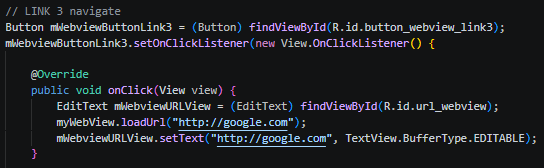</figure>

실습 환경인 API 26에선 proxy 기능을 찾아볼 수 없어 직접 검증하진 못했습니다...

<h3 data-ke-size="size23">14. Weak hashing algorithms</h3>

The mobile application uses weak hashing algorithms. Weak hashing algorithms (e.g. MD2, MD4, MD5 or SHA-1) can be vulnerable to collisions and other security weaknesses, and should not be used when reliable hashing of data is required.

해석 : 해당 모바일 애플리케이션은 취약한 해싱 알고리즘을 사용합니다. 취약한 해싱 알고리즘(예: MD2, MD4, MD5 또는 SHA-1)은 충돌(collision) 및 기타 보안 취약점에 노출될 수 있으므로, 데이터에 대한 신뢰할 수 있는 해싱이 요구되는 경우에는 사용해서는 안 됩니다.

 

이전 암호학 문제에서 MD5 알고리즘 사용을 권고하지 않는다는 내용이 생각났습니다.

EncryptionActivity.java 코드를 볼 때도 MD5 알고리즘이 사용되는 것을 봐서 관련이 있을 거라 생각했습니다.

 

우선 Authentication.java에 다음과 같은 부분이 있습니다.

사용자가 로그인 페이지에서 username과 password를 입력하면 &lt;username&gt;:&lt;password&gt; 형식의 데이터를 MD5로 해싱하여 저장하는 거 같습니다.

<figure class="imageblock alignCenter" data-ke-mobilestyle="widthOrigin" data-origin-height="397" data-origin-width="726">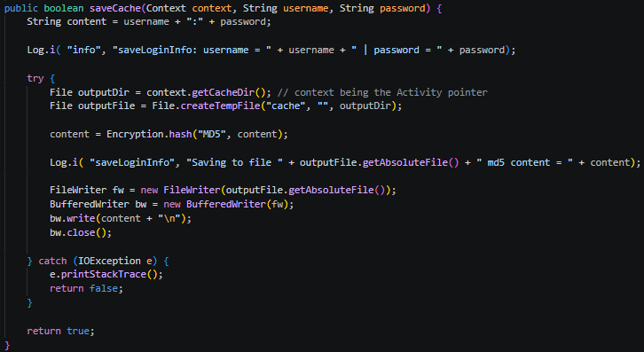</figure>

또한 md5로 해싱된 내용이 Log.i로 인해 로그캣에서 볼 수 있습니다.

 

Login 페이지에서 username과 password 입력 후 SIGN IN을 클릭했습니다.

<figure class="imageblock alignCenter" data-ke-mobilestyle="widthOrigin" data-origin-height="317" data-origin-width="408">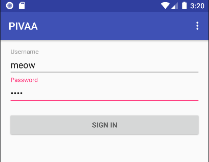</figure>

로그캣을 열어 필터란에 md5를 입력하니 md5로 해싱된 값이 16진수로 표시됩니다.

<figure class="imageblock alignCenter" data-ke-mobilestyle="widthOrigin" data-origin-height="134" data-origin-width="1428">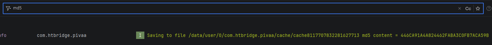</figure>

 

md5는 충돌 저항성이 깨진 해시 함수이므로 무결성 검증에 사용하기 부적절합니다.

<h3 data-ke-size="size23">15. Predictable Random Number Generator</h3>

The mobile application uses predictable Random Number Generator. Under certain conditions this can jeopardize the entire data encryption performed by the mobile application.

해석 : 해당 모바일 애플리케이션은 예측 가능한 난수 생성기를 사용합니다. 특정 조건에서는 이로 인해 애플리케이션이 수행하는 전체 데이터 암호화가 위태로워질 수 있습니다.

 

에뮬레이터에서 해당 문제명을 가진 부분이 있고, GENERATE를 클릭하면 임의의 수가 나타납니다.

<figure class="imageblock alignCenter" data-ke-mobilestyle="widthOrigin" data-origin-height="271" data-origin-width="410">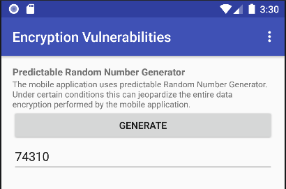</figure>

 

난수를 생성하는 코드를 봐야 한다고 생각했습니다.

Encryption.java 코드에서 난수를 생성하는 부분입니다.

<figure class="imageblock alignCenter" data-ke-mobilestyle="widthOrigin" data-origin-height="170" data-origin-width="240">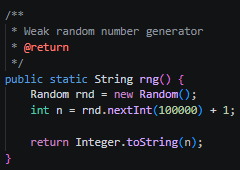</figure>

이때 java.util.Random이라는 난수 생성기를 사용하는데 이는 의사 난수 생성기 알고리즘을 사용하여 결과를 예측할 수 있다고 합니다.

따라서 암호화에 쓰이는 난수 생성을 위해 사용하기 적절하지 않습니다.

<h3 data-ke-size="size23">16. Exported Content Providers with insufficient protection</h3>

The mobile application contains exported content providers. Content providers are used to share data between different applications. Other applications, including malicious ones, can access exported content providers.  This can lead to various security issues, including information disclosure. To securely export your content provider, you can set-up 'android:protectionLevel' or 'android:grantUriPermissions' attributes in Android Manifest file in order to restrict access to your content providers.

해석 : 해당 모바일 애플리케이션에는 외부로 노출된(exported) 콘텐츠 제공자(Content Provider)가 포함되어 있습니다. 콘텐츠 제공자는 서로 다른 애플리케이션 간에 데이터를 공유하는 데 사용되는데, 악성 애플리케이션을 포함한 다른 애플리케이션이 이러한 노출된 콘텐츠 제공자에 접근할 수 있습니다. 이는 정보 유출을 비롯한 다양한 보안 문제를 초래할 수 있습니다. 콘텐츠 제공자를 안전하게 노출하려면 Android 매니페스트 파일에서 'android:protectionLevel' 또는 'android:grantUriPermissions' 속성을 설정하여 해당 콘텐츠 제공자에 대한 접근을 제한할 수 있습니다.

 

문제 설명에서 AndroidManifest 파일에 대한 내용이 언급되어 한 번 코드를 봤습니다.

provider 부분에 다음과 같은 내용이 있었습니다.

<figure class="imageblock alignCenter" data-ke-mobilestyle="widthOrigin" data-origin-height="184" data-origin-width="447">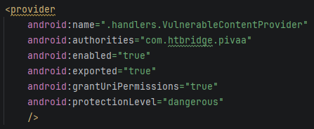</figure>

여기서 android:exported가 true입니다. 이는 외부 앱이 이 provider 컴포넌트에 접근할 수 있다는 의미입니다.

 

android:exported="true"라고 해서 무조건 취약한 것은 아닙니다. provider에서 외부 앱에 대한 접근을 통제하는 속성이 존재합니다.

android:permission, android:readPermission, android:writePermission 등이 있음에도 android:exported는 true인데 다른 접근 통제 조치가 존재하지 않습니다.

 

content proiver 컴포넌트와 관련이 있는 듯한 VulnerableContentProvider.java 코드가 있기에 살펴봤습니다.

코드에 다음과 같은 부분이 있었습니다.

<figure class="imageblock alignCenter" data-ke-mobilestyle="widthOrigin" data-origin-height="160" data-origin-width="722">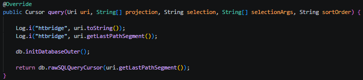</figure>

사용자 입력을 검증 없이 그대로 받기에 SQL Injection을 시도할 수 있을 거 같았습니다.

 

안드로이드 앱에서 Content Proivder에 접근하기 위해선 content:// 스킴을 사용합니다.

패키지명은 com.htbridge.pivaa이니 SQL문을 넣은 전체 uri 주소는 다음과 같습니다.

content://com.htbridge.pivaa/select * from data

 

에뮬레이터에서 시도해봤습니다.

위 SQL문이 있는 uri를 입력한 후 GO를 클릭했습니다.

<figure class="imageblock alignCenter" data-ke-mobilestyle="widthOrigin" data-origin-height="381" data-origin-width="410">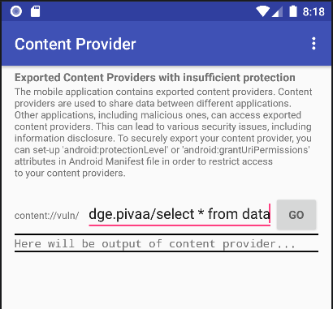</figure>

다음과 같이 데이터베이스의 데이터 테이블이 노출되게 됩니다.

<figure class="imageblock alignCenter" data-ke-mobilestyle="widthOrigin" data-origin-height="854" data-origin-width="404">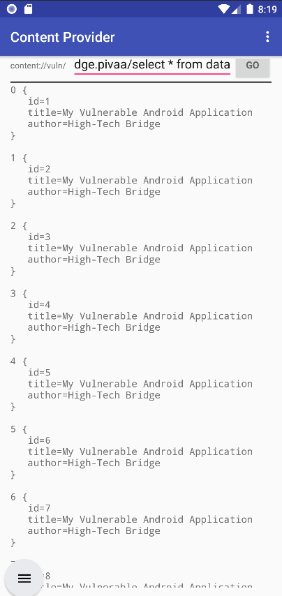</figure>

<h3 data-ke-size="size23">17. Exported Broadcast Receivers</h3>

The mobile application contains an exported receiver enabling other applications, including malicious ones, to send intents without restrictions. By default, Broadcast Receivers is exported in Android, as the result any application will be able to send an intent to the Broadcast Receiver of the application. To define which applications can send intents to mobile application's Broadcast Receiver set relevant permissions in the Android Manifest file.

해석 : 해당 모바일 애플리케이션에는 악성 앱을 포함한 다른 애플리케이션이 제한 없이 인텐트(intent)를 전송할 수 있도록 허용하는 '외부 공개(exported)' 상태의 리시버가 포함되어 있습니다. 안드로이드에서 브로드캐스트 리시버(Broadcast Receiver)는 기본적으로 외부 공개로 설정되므로, 결과적으로 모든 애플리케이션이 해당 앱의 브로드캐스트 리시버로 인텐트를 보낼 수 있게 됩니다. 특정 애플리케이션만 인텐트를 보낼 수 있도록 제한하려면 Android Manifest 파일에서 관련 권한을 설정해야 합니다.

 

이전 문제가 Content Provider 컴포넌트 관련 문제였다면 이번 문제는 Broadcast Receivers 컴포넌트 관련 문제인 거 같습니다.

 

우선 AndroidManifest 파일부터 보겠습니다.

<figure class="imageblock alignCenter" data-ke-mobilestyle="widthOrigin" data-origin-height="162" data-origin-width="482"></figure>

receiver에서도 android:exported가 true로 설정되어 있습니다.

따라서 외부에서 이 앱에 브로드캐스트를 보낼 수 있습니다.

receiver 컴포넌트의 접근 통제는 android:permission으로 수행하는데 매니페스트 상에 나와있는 것을 보면 이전 문제와 마찬가지로 접근 통제 기법이 없다는 걸 알 수 있습니다.

 

VulnerableReceiver.java 코드를 보겠습니다.

<figure class="imageblock alignCenter" data-ke-mobilestyle="widthOrigin" data-origin-height="415" data-origin-width="752"></figure>

이 부분에서 receiver는 외부에서 전달한 location과 data를 가져옵니다.

그 후 별도 검증 없이 FileOutputStrem을 실행하여 파일 경로를 지정합니다.

<figure class="imageblock alignCenter" data-filename="blob" data-ke-mobilestyle="widthOrigin" data-origin-height="212" data-origin-width="551"></figure>

 

BroadcastReceiverActivity.java 코드를 봤을 때 최종적으로 파일이 저장될 location은 /broadcast.html인 거 같습니다.

<figure class="imageblock alignCenter" data-ke-mobilestyle="widthOrigin" data-origin-height="46" data-origin-width="416"></figure>

에뮬레이터에 접속해보니 다음과 같은 기본값이 적혀있었습니다.

일단 SEND BROADCAST를 클릭했습니다.

<figure class="imageblock alignCenter" data-ke-mobilestyle="widthOrigin" data-origin-height="620" data-origin-width="388"></figure>

 

Device Explorer로 열어보니 다음과 같은 경로(/sdcard/Android/data/com.htbridge.pivaa/files/broadcast.html)에 broadcast.html 파일이 있었습니다.

<figure class="imageblock alignCenter" data-ke-mobilestyle="widthOrigin" data-origin-height="417" data-origin-width="278"></figure>

.html 파일을 열어보니 Your new file 이라는 문자열이 저장되어 있었습니다.

<figure class="imageblock alignCenter" data-ke-mobilestyle="widthOrigin" data-origin-height="111" data-origin-width="308"></figure>

외부 권한으로 브로드캐스트를 보내 해당 경로에 원하는 문자열을 써보겠습다.

에뮬레이터에서 본 adb 명령어를 현재 작업 환경에 맞게 재작성하면 명령어는 다음과 같습니다.

<pre class="bash" data-ke-language="bash" data-ke-type="codeblock" id="code_1790397876896"><code class="hljs">adb shell am broadcast -n com.htbridge.pivaa/.handlers.VulnerableReceiver --es data MEOW --es location /sdcard/Android/data/com.htbridge.pivaa/files/broadcast.html</code></pre>

터미널에서 위 명령어 실행 후 cat으로 파일 내용이 바뀌었는지 확인해보겠습니다.

<figure class="imageblock alignCenter" data-ke-mobilestyle="widthOrigin" data-origin-height="144" data-origin-width="1831"></figure>

adb shell cat /sdcard/Android/data/co<a href="http://m.htbridge.pivaa/files/broadcast.html" rel="noopener noreferrer" target="_blank">m.htbridge.pivaa/files/broadcast.html</a>으로 확인한 결과 원래 파일 내용에서 MEOW라는 문자열이 추가된 걸 확인할 수 있었습니다.

<h3 data-ke-size="size23">18. Exported Services</h3>

The mobile application contains an exported service. By default, in Android services are not exported and cannot be invoked by other applications. However, if an intent filter is defined in  Android Manifest file, it is exported by default. Particular attention should be given to the exported services, as without the specific permissions, they can be used by any other applications including malicious ones.

해석 : 해당 모바일 애플리케이션에는 외부로 노출된(exported) 서비스가 포함되어 있습니다. 기본적으로 안드로이드 서비스는 외부로 노출되지 않으며 다른 애플리케이션에 의해 호출될 수 없습니다. 그러나 Android Manifest 파일에 인텐트 필터(intent filter)가 정의되어 있으면 해당 서비스는 기본적으로 외부로 노출됩니다. 외부로 노출된 서비스는 별도의 권한 설정이 없을 경우 악성 애플리케이션을 포함한 모든 애플리케이션에서 호출할 수 있으므로 각별한 주의가 필요합니다.

 

매니페스트 파일에서 service 컴포넌트 관련 부분입니다.

여기서도 android:exported가 true로 설정되어 있습니다.

<figure class="imageblock alignCenter" data-ke-mobilestyle="widthOrigin" data-origin-height="95" data-origin-width="302"></figure>

문제 코드인 VulnerableService.java 코드를 보도록 하겠습니다.

<figure class="imageblock alignCenter" data-ke-mobilestyle="widthOrigin" data-origin-height="105" data-origin-width="384"></figure>

service가 시작되면 startRecording이 실행되는 거 같습니다.

startRecording 함수부에선 녹화 또는 녹음을 하는 거 같습니다.

<figure class="imageblock alignCenter" data-ke-mobilestyle="widthOrigin" data-origin-height="739" data-origin-width="604"></figure>

그나저나 해당 코드에 다음과 같은 주석이 있습니다.

<figure class="imageblock alignCenter" data-ke-mobilestyle="widthOrigin" data-origin-height="233" data-origin-width="706"></figure>

해석 : MyVulnerableService는 의도적으로 취약하게 설계된 안드로이드 서비스입니다. 이 서비스는 오디오를 녹음하며, 녹음된 파일의 크기가 1MB에 도달하면 녹음을 중단합니다. 오디오 파일은 외부 저장소(external storage)의 루트 디렉토리에 저장됩니다. 이 서비스는 AndroidManifest.xml에서 외부로 노출(exported)되도록 설정되어 있어, 다른 어떤 애플리케이션이라도 이 서비스를 시작할 수 있습니다. 따라서 오디오 녹음 권한이 없는 애플리케이션이라도 이 서비스를 악용하여 오디오를 녹음할 수 있습니다.

 

어느 부분이 취약한지, 그리고 녹음된 오디오 파일은 어디에 저장되는지도 다 나와있었습니다!

 

주석대로, 코드에선 exported가 true로 설정되어 있고, 외부 앱에 대한 접근을 따로 막는 조치도 되어 있지 않았습니다.

<h3 data-ke-size="size23">19. JS enabled in a WebView</h3>

The mobile application has enabled JavaScript in WebView. By default, JavaScript is disabled in WebView, if enabled it can bring various JS-related security issues, such as Cross-Site Scripting (XSS) attacks.

해석 : 해당 모바일 애플리케이션은 WebView에서 JavaScript를 활성화했습니다. WebView에서 JavaScript는 기본적으로 비활성화되어 있는데, 이를 활성화할 경우 교차 사이트 스크립팅(XSS) 공격과 같은 다양한 JavaScript 관련 보안 문제가 발생할 수 있습니다.

 

WebView에서 JS를 활성화하면 XSS가 발생할 수 있는 문제 같습니다.

 

에뮬레이터에서 WebView 문제 하단에 XSS ME!라고 적혀있는 버튼이 있습니다.

<figure class="imageblock alignCenter" data-ke-mobilestyle="widthOrigin" data-origin-height="558" data-origin-width="375"></figure>

코드를 한 번 확인해보겠습니다.

WebviewActivity.java 코드입니다.

setJavaScriptEnabled를 true로 설정했습니다.

<figure class="imageblock alignCenter" data-ke-mobilestyle="widthOrigin" data-origin-height="116" data-origin-width="436"></figure>

또한 코드에도 xss를 발생시키는 구문이 삽입되어 있습니다.

<figure class="imageblock alignCenter" data-ke-mobilestyle="widthOrigin" data-origin-height="219" data-origin-width="495"></figure>

즉, WebView에서 js 실행이 가능하므로 xss와 같은 공격이 발생할 가능성이 존재합니다.

<h3 data-ke-size="size23">20. Deprecated setPluginState in WebView</h3>

The mobile application uses a deprecated setPluginState method in WebView. The 'setPluginState' method was deprecated in Android's API level 18 because plugins will not be supported anymore in the future and should not be used. Example of plugins are embedded PDF reader, Flash plugin, etc.

해석 : 해당 모바일 애플리케이션은 WebView에서 더 이상 권장되지 않는(deprecated) `setPluginState` 메서드를 사용하고 있습니다. `setPluginState` 메서드는 향후 플러그인이 더 이상 지원되지 않으므로 사용해서는 안 되며, 이에 따라 Android API 레벨 18에서 사용 중단(deprecated) 처리되었습니다. 플러그인의 예로는 내장 PDF 리더, Flash 플러그인 등이 있습니다.

 

WebView 플러그인 API 사용으로 인해 발생하는 문제 같습니다.

문제에서 setPluginState 메서드를 언급했으므로 WebviewActivity.java에서 해당 메서드를 찾아보겠습니다.

<figure class="imageblock alignCenter" data-ke-mobilestyle="widthOrigin" data-origin-height="104" data-origin-width="437"></figure>

js와 같은 부분에 있었습니다!

 

setPluginState 메서드는 description에도 나와있듯 웹뷰에서 플러그인 콘텐츠를 허용하기 위한 것이고 deprecated 되었다고 합니다.

<h3 data-ke-size="size23">21. Temporary file creation</h3>

The mobile application creates temporary files. Despite that cache files are usually private by default, it is recommended to make sure that temporary files are securely deleted when they are not required by the application anymore.

해석 : 해당 모바일 애플리케이션은 임시 파일을 생성합니다. 일반적으로 캐시 파일은 기본적으로 비공개로 처리되지만, 애플리케이션에서 더 이상 필요하지 않은 임시 파일은 안전하게 삭제되도록 조치하는 것이 권장됩니다.

 

다른 문제를 풀며 Authentication.java를 볼 때 임시 파일과 관련된 코드를 본 기억이 있어서 Authentication.java 코드를 봤습니다.

 

사용자 로그인 정보를 저장하는 코드입니다.

 

다음 부분에서 사용자가 로그인할 때마다 createTempFile에 의해 임시 파일을 생성하고, &lt;username&gt;:&lt;password&gt; 꼴의 MD5 꼴의 데이터를 저장합니다.

그 후 해당 파일을 삭제하는 코드는 존재하지 않습니다.

 

안드로이드 스튜디오에서 cache 파일을 불러와보겠습니다.

명령어는 다음과 같습니다.

<pre class="bash" data-ke-language="bash" data-ke-type="codeblock" id="code_1790481072553"><code class="hljs">adb shell run-as com.htbridge.pivaa ls -l cache</code></pre>

명령어를 입력하면 다음과 같이 목록이 주르륵 뜹니다.

<figure class="imageblock alignCenter" data-filename="스크린샷 2026-09-26 131621.png" data-ke-mobilestyle="widthOrigin" data-origin-height="152" data-origin-width="1172"></figure>

 

파일 내용을 확인하고자 Device Explorer로 cache 폴더에 접근이 거부돼서 adb 명령어로 접근해봤습니다.

<figure class="imageblock alignCenter" data-filename="스크린샷 2026-09-26 131914.png" data-ke-mobilestyle="widthOrigin" data-origin-height="159" data-origin-width="263"></figure>

다음 명령어를 입력하여 파일 내부 데이터를 출력할 수 있었습니다.

<pre class="bash" data-ke-language="bash" data-ke-type="codeblock" id="code_1790481433717"><code class="hljs">adb shell run-as com.htbridge.pivaa cat cache/cache1903841069929653142</code></pre>

<figure class="imageblock alignCenter" data-filename="스크린샷 2026-09-26 132024.png" data-ke-mobilestyle="widthOrigin" data-origin-height="42" data-origin-width="1360"></figure>

 

<h3 data-ke-size="size23">22. Hardcoded data</h3>

The mobile application contains debugging or potentially sensitive hardcoded data. An attacker with an access to the mobile application file can easily extract this data from the application and use it in any further attacks if it contains any internal or confidential information.

해석 : 해당 모바일 애플리케이션에는 디버깅용 데이터나 잠재적으로 민감한 정보가 하드코딩되어 포함되어 있습니다. 애플리케이션 파일에 접근할 수 있는 공격자는 이러한 데이터를 쉽게 추출할 수 있으며, 만약 해당 데이터에 내부 정보나 기밀 정보가 포함되어 있을 경우 이를 후속 공격에 악용할 수 있습니다.

 

민감 정보가 하드코딩되어 있다는 문제 같습니다.

 

Configuration.java에 사용자명과 비밀번호로 추정되는 내용이 하드코딩되어 있었습니다.

<figure class="imageblock alignCenter" data-ke-mobilestyle="widthOrigin" data-origin-height="58" data-origin-width="407"></figure>

 

에뮬레이터 상에 LOGIN 기능이 있긴 하나 사실상 SIGN IN 기능으로 아무 문자열이나 입력을 해도 SIGN IN을 할 수 있긴 하지만, 민감 정보가 하드코딩되어 있다는 문제가 있으므로 주의해야 합니다.

<h3 data-ke-size="size23">23. Untrusted CA acceptance</h3>

The mobile application may allow some untrusted Certificate Authorities (CA) to be used. TrustManager allows developers to accept certificates not trusted by Android. This feature can tremendously facilitate MiTM attacks.

해석 : 해당 모바일 애플리케이션은 신뢰할 수 없는 일부 인증 기관(CA)의 사용을 허용할 수 있습니다. TrustManager를 사용하면 개발자가 Android에서 신뢰하지 않는 인증서를 수락할 수 있는데, 이러한 기능은 중간자 공격(MiTM)을 매우 용이하게 만들 수 있습니다.

 

신뢰할 수 없는 인증 기관의 인증서를 허용하면 MITM 공격이 가능하다는 문제 같습니다.

 

 

 

<h3 data-ke-size="size23">24. Usage of banned API functions</h3>

 

<h3 data-ke-size="size23">25. Self-signed CA enabled in WebView</h3>

 

<h3 data-ke-size="size23">26. Path Traversal</h3>

 

<h3 data-ke-size="size23">27. Cleartext SQLite database</h3>

 

 

 

 

 


