
<div class="and-lab-article">
<div class="tt_article_useless_p_margin contents_style"><h3 data-ke-size="size23">AndroGoat</h3>
<p data-ke-size="size16">AndroGoat는 취약하게 설계된 안드로이드 애플리케이션입니다.</p>
<p data-ke-size="size16"><a href="https://github.com/satishpatnayak/AndroGoat" rel="noopener noreferrer" target="_blank">https://github.com/satishpatnayak/AndroGoat</a></p>
<figure contenteditable="false" data-ke-align="alignCenter" data-ke-type="opengraph" data-og-description="AndroGoat. Contribute to satishpatnayak/AndroGoat development by creating an account on GitHub." data-og-host="github.com" data-og-image="/assets/img/and-lab/03/og-01.png" data-og-source-url="https://github.com/satishpatnayak/AndroGoat" data-og-title="GitHub - satishpatnayak/AndroGoat: AndroGoat" data-og-type="object" data-og-url="https://github.com/satishpatnayak/AndroGoat" id="og_1790968988858"><a data-source-url="https://github.com/satishpatnayak/AndroGoat" href="https://github.com/satishpatnayak/AndroGoat" rel="noopener" target="_blank">
<div class="og-image" style="background-image: url('/assets/img/and-lab/03/og-01.png');"> </div>
<div class="og-text">
<p class="og-title" data-ke-size="size16">GitHub - satishpatnayak/AndroGoat: AndroGoat</p>
<p class="og-desc" data-ke-size="size16">AndroGoat. Contribute to satishpatnayak/AndroGoat development by creating an account on GitHub.</p>
<p class="og-host" data-ke-size="size16">github.com</p>
</div>
</a></figure>
<h3 data-ke-size="size23">목표</h3>
<ul data-ke-list-type="disc" style="list-style-type: disc;">
<li>외부 노출 Activity와 안전하지 않은 저장소 항목에서 각각 한 건의 취약점 선정 후 입력 -&gt; 처리 -&gt; 민감 동작 경로 파악</li>
<li>같은 AVD에 시험 앱 설치 후 일반 UID가 할 수 있는 동작과 adb/root로만 보이는 데이터 분류. 외부 호출 가능성, 파일 읽기 가능성, 필요한 사전조건을 표로 제작</li>
<li>소스 수정 후 정상 시나리오 4개, 비정상 시나리오 4개 자동 회귀 시험</li>
</ul>
<h3 data-ke-size="size23">산출물</h3>
<ul data-ke-list-type="disc" style="list-style-type: disc;">
<li>수정 커밋 2건</li>
<li>원본/수정 APK 해시</li>
<li>UID별 영향표</li>
<li>8개 시험 결과</li>
</ul>
<h3 data-ke-size="size23">실습 환경</h3>
<ul data-ke-list-type="disc" style="list-style-type: disc;">
<li>AndroGoat (취약 앱)</li>
<li>Android Studio</li>
<li>AOSP Android 16 (API 36)</li>
</ul>
<h3 data-ke-size="size23">1. Unprotected Android Components - Activity</h3>
<p data-ke-size="size16">먼저 외부 노출 Activity를 보겠습니다.</p>
<p data-ke-size="size16"> </p>
<p data-ke-size="size16">매니페스트 파일을 보면 exported가 true이며 실습 조건에 부합하는 액티비티는 AccessControl1ViewActivity 였습니다.</p>
<p></p><figure class="imageblock alignCenter" data-ke-mobilestyle="widthOrigin" data-origin-height="266" data-origin-width="526"><span>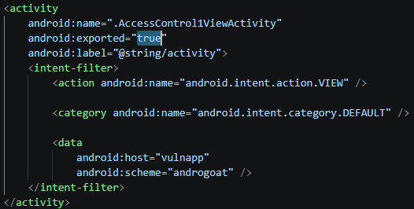</span></figure>
<p></p>
<p data-ke-size="size16"> </p>
<p data-ke-size="size16">AccessControl1ViewActivity.kt를 분석해보겠습니다.</p>
<p data-ke-size="size16">해당 코드를 보면 Android 앱 버튼을 누르면 Invoice(청구서)를 다운로드합니다.</p>
<p></p><figure class="imageblock alignCenter" data-ke-mobilestyle="widthOrigin" data-origin-height="176" data-origin-width="633"><span>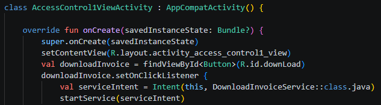</span></figure>
<p></p>
<p data-ke-size="size16">해당 코드만 이 문제의 핵심은 아닌 거 같아서 다른 파일을 더 찾아봤습니다.</p>
<p data-ke-size="size16"> </p>
<p data-ke-size="size16">vscode에서 전체 검색으로 AccessControl1ViewActivity를 검색해보니 해당 액티비티를 불러오는 또 다른 코드가 있었습니다.</p>
<p data-ke-size="size16"> </p>
<p data-ke-size="size16">AccessControlIssue1Activity.kt 코드의 isPinCorrect에서 사용자가 입력한 비밀번호가 일치하는지 검증하고 일치하지 않으면 "Incorrect PIN entered"를 출력하고 일치하면 현재 AccessControlIssue1Activity에서 AccessControl1ViewActivity로 이동합니다.</p>
<p></p><figure class="imageblock alignCenter" data-ke-mobilestyle="widthOrigin" data-origin-height="324" data-origin-width="758"><span>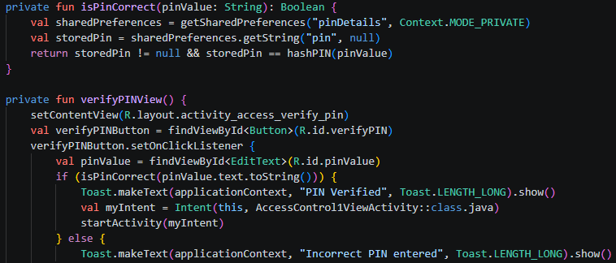</span></figure>
<p></p>
<p data-ke-size="size16">AccessControl1ViewActivity의 exported는 true이기에 Intent를 보내 비밀번호 검증을 우회하여 Invoice를 다운로드하는 Activity에 접근할 수 있을 거라고 생각했습니다.</p>
<p data-ke-size="size16"> </p>
<p data-ke-size="size16">안드로이드 스튜디오에서 터미널을 열어 adb 명령어를 실행했습니다.</p>
<p data-ke-size="size16">명시적 intent를 호출하기 위해 입력한 명령어는 다음과 같습니다.</p>
<pre class="bash" data-ke-language="bash" data-ke-type="codeblock" id="code_1791015795221"><code class="hljs">adb shell am start -n owasp.sat.agoat/.AccessControl1ViewActivity</code></pre>
<p data-ke-size="size16"> </p>
<p></p><figure class="imageblock alignCenter" data-ke-mobilestyle="widthOrigin" data-origin-height="48" data-origin-width="1243"><span>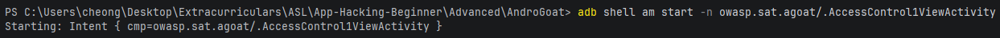</span></figure>
<p></p>
<p data-ke-size="size16">명령어를 실행하면 원래는 PIN이 일치해야 보이는 Invoice 화면이 노출됩니다.</p>
<p></p><figure class="imageblock alignCenter" data-filename="blob" data-ke-mobilestyle="widthOrigin" data-origin-height="188" data-origin-width="404"><span>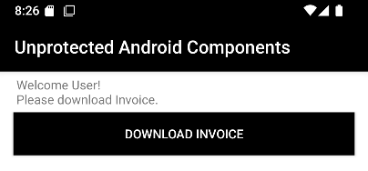</span></figure>
<p></p>
<p data-ke-size="size16"> </p>
<p data-ke-size="size16">또한 매니페스트 코드를 보면 intent filter도 선언되어 있습니다.</p>
<p></p><figure class="imageblock alignCenter" data-ke-mobilestyle="widthOrigin" data-origin-height="266" data-origin-width="526"><span></span></figure>
<p></p>
<p data-ke-size="size16">따라서 명시적 Intent 말고도 URI를 통해 암시적 Intent 호출도 가능합니다.</p>
<p data-ke-size="size16">android:host="vulnapp"이고, android:scheme="androgoat"이므로 암시적 Intent를 호출하는 명령어는 다음과 같습니다.</p>
<pre class="bash" data-ke-language="bash" data-ke-type="codeblock" id="code_1791077478127"><code class="hljs">adb shell am start -a android.intent.action.VIEW -d <span class="hljs-string">"androgoat://vulnapp"</span> owasp.sat.agoat</code></pre>
<p></p><figure class="imageblock alignCenter" data-ke-mobilestyle="widthOrigin" data-origin-height="55" data-origin-width="1276"><span>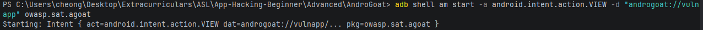</span></figure>
<p></p>
<p data-ke-size="size16"> </p>
<p></p><figure class="imageblock alignCenter" data-ke-mobilestyle="widthOrigin" data-origin-height="118" data-origin-width="237"><span>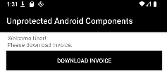</span></figure>
<p></p>
<p data-ke-size="size16">외부에서 AccessControl1ViewActivity를 직접 실행하여 PIN 검증이 생략되고, Invoice 화면이 노출되는 문제였습니다.</p>
<h4 data-ke-size="size20">1-1. 입력 -&gt; 처리 -&gt; 민감 동작</h4>
<table border="1" data-ke-align="alignLeft" data-ke-style="style14" style="border-collapse: collapse; width: 100%;">
<tbody>
<tr>
<td style="width: 9.88371%; text-align: center;">구분</td>
<td style="width: 90.1163%; text-align: center;">내용</td>
</tr>
<tr>
<td style="width: 9.88371%; text-align: center;">입력</td>
<td style="width: 90.1163%; text-align: center;">외부 앱 또는 adb로 AccessControl1ViewActivity에 Intent 전달</td>
</tr>
<tr>
<td style="width: 9.88371%; text-align: center;">처리</td>
<td style="width: 90.1163%; text-align: center;">exported=true인 Activity를 외부 호출 대상으로 해석하여 PIN 검증 X</td>
</tr>
<tr>
<td style="width: 9.88371%; text-align: center;">민감 동작</td>
<td style="width: 90.1163%; text-align: center;">PIN 검증 후 보여야 할 즉, 보호되어야 할 Invoice 화면 노출 -&gt; 사용자가 DOWNLOAD INVOICE 버튼을 클릭하면 DownloadInvoiceService 실행 -&gt; Invoice 다운로드</td>
</tr>
</tbody>
</table>
<p data-ke-size="size16"> </p>
<h4 data-ke-size="size20">1-2. 별도 시험 앱을 이용한 일반 UID 검증</h4>
<p data-ke-size="size16">일반 앱 조건을 확인하기 위해 별도의 시험 앱을 제작했습니다.</p>
<p data-ke-size="size16"> </p>
<p data-ke-size="size16">시험 앱은 root 권한이 없는 일반 UID를 가진 앱입니다.</p>
<p data-ke-size="size16">안드로이드 UID 분류는 다음과 같습니다.</p>
<p data-ke-size="size16"> </p>
<p data-ke-size="size16">1. root (UID 0)</p>
<p data-ke-size="size16">2. system (UID 1000)</p>
<p data-ke-size="size16">3. shell (UID 2000)</p>
<p data-ke-size="size16">4. 일반 UID (UID 10121 등)</p>
<p data-ke-size="size16"> </p>
<p data-ke-size="size16">뒤에 패치할 취약점 또한 이 시험 앱을 통해 패치되었는지 검증하기 위해 기능을 총 세 가지 넣었습니다.</p>
<p data-ke-size="size16">시험 앱 기능은 다음과 같습니다.</p>
<table border="1" data-ke-align="alignLeft" data-ke-style="style14" style="border-collapse: collapse; width: 100%;">
<tbody>
<tr>
<td style="width: 43.3721%; text-align: center;">버튼</td>
<td style="width: 56.6279%; text-align: center;">기능</td>
</tr>
<tr>
<td style="width: 43.3721%; text-align: center;">1-1. 명시적 Intent 호출</td>
<td style="width: 56.6279%; text-align: center;">컴포넌트명을 직접 지정하여 AccessControlViewActivity 실행 시도</td>
</tr>
<tr>
<td style="width: 43.3721%; text-align: center;">1-2. 암시적 Intent 호출</td>
<td style="width: 56.6279%; text-align: center;">ACTION_VIEW와 androgoat://vulnapp URI 전달</td>
</tr>
<tr>
<td style="width: 43.3721%; text-align: center;">2. SharedPreferences 파일 read</td>
<td style="width: 56.6279%; text-align: center;">AndroGoat의 users.xml 파일 직접 읽기</td>
</tr>
</tbody>
</table>
<p data-ke-size="size16"> </p>
<p data-ke-size="size16">AndroidManifest.xml</p>
<pre class="bash" data-ke-language="bash" data-ke-type="codeblock" id="code_1791716296891"><code class="hljs">&lt;?xml version=<span class="hljs-string">"1.0"</span> encoding=<span class="hljs-string">"utf-8"</span>?&gt;
&lt;manifest xmlns:android=<span class="hljs-string">"http://schemas.android.com/apk/res/android"</span>&gt;

    &lt;queries&gt;
        &lt;package android:name=<span class="hljs-string">"owasp.sat.agoat"</span> /&gt;

        &lt;intent&gt;
            &lt;action android:name=<span class="hljs-string">"android.intent.action.VIEW"</span> /&gt;
            &lt;data
                android:host=<span class="hljs-string">"vulnapp"</span>
                android:scheme=<span class="hljs-string">"androgoat"</span> /&gt;
        &lt;/intent&gt;
    &lt;/queries&gt;

    &lt;application
        android:allowBackup=<span class="hljs-string">"false"</span>
        android:label=<span class="hljs-string">"@string/app_name"</span>
        android:supportsRtl=<span class="hljs-string">"true"</span>
        android:theme=<span class="hljs-string">"@android:style/Theme.Material.Light.NoActionBar"</span>&gt;

        &lt;activity
            android:name=<span class="hljs-string">".MainActivity"</span>
            android:exported=<span class="hljs-string">"true"</span>&gt;
            &lt;intent-filter&gt;
                &lt;action android:name=<span class="hljs-string">"android.intent.action.MAIN"</span> /&gt;
                &lt;category android:name=<span class="hljs-string">"android.intent.category.LAUNCHER"</span> /&gt;
            &lt;/intent-filter&gt;
        &lt;/activity&gt;

    &lt;/application&gt;

&lt;/manifest&gt;
```</code></pre>
<p data-ke-size="size16"> </p>
<p data-ke-size="size16">1-1. 명시적 Intent 호출 기능 </p>
<pre class="kotlin" data-ke-language="kotlin" data-ke-type="codeblock" id="code_1791716326811"><code class="hljs"><span class="hljs-keyword">private</span> <span class="hljs-function"><span class="hljs-keyword">fun</span> <span class="hljs-title">launchExplicitActivity</span><span class="hljs-params">()</span></span> {
    <span class="hljs-keyword">val</span> intent = Intent().apply {
        component = ComponentName(
            <span class="hljs-string">"owasp.sat.agoat"</span>,
            <span class="hljs-string">"owasp.sat.agoat.AccessControl1ViewActivity"</span>
        )
    }

    <span class="hljs-keyword">try</span> {
        startActivity(intent)
    } <span class="hljs-keyword">catch</span> (exception: SecurityException) {
        showBlocked(<span class="hljs-string">"1-1 명시적 Intent"</span>, exception)
    } <span class="hljs-keyword">catch</span> (exception: ActivityNotFoundException) {
        showBlocked(<span class="hljs-string">"1-1 명시적 Intent"</span>, exception)
    }
}</code></pre>
<p data-ke-size="size16"> </p>
<p data-ke-size="size16">1-2. 암시적 intent 호출 기능</p>
<pre class="kotlin" data-ke-language="kotlin" data-ke-type="codeblock" id="code_1791716356905"><code class="hljs"><span class="hljs-keyword">private</span> <span class="hljs-function"><span class="hljs-keyword">fun</span> <span class="hljs-title">launchImplicitActivity</span><span class="hljs-params">()</span></span> {
    <span class="hljs-keyword">val</span> intent = Intent(
        Intent.ACTION_VIEW,
        Uri.parse(<span class="hljs-string">"androgoat://vulnapp"</span>)
    ).apply {
        setPackage(<span class="hljs-string">"owasp.sat.agoat"</span>)
    }

    <span class="hljs-keyword">try</span> {
        startActivity(intent)
    } <span class="hljs-keyword">catch</span> (exception: SecurityException) {
        showBlocked(<span class="hljs-string">"1-2 암시적 Intent"</span>, exception)
    } <span class="hljs-keyword">catch</span> (exception: ActivityNotFoundException) {
        showBlocked(<span class="hljs-string">"1-2 암시적 Intent"</span>, exception)
    }
}</code></pre>
<p data-ke-size="size16"> </p>
<p data-ke-size="size16">2. SharedPreferences 파일 읽기 기능</p>
<pre class="kotlin" data-ke-language="kotlin" data-ke-type="codeblock" id="code_1791716378415"><code class="hljs"><span class="hljs-keyword">private</span> <span class="hljs-function"><span class="hljs-keyword">fun</span> <span class="hljs-title">readTargetPreferences</span><span class="hljs-params">()</span></span> {
    <span class="hljs-keyword">try</span> {
        <span class="hljs-keyword">val</span> content = FileInputStream(
            <span class="hljs-string">"/data/user/0/owasp.sat.agoat/shared_prefs/users.xml"</span>
        ).bufferedReader().use { it.readText() }

        showResult(
            title = <span class="hljs-string">"2 파일 읽기 성공"</span>,
            detail = content
        )
    } <span class="hljs-keyword">catch</span> (exception: Exception) {
        showResult(
            title = <span class="hljs-string">"2 파일 읽기 거부됨"</span>,
            detail = buildString {
                appendLine(<span class="hljs-string">"예외: <span class="hljs-subst">${exception.javaClass.name}</span>"</span>)
                appendLine(<span class="hljs-string">"메시지: <span class="hljs-subst">${exception.message}</span>"</span>)
            }
        )
    }
}</code></pre>
<p data-ke-size="size16"> </p>
<p data-ke-size="size16">별도 시험 앱으로 명시적 Intent와 암시적 Intent를 전송해보겠습니다.</p>
<p data-ke-size="size16">명시적 Intent를 전송하는 코드입니다. TARGET_PACKAGE와 TARGET_ACTIVITY에는 AndroGoat의 패키지명(owasp.sat.agoat)과 액티비티명(owasp.sat.agoat.AccessControl1ViewActivity)이 들어갑니다.</p>
<p></p><figure class="imageblock alignCenter" data-ke-mobilestyle="widthOrigin" data-origin-height="487" data-origin-width="652"><span>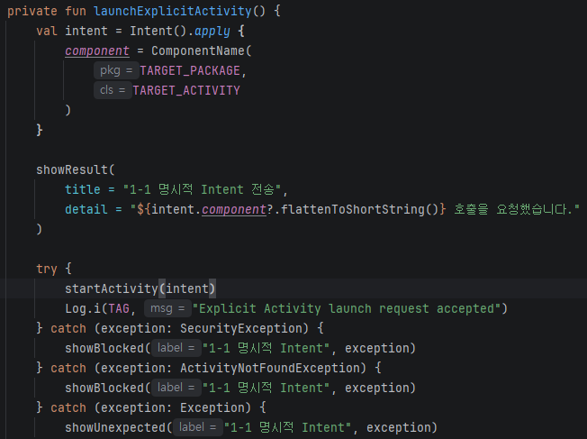</span></figure>
<p></p>
<p data-ke-size="size16">시험 앱의 1-1. 명시적 Intent 호출 버튼을 눌러보겠습니다.</p>
<p></p><figure class="imageblock alignCenter" data-ke-mobilestyle="widthOrigin" data-origin-height="304" data-origin-width="392"><span>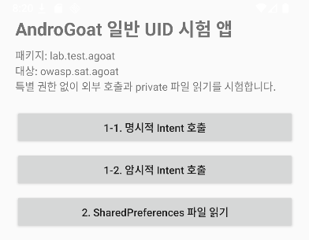</span></figure>
<p></p>
<p data-ke-size="size16">버튼을 누르면 AndroGoat의 Invoice 다운로드 창으로 이동합니다.</p>
<p></p><figure class="imageblock alignCenter" data-ke-mobilestyle="widthOrigin" data-origin-height="174" data-origin-width="389"><span>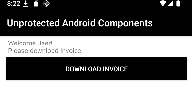</span></figure>
<p></p>
<p data-ke-size="size16">암시적 Intent도 전송해보겠습니다.</p>
<p data-ke-size="size16">시험 앱에서 암시적 Intent를 전송하는 코드입니다.</p>
<p data-ke-size="size16">ACTION_VIEW와 TARGET_DEEP_LINK에는 AndroGoat의 스킴(androgoat)과 URI(vulnapp)가 들어갑니다.</p>
<p></p><figure class="imageblock alignCenter" data-ke-mobilestyle="widthOrigin" data-origin-height="205" data-origin-width="580"><span>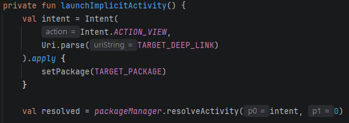</span></figure>
<p></p>
<p data-ke-size="size16"> </p>
<p data-ke-size="size16">1-2. 암시적 Intent 호출 버튼을 눌러보겠습니다.</p>
<p></p><figure class="imageblock alignCenter" data-ke-mobilestyle="widthOrigin" data-origin-height="435" data-origin-width="388"><span>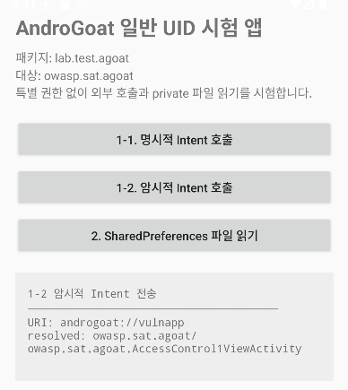</span></figure>
<p></p>
<p data-ke-size="size16">Invoice 다운로드 화면으로 넘어갑니다.</p>
<p></p><figure class="imageblock alignCenter" data-ke-mobilestyle="widthOrigin" data-origin-height="178" data-origin-width="389"><span>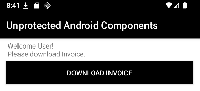</span></figure>
<p></p>
<p data-ke-size="size16"> </p>
<table border="1" data-ke-align="alignLeft" data-ke-style="style14" style="border-collapse: collapse; width: 100%; height: 76px;">
<tbody>
<tr style="height: 21px;">
<td style="width: 13.2558%; text-align: center; height: 21px;">시험 주체</td>
<td style="width: 9.8837%; text-align: center; height: 21px;">권한</td>
<td style="width: 18.0232%; text-align: center; height: 21px;">외부 호출 가능성</td>
<td style="width: 20.1163%; text-align: center; height: 21px;">파일 읽기 가능성</td>
<td style="width: 21.3953%; text-align: center; height: 21px;">필요한 사전 조건</td>
</tr>
<tr style="height: 21px;">
<td style="width: 13.2558%; text-align: center; height: 21px;">lab.test.agoat</td>
<td style="width: 9.8837%; text-align: center; height: 21px;">일반 UID</td>
<td style="width: 18.0232%; text-align: center; height: 21px;">명시적/암시적 Intent 모두 호출 가능</td>
<td style="width: 20.1163%; text-align: center; height: 21px;">해당 없음</td>
<td style="width: 21.3953%; text-align: center; height: 21px;">AndroGoat와 같은 AVD에 설치, AndroGoat와 서로 다른 UID, 패키지명 액티비티명 등 파악</td>
</tr>
<tr style="height: 17px;">
<td style="width: 13.2558%; text-align: center; height: 17px;">adb shell</td>
<td style="width: 9.8837%; text-align: center; height: 17px;">UID 2000</td>
<td style="width: 18.0232%; text-align: center; height: 17px;">am start를 통해 명시적/암시적 Intent 모두 호출 가능</td>
<td style="width: 20.1163%; text-align: center; height: 17px;">해당 없음</td>
<td style="width: 21.3953%; text-align: center; height: 17px;">USB debugging 승인 및 adb 연결</td>
</tr>
<tr style="height: 17px;">
<td style="width: 13.2558%; text-align: center; height: 17px;">adb root</td>
<td style="width: 9.8837%; text-align: center; height: 17px;">UID 0</td>
<td style="width: 18.0232%; text-align: center; height: 17px;">호출 가능</td>
<td style="width: 20.1163%; text-align: center; height: 17px;">해당 없음</td>
<td style="width: 21.3953%; text-align: center; height: 17px;">AOSP userdebug AVD</td>
</tr>
</tbody>
</table>
<p data-ke-size="size16"> </p>
<h4 data-ke-size="size20">1-3. 소스 코드 수정</h4>
<p data-ke-size="size16">외부에서 호출할 필요가 없는 AccessControl1ViewActivity가 android:exported=true로 설정되어 있어 취약점이 발생했습니다.</p>
<p data-ke-size="size16"> </p>
<p data-ke-size="size16">수정 전 매니페스트 코드는 다음과 같습니다.</p>
<p></p><figure class="imageblock alignCenter" data-ke-mobilestyle="widthOrigin" data-origin-height="311" data-origin-width="548"><span>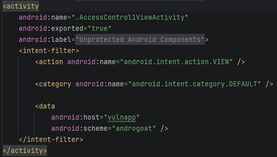</span></figure>
<p></p>
<p data-ke-size="size16">exported=false로 설정해도 명시적 Intent와 암시적 Intent를 호출할 수 없으나 intent filter를 남겨두면 androgoat://vulnapp 에 사용하지 않는 URI 진입점이 남게 되므로 불필요한 외부 진입점과 공격 표면을 전부 삭제했습니다.</p>
<table border="1" data-ke-align="alignLeft" data-ke-style="style14" style="border-collapse: collapse; width: 100%; height: 59px;">
<tbody>
<tr style="height: 21px;">
<td style="width: 50%; height: 21px; text-align: center;">수정 전</td>
<td style="width: 50%; height: 21px; text-align: center;">수정 후</td>
</tr>
<tr style="height: 17px;">
<td style="width: 50%; height: 17px; text-align: center;">android:exported="true"</td>
<td style="width: 50%; height: 17px; text-align: center;">android:exported="false"</td>
</tr>
<tr style="height: 21px;">
<td style="width: 50%; height: 21px; text-align: center;">intent-filter 존재</td>
<td style="width: 50%; height: 21px; text-align: center;">intent-filter 삭제</td>
</tr>
</tbody>
</table>
<p data-ke-size="size16"> </p>
<p data-ke-size="size16">수정한 AndroidManifest.xml 코드 일부</p>
<pre class="kotlin" data-ke-language="kotlin" data-ke-type="codeblock" id="code_1791198659229"><code class="hljs">&lt;activity
            android:name=<span class="hljs-string">".AccessControlIssue1Activity"</span>
            android:label=<span class="hljs-string">"@string/activity"</span> /&gt;

        &lt;activity
            android:name=<span class="hljs-string">".AccessControl1ViewActivity"</span>
            android:exported=<span class="hljs-string">"false"</span>
            android:label=<span class="hljs-string">"@string/activity"</span> /&gt;</code></pre>
<h3 data-ke-size="size23">2. Insecure Data Storage - Shared Prefs - 1</h3>
<p data-ke-size="size16">문제 코드인 InsecureStorageSharedPrefs.kt를 보겠습니다.</p>
<p data-ke-size="size16">다음 부분을 보면 SharedPreferences로 사용자가 입력한 username과 password를 키-값 형태로 로컬에 저장합니다.</p>
<p></p><figure class="imageblock alignCenter" data-ke-mobilestyle="widthOrigin" data-origin-height="151" data-origin-width="617"><span>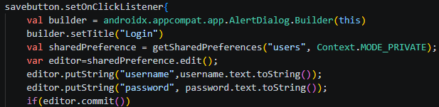</span></figure>
<p></p>
<p data-ke-size="size16">getSharedPreferences는 첫 번째 인자로 들어온 문자열을 파일명으로 저장하며 파일은 /data/data/&lt;패키지명&gt;/shared_prefs/&lt;파일명&gt; 경로에 저장됩니다.</p>
<p data-ke-size="size16"> </p>
<p data-ke-size="size16">안드로이드 스튜디오에서 확인해보겠습니다.</p>
<p data-ke-size="size16">username과 password에 값을 입력하고 VERIFY 버튼을 눌렀습니다.</p>
<p></p><figure class="imageblock alignCenter" data-ke-mobilestyle="widthOrigin" data-origin-height="310" data-origin-width="238"><span>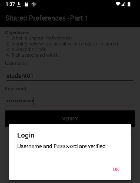</span></figure>
<p></p>
<p data-ke-size="size16"> </p>
<p data-ke-size="size16">그 후 Device Explorer에서 파일이 저장된 경로를 찾았습니다.</p>
<p data-ke-size="size16">/data/data/owasp.sat.agoat/shared_prefs/users.xml</p>
<p></p><figure class="imageblock alignCenter" data-filename="스크린샷 2026-10-04 102323.png" data-ke-mobilestyle="widthOrigin" data-origin-height="300" data-origin-width="236"><span>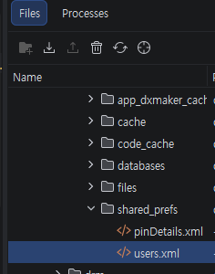</span></figure>
<p></p>
<p data-ke-size="size16">사용자가 입력한 값이 users.xml에 평문으로 저장되어 있습니다.</p>
<p></p><figure class="imageblock alignCenter" data-ke-mobilestyle="widthOrigin" data-origin-height="111" data-origin-width="464"><span>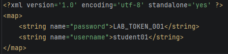</span></figure>
<p></p>
<h4 data-ke-size="size20">2-1. 입력 -&gt; 처리 -&gt; 민감 동작</h4>
<table border="1" data-ke-align="alignLeft" data-ke-style="style14" style="border-collapse: collapse; width: 100%;">
<tbody>
<tr>
<td style="width: 9.88371%; text-align: center;">구분</td>
<td style="width: 90.1163%; text-align: center;">내용</td>
</tr>
<tr>
<td style="width: 9.88371%; text-align: center;">입력</td>
<td style="width: 90.1163%; text-align: center;">username에 student01, password에 LAB_TOKEN_001 입력</td>
</tr>
<tr>
<td style="width: 9.88371%; text-align: center;">처리</td>
<td style="width: 90.1163%; text-align: center;">사용자가 입력한 문자열을 그대로 받아 users.xml 키-값 형태로 저장</td>
</tr>
<tr>
<td style="width: 9.88371%; text-align: center;">민감 동작</td>
<td style="width: 90.1163%; text-align: center;">users.xml에 username과 password를 평문 문자열로 영구 저장</td>
</tr>
</tbody>
</table>
<p data-ke-size="size16"> </p>
<h4 data-ke-size="size20">2-2. 별도 시험 앱을 통한 UID 검증</h4>
<p data-ke-size="size16">일반 UID가 할 수 있는 동작과 adb/root로만 보이는 데이터를 분리하겠습니다.</p>
<p data-ke-size="size16"> </p>
<p data-ke-size="size16">adb에서 권한을 root로 전환하였습니다.</p>
<p></p><figure class="imageblock alignCenter" data-ke-mobilestyle="widthOrigin" data-origin-height="41" data-origin-width="792"><span>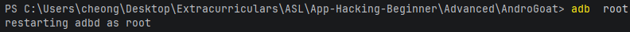</span></figure>
<p></p>
<p data-ke-size="size16"> id를 확인해보니 root 권한인 걸 알 수 있습니다.</p>
<p></p><figure class="imageblock alignCenter" data-ke-mobilestyle="widthOrigin" data-origin-height="57" data-origin-width="1268"><span>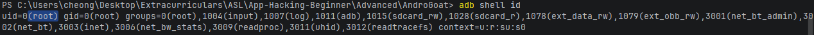</span></figure>
<p></p>
<p data-ke-size="size16">/data/data/owasp.sat.agoat/shared_prefs/users.xml의 파일을 cat 명령어로 출력하였습니다.</p>
<pre class="kotlin" data-ke-language="kotlin" data-ke-type="codeblock" id="code_1791079074547"><code class="hljs">adb shell cat /<span class="hljs-keyword">data</span>/<span class="hljs-keyword">data</span>/owasp.sat.agoat/shared_prefs/users.xml</code></pre>
<p></p><figure class="imageblock alignCenter" data-ke-mobilestyle="widthOrigin" data-origin-height="130" data-origin-width="1223"><span>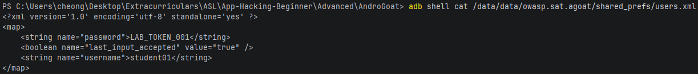</span></figure>
<p></p>
<p data-ke-size="size16">adb shell cat /data/user/0/owasp.sat.agoat/shared_prefs/users.xml로도 볼 수 있다고 합니다.</p>
<p data-ke-size="size16"> </p>
<p data-ke-size="size16">root 권한이 아닐 때도 한 번 해당 파일을 출력해보겠습니다.</p>
<p data-ke-size="size16"> </p>
<p data-ke-size="size16">adb unroot를 하여 root 권한을 해제했습니다.</p>
<p></p><figure class="imageblock alignCenter" data-ke-mobilestyle="widthOrigin" data-origin-height="103" data-origin-width="1270"><span>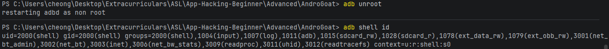</span></figure>
<p></p>
<p data-ke-size="size16">그리고 동일한 파일을 읽으려고 하니 Permission denied이 떴습니다.</p>
<p></p><figure class="imageblock alignCenter" data-ke-mobilestyle="widthOrigin" data-origin-height="41" data-origin-width="1232"><span>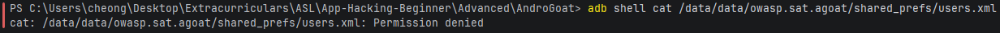</span></figure>
<p></p>
<p data-ke-size="size16"> </p>
<p data-ke-size="size16">시험 앱에서 users.xml 파일을 읽는 코드입니다.</p>
<p data-ke-size="size16">TARGET_PREFS_PATH에 users.xml 파일 경로가 들어갑니다.</p>
<p></p><figure class="imageblock alignCenter" data-ke-mobilestyle="widthOrigin" data-origin-height="658" data-origin-width="646"><span>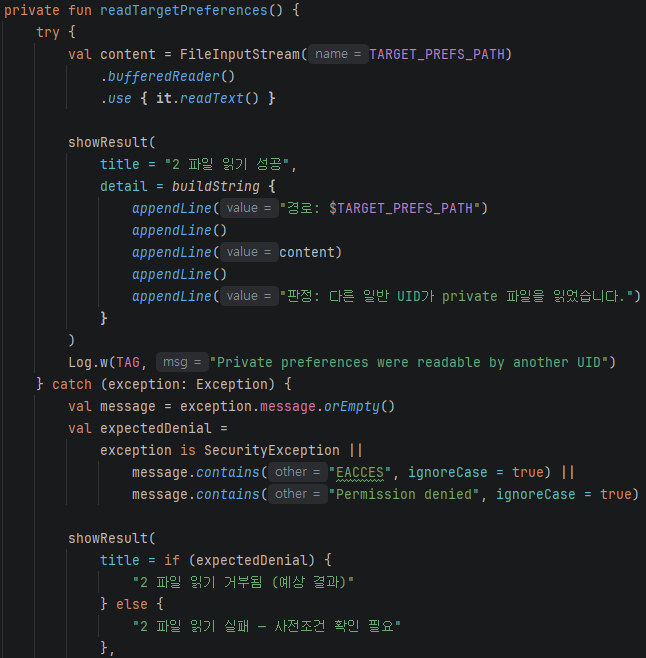</span></figure>
<p></p>
<p data-ke-size="size16">2. SharedPreferences 파일 읽기 버튼을 눌러보겠습니다.</p>
<p></p><figure class="imageblock alignCenter" data-ke-mobilestyle="widthOrigin" data-origin-height="316" data-origin-width="404"><span>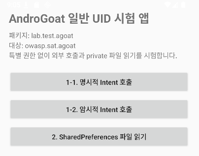</span></figure>
<p></p>
<p data-ke-size="size16">별도 시험 앱의 UID는 AndroGoat와 다른 일반 UID를 사용하므로 AndroGoat에서 SharedPreferences로 생성된 파일에 접근할 수 없었습니다.</p>
<p></p><figure class="imageblock alignCenter" data-ke-mobilestyle="widthOrigin" data-origin-height="160" data-origin-width="360"><span>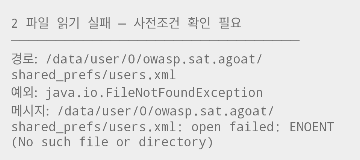</span></figure>
<p></p>
<table border="1" data-ke-align="alignLeft" data-ke-style="style14" style="border-collapse: collapse; width: 100%; height: 76px;">
<tbody>
<tr>
<td style="background-color: #008300; color: #ffffff; text-align: center; width: 13.4884%;">시험 주체</td>
<td style="background-color: #008300; color: #ffffff; text-align: center; width: 10.4651%;">권한</td>
<td style="background-color: #008300; color: #ffffff; text-align: center; width: 17.442%;">외부 호출 가능성</td>
<td style="background-color: #008300; color: #ffffff; text-align: center; width: 24.7673%;">파일 읽기 가능성</td>
<td style="background-color: #008300; color: #ffffff; text-align: center; width: 33.7209%;">필요한 사전 조건</td>
</tr>
<tr>
<td style="background-color: #efefef; text-align: center; width: 13.4884%;">lab.test.agoat</td>
<td style="text-align: center; width: 10.4651%;">일반 UID</td>
<td style="text-align: center; width: 17.442%;">해당 없음</td>
<td style="text-align: center; width: 24.7673%;">불가능, EACCES</td>
<td style="text-align: center; width: 33.7209%;">AndroGoat와 같은 AVD에 설치, AndroGoat와 서로 다른 UID, users.xml 미리 생성</td>
</tr>
<tr>
<td style="background-color: #efefef; text-align: center; width: 13.4884%;">adb shell</td>
<td style="background-color: #f9f9f9; text-align: center; width: 10.4651%;">UID 2000</td>
<td style="background-color: #f9f9f9; text-align: center; width: 17.442%;">해당 없음</td>
<td style="background-color: #f9f9f9; text-align: center; width: 24.7673%;">불가능, Permission denied</td>
<td style="background-color: #f9f9f9; text-align: center; width: 33.7209%;">USB debugging 승인, users.xml 미리 생성</td>
</tr>
<tr>
<td style="background-color: #efefef; text-align: center; width: 13.4884%;">adb root</td>
<td style="text-align: center; width: 10.4651%;">UID 0</td>
<td style="text-align: center; width: 17.442%;">해당 없음</td>
<td style="text-align: center; width: 24.7673%;">평문 확인 가능</td>
<td style="text-align: center; width: 33.7209%;">AOSP userdebug AVD, users.xml 미리 생성</td>
</tr>
</tbody>
</table>
<p data-ke-size="size16"> </p>
<h4 data-ke-size="size20">2-3. 소스 코드 수정</h4>
<p data-ke-size="size16">기존 코드에선 username과 password를 평문 그대로 저장하는 취약점이었습니다. 사용자의 민감 정보가 평문으로 저장되기에 평문을 암호화하여 저장하는 방향으로 수정해야겠다고 생각했습니다.</p>
<p data-ke-size="size16"> </p>
<p data-ke-size="size16">그러나 코드엔 사용자가 입력한 값을 기존 계정 정보와 비교하거나 하는... 그런 형식의 사용자 입력값을 다시 사용하는 기능이 없었습니다. 그렇다면 평문을 암호화하여 저장하는 것이 아니라 애초부터 입력값을 저장하지 않는 방향이 나을 거라고 판단했습니다. (제 판단이 이 과제가 의도한 바인지는 모르겠지만...)</p>
<p data-ke-size="size16"> </p>
<table border="1" data-ke-align="alignLeft" data-ke-style="style14" style="border-collapse: collapse; width: 100%;">
<tbody>
<tr>
<td style="width: 50%; text-align: center;">수정 전</td>
<td style="width: 50%; text-align: center;">수정 후</td>
</tr>
<tr>
<td style="width: 50%; text-align: center;">username과 password를 키-값 형태로 저장</td>
<td style="width: 50%; text-align: center;">username과 password 저장 X</td>
</tr>
<tr>
<td style="width: 50%; text-align: center;">root에서 입력값이 평문으로 저장된 파일 확인 가능</td>
<td style="width: 50%; text-align: center;">평문으로 된 입력값 X</td>
</tr>
</tbody>
</table>
<p data-ke-size="size16"> </p>
<p data-ke-size="size16">수정한 InsecureStorageSharedPrefs.kt 전체 코드</p>
<pre class="kotlin" data-ke-language="kotlin" data-ke-type="codeblock" id="code_1791198590950"><code class="hljs"><span class="hljs-keyword">package</span> owasp.sat.agoat

<span class="hljs-keyword">import</span> android.content.Context
<span class="hljs-keyword">import</span> android.os.Bundle
<span class="hljs-keyword">import</span> android.widget.Button
<span class="hljs-keyword">import</span> android.widget.EditText
<span class="hljs-keyword">import</span> android.widget.Toast
<span class="hljs-keyword">import</span> androidx.appcompat.app.AppCompatActivity

<span class="hljs-class"><span class="hljs-keyword">class</span> <span class="hljs-title">InsecureStorageSharedPrefs</span> : <span class="hljs-type">AppCompatActivity</span></span>() {

    <span class="hljs-keyword">private</span> <span class="hljs-keyword">val</span> preferences <span class="hljs-keyword">by</span> lazy {
        getSharedPreferences(<span class="hljs-string">"users"</span>, Context.MODE_PRIVATE)
    }

    <span class="hljs-keyword">override</span> <span class="hljs-function"><span class="hljs-keyword">fun</span> <span class="hljs-title">onCreate</span><span class="hljs-params">(savedInstanceState: <span class="hljs-type">Bundle</span>?)</span></span> {
        <span class="hljs-keyword">super</span>.onCreate(savedInstanceState)
        setContentView(R.layout.activity_insecure_storage_shared_prefs)

        preferences.edit()
            .remove(<span class="hljs-string">"username"</span>)
            .remove(<span class="hljs-string">"password"</span>)
            .apply()

        <span class="hljs-keyword">val</span> saveButton = findViewById&lt;Button&gt;(R.id.SPViewButton)
        <span class="hljs-keyword">val</span> username = findViewById&lt;EditText&gt;(R.id.userName)
        <span class="hljs-keyword">val</span> password = findViewById&lt;EditText&gt;(R.id.password)

        saveButton.setOnClickListener {
            <span class="hljs-keyword">val</span> builder = androidx.appcompat.app.AlertDialog.Builder(<span class="hljs-keyword">this</span>)
            builder.setTitle(<span class="hljs-string">"Login"</span>)

            <span class="hljs-keyword">val</span> usernameValue = username.text.toString()
            <span class="hljs-keyword">val</span> tokenValue = password.text.toString()

            <span class="hljs-keyword">if</span> (usernameValue.isBlank() || tokenValue.isBlank()) {
                builder.setMessage(<span class="hljs-string">"Username and token are required"</span>)

                Toast.makeText(
                    applicationContext,
                    <span class="hljs-string">"Username and token are required"</span>,
                    Toast.LENGTH_LONG
                ).show()
            } <span class="hljs-keyword">else</span> {

                preferences.edit()
                    .clear()
                    .putBoolean(<span class="hljs-string">"last_input_accepted"</span>, <span class="hljs-literal">true</span>)
                    .apply()

                builder.setMessage(
                    <span class="hljs-string">"Input accepted; credentials were not stored"</span>
                )

                Toast.makeText(
                    applicationContext,
                    <span class="hljs-string">"Input accepted; credentials were not stored"</span>,
                    Toast.LENGTH_LONG
                ).show()
            }

            builder.setPositiveButton(<span class="hljs-string">"OK"</span>) { dialog, _ -&gt;
                dialog.dismiss()
            }

            <span class="hljs-keyword">val</span> dialog = builder.create()
            dialog.show()
        }
    }
}</code></pre>
<h4 data-ke-size="size20">3. 수정 후 회귀시험</h4>
<p data-ke-size="size16">우선 각 취약점 패치 후 취약점이 제대로 패치되었는지 검증해봤습니다.</p>
<p data-ke-size="size16"> </p>
<p data-ke-size="size16">외부 노출 Activity 문제에서 명시적 Intent를 호출해봤습니다.</p>
<p></p><figure class="imageblock alignCenter" data-ke-mobilestyle="widthOrigin" data-origin-height="415" data-origin-width="1608"><span>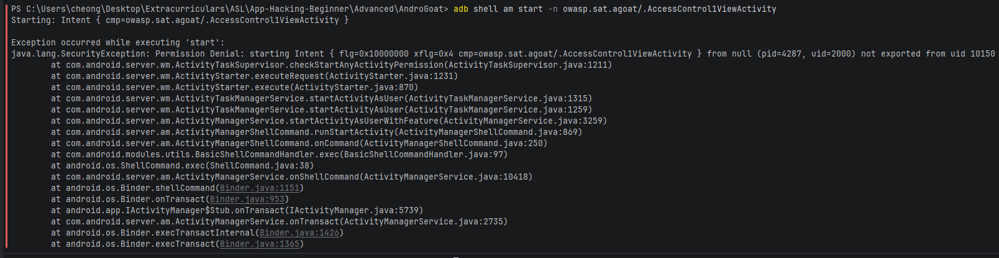</span></figure>
<p></p>
<p data-ke-size="size16">exported가 false이므로 차단되었습니다.</p>
<p data-ke-size="size16"> </p>
<p data-ke-size="size16">암시적 Intent 또한 차단되었습니다.</p>
<p></p><figure class="imageblock alignCenter" data-ke-mobilestyle="widthOrigin" data-origin-height="74" data-origin-width="1446"><span>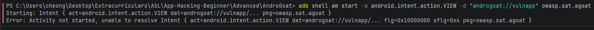</span></figure>
<p></p>
<p data-ke-size="size16">시험 앱에서 명시적 Intent 호출 버튼을 눌렀을 때도 차단되었고,</p>
<p></p><figure class="imageblock alignCenter" data-ke-mobilestyle="widthOrigin" data-origin-height="456" data-origin-width="392"><span>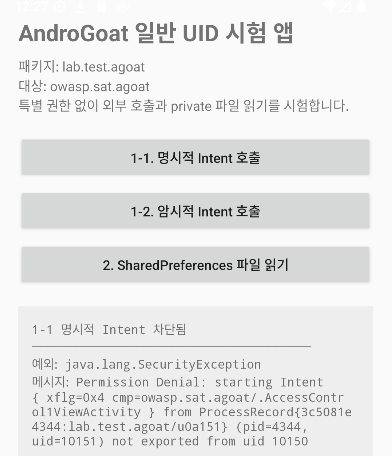</span></figure>
<p></p>
<p data-ke-size="size16">암시적 Intent 또한 차단되었음을 확인했습니다.</p>
<p></p><figure class="imageblock alignCenter" data-ke-mobilestyle="widthOrigin" data-origin-height="404" data-origin-width="391"><span>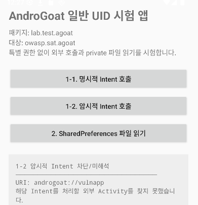</span></figure>
<p></p>
<p data-ke-size="size16" style="color: #333333; text-align: start;">외부 노출 Activity 취약점 패치 후 커밋</p>
<p></p><figure class="imageblock alignCenter" data-filename="스크린샷 2026-10-04 213518.png" data-ke-mobilestyle="widthOrigin" data-origin-height="90" data-origin-width="1099"><span>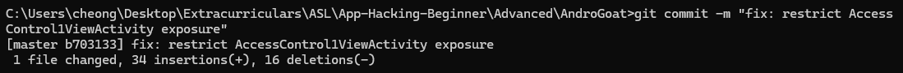</span></figure>
<p></p>
<p data-ke-size="size16"> </p>
<p data-ke-size="size16">안전하지 않은 저장소 문제 또한 취약한 코드를 수정한 후 제대로 패치됐는지 확인해봤습니다.</p>
<p data-ke-size="size16">에뮬레이터에서 값 입력 후 VERIFY를 클릭하면 팝업이 뜨며 입력값이 저장되지 않았다는 창이 뜨도록 수정했습니다.</p>
<p></p><figure class="imageblock alignCenter" data-filename="스크린샷 2026-10-04 213935.png" data-ke-mobilestyle="widthOrigin" data-origin-height="537" data-origin-width="387"><span>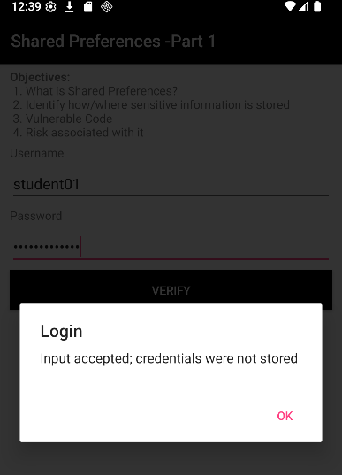</span></figure>
<p></p>
<p data-ke-size="size16">진짜 저장되지 않았는지 확인해봤습니다.</p>
<p data-ke-size="size16">아까와 같은 경로에 저장되어 있는 users.xml 파일입니다. 이 파일을 열어보면</p>
<p></p><figure class="imageblock alignCenter" data-filename="스크린샷 2026-10-04 214059.png" data-ke-mobilestyle="widthOrigin" data-origin-height="144" data-origin-width="225"><span>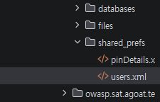</span></figure>
<p></p>
<p data-ke-size="size16">사용자가 입력한 값이 저장되지 않았음을 알 수 있습니다.</p>
<p></p><figure class="imageblock alignCenter" data-filename="스크린샷 2026-10-04 214104.png" data-ke-mobilestyle="widthOrigin" data-origin-height="101" data-origin-width="457"><span>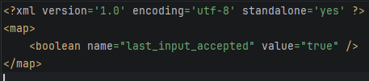</span></figure>
<p></p>
<p data-ke-size="size16">시험 앱에서도 확인해보니 파일을 읽을 수 없다고 합니다.</p>
<p></p><figure class="imageblock alignCenter" data-filename="스크린샷 2026-10-04 214216.png" data-ke-mobilestyle="widthOrigin" data-origin-height="457" data-origin-width="389"><span>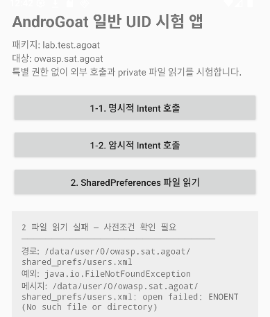</span></figure>
<p></p>
<p data-ke-size="size16" style="color: #333333; text-align: start;">안전하지 않은 저장소 취약점 패치 후 커밋</p>
<p></p><figure class="imageblock alignCenter" data-filename="스크린샷 2026-10-04 214521.png" data-ke-mobilestyle="widthOrigin" data-origin-height="90" data-origin-width="1094"><span>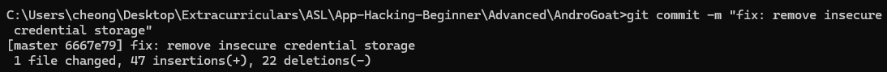</span></figure>
<p></p>
<p data-ke-size="size16"> </p>
<p data-ke-size="size16">원본/수정 APK 해시 확인 결과는 다음과 같습니다.</p>
<p></p><figure class="imageblock alignCenter" data-ke-mobilestyle="widthOrigin" data-origin-height="132" data-origin-width="1090"><span>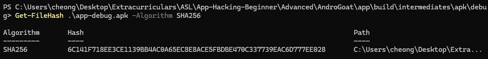</span></figure>
<p></p>
<p data-ke-size="size16">원본 APK 해시 : 6C141F718EE3CE1139BB4AC0A65EC8E8ACE5FBDBE470C337739EAC6D777EE028</p>
<p data-ke-size="size16"> </p>
<p></p><figure class="imageblock alignCenter" data-filename="blob" data-ke-mobilestyle="widthOrigin" data-origin-height="124" data-origin-width="1095"><span>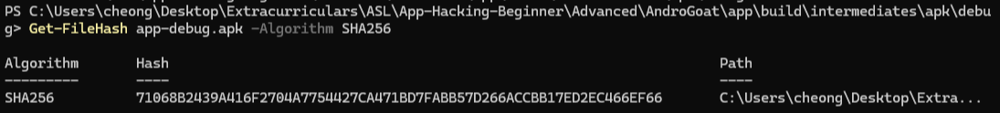</span></figure>
<p></p>
<p data-ke-size="size16">수정 APK 해시 : 71068B2439A416F2704A7754427CA471BD7FABB57D266ACCBB17ED2EC466EF66</p>
<p data-ke-size="size16" style="color: #333333; text-align: start;"> </p>
<p data-ke-size="size16" style="color: #333333; text-align: start;">UID별 영향표는 다음과 같습니다.</p>
<table border="1" data-ke-align="alignLeft" data-ke-style="style14" style="border-collapse: collapse; width: 100%;">
<tbody>
<tr>
<td style="background-color: #008300; color: #ffffff; text-align: center; width: 9.4186%;"><span>시험 주체</span></td>
<td style="background-color: #008300; color: #ffffff; text-align: center; width: 10.3488%;"><span>UID/권한</span></td>
<td style="background-color: #008300; color: #ffffff; text-align: center; width: 15.6977%;"><span>원본</span></td>
<td style="background-color: #008300; color: #ffffff; text-align: center; width: 25.2326%;"><span>수정</span></td>
<td style="background-color: #008300; color: #ffffff; text-align: center; width: 14.5349%;"><span>원본 파일</span></td>
<td style="background-color: #008300; color: #ffffff; text-align: center; width: 24.6512%;"><span>수정 파일</span></td>
</tr>
<tr>
<td style="background-color: #efefef; text-align: center; width: 9.4186%;"><span>AndroGoat</span></td>
<td style="text-align: center; width: 10.3488%;"><span>앱 UID</span></td>
<td style="text-align: center; width: 15.6977%;"><span>내부 실행 가능</span></td>
<td style="text-align: center; width: 25.2326%;"><span>내부 실행 가능</span></td>
<td style="text-align: center; width: 14.5349%;"><span>자기 파일 접근 가능</span></td>
<td style="text-align: center; width: 24.6512%;"><span>접근 가능하지만 가짜 자격증명 없음</span></td>
</tr>
<tr>
<td style="background-color: #efefef; text-align: center; width: 9.4186%;"><span>시험 앱</span></td>
<td style="background-color: #f9f9f9; text-align: center; width: 10.3488%;"><span>일반 UID</span></td>
<td style="background-color: #f9f9f9; text-align: center; width: 15.6977%;"><span>명시적·암시적 호출 가능</span></td>
<td style="background-color: #f9f9f9; text-align: center; width: 25.2326%;"><span>모두 차단</span></td>
<td style="background-color: #f9f9f9; text-align: center; width: 14.5349%;"><span>EACCES</span></td>
<td style="background-color: #f9f9f9; text-align: center; width: 24.6512%;"><span>EACCES</span></td>
</tr>
<tr>
<td style="background-color: #efefef; text-align: center; width: 9.4186%;">adb shell</td>
<td style="text-align: center; width: 10.3488%;"><span>UID 2000</span></td>
<td style="text-align: center; width: 15.6977%;"><span>외부 호출 가능</span></td>
<td style="text-align: center; width: 25.2326%;"><span>일반적으로 비공개 Activity 호출 거부</span></td>
<td style="text-align: center; width: 14.5349%;"><span>Permission denied</span></td>
<td style="text-align: center; width: 24.6512%;"><span>Permission denied</span></td>
</tr>
<tr>
<td style="background-color: #efefef; text-align: center; width: 9.4186%;">adb root</td>
<td style="background-color: #f9f9f9; text-align: center; width: 10.3488%;"><span>UID 0</span></td>
<td style="background-color: #f9f9f9; text-align: center; width: 15.6977%;"><span>접근 가능</span></td>
<td style="background-color: #f9f9f9; text-align: center; width: 25.2326%;"><span>일반 앱 공격자 기준에서 제외</span></td>
<td style="background-color: #f9f9f9; text-align: center; width: 14.5349%;"><span>평문 확인 가능</span></td>
<td style="background-color: #f9f9f9; text-align: center; width: 24.6512%;"><span>파일을 읽어도 가짜 자격증명 없음</span></td>
</tr>
</tbody>
</table>
<p data-ke-size="size16"> </p>
<p data-ke-size="size16">정상 동작 시나리오와 비정상 동작 시나리오는 다음과 같습니다.</p>
<p data-ke-size="size16"> </p>
<p data-ke-size="size16" style="color: #333333; text-align: start;">N1~N4 : AndroGoat 앱 내부의 정상 기능 확인</p>
<p data-ke-size="size16" style="color: #333333; text-align: start;">A1~A2 : 보호 Activity의 외부 공개 설정과 딥링크 제거 확인</p>
<p data-ke-size="size16" style="color: #333333; text-align: start;">A3~A4 : 잘못된 입력 거부와 입력값 미저장 확인</p>
<table border="1" data-ke-align="alignLeft" data-ke-style="style14" style="border-collapse: collapse; width: 100%; height: 189px;">
<tbody>
<tr style="height: 21px;">
<td style="background-color: #008300; color: #ffffff; text-align: center; width: 17.4418%; height: 21px;">시나리오</td>
<td style="background-color: #008300; color: #ffffff; text-align: center; width: 17.4418%;">대상 취약점</td>
<td style="background-color: #008300; color: #ffffff; text-align: center; width: 33.1396%; height: 21px;">내용</td>
<td style="background-color: #008300; color: #ffffff; text-align: center; width: 31.8605%; height: 21px;">성공 조건</td>
</tr>
<tr style="height: 42px;">
<td style="background-color: #efefef; text-align: center; width: 17.4418%; height: 42px;">정상 시나리오 N1</td>
<td style="background-color: #efefef; text-align: center; width: 17.4418%;">외부 노출 Activity</td>
<td style="text-align: center; width: 33.1396%; height: 42px;">PIN 없는 상태에서 새 PIN 생성</td>
<td style="text-align: center; width: 31.8605%; height: 42px;">PIN 생성 후 verify PIN 화면이 표시</td>
</tr>
<tr style="height: 42px;">
<td style="background-color: #efefef; text-align: center; width: 17.4418%; height: 42px;">정상 시나리오 N2</td>
<td style="background-color: #efefef; text-align: center; width: 17.4418%;"><span style="background-color: #efefef; color: #333333; text-align: center;">외부 노출 Activity</span></td>
<td style="background-color: #f9f9f9; text-align: center; width: 33.1396%; height: 42px;">올바른 PIN AndroGoat 내부 화면에 입력</td>
<td style="background-color: #f9f9f9; text-align: center; width: 31.8605%; height: 42px;">내부 경로로 Invoice에 접근 가능 </td>
</tr>
<tr>
<td style="background-color: #efefef; text-align: center; width: 17.4418%;"><span style="background-color: #efefef; color: #333333; text-align: center;">정상 시나리오 N3</span></td>
<td style="background-color: #efefef; text-align: center; width: 17.4418%;"><span style="background-color: #efefef; color: #333333; text-align: center;">안전하지 않은 저장소</span></td>
<td style="background-color: #f9f9f9; text-align: center; width: 33.1396%;">student01, LAB_TOKEN_001 입력 후 제출</td>
<td style="background-color: #f9f9f9; text-align: center; width: 31.8605%;">입력 성공 메시지 표시, 두 입력값은 저장 X</td>
</tr>
<tr>
<td style="background-color: #efefef; text-align: center; width: 17.4418%;"><span style="background-color: #efefef; color: #333333; text-align: center;">정상 시나리오 N4</span></td>
<td style="background-color: #efefef; text-align: center; width: 17.4418%;"><span style="background-color: #efefef; color: #333333; text-align: center;"> <span style="background-color: #efefef; color: #333333; text-align: center;">안전하지 않은 저장소</span> </span></td>
<td style="background-color: #f9f9f9; text-align: center; width: 33.1396%;">저장소 화면 재실행 후 다시 제출</td>
<td style="background-color: #f9f9f9; text-align: center; width: 31.8605%;">입력칸이 비어 있고 화면과 제출 기능 정상 동작</td>
</tr>
<tr style="height: 42px;">
<td style="background-color: #efefef; text-align: center; width: 17.4418%; height: 42px;">비정상 시나리오 A1</td>
<td style="background-color: #efefef; text-align: center; width: 17.4418%;"><span style="background-color: #efefef; color: #333333; text-align: center;">외부 노출 Activity</span></td>
<td style="text-align: center; width: 33.1396%; height: 42px;">패키지 매니저<span>로 </span>AccessControl1ViewActivity<span> </span><span>설정 </span><span>조회</span></td>
<td style="text-align: center; width: 31.8605%; height: 42px;">exported가 false</td>
</tr>
<tr style="height: 42px;">
<td style="background-color: #efefef; text-align: center; width: 17.4418%; height: 42px;">비정상 시나리오 A2 </td>
<td style="background-color: #efefef; text-align: center; width: 17.4418%;"><span style="background-color: #efefef; color: #333333; text-align: center;">외부 노출 Activity</span></td>
<td style="background-color: #f9f9f9; text-align: center; width: 33.1396%; height: 42px;"><span>딥링크를 처리하는 앱 내부 Activity 조회</span></td>
<td style="background-color: #f9f9f9; text-align: center; width: 31.8605%; height: 42px;">AccessControl1ViewActivity<span>가 조회 결과에 없음</span></td>
</tr>
<tr>
<td style="background-color: #efefef; text-align: center; width: 17.4418%;"><span style="background-color: #efefef; color: #333333; text-align: center;">비정상 시나리오 A3</span></td>
<td style="background-color: #efefef; text-align: center; width: 17.4418%;"><span style="background-color: #efefef; color: #333333; text-align: center;"> <span style="background-color: #efefef; color: #333333; text-align: center;">안전하지 않은 저장소</span> </span></td>
<td style="background-color: #f9f9f9; text-align: center; width: 33.1396%;"><span>username은 비우고 password에만 값</span><span>입력</span></td>
<td style="background-color: #f9f9f9; text-align: center; width: 31.8605%;"><span>필수 입력 안내가 표시되고 </span>last_input_accepted<span>가 </span>false<span>임</span></td>
</tr>
<tr>
<td style="background-color: #efefef; text-align: center; width: 17.4418%;"><span style="background-color: #efefef; color: #333333; text-align: center;">비정상 시나리오 A4</span></td>
<td style="background-color: #efefef; text-align: center; width: 17.4418%;"><span style="background-color: #efefef; color: #333333; text-align: center;"> <span style="background-color: #efefef; color: #333333; text-align: center;">안전하지 않은 저장소</span> </span></td>
<td style="background-color: #f9f9f9; text-align: center; width: 33.1396%;">입력값 제출 후 users.xml을 읽어 검사</td>
<td style="background-color: #f9f9f9; text-align: center; width: 31.8605%;">입력값과 username, password 키 존재 X</td>
</tr>
</tbody>
</table>
<p data-ke-size="size16"> </p>
<p data-ke-size="size16">회귀시험을 수행할 코드는 다음과 같습니다.</p>
<pre class="kotlin" data-ke-language="kotlin" data-ke-type="codeblock" id="code_1791210833108"><code class="hljs"><span class="hljs-keyword">package</span> owasp.sat.agoat

<span class="hljs-keyword">import</span> android.app.Activity
<span class="hljs-keyword">import</span> android.content.ComponentName
<span class="hljs-keyword">import</span> android.content.Context
<span class="hljs-keyword">import</span> android.content.Intent
<span class="hljs-keyword">import</span> android.content.pm.PackageManager
<span class="hljs-keyword">import</span> android.net.Uri
<span class="hljs-keyword">import</span> androidx.test.core.app.ActivityScenario
<span class="hljs-keyword">import</span> androidx.test.core.app.ApplicationProvider
<span class="hljs-keyword">import</span> androidx.test.espresso.Espresso.onView
<span class="hljs-keyword">import</span> androidx.test.espresso.action.ViewActions.click
<span class="hljs-keyword">import</span> androidx.test.espresso.action.ViewActions.closeSoftKeyboard
<span class="hljs-keyword">import</span> androidx.test.espresso.action.ViewActions.typeText
<span class="hljs-keyword">import</span> androidx.test.espresso.assertion.ViewAssertions.matches
<span class="hljs-keyword">import</span> androidx.test.espresso.matcher.ViewMatchers.isDisplayed
<span class="hljs-keyword">import</span> androidx.test.espresso.matcher.ViewMatchers.withId
<span class="hljs-keyword">import</span> androidx.test.espresso.matcher.ViewMatchers.withText
<span class="hljs-keyword">import</span> androidx.test.ext.junit.runners.AndroidJUnit4
<span class="hljs-keyword">import</span> org.junit.Assert.assertFalse
<span class="hljs-keyword">import</span> org.junit.Assert.assertTrue
<span class="hljs-keyword">import</span> org.junit.Before
<span class="hljs-keyword">import</span> org.junit.Test
<span class="hljs-keyword">import</span> org.junit.runner.RunWith
<span class="hljs-keyword">import</span> java.io.File

<span class="hljs-meta">@RunWith(AndroidJUnit4::class)</span>
<span class="hljs-class"><span class="hljs-keyword">class</span> <span class="hljs-title">SecurityRegressionSuite</span> </span>{

    <span class="hljs-keyword">private</span> <span class="hljs-keyword">lateinit</span> <span class="hljs-keyword">var</span> app: Context

    <span class="hljs-keyword">private</span> <span class="hljs-keyword">object</span> Sample {
        <span class="hljs-keyword">const</span> <span class="hljs-keyword">val</span> USERNAME = <span class="hljs-string">"student01"</span>
        <span class="hljs-keyword">const</span> <span class="hljs-keyword">val</span> TOKEN = <span class="hljs-string">"LAB_TOKEN_001"</span>
        <span class="hljs-keyword">const</span> <span class="hljs-keyword">val</span> ACCEPTED = <span class="hljs-string">"Input accepted; credentials were not stored"</span>
        <span class="hljs-keyword">const</span> <span class="hljs-keyword">val</span> REQUIRED = <span class="hljs-string">"Username and token are required"</span>
    }

    <span class="hljs-meta">@Before</span>
    <span class="hljs-function"><span class="hljs-keyword">fun</span> <span class="hljs-title">reset</span><span class="hljs-params">()</span></span> {
        app = ApplicationProvider.getApplicationContext()
        store(<span class="hljs-string">"pinDetails"</span>).edit().clear().commit()
        store(<span class="hljs-string">"users"</span>).edit().clear().commit()
    }

    <span class="hljs-meta">@Test</span>
    <span class="hljs-function"><span class="hljs-keyword">fun</span> <span class="hljs-title">N1</span><span class="hljs-params">()</span></span> =
        screen&lt;AccessControlIssue1Activity&gt; {
            createPin()
            onView(withId(R.id.verifyPIN)).check(matches(isDisplayed()))
        }

    <span class="hljs-meta">@Test</span>
    <span class="hljs-function"><span class="hljs-keyword">fun</span> <span class="hljs-title">N2</span><span class="hljs-params">()</span></span> =
        screen&lt;AccessControlIssue1Activity&gt; {
            createPin()
            onView(withId(R.id.pinValue)).perform(
                typeText(Sample.TOKEN),
                closeSoftKeyboard()
            )
            onView(withId(R.id.verifyPIN)).perform(click())
            onView(withId(R.id.downLoad)).check(matches(isDisplayed()))
        }

    <span class="hljs-meta">@Test</span>
    <span class="hljs-function"><span class="hljs-keyword">fun</span> <span class="hljs-title">N3</span><span class="hljs-params">()</span></span> =
        screen&lt;InsecureStorageSharedPrefs&gt; {
            submit()
            onView(withText(Sample.ACCEPTED)).check(matches(isDisplayed()))

            <span class="hljs-keyword">val</span> values = store(<span class="hljs-string">"users"</span>)
            assertTrue(values.getBoolean(<span class="hljs-string">"last_input_accepted"</span>, <span class="hljs-literal">false</span>))
            assertFalse(values.contains(<span class="hljs-string">"username"</span>))
            assertFalse(values.contains(<span class="hljs-string">"password"</span>))
            assertFalse(
                values.all.values.any {
                    it.toString().contains(Sample.USERNAME) ||
                        it.toString().contains(Sample.TOKEN)
                }
            )
        }

    <span class="hljs-meta">@Test</span>
    <span class="hljs-function"><span class="hljs-keyword">fun</span> <span class="hljs-title">N4</span><span class="hljs-params">()</span></span> {
        screen&lt;InsecureStorageSharedPrefs&gt; {
            submit()
            onView(withText(<span class="hljs-string">"OK"</span>)).perform(click())
        }

        screen&lt;InsecureStorageSharedPrefs&gt; {
            onView(withId(R.id.userName)).check(matches(withText(<span class="hljs-string">""</span>)))
            onView(withId(R.id.password)).check(matches(withText(<span class="hljs-string">""</span>)))
            submit()
            onView(withText(Sample.ACCEPTED)).check(matches(isDisplayed()))
        }
    }

    <span class="hljs-meta">@Test</span>
    <span class="hljs-function"><span class="hljs-keyword">fun</span> <span class="hljs-title">A1</span><span class="hljs-params">()</span></span> {
        <span class="hljs-keyword">val</span> component = ComponentName(
            app,
            AccessControl1ViewActivity::<span class="hljs-keyword">class</span>.java
        )
        <span class="hljs-keyword">val</span> info = app.packageManager.getActivityInfo(
            component,
            PackageManager.GET_META_DATA
        )
        assertFalse(info.exported)
    }

    <span class="hljs-meta">@Test</span>
    <span class="hljs-function"><span class="hljs-keyword">fun</span> <span class="hljs-title">A2</span><span class="hljs-params">()</span></span> {
        <span class="hljs-keyword">val</span> request = Intent(
            Intent.ACTION_VIEW,
            Uri.parse(<span class="hljs-string">"androgoat://vulnapp"</span>)
        ).setPackage(app.packageName)

        <span class="hljs-keyword">val</span> matched = app.packageManager
            .queryIntentActivities(request, PackageManager.MATCH_DEFAULT_ONLY)
            .any {
                it.activityInfo.name ==
                    AccessControl1ViewActivity::<span class="hljs-keyword">class</span>.java.name
            }

        assertFalse(matched)
    }

    <span class="hljs-meta">@Test</span>
    <span class="hljs-function"><span class="hljs-keyword">fun</span> <span class="hljs-title">A3</span><span class="hljs-params">()</span></span> =
        screen&lt;InsecureStorageSharedPrefs&gt; {
            onView(withId(R.id.password)).perform(
                typeText(Sample.TOKEN),
                closeSoftKeyboard()
            )
            onView(withId(R.id.SPViewButton)).perform(click())
            onView(withText(Sample.REQUIRED)).check(matches(isDisplayed()))
            assertFalse(
                store(<span class="hljs-string">"users"</span>).getBoolean(
                    <span class="hljs-string">"last_input_accepted"</span>,
                    <span class="hljs-literal">false</span>
                )
            )
        }

    <span class="hljs-meta">@Test</span>
    <span class="hljs-function"><span class="hljs-keyword">fun</span> <span class="hljs-title">A4</span><span class="hljs-params">()</span></span> =
        screen&lt;InsecureStorageSharedPrefs&gt; {
            submit()
            onView(withText(Sample.ACCEPTED)).check(matches(isDisplayed()))

            store(<span class="hljs-string">"users"</span>).edit().commit()

            <span class="hljs-keyword">val</span> xml = File(
                app.applicationInfo.dataDir,
                <span class="hljs-string">"shared_prefs/users.xml"</span>
            )
            assertTrue(xml.isFile)

            <span class="hljs-keyword">val</span> raw = xml.readText(Charsets.UTF_8)
            assertFalse(raw.contains(Sample.USERNAME))
            assertFalse(raw.contains(Sample.TOKEN))
            assertFalse(raw.contains(<span class="hljs-string">"name=\"username\""</span>))
            assertFalse(raw.contains(<span class="hljs-string">"name=\"password\""</span>))
        }

    <span class="hljs-keyword">private</span> <span class="hljs-keyword">inline</span> <span class="hljs-function"><span class="hljs-keyword">fun</span> <span class="hljs-type">&lt;<span class="hljs-keyword">reified</span> T : Activity&gt;</span> <span class="hljs-title">screen</span><span class="hljs-params">(
        action: () -&gt; <span class="hljs-type">Unit</span>
    )</span></span> {
        ActivityScenario.launch(T::<span class="hljs-keyword">class</span>.java).use {
            action()
        }
    }

    <span class="hljs-keyword">private</span> <span class="hljs-function"><span class="hljs-keyword">fun</span> <span class="hljs-title">createPin</span><span class="hljs-params">()</span></span> {
        onView(withId(R.id.setpin)).perform(
            typeText(Sample.TOKEN),
            closeSoftKeyboard()
        )
        onView(withId(R.id.setPIN)).perform(click())
    }

    <span class="hljs-keyword">private</span> <span class="hljs-function"><span class="hljs-keyword">fun</span> <span class="hljs-title">submit</span><span class="hljs-params">()</span></span> {
        onView(withId(R.id.userName)).perform(
            typeText(Sample.USERNAME),
            closeSoftKeyboard()
        )
        onView(withId(R.id.password)).perform(
            typeText(Sample.TOKEN),
            closeSoftKeyboard()
        )
        onView(withId(R.id.SPViewButton)).perform(click())
    }

    <span class="hljs-keyword">private</span> <span class="hljs-function"><span class="hljs-keyword">fun</span> <span class="hljs-title">store</span><span class="hljs-params">(name: <span class="hljs-type">String</span>)</span></span> =
        app.getSharedPreferences(name, Context.MODE_PRIVATE)
}</code></pre>
<p data-ke-size="size16">안드로이드 스튜디오에서 API 36 에뮬레이터를 실행한 상태에서 해당 코드를 열고 class 옆의 실행 버튼을 눌러 회귀시험을 진행했습니다.</p>
<p></p><figure class="imageblock alignCenter" data-ke-mobilestyle="widthOrigin" data-origin-height="76" data-origin-width="371"><span>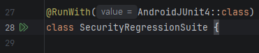</span></figure>
<p></p>
<p data-ke-size="size16">자동 회귀시험을 돌려본 결과 모든 시나리오가 PASS되었습니다.</p>
<p></p><figure class="imageblock alignCenter" data-ke-mobilestyle="widthOrigin" data-origin-height="283" data-origin-width="919"><span>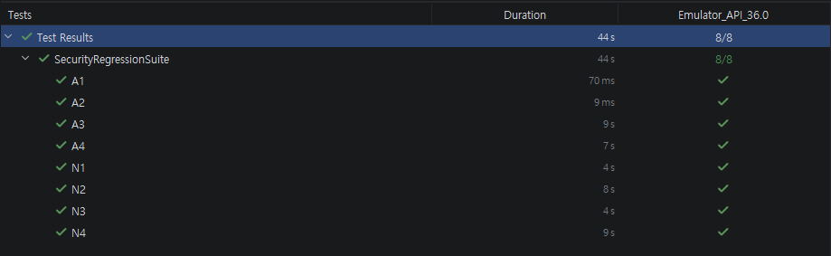</span></figure>
<p></p>
<p data-ke-size="size16">정상 시나리오 ： 4/4 PASS</p>
<p data-ke-size="size16">비정상 시나리오 : 4/4 PASS</p>
<p data-ke-size="size16">전체 : 8/8 PASS</p></div>
</div>

