

<h3 data-ke-size="size23">목표</h3>
<ul data-ke-list-type="disc" style="list-style-type: disc;">
<li>InsecureBankv2와 InsecureShop에서 안전하지 않은 데이터 저장 방식 분석</li>
<li>SharedPreferences, SQLite, 외부저장소에 저장된 민감 데이터를 adb run-as로 추출</li>
<li>API 23(MODE_WORLD_READABLE)과 API 33(Scoped Storage)에서의 저장소 정책 차이 비교</li>
</ul>
<h3 data-ke-size="size23">실습 환경</h3>
<ul data-ke-list-type="disc" style="list-style-type: disc;">
<li>Android Studio</li>
<li>Nexus 5X Android 6.0 (API 23)</li>
<li>Pixel 4 Android 13 (API 33)</li>
<li>InsecureShop (취약 앱) </li>
<li>InsecureBankv2 (취약 앱)</li>
</ul>
<h3 data-ke-size="size23">1. InsecureShop</h3>
<h4 data-ke-size="size20">1-1. SharedPreferences</h4>

API 23 버전 에뮬레이터에서 InsecureShop 실행 후, 주어진 계정 (Util.kt에 하드코딩 되어 있는 username : shopuser / password : !ns3csh0p)으로 로그인하겠습니다.

<figure class="imageblock alignCenter" data-ke-mobilestyle="widthOrigin" data-origin-height="876" data-origin-width="436">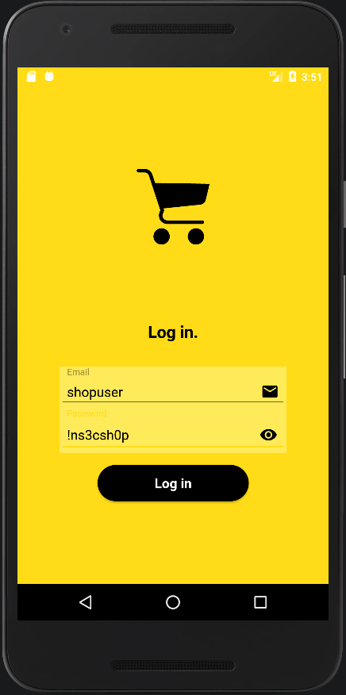</figure>

야호 로그인

<figure class="imageblock alignCenter" data-ke-mobilestyle="widthOrigin" data-origin-height="872" data-origin-width="437">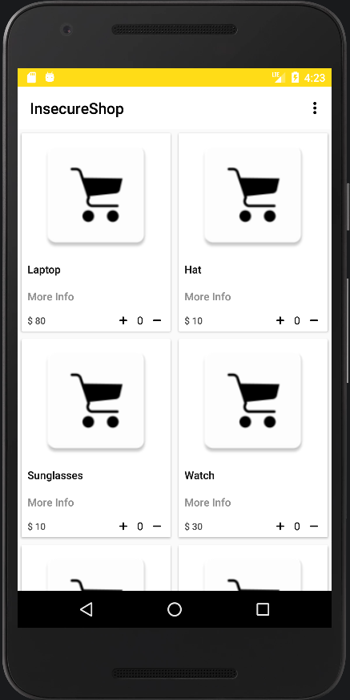</figure>

먼저 SharedPreferences로 저장된 정보를 노출시켜 보겠습니다.

 

SharedPreferences는 데이터를 키-값(Key-Value) 형태로 저장하는 기능입니다.

일반적으로 data/data/&lt;패키지명&gt;/shared_prefs/ 경로에 xml 파일로 저장되며, 사용자 설정이나 자동 로그인에 필요한 정보 등을 저장하는 데 사용됩니다.

 

SharedPreferences를 전체 검색하니 Prefs.kt라는 파일이 있었습니다.

코드를 보겠습니다.

<figure class="imageblock alignCenter" data-ke-mobilestyle="widthOrigin" data-origin-height="216" data-origin-width="591">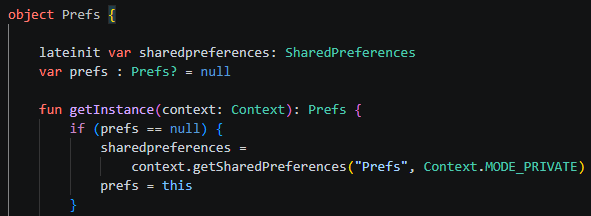</figure>

getInstance() 함수를 보면 context.getSharedPreferences("Prefs", Context.MODE_PRIVATE) 에서 SharedPreferences를 생성합니다.

 

그 후, username과 password를 putString()을 통해 받는데 putString()은 평문을 암호화하는 과정이 없어 입력값 그대로 저장합니다.

<figure class="imageblock alignCenter" data-ke-mobilestyle="widthOrigin" data-origin-height="215" data-origin-width="550">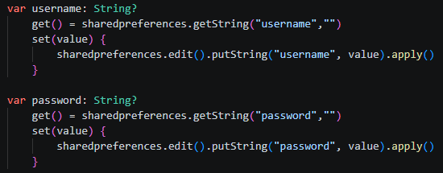</figure>

LoginActivity.kt 코드를 보겠습니다.

 

onLogin() 함수를 보면 username과 password를 Prefs 객체에 전달합니다.

<figure class="imageblock alignCenter" data-ke-mobilestyle="widthOrigin" data-origin-height="294" data-origin-width="528">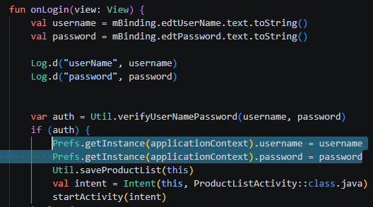</figure>

안드로이드 스튜디오의 Device Explorer에서 확인해보니 /data/data/com.insecureshop/shared_prefs/Prefs.xml 파일이 있었습니다.

<figure class="imageblock alignCenter" data-ke-mobilestyle="widthOrigin" data-origin-height="196" data-origin-width="345">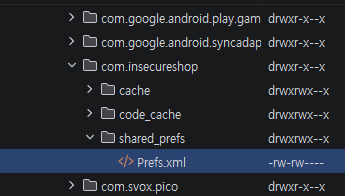</figure>

Prefs.xml에 로그인 시 입력한 사용자명과 비밀번호가 암호화 없이 저장되어 있습니다.

<figure class="imageblock alignCenter" data-ke-mobilestyle="widthOrigin" data-origin-height="94" data-origin-width="387">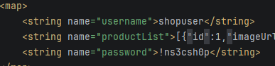</figure>

이 파일의 내용을 adb run-as로 추출하면 될 거라 생각했습니다.

 

다음 명령어로 Prefs.xml 파일의 내용을 출력할 수 있습니다.

<pre class="bash" data-ke-language="bash" data-ke-type="codeblock" id="code_1795153767184"><code class="hljs">adb shell run-as com.insecureshop cat /data/data/com.insecureshop/shared_prefs/Prefs.xml</code></pre>

<figure class="imageblock alignCenter" data-ke-mobilestyle="widthOrigin" data-origin-height="314" data-origin-width="856">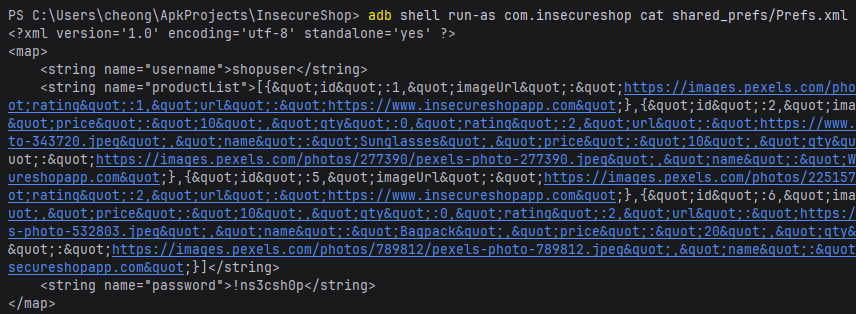</figure>

 

<h4 data-ke-size="size20">1-2. SQLite</h4>

InsecureShop에는 사용자 정보나 상품 목록과 같은 데이터를 따로 데이터베이스에 저장하지 않습니다. SQLite에 저장된 정보 추출은 InsecureBankv2에서 다뤄보도록 하겠슴다...

 

<h4 data-ke-size="size20">1-3. 외부 저장소</h4>

이번엔 InsecureShop이 데이터를 외부 저장소에 저장하고 있는지 확인해보겠습니다.

 

먼저 매니페스트 파일을 확인하겠습니다.

 

매니페스트에 선언된 외부 저장소 관련 권한은 READ_EXTERNAL_STORAGE와 WRITE_EXTERNAL_STORAGE가 선언되어 있습니다.

 

READ_EXTERNAL_STORAGE : 안드로이드 앱이 외부 저장소(SD 카드 등)에 있는 파일을 읽을 수 있도록 요청하는 권한

WRITE_EXTERNAL_STORAGE : 안드로이드 앱이 외부 저장소에 파일을 쓰는 권한

<figure class="imageblock alignCenter" data-ke-mobilestyle="widthOrigin" data-origin-height="197" data-origin-width="632">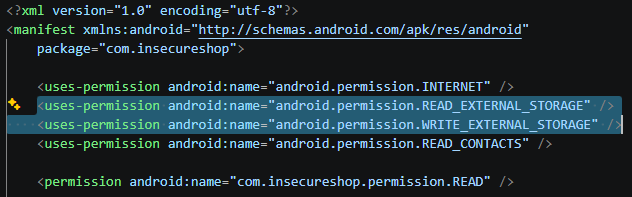</figure>

디바이스 익스플로러에서 외부 저장소에 값이 저장되어 있는지 먼저 확인해봤습니다.

그러나 /sdcard/Android/data/ 경로에서 InsecureShop의 패키지명인 com.insecureshop 폴더를 찾을 수 없었습니다.

<figure class="imageblock alignCenter" data-ke-mobilestyle="widthOrigin" data-origin-height="200" data-origin-width="294">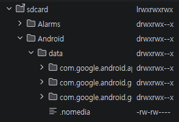</figure>

앱이 외부 저장소에 파일을 읽고 쓸 수 있는 권한이 있더라도 사용자 정보와 같은 민감 정보를 저장하는 파일이 따로 없었습니다.

 

API 23 환경에서 진행했던 실습을 똑같이 API 33에서 해보겠습니다.

SQLite와 외부 저장소는 실제로 존재하지 않는 거 같아 API 33에선 진행하지 않았습니다.

 

SharedPreferences에서 민감 정보 노출 :

<figure class="imageblock alignCenter" data-ke-mobilestyle="widthOrigin" data-origin-height="314" data-origin-width="1834">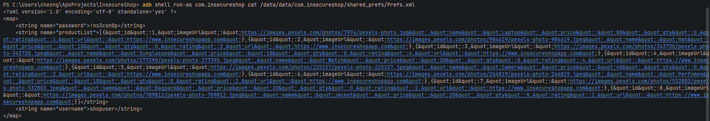</figure>

결과 같음

<h3 data-ke-size="size23">2. InsecureBankv2</h3>

InsecureBankv2 깃허브에 나와있는 설명을 따라해봅시당~

<a href="https://github.com/dineshshetty/Android-InsecureBankv2/blob/master/README.markdown" rel="noopener noreferrer" target="_blank">https://github.com/dineshshetty/Android-InsecureBankv2/blob/master/README.markdown</a>

<figure contenteditable="false" data-ke-align="alignCenter" data-ke-type="opengraph" data-og-description="Vulnerable Android application for developers and security enthusiasts to learn about Android insecurities - dineshshetty/Android-InsecureBankv2" data-og-host="github.com" data-og-image="/assets/img/and-lab/08/og-01.png" data-og-source-url="https://github.com/dineshshetty/Android-InsecureBankv2/blob/master/README.markdown" data-og-title="Android-InsecureBankv2/README.markdown at master · dineshshetty/Android-InsecureBankv2" data-og-type="object" data-og-url="https://github.com/dineshshetty/Android-InsecureBankv2/blob/master/README.markdown" id="og_1795169615806"><a data-source-url="https://github.com/dineshshetty/Android-InsecureBankv2/blob/master/README.markdown" href="https://github.com/dineshshetty/Android-InsecureBankv2/blob/master/README.markdown" rel="noopener" target="_blank">

 

Android-InsecureBankv2/README.markdown at master · dineshshetty/Android-InsecureBankv2

Vulnerable Android application for developers and security enthusiasts to learn about Android insecurities - dineshshetty/Android-InsecureBankv2

github.com

</a></figure>

 

InsecureBankv2 파일을 클론하고 apk 파일을 드래그 앤 드랍으로 에뮬레이터에 설치 후 실행합니다.

<figure class="imageblock alignCenter" data-filename="스크린샷 2026-11-20 180633.png" data-ke-mobilestyle="widthOrigin" data-origin-height="791" data-origin-width="396">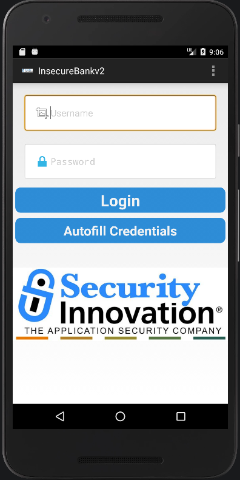</figure>

 

/AndroLabServer에서 py -2.7 app.py 명령어를 입력해 서버를 실행시킵니다.

<figure class="imageblock alignCenter" data-ke-mobilestyle="widthOrigin" data-origin-height="59" data-origin-width="991">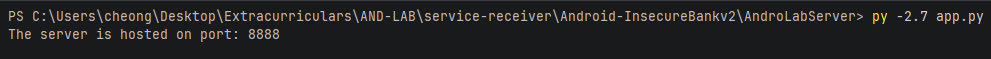</figure>

 

그 후 IP는 10.0.2.2, port는 8888로 설정 후 Submit을 클릭합니다.

<figure class="imageblock alignCenter" data-filename="스크린샷 2026-11-20 190501.png" data-ke-mobilestyle="widthOrigin" data-origin-height="794" data-origin-width="387">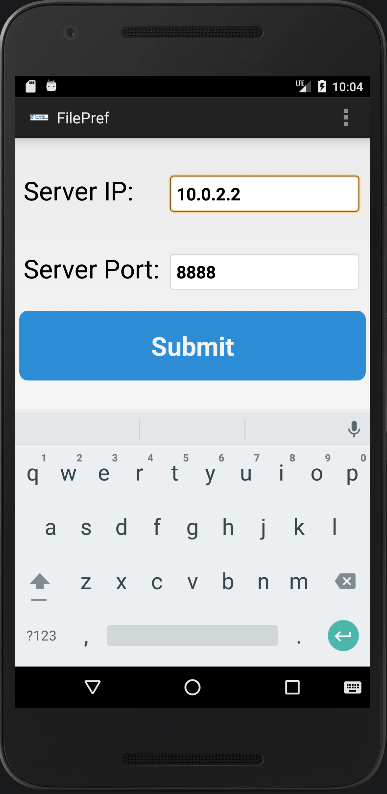</figure>

해당 애플리케이션의 실습 계정은 다음과 같습니다.

username : dinesh

password : Dinesh@123$

이 계정으로 로그인하겠습니다.

<figure class="imageblock alignCenter" data-filename="스크린샷 2026-11-20 190548.png" data-ke-mobilestyle="widthOrigin" data-origin-height="788" data-origin-width="399">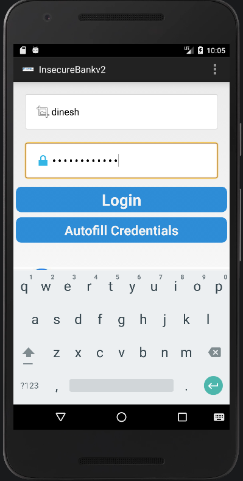</figure>

로그인 야호

<figure class="imageblock alignCenter" data-filename="스크린샷 2026-11-20 190632.png" data-ke-mobilestyle="widthOrigin" data-origin-height="795" data-origin-width="398">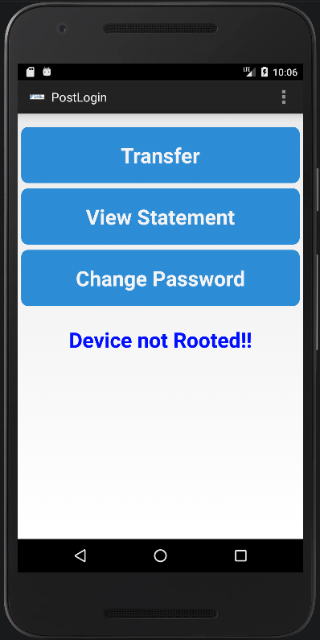</figure>

<h4 data-ke-size="size20">2-1. SharedPreferences</h4>

로그인 정보를 SharedPreferences로 저장하는지 확인해봤습니다.

 

DoLogin.java 코드를 보겠습니다.

saveCreds() 함수 부분을 보면 ShreadPreferences에 username과 password를 저장합니다.

<figure class="imageblock alignCenter" data-ke-mobilestyle="widthOrigin" data-origin-height="308" data-origin-width="759">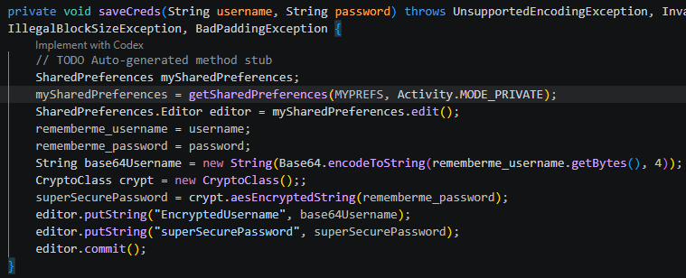</figure>

여기까진 InsecureShop과 똑같은 거 같지만,.. InsecureBankv2에선 사용자명을 base64로 인코딩하고, 비밀번호는 CryptoClass()에서 암호화 과정을 거치는 듯합니다.

CryptoCalss 일부인데 AES 알고리즘인 거 같습니다. 대신 초기 벡터값이 전부 0x00인...

<figure class="imageblock alignCenter" data-ke-mobilestyle="widthOrigin" data-origin-height="713" data-origin-width="802">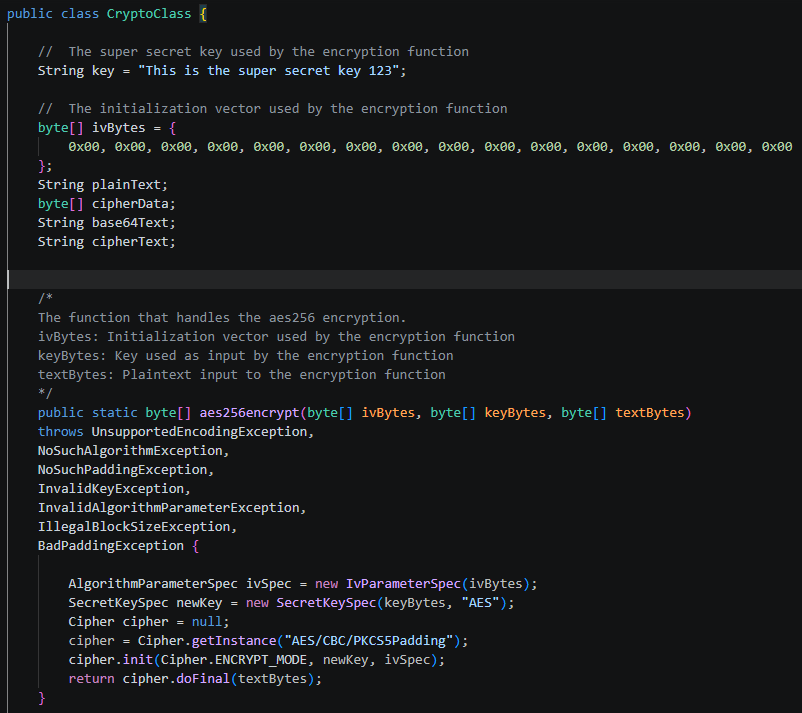</figure>

 

그 후 각각 인코딩, 암호화를 거친 사용자명과 비밀번호를 EncryptedUsername, superSecurePassword에 저장합니다.

 

apk를 드래그 앤 드랍으로 실행한 거라 디바이스 익스플로러를 쓸 수 없는...

adb 명령어로 파일 목록을 보겠습니다.

<pre class="bash" data-ke-language="bash" data-ke-type="codeblock" id="code_1795176526284"><code class="hljs">adb shell run-as com.android.insecurebankv2 ls</code></pre>

 

<figure class="imageblock alignCenter" data-ke-mobilestyle="widthOrigin" data-origin-height="98" data-origin-width="740">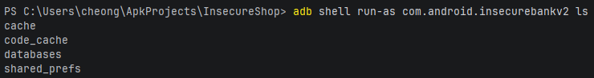</figure>

 

사용자명과 비밀번호는 shared_prets 폴더에 저장되어 있을 거라 생각했습니다.

또 ls로 파일 확인...

mySharedPreferences.xml라는 xml 파일이 있습니다.

<figure class="imageblock alignCenter" data-ke-mobilestyle="widthOrigin" data-origin-height="60" data-origin-width="849">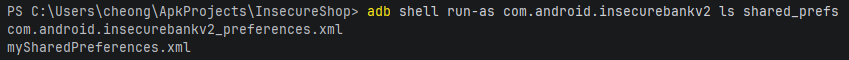</figure>

해당 xml 파일을 확인해보겠습니다.

<pre class="bash" data-ke-language="bash" data-ke-type="codeblock" id="code_1795176834418"><code class="hljs">adb shell run-as com.android.insecurebankv2 cat shared_prefs/mySharedPreferences.xml</code></pre>

<figure class="imageblock alignCenter" data-ke-mobilestyle="widthOrigin" data-origin-height="144" data-origin-width="1045">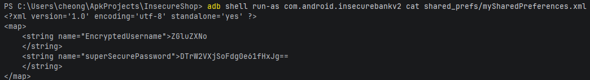</figure>

 

이미 사용자명은 base64로 인코딩(암호화도 아닌...) 되어 있고, 비밀번호는 AES 암호화가 적용된 걸 알고 있기에 평문을 알아낸 거나 다름 없다고 판단할 수 있겠습니다.

<h4 data-ke-size="size20">2-2. SQLite</h4>

전체 검색으로 database를 검색해보니 TrackUserContentProvider.java 코드가 있었습니다.

 

다음 선언 부분을 보면 데이터베이스명이 mydb이고, 테이블명은 names인 걸 알 수 있습니다.

<figure class="imageblock alignCenter" data-ke-mobilestyle="widthOrigin" data-origin-height="260" data-origin-width="703">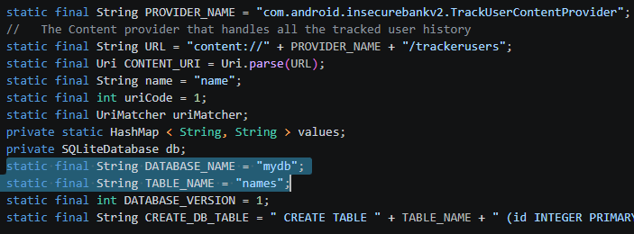</figure>

mydb 파일에 사용자명이 저장되어 있을 거라고 생각했습니다.

 

먼저 mydb라는 데이터베이스가 실제로 존재하는지 확인해보겠습니다.

<pre class="bash" data-ke-language="bash" data-ke-type="codeblock" id="code_1795180569180"><code class="hljs">adb shell run-as com.android.insecurebankv2 ls databases</code></pre>

아까 TrackUserContentProvider.java에서 선언된 데이터베이스인 mydb가 있습니다.

<figure class="imageblock alignCenter" data-ke-mobilestyle="widthOrigin" data-origin-height="62" data-origin-width="1324">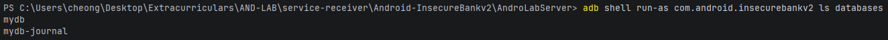</figure>

 

mydb에 저장된 값을 터미널에서 직접 조회해보겠습니다. (sqlite가 사전에 깔려 있어야 함)

데이터베이스명과 사용자명이 저장된 테이블명을 알기 때문에 조회 명령어는 다음과 같습니다.

<pre class="bash" data-ke-language="bash" data-ke-type="codeblock" id="code_1795181247576"><code class="hljs">'SELECT * FROM names;' | adb shell run-as com.android.insecurebankv2 sqlite3 databases/mydb</code></pre>

<figure class="imageblock alignCenter" data-ke-mobilestyle="widthOrigin" data-origin-height="95" data-origin-width="1606">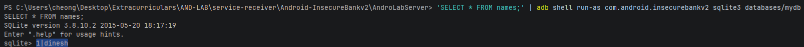</figure>

로그인 시 사용했던 dinesh라는 사용자명이 노출된 걸 확인할 수 있습니다.

<h4 data-ke-size="size20">2-3. 외부 저장소</h4>

외부 저장소에 민감 정보를 저장하는 부분이 있는지 찾아보겠습니다.

 

매니페스트엔 외부 저장소의 파일에 쓸 수 있는 권한이 있습니다.

<figure class="imageblock alignCenter" data-ke-mobilestyle="widthOrigin" data-origin-height="82" data-origin-width="622">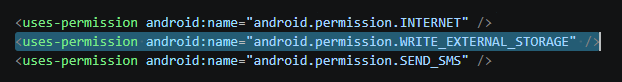</figure>

 

실제로 외부 저장소에 민감 정보를 저장하는지 확인해보겠습니다.

외부 저장소와 관련된 메서드 중 공유 외부 저장소의 루트 경로를 가져오는 메서드인 getExternalStorageDirectory를 검색했는데 DoTransfer.java 코드에서 찾을 수 있었습니다.

<figure class="imageblock alignCenter" data-ke-mobilestyle="widthOrigin" data-origin-height="180" data-origin-width="911">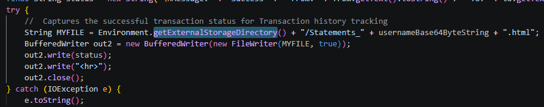</figure>

코드를 보면 getExternalStorageDirectory()를 이용해 공유 외부저장소의 경로를 가져오고 사용자명이 포함된 html 파일을 생성합니다.

 

어떤 정보가 저장되는지 확인해보겠습니다.

 

다음 부분을 보면 계좌 이체에 성공했을 때 계좌 이체 성공 여부, 출금 계좌, 입금 계좌, 이체 금액을 문자열로 생성 후 저장하고 있습니다. 

<figure class="imageblock alignCenter" data-ke-mobilestyle="widthOrigin" data-origin-height="217" data-origin-width="1424">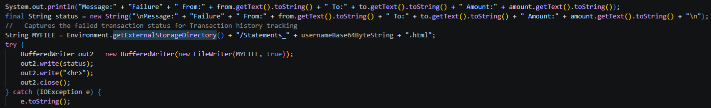</figure>

이체가 성공하면 Statemount_&lt;문자열&gt;.html 형식으로 파일이 생성되고 그 파일 안에 문자열이 적히는 방식 같은데 &lt;문자열&gt;에 들어가는 것이 무엇일까요...

 

일단 앱에서 이체를 해보겠습니다. (열어둔 서버가 닫히지 않도록 하세요... 왜 안 되지 했네)

<figure class="imageblock alignCenter" data-filename="스크린샷 2026-11-20 230136.png" data-ke-mobilestyle="widthOrigin" data-origin-height="806" data-origin-width="401">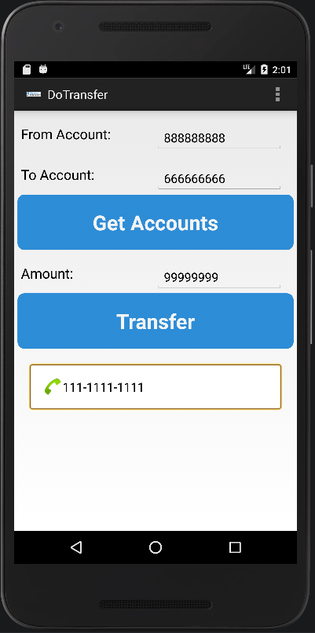</figure>

값들을 다 채우고 Transfer를 클릭해 이체해보겠습니다.

<figure class="imageblock alignCenter" data-ke-mobilestyle="widthOrigin" data-origin-height="230" data-origin-width="535">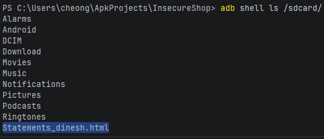</figure>

외부 저장소인 sdcard 경로에 Statements_&lt;문자열&gt;.html 형식의 파일인 Statements_dinesh.html 파일이 있습니다.

 

run-as 명령어로 이체 관련 정보들을 출력할 수 있습니다.

<pre class="bash" data-ke-language="bash" data-ke-type="codeblock" id="code_1795183489456"><code class="hljs">adb shell run-as com.android.insecurebankv2 cat /sdcard/Statements_dinesh.html</code></pre>

<figure class="imageblock alignCenter" data-ke-mobilestyle="widthOrigin" data-origin-height="121" data-origin-width="993">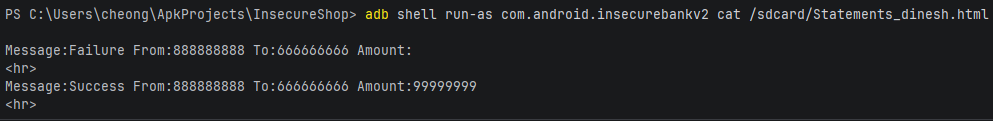</figure>

 

이것도 API 23에서 했던 것과 같이 API 33에서 따라해보도록 하겠습니다.

 

SharedPreferences :

<figure class="imageblock alignCenter" data-ke-mobilestyle="widthOrigin" data-origin-height="115" data-origin-width="1041">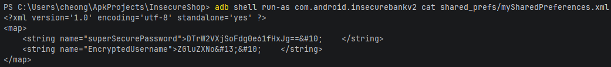</figure>

 

SQLite :

<figure class="imageblock alignCenter" data-ke-mobilestyle="widthOrigin" data-origin-height="49" data-origin-width="1098">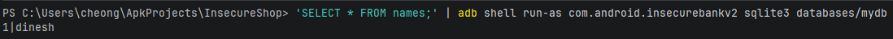</figure>

 

외부 저장소 : 

<figure class="imageblock alignCenter" data-ke-mobilestyle="widthOrigin" data-origin-height="47" data-origin-width="1010">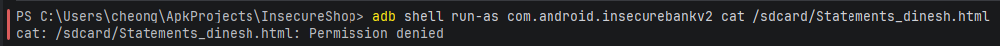</figure>

다른 두 실습은 API 23과 결과가 같았는데 외부 저장소 파트만 Permission denied가 떴습니다.

<figure class="imageblock alignCenter" data-ke-mobilestyle="widthOrigin" data-origin-height="76" data-origin-width="725">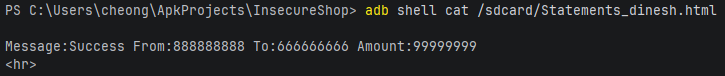</figure>

+ run-as(일반 앱 UID)로는 접근 불가능인데 shell 권한으로는 접근 가능

<h3 data-ke-size="size23">3. 실습 결과 및 총정리</h3>
<h4 data-ke-size="size20">3-1. 결과 비교</h4>

InsecureShop과 InsecureBankv2에서 SharedPreferences, SQLite, 외부 저장소에 저장된 데이터를 확인하고 API 23과 API 33에서 동일한 실습을 진행했습니다.

 

실습 결과를 정리하면 다음과 같습니다.

<table border="1" data-ke-align="alignLeft" data-ke-style="style14" data-pm-slice="3 3 []" style="border-collapse: collapse; width: 100%;">
<tbody>
<tr>
<td style="width: 37.2093%; text-align: center;">구분</td>
<td style="width: 37.5582%; text-align: center;">API 23</td>
<td style="width: 25.2325%; text-align: center;">API 33</td>
</tr>
<tr>
<td style="width: 37.2093%; text-align: center;">InsecureShop - SharedPreferences</td>
<td style="width: 37.5582%; text-align: center;">평문 인증 정보 노출</td>
<td style="width: 25.2325%; text-align: center;">동일</td>
</tr>
<tr>
<td style="width: 37.2093%; text-align: center;">InsecureShop - SQLite</td>
<td style="width: 37.5582%; text-align: center;">X</td>
<td style="width: 25.2325%; text-align: center;">X</td>
</tr>
<tr>
<td style="width: 37.2093%; text-align: center;">InsecureShop - 외부 저장소</td>
<td style="width: 37.5582%; text-align: center;">X</td>
<td style="width: 25.2325%; text-align: center;">X</td>
</tr>
<tr>
<td style="width: 37.2093%; text-align: center;">InsecureBankv2 - SharedPreferences</td>
<td style="width: 37.5582%; text-align: center;">인코딩·암호화된 인증 정보 확인</td>
<td style="width: 25.2325%; text-align: center;">동일</td>
</tr>
<tr>
<td style="width: 37.2093%; text-align: center;">InsecureBankv2 - SQLite</td>
<td style="width: 37.5582%; text-align: center;">사용자명 노출</td>
<td style="width: 25.2325%; text-align: center;">동일</td>
</tr>
<tr>
<td style="width: 37.2093%; text-align: center;">InsecureBankv2 - 외부 저장소</td>
<td style="width: 37.5582%; text-align: center;">이체 내역 확인 성공</td>
<td style="width: 25.2325%; text-align: center;">Permission denied</td>
</tr>
</tbody>
</table>

 

<h4 data-ke-size="size20">3-2. API 23 vs API 33 저장소 정책 차이</h4>

API 23과 API 33은 저장소 관련 보안 정책에 차이가 있습니다.

 

먼저 MODE_WORLD_READABLE은 다른 앱에서도 파일을 읽을 수 있도록 하는 모드입니다. API 17부터 지원 중단됐으며, API 24부터는 사용 시 SecurityException이 발생합니다.

<a href="https://developer.android.com/training/data-storage/shared-preferences?hl=ko">SharedPreferences로 단순 데이터 저장하기  |  App data and files  |  Android Developers</a>

<figure contenteditable="false" data-ke-align="alignCenter" data-ke-type="opengraph" data-og-description="SharedPreferences API를 사용하여 Android 앱의 키-값 쌍 컬렉션을 저장하고 검색하는 방법을 알아봅니다." data-og-host="developer.android.com" data-og-image="/assets/img/and-lab/08/og-02.png" data-og-source-url="https://developer.android.com/training/data-storage/shared-preferences?hl=ko" data-og-title="SharedPreferences로 단순 데이터 저장하기  |  App data and files  |  Android Developers" data-og-type="website" data-og-url="https://developer.android.com/training/data-storage/shared-preferences?hl=ko" id="og_1795185695577"><a data-source-url="https://developer.android.com/training/data-storage/shared-preferences?hl=ko" href="https://developer.android.com/training/data-storage/shared-preferences?hl=ko" rel="noopener" target="_blank">

 

SharedPreferences로 단순 데이터 저장하기  |  App data and files  |  Android Developers

SharedPreferences API를 사용하여 Android 앱의 키-값 쌍 컬렉션을 저장하고 검색하는 방법을 알아봅니다.

developer.android.com

</a></figure>

 

Scoped Storage는 앱의 외부 저장소 접근 범위를 제한하는 정책으로, Android 10부터 도입됐으며 Android 11부터 API 30 이상을 타겟팅하는 앱에 의무적으로 적용됩니다.

<a href="https://source.android.com/docs/core/storage/scoped?hl=en">Scoped storage  |  Android OS core topics  |  Android Open Source Project</a>

<figure contenteditable="false" data-ke-align="alignCenter" data-ke-type="opengraph" data-og-description="2026년부터 트렁크 안정 개발 모델과 일치하고 생태계의 플랫폼 안정성을 보장하기 위해 2분기와 4분기에 AOSP에 소스 코드를 게시합니다. AOSP를 빌드하고 기여하려면 android-latest-release를 사용하세" data-og-host="source.android.com" data-og-image="" data-og-source-url="https://source.android.com/docs/core/storage/scoped?hl=en" data-og-title="범위 지정 저장소  |  Android OS core topics  |  Android Open Source Project" data-og-type="website" data-og-url="https://source.android.com/docs/core/storage/scoped" id="og_1795185642292"><a data-source-url="https://source.android.com/docs/core/storage/scoped?hl=en" href="https://source.android.com/docs/core/storage/scoped?hl=en" rel="noopener" target="_blank">

 

범위 지정 저장소  |  Android OS core topics  |  Android Open Source Project

2026년부터 트렁크 안정 개발 모델과 일치하고 생태계의 플랫폼 안정성을 보장하기 위해 2분기와 4분기에 AOSP에 소스 코드를 게시합니다. AOSP를 빌드하고 기여하려면 android-latest-release를 사용하세

source.android.com

</a></figure>

즉, 과거에는 적절한 권한이 있다면 외부 저장소에 비교적 자유롭게 접근할 수 있었지만, 최신 Android에서는 접근 범위가 제한됩니다.

 

이번 실습에서는 API 23과 API 33에서 대부분 동일한 결과가 나왔으나, InsecureBankv2의 외부 저장소에서는 차이가 있었습니다.

 

API 23에서는 run-as로 파일을 읽을 수 있었지만 API 33에서는 Permission denied가 발생했습니다. 다만 일반 adb shell에서는 읽을 수 있었으므로, 접근 주체에 따라 결과가 달라진 것을 확인했습니다.


