

<h2 data-ke-size="size26">목표</h2>

Google 후원 HexTree 안드로이드 코스(14개 마이크로코스, 50+ 실습)를 팀 단위로 나눠 완주하고 각 모듈 핵심 요약

<h2 data-ke-size="size26">실습 환경</h2>
<ul data-ke-list-type="disc" style="list-style-type: disc;">
<li>각 코스에서 지정하는 환경</li>
</ul>
<h2 data-ke-size="size26">hextree</h2>

헥스트리는 구글에서 후원하는 해킹 &amp; 보안을 공부할 수 있는 플랫폼입니다. 리버싱, 웹, 하드웨어, 안드로이드 등 다양한 Path가 있습니다.

<a href="https://app.hextree.io/" rel="noopener noreferrer" target="_blank">https://app.hextree.io/</a>

<figure contenteditable="false" data-ke-align="alignCenter" data-ke-type="opengraph" data-og-description="Grow your cybersecurity skills with handcrafted and well edited courses" data-og-host="app.hextree.io" data-og-image="/assets/img/and-lab/09/og-01.png" data-og-source-url="https://app.hextree.io/" data-og-title="hextree.io" data-og-type="website" data-og-url="https://app.hextree.io/" id="og_1794987683266"><a data-source-url="https://app.hextree.io/" href="https://app.hextree.io/" rel="noopener" target="_blank">

 

hextree.io

Grow your cybersecurity skills with handcrafted and well edited courses

app.hextree.io

</a></figure>

 

헥스트리에 접속하면 다음과 같은 그래프뷰가 나옵니다.

오른쪽 하단에 있는 Android Path를 완주해보겠습니다.

<figure class="imageblock alignCenter" data-filename="blob" data-ke-mobilestyle="widthOrigin" data-origin-height="989" data-origin-width="1917">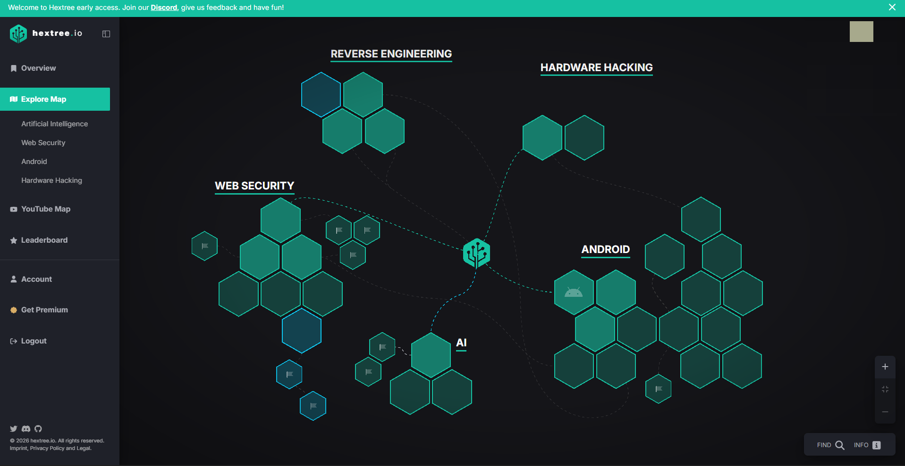</figure>

각 챕터마다 적은 순서는 제가 구분하기 위해 적은 것입니다. 실제 수강 순서와 관련 X

<h2 data-ke-size="size26">1. Research Device &amp; Emulator Setup</h2>
<ul data-ke-list-type="disc" style="list-style-type: disc;">
<li>강좌 개요 : 안드로이드 애플리케이션 분석을 위한 연구 환경 구축 방법 학습</li>
</ul>

Research Device &amp; Emulator Setup 강좌 구성

<ol data-ke-list-type="decimal" style="list-style-type: decimal;">
<li>Basic Research Setup</li>
<li>The Android Debug Bridge (adb)</li>
</ol>
<h3 data-ke-size="size23">1-1. Basic Research Setup</h3>
<h4 data-ke-size="size20">1-1-1. Physical Device</h4>

<b>요약</b>

연구용 기기 설정 방법 : 안드로이드 기기 설정 -&gt; 맨 아래로 스크롤 -&gt; "휴대전화 정보" 클릭 -&gt; "소프트웨어 정보" 클릭 -&gt; 빌드 번호 7번 탭

=&gt; "개발자 옵션" 항목 활성화 

=&gt; "개발자 옵션" -&gt; USB 디버깅 활성화 가능

<h4 data-ke-size="size20">1-1-2. Setup Android Emulator</h4>

<b>요약</b>

PC에서 Android Emulator를 사용하기 위해 Android Studio 설치

<a href="https://developer.android.com/studio" rel="noopener noreferrer" target="_blank">https://developer.android.com/studio</a>

<figure contenteditable="false" data-ke-align="alignCenter" data-ke-type="opengraph" data-og-description="Android 스튜디오는 Android 앱에 최적화된 통합 개발 환경(IDE)을 앱 빌더에게 제공합니다. 지금 Android 스튜디오를 다운로드하세요." data-og-host="developer.android.com" data-og-image="/assets/img/and-lab/09/og-02.png" data-og-source-url="https://developer.android.com/studio" data-og-title="Android 스튜디오 및 앱 도구 다운로드 - Android 개발자  |  Android Studio  |  Android Developers" data-og-type="website" data-og-url="https://developer.android.com/studio?hl=ko" id="og_1794990646761"><a data-source-url="https://developer.android.com/studio" href="https://developer.android.com/studio" rel="noopener" target="_blank">

 

Android 스튜디오 및 앱 도구 다운로드 - Android 개발자  |  Android Studio  |  Android Developers

Android 스튜디오는 Android 앱에 최적화된 통합 개발 환경(IDE)을 앱 빌더에게 제공합니다. 지금 Android 스튜디오를 다운로드하세요.

developer.android.com

</a></figure>

(저는 이미 설치가 되어 있어서 넘기겠습니당)

<h4 data-ke-size="size20">1-1-3. Using the Emulator</h4>

<b>요약</b>

안드로이드 에뮬레이터는 실제 안드로이드 폰처럼 작동

<h3 data-ke-size="size23">1-2. The Android Debug Bridge (adb)</h3>
<ul data-ke-list-type="disc" style="list-style-type: disc;">
<li>강좌 개요 : adb의 구성 요소 및 동작 구조 이해 및 기본 adb 명령어를 통해 안드로이드 기기와 통신하는 법 학습</li>
</ul>
<h4 data-ke-size="size20">1-2-1. Introduction to adb</h4>

<b>요약</b>

adb(Android Debuf Bridge) : PC와 안드로이드 기기 간 통신을 지원하는 도구.

 

adb의 구성 요소

<ul data-ke-list-type="disc" style="list-style-type: disc;">
<li>Client : 사용자가 입력한 명령어를 server에 전달</li>
<li>Server : Client와 Daemon 간의 연결 및 통신 관리</li>
<li>Daemon : 안드로이드 기기에서 실행되며 전달 받은 요청 처리</li>
</ul>

환경 변수 설정

: 터미널에서 adb 명령어를 사용할 수 있도록 PATH 환경 변수에 platform-tools 디렉토리 경로 추가

<ul data-ke-list-type="disc" style="list-style-type: disc;">
<li>windows : C:\Users\[Your-Username]\AppData\Local\Android\Sdk\platform-tools directory</li>
<li>macOS : ~/Library/Android/sdk/platform-tools</li>
</ul>

adb 기본 명령어

<ul data-ke-list-type="disc" style="list-style-type: disc;">
<li>adb devices : 연결된 기기 목록 확인</li>
<li>adb version : adb 설치 &amp; 버전 확인</li>
<li>adb -s emulator-5554 shell : 특정 기기를 지정하여 쉘 접속</li>
<li>adb -d shell : 단일 USB 장치를 사용하도록 지정</li>
<li>adb shell : 안드로이드 기기의 일반 리눅스 쉘 지정</li>
</ul>
<h4 data-ke-size="size20">1-2-2. Transferring Files</h4>

adb push : 컴퓨터에서 안드로이드 기기로 파일 전송

명령어 형식 : 

<pre class="bash" data-ke-language="bash" data-ke-type="codeblock" id="code_1795001778039"><code class="hljs">adb push &lt;local_file_on_computer&gt; &lt;target_path_on_device&gt;</code></pre>

파일을 전송할 목적지 경로로 일반적으로 /sdcard/ 경로를 사용 -&gt; 이 경로는 외부 SD 카드가 아닌 기기의 내부 저장소에 마운트

 

예시 :

<pre class="bash" data-ke-language="bash" data-ke-type="codeblock" id="code_1795001942562"><code class="hljs">adb push Desktop/test.png /sdcard/Downloads/</code></pre>

: 컴퓨터 바탕화면의 test.png를 안드로이드 기기의 다운로드 폴더로 전송

 

adb pull : 안드로이드 기기에서 컴퓨터로 파일 전송

명령어 형식 :

<pre class="bash" data-ke-language="bash" data-ke-type="codeblock" id="code_1795001840458"><code class="hljs">adb pull &lt;file_path_on_device&gt; [&lt;optional_target path_on_the_computer&gt;]</code></pre>

adb pull 사용 시 adb shell에서 접근할 수 있는 파일에만 접근 가능

<h4 data-ke-size="size20">1-2-3. Managing Apps</h4>

adb를 통해 애플리케이션 설치, 삭제, 데이터 초기화, 패키지 정보 확인, 액티비티 실행 등 가능

<table border="1" data-ke-align="alignLeft" data-ke-style="style14" style="border-collapse: collapse; width: 100%;">
<tbody>
<tr>
<td style="width: 50.2326%; text-align: center;">명령어</td>
<td style="width: 49.7674%; text-align: center;">설명</td>
</tr>
<tr>
<td style="width: 50.2326%; text-align: center;">adb install &lt;apk_path&gt;</td>
<td style="width: 49.7674%; text-align: center;">apk 설치</td>
</tr>
<tr>
<td style="width: 50.2326%; text-align: center;">adb shell pm list packages</td>
<td style="width: 49.7674%; text-align: center;">전체 패키지 목록 출력</td>
</tr>
<tr>
<td style="width: 50.2326%; text-align: center;">adb shell pm list packages -3</td>
<td style="width: 49.7674%; text-align: center;">서드 파티 패키지 목록 출력</td>
</tr>
<tr>
<td style="width: 50.2326%; text-align: center;">adb shell pm clear &lt;package_name&gt;</td>
<td style="width: 49.7674%; text-align: center;">애플리케이션 데이터 초기화</td>
</tr>
<tr>
<td style="width: 50.2326%; text-align: center;">adb shell dumpsys package &lt;package_name&gt;</td>
<td style="width: 49.7674%; text-align: center;">패키지 상세 정보 출력</td>
</tr>
<tr>
<td style="width: 50.2326%; text-align: center;">adb shell am start &lt;package_name&gt;/&lt;activity_name&gt;</td>
<td style="width: 49.7674%; text-align: center;">특정 activity 실행</td>
</tr>
<tr>
<td style="width: 50.2326%; text-align: center;">adb uninstall &lt;package_name&gt;</td>
<td style="width: 49.7674%; text-align: center;">애플리케이션 삭제</td>
</tr>
</tbody>
</table>

 

<b>실습 1</b>

: 주어진 애플리케이션을 설치하고 실행하여 플래그 획득

 

실습 환경 : AOSP API 36.0

 

주어진 adb_test_application.apk를 에뮬레이터에 드래그 앤 드랍으로 설치 후, 앱을 실행하면 플래그가 나옵니다.

<figure class="imageblock alignCenter" data-ke-mobilestyle="widthOrigin" data-origin-height="929" data-origin-width="415">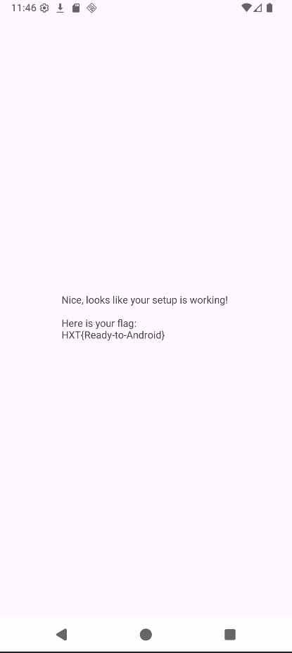</figure>

FLAG : HEX{Ready-to-Android}

<figure class="imageblock alignCenter" data-ke-mobilestyle="widthOrigin" data-origin-height="179" data-origin-width="923">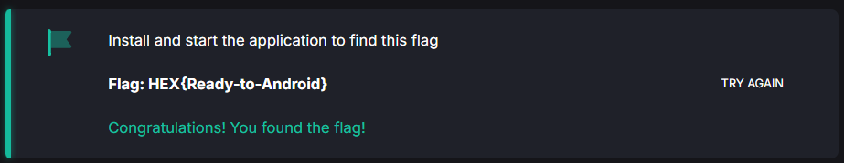</figure>

 

<b>실습 2</b>

: dumpsys를 사용하여 숨겨진 액티비티를 am을 사용하여 실행

 

실습 환경 : AOSP API 36.0

 

adb_test_application.apk의 패키지명을 알기 위해 jadx로 apk를 열었습니다.

AndroidManifest.xml에서 패키지명이 io.hextree.adbtestapplication인 걸 알 수 있습니다.

<figure class="imageblock alignCenter" data-ke-mobilestyle="widthOrigin" data-origin-height="145" data-origin-width="553">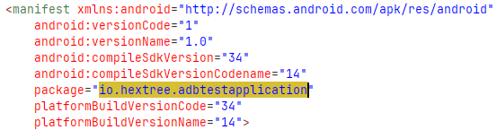</figure>

dumpsys 명령어로 숨겨진 액티비티를 찾아보겠습니다.

<pre class="bash" data-ke-language="bash" data-ke-type="codeblock" id="code_1795090473108"><code class="hljs">adb shell dumpsys package io.hextree.adbtestapplication</code></pre>

io.hextree.adbtestapplication.HiddenActivity라는 숨겨진 액티비티가 있는 것을 확인할 수 있습니다.

<figure class="imageblock alignCenter" data-ke-mobilestyle="widthOrigin" data-origin-height="204" data-origin-width="614">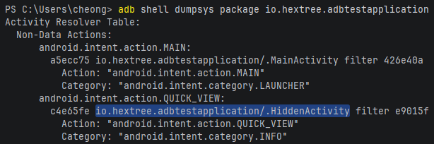</figure>

특정 액티비티를 실행하는 adb shell am start 명령어를 사용해 숨겨진 액티비티를 실행해보겠습니다.

<pre class="bash" data-ke-language="bash" data-ke-type="codeblock" id="code_1795090597199"><code class="hljs">adb shell am start io.hextree.adbtestapplication/io.hextree.adbtestapplication.HiddenActivity</code></pre>

<figure class="imageblock alignCenter" data-ke-mobilestyle="widthOrigin" data-origin-height="45" data-origin-width="1132">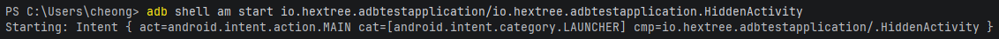</figure>

명령어를 실행하면 화면이 바뀌며 플래그가 나옵니다.

<figure class="imageblock alignCenter" data-ke-mobilestyle="widthOrigin" data-origin-height="924" data-origin-width="418">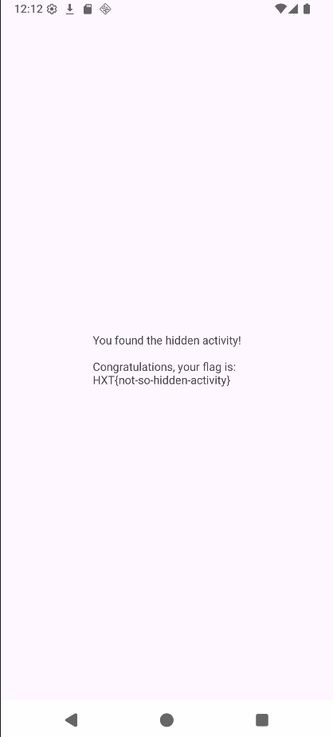</figure>

FLAG : HXT{not-so-hidden-activity}

<figure class="imageblock alignCenter" data-ke-mobilestyle="widthOrigin" data-origin-height="173" data-origin-width="921">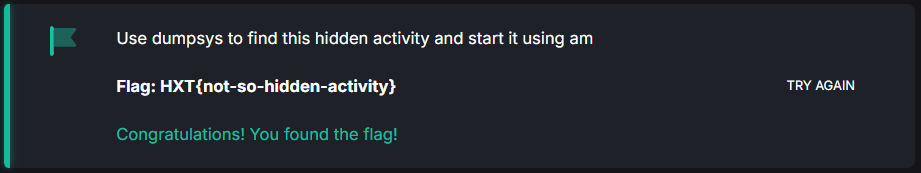</figure>

 

<h4 data-ke-size="size20">2-4. Exploring Logs with logcat</h4>

<b>요약</b>

adb logcat : 안드로이드 기기의 로그 확인 명령어

명령어 형식 : 

<pre class="bash" data-ke-language="bash" data-ke-type="codeblock" id="code_1795092134453"><code class="hljs">adb logcat -v &lt;log_format&gt;</code></pre>

-v 옵션 : 로그 출력 형식 변경 가능

 

Log Filtering : 특정 태그 및 로그 레벨을 기준으로 필요한 로그만 출력

명령어 형식 : 

<pre class="bash" data-ke-language="bash" data-ke-type="codeblock" id="code_1795092196242"><code class="hljs">adb logcat "MainActivity:V *:S"</code></pre>

MainActivity:V : MaintActivity 태그의 Verbose 이상 로그 출력

*:S : 나머지 모든 태그의 로그 출력 차단

 

로그 심각도(Logging Severities) :

<table border="1" data-ke-align="alignLeft" data-ke-style="style14" style="border-collapse: collapse; width: 46.9768%; height: 168px;">
<tbody>
<tr style="height: 21px;">
<td style="height: 21px; width: 6.95869%; text-align: center;">기호</td>
<td style="height: 21px; width: 21.5453%; text-align: center;">로그 레벨</td>
<td style="height: 21px; width: 13.4832%; text-align: center;">의미</td>
</tr>
<tr style="height: 21px;">
<td style="height: 21px; width: 6.95869%; text-align: center;">V</td>
<td style="height: 21px; width: 21.5453%; text-align: center;">Verbose</td>
<td style="height: 21px; width: 13.4832%; text-align: center;">상세 정보</td>
</tr>
<tr style="height: 21px;">
<td style="height: 21px; width: 6.95869%; text-align: center;">D</td>
<td style="height: 21px; width: 21.5453%; text-align: center;">Debug</td>
<td style="height: 21px; width: 13.4832%; text-align: center;">디버깅 정보</td>
</tr>
<tr style="height: 21px;">
<td style="height: 21px; width: 6.95869%; text-align: center;">I</td>
<td style="height: 21px; width: 21.5453%; text-align: center;">Info</td>
<td style="height: 21px; width: 13.4832%; text-align: center;">일반 정보</td>
</tr>
<tr style="height: 21px;">
<td style="height: 21px; width: 6.95869%; text-align: center;">W</td>
<td style="height: 21px; width: 21.5453%; text-align: center;">Warning</td>
<td style="height: 21px; width: 13.4832%; text-align: center;">경고</td>
</tr>
<tr style="height: 21px;">
<td style="height: 21px; width: 6.95869%; text-align: center;">E</td>
<td style="height: 21px; width: 21.5453%; text-align: center;">Error</td>
<td style="height: 21px; width: 13.4832%; text-align: center;">오류</td>
</tr>
<tr style="height: 21px;">
<td style="height: 21px; width: 6.95869%; text-align: center;">F</td>
<td style="height: 21px; width: 21.5453%; text-align: center;">Fatal</td>
<td style="height: 21px; width: 13.4832%; text-align: center;">치명적 오류</td>
</tr>
<tr style="height: 21px;">
<td style="height: 21px; width: 6.95869%; text-align: center;">S</td>
<td style="height: 21px; width: 21.5453%; text-align: center;">Silent</td>
<td style="height: 21px; width: 13.4832%; text-align: center;">출력하지 않음</td>
</tr>
</tbody>
</table>

 

<b>실습</b> : 로그 메시지에서 플래그 찾기

 

앞선 실습에서 사용한 애플리케이션을 실행 중인 상태에서 다음 명령어를 실행해보겠습니다.

<pre class="bash" data-ke-language="bash" data-ke-type="codeblock" id="code_1795092650745"><code class="hljs">adb logcat -v brief "MainActivity:V *:S"</code></pre>

해당 애플리케이션의 MainActivity 액티비티에서 심각도가 높은 로그를 출력하는 명령어입니다.

 

위 명령어를 실행하면 플래그가 나옵니다.

<figure class="imageblock alignCenter" data-ke-mobilestyle="widthOrigin" data-origin-height="65" data-origin-width="764">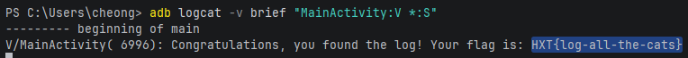</figure>
<figure class="imageblock alignCenter" data-ke-mobilestyle="widthOrigin" data-origin-height="172" data-origin-width="921">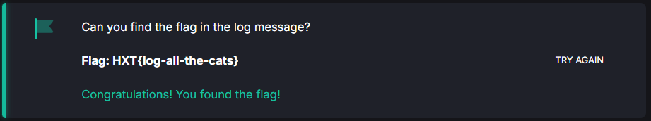</figure>

FLAG : HXT{log-all-the-cats}

<h2 data-ke-size="size26">2. Your First Android App</h2>

강좌 개요 : 간단한 안드로이드 애플리케이션 제작

 

강좌 구성

<ol data-ke-list-type="decimal" style="list-style-type: decimal;">
<li>Building a Clicker APp</li>
<li>Special Android Features</li>
<li>Debugging and Sharing</li>
</ol>
<h3 data-ke-size="size23">2-1. Building a Clicker App</h3>
<h4 data-ke-size="size20">2-1-1. Android Studio Project Setup</h4>

<b>요약</b>

안드로이드 스튜디오 설치 후 애플리케이션 제작

 

실습 과정

<ol data-ke-list-type="decimal" style="list-style-type: decimal;">
<li>안드로이드 스튜디오 설치</li>
<li>Empty Views Activity 템플릿 선택</li>
<li>프로그래밍 언어 Java 선택</li>
<li>안드로이드 에뮬레이터 설정</li>
<li>애플리케이션 빌드 및 실행</li>
</ol>

전 이미 안드로이드 스튜디오가 설치되어 있어서 새로운 프로젝트에서 애플리케이션을 만들어 보겠습니다.

New Project 클릭 후 Basic Views Activity 선택 (강의 녹화 당시 안드로이드 스튜디오 버전과 제 안드로이드 스튜디오 버전이 달라서 그런지 화면이 다를 수도...)

<figure class="imageblock alignCenter" data-ke-mobilestyle="widthOrigin" data-origin-height="647" data-origin-width="898">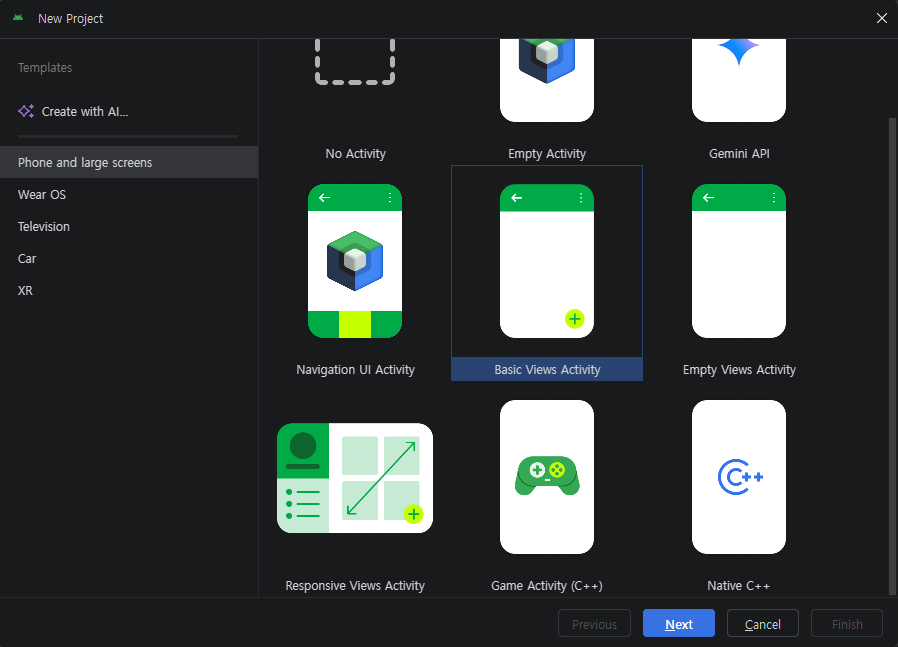</figure>

강의 영상과 똑같이 설정하고 Finish를 클릭합니다.

그럼 좀 기다리면 모든 설정이 완료될 겁니다.

이렇겡

<figure class="imageblock alignCenter" data-filename="스크린샷(2087).png" data-ke-mobilestyle="widthOrigin" data-origin-height="1080" data-origin-width="1920">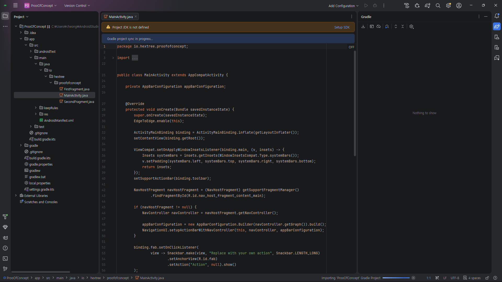</figure>

 

<figure class="imageblock alignCenter" data-ke-mobilestyle="widthOrigin" data-origin-height="643" data-origin-width="893">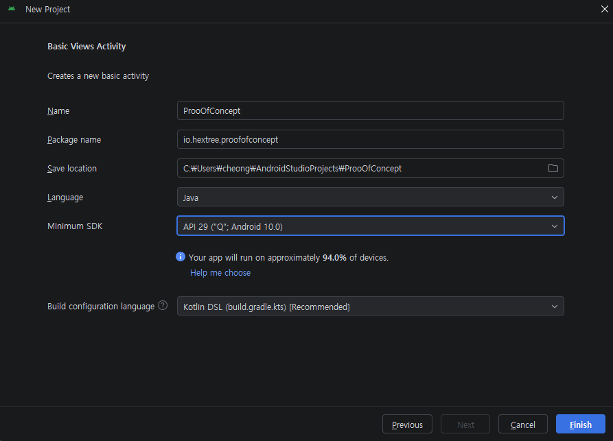</figure>

좌측 상단의 Tools -&gt; Device Manager 또는,

<figure class="imageblock alignCenter" data-ke-mobilestyle="widthOrigin" data-origin-height="486" data-origin-width="630">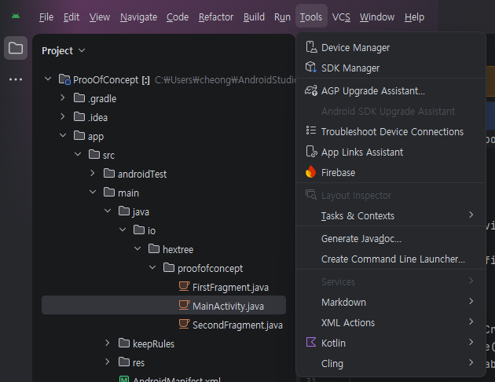</figure>

우측 사이드바에 있는 Device Manager에서 + 아이콘을 눌러 가상 머신을 생성할 수 있습니다.

<figure class="imageblock alignCenter" data-ke-mobilestyle="widthOrigin" data-origin-height="372" data-origin-width="516">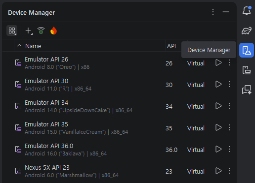</figure>

전 이미 많은 에뮬레이터가 있으므로...

강의 영상에서 설정한 API 34 버전으로 진행하겠습니다.

 

상단의 Run 버튼을 클릭하여 앱을 실행할 수 있습니다.

<figure class="imageblock alignCenter" data-ke-mobilestyle="widthOrigin" data-origin-height="118" data-origin-width="377">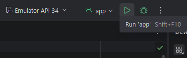</figure>

기본 설정 그대로 둔 것이라 실행하면 에뮬레이터 화면은 다음과 같이 뜨게 됩니다.

<figure class="imageblock alignCenter" data-ke-mobilestyle="widthOrigin" data-origin-height="900" data-origin-width="404">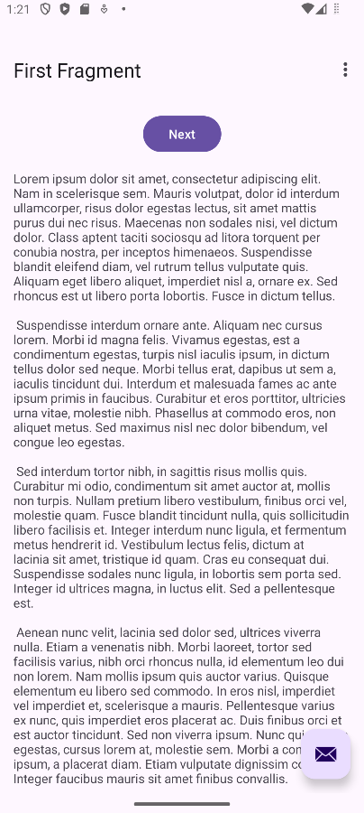</figure>

<h4 data-ke-size="size20">2-1-2. The Application Layout</h4>

<b>요약</b>

레이아웃 : 안드로이드 애플리케이션의 User Interface(UI)를 구성하며, 내부적으로 xml 파일로 구성

안드로이드 스튜디오에서 제공하는 Layout Editor를 통해 UI 편집 가능

 

UI 요소 참조 및 조작

<ul data-ke-list-type="disc" style="list-style-type: disc;">
<li>ID : 각 UI 요소에 부여할 수 있는 식별자</li>
<li>R : 다양한 리소스를 기반으로 자동 생성되는 리소스 참조 클래스</li>
<li>R.id.home_text : home_text ID를 참조하는 식별자</li>
<li>findViewById() : ID를 기반으로 UI 요소를 찾는 메서드</li>
<li>seText() : UI 요소의 텍스트를 변경하는 메서드</li>
</ul>

onCreate() : UI 상에 보이는 부분

<figure class="imageblock alignCenter" data-ke-mobilestyle="widthOrigin" data-origin-height="514" data-origin-width="1389">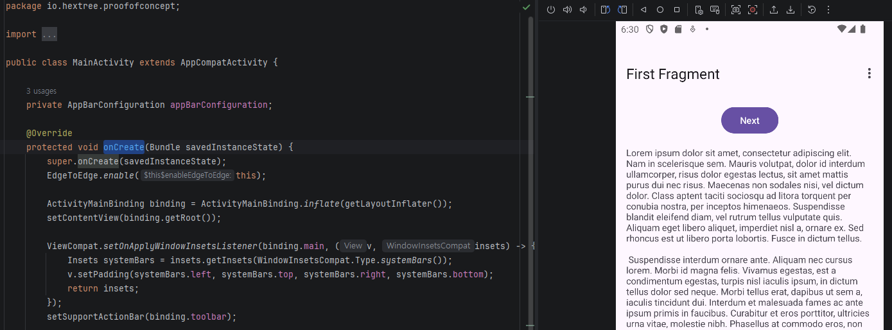</figure>

<h4 data-ke-size="size20">2-1-3. Handling Button Clicks</h4>

<b>요약</b>

OnClickListener를 사용하여 버튼 클릭 시 특정 동작을 실행하도록 설정 가능

<ul data-ke-list-type="disc" style="list-style-type: disc;">
<li>findViewById() : home_button ID를 가진 버튼 참조</li>
<li>setOnClickListener() : 버튼 클릭 이벤트를 처리할 리스너 등록</li>
<li>onClick() : 버튼 클릭 시 실행되는 메서드</li>
<li>Log.v() : Verbose 레벨의 로그 출력</li>
</ul>

 

안드로이드 스튜디오 레이아웃 편집기에서 여러 구성 요소 편집 가

<figure class="imageblock alignCenter" data-ke-mobilestyle="widthOrigin" data-origin-height="992" data-origin-width="1259">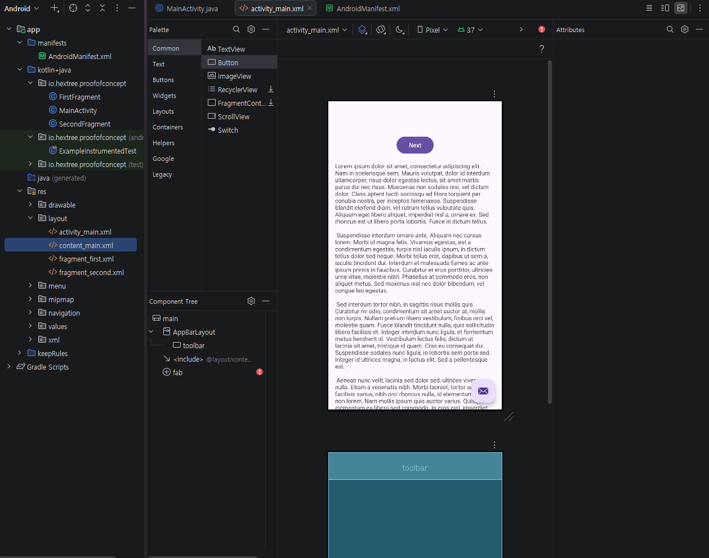</figure>

버튼 속성도 편집 가능 신기하당

<figure class="imageblock alignCenter" data-ke-mobilestyle="widthOrigin" data-origin-height="926" data-origin-width="859">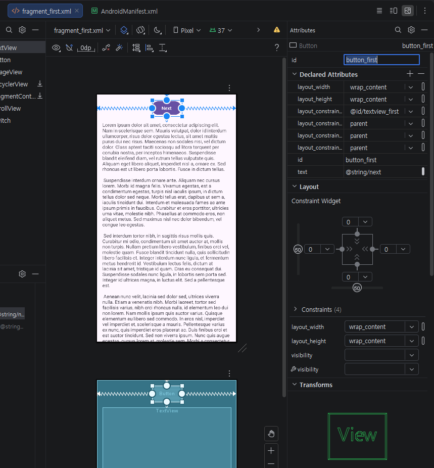</figure>

왼쪽 사이드바의 Button 요소를 컴포넌트 트리 부분에 드래그 앤 드랍하여 요소 추가 가능

<figure class="imageblock alignCenter" data-ke-mobilestyle="widthOrigin" data-origin-height="654" data-origin-width="985">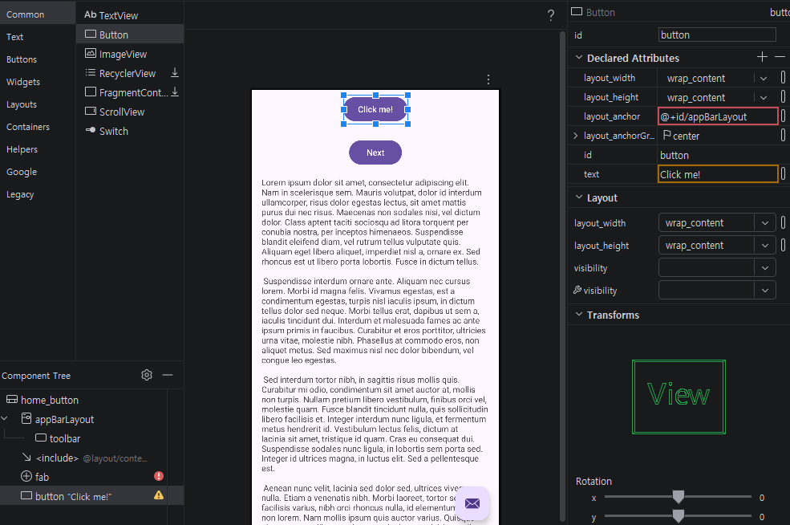</figure>

다음 코드를 MainActivity.java 코드의 onCreate() 함수 끝에 추가

<pre class="java" data-ke-language="java" data-ke-type="codeblock" id="code_1795244494168"><code class="hljs">Button homeButton = findViewById(R.id.home_button);
homeButton.setOnClickListener(new View.OnClickListener() {
    @Override
    public void onClick(View v) {
        Log.v("HEXTREE", "Button has been clicked!");
    }
});</code></pre>

<figure class="imageblock alignCenter" data-ke-mobilestyle="widthOrigin" data-origin-height="783" data-origin-width="1568">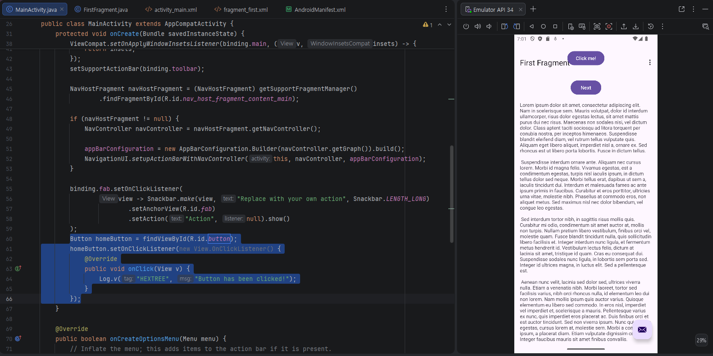</figure>

새로 추가한 Click me! 라는 버튼 클릭 시, 로그캣을 보면 나오는 화면

<figure class="imageblock alignCenter" data-ke-mobilestyle="widthOrigin" data-origin-height="57" data-origin-width="844">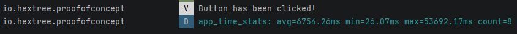</figure>

<h4 data-ke-size="size20">2-1-4. The Official Development Documentation</h4>

<b>요약</b>

안드로이드 공식 개발 문서를 활용하여 앱 개발에 필요한 기능 및 사용법 확인

<a href="https://developer.android.com/" rel="noopener noreferrer" target="_blank">https://developer.android.com/</a>

<figure contenteditable="false" data-ke-align="alignCenter" data-ke-type="opengraph" data-og-description="Discover the latest app development tools, platform updates, training, and documentation for developers across every Android device." data-og-host="developer.android.com" data-og-image="/assets/img/and-lab/09/og-03.png" data-og-source-url="https://developer.android.com/" data-og-title="Android 모바일 앱 개발자 도구 - Android Developers" data-og-type="website" data-og-url="https://developer.android.com/?hl=ko" id="og_1795244650281"><a data-source-url="https://developer.android.com/" href="https://developer.android.com/" rel="noopener" target="_blank">

 

Android 모바일 앱 개발자 도구 - Android Developers

Discover the latest app development tools, platform updates, training, and documentation for developers across every Android device.

developer.android.com

</a></figure>

문자열을 Java 코드나 레이아웃에 직접 작성하는 대신 strings.xml에 정의하여 관리 가능

 

MainActivity.java 파일은 다음과 같이 수정 (위에 int형 변수 counter 선언해야 함)

<figure class="imageblock alignCenter" data-ke-mobilestyle="widthOrigin" data-origin-height="182" data-origin-width="543">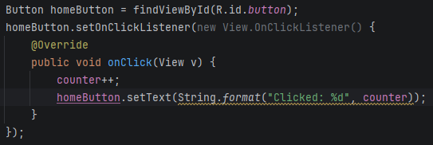</figure>

/values/strings.xml 파일은 뚱쭝한 텍스트 좀 지우고, &lt;string&gt; 태그 선언

<figure class="imageblock alignCenter" data-ke-mobilestyle="widthOrigin" data-origin-height="179" data-origin-width="769">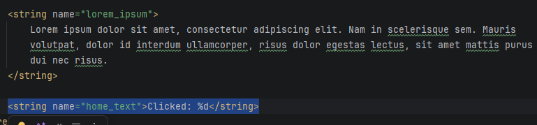</figure>

재빌드 후 버튼 클릭하면, 클릭한 만큼 카운트(밤티긴한데...)

<figure class="imageblock alignCenter" data-ke-mobilestyle="widthOrigin" data-origin-height="218" data-origin-width="317">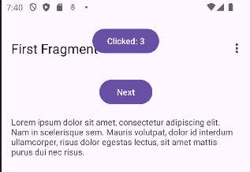</figure>

<h3 data-ke-size="size23">2-2. Special Android Reatures</h3>
<h4 data-ke-size="size20">2-2-1. Running App on a Real Device</h4>

<b>요약</b>

안드로이드 스튜디오를 통해 개발자 모드가 활성화된 실제 안드로이드 기기에서 애플리케이션 실행 가능

 

과정

<ul data-ke-list-type="disc" style="list-style-type: disc;">
<li>안드로이드 기기에서 설정 -&gt; 소프트웨어 정보 -&gt; 빌드번호를 7번 탭하여 개발자 옵션 활성화</li>
<li>USB 케이블로 컴퓨터와 안드로이드 기기 연결</li>
<li>기기에서 USB 디버깅 허용 (프로젝트 SDK 버전과 안드로이드 버전 호환되는지 확인!)</li>
<li>안드로이드 스튜디오에서 연결한 기기에 애플리케이션 실행 가능</li>
</ul>
<h4 data-ke-size="size20">2-2-2. Sending Intents</h4>

<b>요약</b>

Intent : 안드로이드에서 특정 작업을 요청하는 메시지 객체. 다른 앱과 상호작용하는 데 사용

<ul data-ke-list-type="disc" style="list-style-type: disc;">
<li>Intent.ACTION_VIEW : 지정된 데이터를 표시하도록 요청</li>
<li>Uri.parse() : URL 문자열을 URI 객체로 변환</li>
<li>startActivity() : 인텐트를 전달하여 해당 요청을 처리할 액티비티 실행</li>
</ul>

<figure class="imageblock alignCenter" data-ke-mobilestyle="widthOrigin" data-origin-height="195" data-origin-width="1296">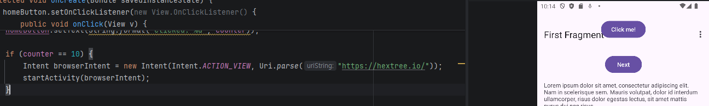</figure>

버튼 열 번 클릭시 헥스트리 사이트로 이동하는 코드 추가 후 재빌드

 

열번 누르니까 헥스트리 사이트로 이동함~

<figure class="imageblock alignCenter" data-ke-mobilestyle="widthOrigin" data-origin-height="681" data-origin-width="311"></figure>

<h4 data-ke-size="size20">2-2-4. Deompiling Our Clicker App</h4>

글이 길어질 거 같아서 이제부턴 따로 강의 영상 따라하는 사진은 첨부하지 않고 문제 푸는 것만 넣을게용... 생각보다 내용이 많네용..

 

<b>요약</b>

jadx를 통해 앞에서 제작한 클리커 앱의 apk 파일 디컴파일 후 원본 소스 코드와 비교(리버싱!!)

<ul data-ke-list-type="disc" style="list-style-type: disc;">
<li>APK (Android Package) : 안드로이드 애플리케이션의 코드와 리소스 등을 포함하는 패키지 파일</li>
<li>AAB (Anrdroid App Bundle) : Google Play에 앱을 배포할 때 사용하는 포스트 형식</li>
<li>jadx : APK 내부의 dex 바이트코드를 java 코드 형태로 디컴파일해주는 도구</li>
<li>AndroidManifest.xml : 애플리케이션의 컴포넌트 및 설정 정보를 확인할 수 있는 파일</li>
</ul>

디컴파일 결과 및 알 수 있는 것들

<ul data-ke-list-type="disc" style="list-style-type: disc;">
<li>매니페스트 파일에서 MainActivity, SecretActivity 및 외부에 노출된 액티비티 확인 가능</li>
<li>빌드 과정에서 설정된 SDK 버전이 최종 매니페스트에 반영</li>
<li>원본 소스 코드와 유사한 java 코드 복원 -&gt; 애플리케이션 동작 분석 가능</li>
</ul>
<h3 data-ke-size="size23">2-3. Debugging and Sharing</h3>
<h4 data-ke-size="size20">2-3-1. Using Android Studio's Debugger</h4>

<b>요약</b>

안드로이드 스튜디오의 디버깅 기능을 활용하여 애플리케이션의 실행 흐름과 변수 값을 확인 및 수정 가능

 

강의 영상 속 실습 과정

<ul data-ke-list-type="disc" style="list-style-type: disc;">
<li>인텐트 생성 코드에 브레이크포인트 설정</li>
<li>실행 버튼 옆에 있는 디버그 모드로 실행 버튼을 눌러 디버그 모드로 실행</li>
<li>Click 버튼 10번 클릭하여 인텐트 생성 코드줄에 도달</li>
<li>인텐트의 ACTION_VIEW 설정 확인 후 카운터 변수 값 변경</li>
</ul>
<h4 data-ke-size="size20">2-3-2. Version Control with Git</h4>

<b>요약</b>

안드로이드 스튜디오에 내장된 Git 기능을 이용하여 프로젝트의 변경 사항 관리 및 외부 Git 저장소의 프로젝트를 가져와 실행

 

강의 영상 속 실습 과정

<ul data-ke-list-type="disc" style="list-style-type: disc;">
<li>안드로이드 스튜디오에서 Git 저장소 생성</li>
<li>프로젝트 파일 선택 후 초기 커밋 생성</li>
<li>Git Log에서 커밋 이력 및 변경 사항 확인</li>
<li>외부 Git 저장소의 URL을 이용하여 프로젝트 클론</li>
<li>복제한 프로젝트를 안드로이드 스튜디오에서 열고 에뮬레이터로 실행</li>
</ul>

(안드로이드 스튜디오에서 손쉽게 깃 클론이 가능함)

 

<b>실습</b>

: 제공된 프로젝트의 소스 코드를 분석하여 FlagActivity가 실행되는 조건을 찾고, 앱을 실행하여 플래그 획득

 

챌린지1 링크...

<a href="https://github.com/hextreeio/android-challenge1" rel="noopener noreferrer" target="_blank">https://github.com/hextreeio/android-challenge1</a>

<figure contenteditable="false" data-ke-align="alignCenter" data-ke-type="opengraph" data-og-description="Contribute to hextreeio/android-challenge1 development by creating an account on GitHub." data-og-host="github.com" data-og-image="/assets/img/and-lab/09/og-04.png" data-og-source-url="https://github.com/hextreeio/android-challenge1" data-og-title="GitHub - hextreeio/android-challenge1" data-og-type="object" data-og-url="https://github.com/hextreeio/android-challenge1" id="og_1795258342686"><a data-source-url="https://github.com/hextreeio/android-challenge1" href="https://github.com/hextreeio/android-challenge1" rel="noopener" target="_blank">

 

GitHub - hextreeio/android-challenge1

Contribute to hextreeio/android-challenge1 development by creating an account on GitHub.

github.com

</a></figure>

 

강의 영상에 나왔던 대로 클론해보겠습니다.

<figure class="imageblock alignCenter" data-ke-mobilestyle="widthOrigin" data-origin-height="317" data-origin-width="585">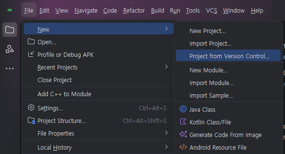</figure>

복사한 코드 URL 칸에 입력 후 Clone 버튼 클릭

<figure class="imageblock alignCenter" data-ke-mobilestyle="widthOrigin" data-origin-height="642" data-origin-width="802">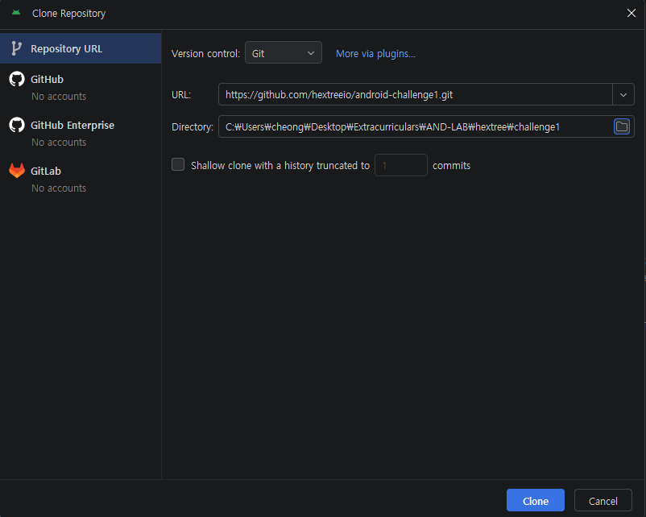</figure>

빌드하고 실행할게용

 

FlagActivity.java가 있길래 먼저 봤습니다.

decryptFlag() 함수 부분이 있는데.. 음. 암호문을 복호화하면 플래그가 나오겠지민, 헥스트리에서도 지향하는 방법은 아니라고 했기에 정석 풀이로 해보겠습니다.

<figure class="imageblock alignCenter" data-ke-mobilestyle="widthOrigin" data-origin-height="485" data-origin-width="627">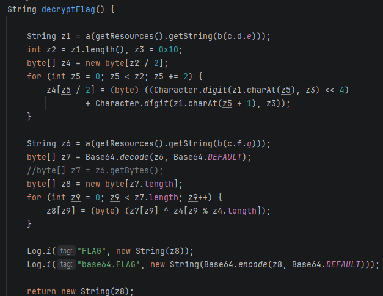</figure>

MainActivity.java를 보겠습니다.

counter가 10000이 되면, 

<figure class="imageblock alignCenter" data-ke-mobilestyle="widthOrigin" data-origin-height="250" data-origin-width="791">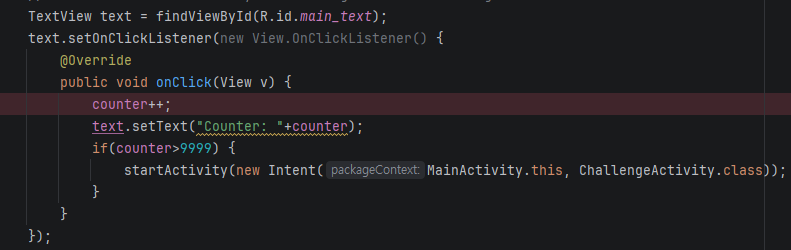</figure>

 

<figure class="imageblock alignCenter" data-ke-mobilestyle="widthOrigin" data-origin-height="598" data-origin-width="1009">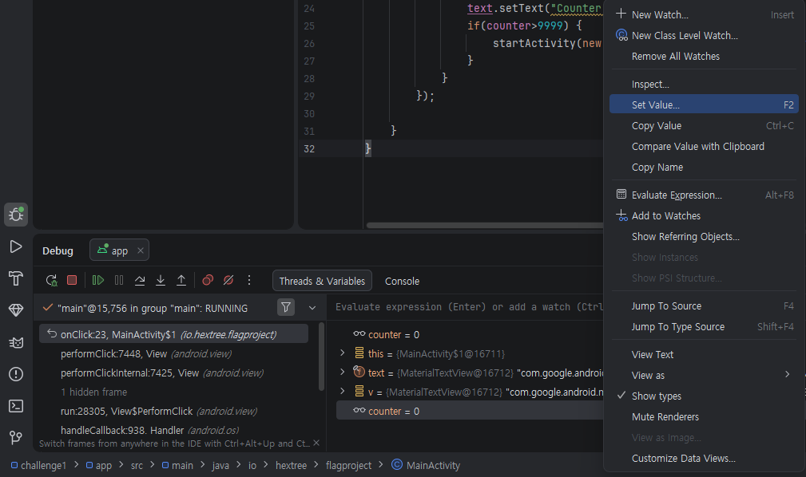</figure>

counter 변수 값을 10000로 설정하고 왼쪽 위에 스텝 오버할 수 있는 버튼을 클릭해보겠습니다.

<figure class="imageblock alignCenter" data-ke-mobilestyle="widthOrigin" data-origin-height="287" data-origin-width="1338">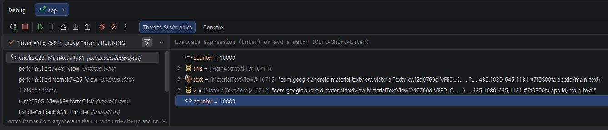</figure>

다음 화면 나올 때까지 스텝 오버... 하면 ChallengeActivity로 넘어옵니다.

이 화면에 버튼이 많은데 여기서 버튼 9를 제외하고는 전부 failHandler 즉, 저 버튼 클릭시 MainActivity로 넘어갑니다.

<figure class="imageblock alignCenter" data-ke-mobilestyle="widthOrigin" data-origin-height="451" data-origin-width="1333">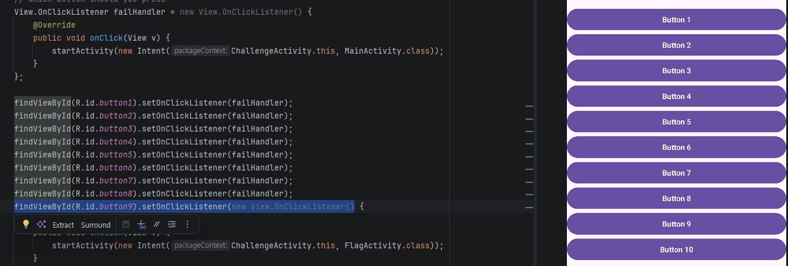</figure>

버튼 9를 클릭하겠습니다.

 

그럼 FlagActivity 화면으로 넘어옵니다.

여기서 저... 바?를 42에 딱 맞춰 드래그하면 복호화된 플래그가 나오게 됩니다.

<figure class="imageblock alignCenter" data-ke-mobilestyle="widthOrigin" data-origin-height="217" data-origin-width="943">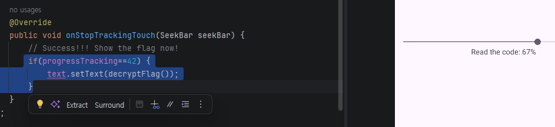</figure>

야호 플래그 획득

<figure class="imageblock alignCenter" data-ke-mobilestyle="widthOrigin" data-origin-height="112" data-origin-width="395">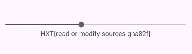</figure>

FLAG : HXT{read-or-modify-sources-gha82f}

<figure class="imageblock alignCenter" data-ke-mobilestyle="widthOrigin" data-origin-height="178" data-origin-width="985">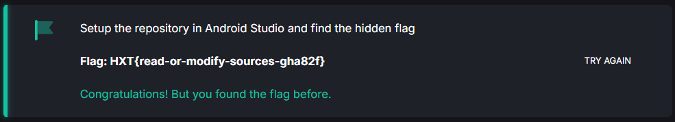</figure>

<h4 data-ke-size="size20">2-3-3. Solving the App Sharing Challenge</h4>

<b>요약</b>

앞 실습에서 제공된 워게임 풀이 방법

 

방법 1

<ol data-ke-list-type="decimal" style="list-style-type: decimal;">
<li>매니페스트에서 진입점(MainActivity) 확인</li>
<li>버튼 클릭 횟수 조건 분석 후 코드 수정 또는 디버깅으로 조건 충족</li>
<li>ChallengeActivity에서 버튼 9를 눌러 FlagActivity로 이동</li>
<li>슬라이더 값을 42로 설정하여 플래그 획득</li>
</ol>

방법 2

<ol data-ke-list-type="decimal" style="list-style-type: decimal;">
<li>MainActivity의 버튼 클릭 이벤트 처리 코드 수정</li>
<li>플래그 복호화 함수인 decryptFlag()의 반환값을 화면에 출력하도록 변경</li>
<li>애플리케이션 실행 후 플래그 획득</li>
</ol>

저는 방법 1에서 디버깅하는 방법으로 풀었는데 코드 수정... 이 더 간단했을 거 같습니다...

<h2 data-ke-size="size26">3. Reverse Engineering Android Apps</h2>
<h3 data-ke-size="size23">3-1. Working with APKs and apktool</h3>
<h4 data-ke-size="size20">3-1-1. What is an APK?</h4>

<b>용어</b>

<ul data-ke-list-type="disc" style="list-style-type: disc;">
<li>DEX (Dalvik Executable) : 안드로이드에서 사용하는 바이트코드 파일 형식</li>
<li>ART (Android Runtime) : 안드로이드 실행 환경, 바이트코드를 네이티브 코드로 컴파일하여 실행</li>
</ul>

<b>안드로이드 애플리케이션 빌드 과정</b>

<ol data-ke-list-type="decimal" style="list-style-type: decimal;">
<li>자바나 코틀린으로 애플리케이션 소스 코드 작성</li>
<li>javac 또는 kotlinc를 통해 .class 파일 생성</li>
<li>D8 컴파일러가 .class 파일을 classes.dex 파일로 변환</li>
<li>dex 파일, 매니페스트 파일, 리소스 등을 APK로 패키징 후 서명</li>
</ol>
<h4 data-ke-size="size20">3-1-2. Getting APKs from a Device</h4>

<b>요약</b>

adb를 이용하여 안드로이드 기기에 설치된 앱의 apk 파일 추출 및 apk 내부 구조 확인

 

강의 영상 속 실습 과정

<ol data-ke-list-type="decimal" style="list-style-type: decimal;">
<li>adb shell pm list packages -3 : 설치된 파티 패키지 목록 확인</li>
<li>adb shell pm path &lt;package_name&gt; : 지정한 패키지의 apk 파일 경로 확인</li>
<li>adb pull &lt;path_to_apk&gt; : 기기에서 pc로 apk 파일 추출</li>
<li>추출한 apk 파일의 확장자를 .zip으로 변경한 뒤 압축 해제</li>
<li>AndroidManifest.xml, classes.dex, 리소스, 네이티브 라이브러리 등 내부 파일 확인</li>
</ol>

유의 사항

<ul data-ke-list-type="disc" style="list-style-type: disc;">
<li>일부 앱은 접근 권한 제한으로 인해 adb pull을 통한 apk 추출 불가능할 수 O</li>
<li>외부 사이트에서 apk를 다운로드할 경우 서명 확인하여 악성 파일인지 주의</li>
</ul>
<h4 data-ke-size="size20">3-1-3. Extracting APKx with apktool</h4>

요약

apktool을 이용하여 apk 파일 디코딩, 내부 구조 및 매니페스트를 분석하여 외부에 노출된 액티비티 확인 가능

 

apktool의 기능

<ul data-ke-list-type="disc" style="list-style-type: disc;">
<li>apk 내부 파일 및 리소스 추출</li>
<li>dex 바이트코드를 smail(dalvik 바이트코드를 표현하는 어셈블리) 코드로 변환</li>
<li>수정한 코드와 리소스를 다시 apk로 재빌드</li>
</ul>

apktool 설치 사이트

<a href="https://apktool.org/docs/install/" rel="noopener noreferrer" target="_blank">https://apktool.org/docs/install/</a>

<figure contenteditable="false" data-ke-align="alignCenter" data-ke-type="opengraph" data-og-description="A minimum of Java 8 is required to run Apktool." data-og-host="apktool.org" data-og-image="/assets/img/and-lab/09/og-05.png" data-og-source-url="https://apktool.org/docs/install/" data-og-title="Install Guide | Apktool" data-og-type="website" data-og-url="https://apktool.org/docs/install" id="og_1795262290398"><a data-source-url="https://apktool.org/docs/install/" href="https://apktool.org/docs/install/" rel="noopener" target="_blank">

 

Install Guide | Apktool

A minimum of Java 8 is required to run Apktool.

apktool.org

</a></figure>

 

<b>실습</b>

: apktool을 이용하여 숨겨진 SecretActivity를 찾고, adb로 실행하여 플래그 획득

 

주어진 apk가 있는 경로에서 다음 명령어 실행.

<pre class="css"><code class="hljs">apktool d io.hextree.reversingexample.apk</code></pre>

<figure class="imageblock alignCenter" data-ke-mobilestyle="widthOrigin" data-origin-height="299" data-origin-width="823">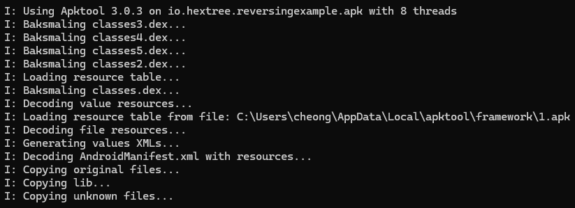</figure>

추출 완료

 

그 후 추출된 폴더에서 매니페스트 내용 확인 

<figure class="imageblock alignCenter" data-ke-mobilestyle="widthOrigin" data-origin-height="57" data-origin-width="686">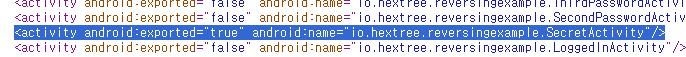</figure>

SecretActivity라는 액티비티의 exported가 true로 설정되어 있습니다.

 

안드로이드 스튜디오에서 에뮬레이터 실행 후 apk를 설치하겠습니다.

<figure class="imageblock alignCenter" data-ke-mobilestyle="widthOrigin" data-origin-height="62" data-origin-width="1084">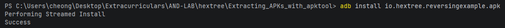</figure>

앱 실행 후 화면

<figure class="imageblock alignCenter" data-ke-mobilestyle="widthOrigin" data-origin-height="270" data-origin-width="304">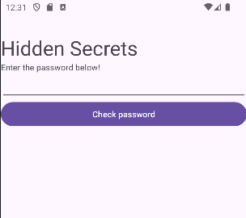</figure>

SecretActivity를 adb로 실행하면 플래그가 나오는 거 같습니다.

액티비티 실행 명령어

<pre class="java" data-ke-language="java" data-ke-type="codeblock" id="code_1795264388731"><code class="hljs">adb shell am start io.hextree.reversingexample/.SecretActivity</code></pre>

<figure class="imageblock alignCenter" data-ke-mobilestyle="widthOrigin" data-origin-height="42" data-origin-width="1227">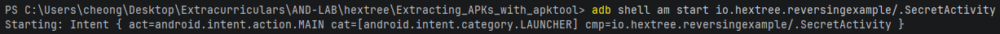</figure>

그럼 화면에 플래그가 나오게 됩니다.

<figure class="imageblock alignCenter" data-ke-mobilestyle="widthOrigin" data-origin-height="391" data-origin-width="301"></figure>

FLAG : HXT{A-not-so-secret-activity}

<figure class="imageblock alignCenter" data-ke-mobilestyle="widthOrigin" data-origin-height="172" data-origin-width="988">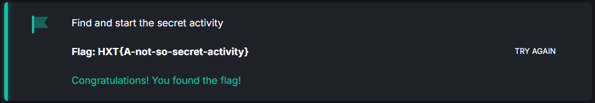</figure>

<h4 data-ke-size="size20">3-1-4. Patching and re-packing APKs with apktool</h4>

<b>요약</b>

apktool을 이용하여 apk 내부 파일을 수정하고 재패키징 및 서명 과정을 거쳐 수정된 애플리케이션 설치

 

강의 영상 속 실습 과정

<ol data-ke-list-type="decimal" style="list-style-type: decimal;">
<li>APKTool로 추출한 AndroidManifest.xml에서 UnreachableActivity의 android:exported 값을 false → true로 수정</li>
<li>apktool b 명령어로 APK 재빌드 (dist 폴더에 생성)</li>
<li>keytool을 이용하여 서명에 사용할 Keystore 및 키 생성</li>
<li>jarsigner를 이용하여 APK 서명</li>
<li>기존 애플리케이션과 서명이 다를 경우 삭제 후 수정된 APK 설치</li>
<li>ADB를 이용하여 UnreachableActivity 실행 확인</li>
</ol>

 

apk 재빌드 :

<pre class="armasm"><code class="hljs css">apktool b &lt;decoded_directory&gt;</code></pre>

keystore 및 서명키 생성 :

<pre class="angelscript"><code class="hljs apache">keytool -genkey -v -keystore research.keystore -alias research_key -keyalg RSA -keysize 2048 -validity 10000</code></pre>

apk 서명 :

<pre class="css"><code class="hljs">jarsigner -verbose -keystore research.keystore app.apk research_key</code></pre>

 

실습

: UnreachableActivity의 android:exported 속성을 true로 변경하고, APK 재빌드 및 서명 후 해당 Activity를 실행하여 FLAG 획득 

 

먼저 매니페스트에서 UnreachableActivity에 설정된 exported="false"를 exported="true"로 수정하였습니다.

<figure class="imageblock alignCenter" data-ke-mobilestyle="widthOrigin" data-origin-height="64" data-origin-width="788">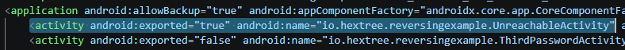</figure>

그리고 apktool b로 재빌드

<figure class="imageblock alignCenter" data-ke-mobilestyle="widthOrigin" data-origin-height="257" data-origin-width="1094">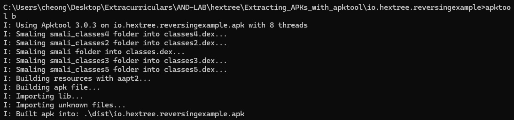</figure>

다음 명령어를 실행하여 서명하겠습니다.

<pre class="bash" data-ke-language="bash" data-ke-type="codeblock" id="code_1795266227795"><code class="hljs">keytool -genkeypair -v -keystore challenge.jks -alias challenge -keyalg RSA -keysize 2048 -validity 10000</code></pre>

<figure class="imageblock alignCenter" data-filename="blob" data-ke-mobilestyle="widthOrigin" data-origin-height="385" data-origin-width="1087">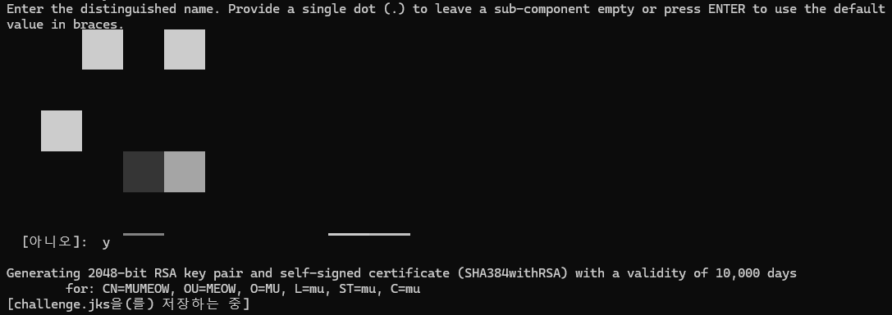</figure>

그 후 새로 서명한 앱을 실행시키기 전 기존 앱을 삭제하겠습니다.

<pre class="bash" data-ke-language="bash" data-ke-type="codeblock" id="code_1795266348814"><code class="hljs">adb uninstall io.hextree.reversingexample</code></pre>

<figure class="imageblock alignCenter" data-ke-mobilestyle="widthOrigin" data-origin-height="32" data-origin-width="1063">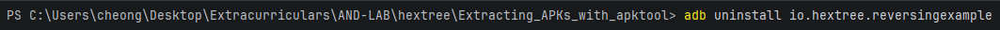</figure>

 

apk 정렬(aligned.apk 파일 생성)

<pre class="bash" data-ke-language="bash" data-ke-type="codeblock" id="code_1795266956223"><code class="hljs">zipalign -f -v 4 io.hextree.reversingexample\dist\io.hextree.reversingexample.apk aligned.apk</code></pre>

apk 서명(signed.apk 파일 생성)

<pre class="bash" data-ke-language="bash" data-ke-type="codeblock" id="code_1795266986509"><code class="hljs">apksigner sign --ks io.hextree.reversingexample\challenge.jks --ks-key-alias challenge --out signed.apk aligned.apk</code></pre>

서명 검증

<figure class="imageblock alignCenter" data-ke-mobilestyle="widthOrigin" data-origin-height="313" data-origin-width="1090">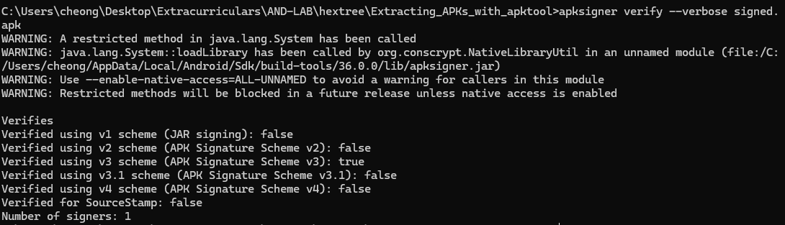</figure>

새로운 apk 파일을 에뮬레이터에서 설치하고 실행시켰습니다.

<figure class="imageblock alignCenter" data-ke-mobilestyle="widthOrigin" data-origin-height="79" data-origin-width="905">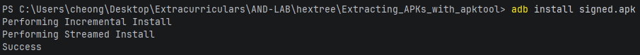</figure>

exported를 true로 변경한 액티비티를 실행시켰습니다.

<pre class="bash" data-ke-language="bash" data-ke-type="codeblock" id="code_1795267199733"><code class="hljs">adb shell am start io.hextree.reversingexample/.UnreachableActivity</code></pre>

<figure class="imageblock alignCenter" data-ke-mobilestyle="widthOrigin" data-origin-height="45" data-origin-width="1268">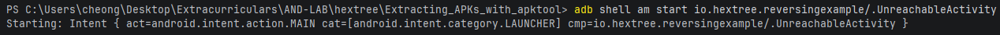</figure>

 

<figure class="imageblock alignCenter" data-ke-mobilestyle="widthOrigin" data-origin-height="150" data-origin-width="355"></figure>

FLAG : HXT{I-thought-I-am-unreachable}

<figure class="imageblock alignCenter" data-ke-mobilestyle="widthOrigin" data-origin-height="169" data-origin-width="981"></figure>

<h3 data-ke-size="size23">3-2. Decompiling Android Applications</h3>
<h4 data-ke-size="size20">3-2-1. Introducation to Decompiling</h4>

<b>요약</b>

<ul data-ke-list-type="disc" style="list-style-type: disc;">
<li>Reflection : 런타임에 클래스, 메서드 등의 정보를 참조할 수 있는 기능</li>
<li>

Dalvik Bytecode : 클래스 구조, 메서드 타입, 제어 흐름 등의 정보를 포함하는 비교적 고수준의 바이트코드

</li>
<li>

Obfuscation : 심볼 및 타입 관련 정보를 숨기거나 알아보기 어렵게 만들어 역공학을 어렵게 하는 기법

</li>
<li>java, kotlin 기반 안드로이드 앱은 클래스 구조 및 제어 흐름 등의 정보가 바이트코드에 남아 있음</li>
<li>디컴파일된 코드는 원본과 유사하지만 주석이나 일부 디버그 정보 손실 가능성 O</li>
</ul>

jadx 설치 (전 이미 깔려있슴미당)

<a href="https://github.com/skylot/jadx?tab=readme-ov-file#download" rel="noopener noreferrer" target="_blank">https://github.com/skylot/jadx?tab=readme-ov-file#download</a>

<figure contenteditable="false" data-ke-align="alignCenter" data-ke-type="opengraph" data-og-description="Dex to Java decompiler. Contribute to skylot/jadx development by creating an account on GitHub." data-og-host="github.com" data-og-image="/assets/img/and-lab/09/og-06.png" data-og-source-url="https://github.com/skylot/jadx?tab=readme-ov-file#download" data-og-title="GitHub - skylot/jadx: Dex to Java decompiler" data-og-type="object" data-og-url="https://github.com/skylot/jadx" id="og_1795267616674"><a data-source-url="https://github.com/skylot/jadx?tab=readme-ov-file#download" href="https://github.com/skylot/jadx?tab=readme-ov-file#download" rel="noopener" target="_blank">

 

GitHub - skylot/jadx: Dex to Java decompiler

Dex to Java decompiler. Contribute to skylot/jadx development by creating an account on GitHub.

github.com

</a></figure>
<h4 data-ke-size="size20">3-2-2. Getting started with jadx</h4>

요약

jadx로 apk 파일 디컴파일 후 디컴파일된 java 코드 분석 -&gt; 애플리케이션 내부에 하드 코딩되어 있는 비밀번호 찾기

 

jadx gui 주요 기능

<ul data-ke-list-type="disc" style="list-style-type: disc;">
<li>디컴파일 : apk의 dex 바이트코드를 자바 코드 형태로 복원</li>
<li>참조 확인 : 변수 및 메서드 사용 위치 확인</li>
<li>주석 : 코드에 메모 추가</li>
</ul>

<b>실습</b>

: jadx를 이용하여 첫 번째 비밀번호를 찾고, 애플리케이션에 입력하여 다음 단계로 이동

 

jadx에서 이전에 사용했던 apk 파일을 열었습니다.

MainActivity에 password라는 변수가 있습니다.

<figure class="imageblock alignCenter" data-ke-mobilestyle="widthOrigin" data-origin-height="87" data-origin-width="446"></figure>

입력 받은 변수는 SecretKeeper라는 클래스와 비교하여 일치하면 if문을 실행시키는 거 같습니다.

<figure class="imageblock alignCenter" data-ke-mobilestyle="widthOrigin" data-origin-height="144" data-origin-width="859"></figure>

SecretKeeper를 더블클릭하면 클래스 내부를 볼 수 있습니다.

 

비밀번호는 iAmHardcoded인 거 같습니다.

<figure class="imageblock alignCenter" data-ke-mobilestyle="widthOrigin" data-origin-height="144" data-origin-width="386"></figure>

에뮬레이터에서 맞는지 확인해보겠습니다.

비밀번호를 입력하고 버튼을 누르면

<figure class="imageblock alignCenter" data-ke-mobilestyle="widthOrigin" data-origin-height="200" data-origin-width="338"></figure>

이렇게 플래그가 나오게 됩니다.

첫 번째 비밀번호를 찾으라고 했으니 아마 여기서 또 입력해야 하는 플래그는 다른 문제에서 수행할 부분 같습니다.

<figure class="imageblock alignCenter" data-ke-mobilestyle="widthOrigin" data-origin-height="249" data-origin-width="338"></figure>

FLAG : HXT{hardcoded-secrets-are-bad}

<figure class="imageblock alignCenter" data-ke-mobilestyle="widthOrigin" data-origin-height="174" data-origin-width="981"></figure>

<h4 data-ke-size="size20">3-2-3. Resolving string Resources</h4>

<b>요약</b>

안드로이드 앱의 문자열은 코드에 직접 작성되지 않고 strings.xml과 같은 리소스 파일에 저장될 수 있음

jadx의 Global Search 기능을 사용하여 코드뿐만 아니라 리소스에서도 문자열 검색 가능

 

<b>실습</b>

LoggedInActivity에서 R.string.secret2를 확인하고 jadx의 Global Search로 해당 문자열 리소스를 찾아 두 번째 비밀번호 획득

 

jadx에서 LoggedInActivity를 보겠습니다. 일단 password가 선언되어 있습니다.

<figure class="imageblock alignCenter" data-ke-mobilestyle="widthOrigin" data-origin-height="82" data-origin-width="477"></figure>

그리고 다음 조건문에서 입력 받은 비밀번호와 secret2와 비교하여 참이면 SecondPasswordActivity를 실행합니다.

<figure class="imageblock alignCenter" data-ke-mobilestyle="widthOrigin" data-origin-height="79" data-origin-width="906"></figure>

더블 클릭해 따라가면 하드코딩된 문자열은 찾아볼 수 없습니다.

<figure class="imageblock alignCenter" data-ke-mobilestyle="widthOrigin" data-origin-height="476" data-origin-width="679"></figure>

전역 검색 기능을 사용하겠습니다.

strings.xml 파일을 보겠습니다.

<figure class="imageblock alignCenter" data-ke-mobilestyle="widthOrigin" data-origin-height="220" data-origin-width="1417"></figure>

VeryResourcefulSecret이라는 문자열이 두 번째 비밀번호 같습니다.

<figure class="imageblock alignCenter" data-ke-mobilestyle="widthOrigin" data-origin-height="60" data-origin-width="478"></figure>

비밀번호를 입력하고 버튼을 클릭하면 플래그가 나오게 됩니다.

<figure class="imageblock alignCenter" data-ke-mobilestyle="widthOrigin" data-origin-height="243" data-origin-width="340"></figure>

FLAG : HXT{resources-are-no-match-for-me}

<figure class="imageblock alignCenter" data-ke-mobilestyle="widthOrigin" data-origin-height="174" data-origin-width="980"></figure>

<h4 data-ke-size="size20">3-2-4. JNI - Java Native Interface</h4>

<b>요약</b>

JNI(Java Native Interface)를 통해 java나 kotlin 코드에서 C/C++로 작성된 네이티브 라이브러리의 함수를 호출 가능

<ul data-ke-list-type="disc" style="list-style-type: disc;">
<li>

native : 네이티브 코드로 구현된 메서드를 나타내는 키워드

</li>
<li>

System.loadLibrary() : 네이티브 라이브러리 로드

</li>
<li>

.so : 안드로이드에서 사용하는 네이티브 공유 라이브러리

</li>
<li>

Ghidra : 네이티브 라이브러리 분석에 활용하는 리버스 엔지니어링 도구

</li>
</ul>

<b>실습</b>

jadx에서 native 메서드와 연결된 .so 파일을 확인하고, strings 명령어를 이용하여 세 번째 비밀번호 획득

 

SecondPaddwordActivity를 보면 다음 조건문에서 입력한 비밀번호와 secretFromJNI와 비교합니ㅏㄷ.

<figure class="imageblock alignCenter" data-ke-mobilestyle="widthOrigin" data-origin-height="84" data-origin-width="958"></figure>

NativeLib을 보니 다음 내용을 확인할 수 있었습니다.

<figure class="imageblock alignCenter" data-ke-mobilestyle="widthOrigin" data-origin-height="131" data-origin-width="401"></figure>

System.loadLibrary("examplge_nativeLib") -&gt; libexample_nativelib.so 라이브러리 로드

secretFromJNI() : 네이티브 라이브러리에 구현된 함수를 호출하는 메서드

즉, 비밀번호는 네이티브 라이브러리에 존재합니다.

 

문제에서 제공한 힌트는 비밀번호에 secret이 있으니 strings 명령어로 찾으라고 했습니다.

 

.so 파일이 있는 경로(io.hextree.reversingexample/lib/x86_64/)로 이동 후 strings 명령어로 secret 문자열을 찾아보겠습니다.

<pre class="bash" data-ke-language="bash" data-ke-type="codeblock" id="code_1795317695753"><code class="hljs">strings libexample_nativelib.so | findstr /I "secret"</code></pre>

<figure class="imageblock alignCenter" data-ke-mobilestyle="widthOrigin" data-origin-height="63" data-origin-width="1470"></figure>

nativeSecretsCanBeFoundToo라는 문자열이 세 번째 비밀번호 같습니다.

<figure class="imageblock alignCenter" data-filename="스크린샷 2026-11-22 124348.png" data-ke-mobilestyle="widthOrigin" data-origin-height="569" data-origin-width="332"></figure>

FLAG : HXT{from-java-to-native}

<figure class="imageblock alignCenter" data-ke-mobilestyle="widthOrigin" data-origin-height="178" data-origin-width="992"></figure>

<h4 data-ke-size="size20">3-2-5. Saving jadx Projects and Working with CLI</h4>

요약

JADX에서 디컴파일한 프로젝트를 저장하거나 다른 IDE에서 분석할 수 있도록 내보내는 방법 학습

<ul data-ke-list-type="disc" style="list-style-type: disc;">
<li>jadx : 디컴파일 프로젝트 및 분석 작업 저장</li>
<li>Source Export : 디컴파일된 소스 코드를 폴더로 내보내기</li>
<li>Gradle Export : Android Studio 등 다른 IDE에서 분석할 수 있도록 Gradle 프로젝트로 내보내기 (오류 발생 가능)</li>
<li>JADX CLI : GUI 없이 명령어로 APK 디컴파일 가능</li>
</ul>

명령어 : 

<pre class="bash" data-ke-language="bash"><code class="hljs">jadx &lt;apk_path&gt;</code></pre>

<a href="https://github.com/skylot/jadx?tab=readme-ov-file#usage" rel="noopener noreferrer" target="_blank">https://github.com/skylot/jadx?tab=readme-ov-file#usage</a>

<figure contenteditable="false" data-ke-align="alignCenter" data-ke-type="opengraph" data-og-description="Dex to Java decompiler. Contribute to skylot/jadx development by creating an account on GitHub." data-og-host="github.com" data-og-image="/assets/img/and-lab/09/og-07.png" data-og-source-url="https://github.com/skylot/jadx?tab=readme-ov-file#usage" data-og-title="GitHub - skylot/jadx: Dex to Java decompiler" data-og-type="object" data-og-url="https://github.com/skylot/jadx" id="og_1795319255223"><a data-source-url="https://github.com/skylot/jadx?tab=readme-ov-file#usage" href="https://github.com/skylot/jadx?tab=readme-ov-file#usage" rel="noopener" target="_blank">

 

GitHub - skylot/jadx: Dex to Java decompiler

Dex to Java decompiler. Contribute to skylot/jadx development by creating an account on GitHub.

github.com

</a></figure>
<h3 data-ke-size="size23">3-3. Case Study: A Weather App</h3>
<h4 data-ke-size="size20">3-3-1. Define Research Goals</h4>

<b>요약</b>

실제 날씨 앱을 디컴파일하여 날씨 데이터를 가져오는 API 엔드포인트를 찾는 실습

<ul data-ke-list-type="disc" style="list-style-type: disc;">
<li>ProGuard : 클래스명 등을 난독화하여 코드 분석을 어렵게 만드는 도구</li>
</ul>

영상 속 실습 과정

<ol data-ke-list-type="decimal" style="list-style-type: decimal;">
<li>Weather Forecast USA APK를 JADX로 디컴파일</li>
<li>Global Search로 http 관련 URL 검색</li>
<li>리소스까지 검색하여 weather.gov 관련 API 엔드포인트 발견</li>
<li>미국 국립기상청의 날씨 API를 사용한다는 사실 확인</li>
</ol>
<h4 data-ke-size="size20">3-3-2. The Hextree Weather App</h4>

실습 &amp; 분석 목표

: 기존 날씨 앱을 수정한 Hextree Weather App을 리버스 엔지니어링하여 API 인증 방식과 날씨 업데이트가 비활성화된 원인을 분석

<ul data-ke-list-type="disc" style="list-style-type: disc;">
<li>앱에서 사용하는 커스텀 API 엔드포인트 확인</li>
<li>API 인증 방식 분석</li>
<li>날씨 업데이트가 비활성화된 원인 파악</li>
</ul>
<h4 data-ke-size="size20">3-3-3. Finding the API Key</h4>

위 실습 문제에서 API 키 찾는 방법

 

날씨 앱에서 사용하는 커스텀 apk 엔드포인트

<figure class="imageblock alignCenter" data-ke-mobilestyle="widthOrigin" data-origin-height="582" data-origin-width="1764"></figure>

찾은 엔드포인트를 따라가면 ApiKey라는 것과 참조되는 것 확인

<figure class="imageblock alignCenter" data-ke-mobilestyle="widthOrigin" data-origin-height="350" data-origin-width="834"></figure>

strings.xml에 하드코딩된 플래그 발견

<figure class="imageblock alignCenter" data-ke-mobilestyle="widthOrigin" data-origin-height="356" data-origin-width="820"></figure>

이전 실습 문제에 대한 답으로 제출하면 됩니당

FLAG : HXT{android-api-key-b1872g}

<figure class="imageblock alignCenter" data-ke-mobilestyle="widthOrigin" data-origin-height="169" data-origin-width="980"></figure>

<h4 data-ke-size="size20">3-3-4. Identifying the Correct ZIP Code</h4>

앞선 실습 문제에서 날씨 업데이트를 활성화하는 ZIP Code 조건 확인

 

영상 속 실습 따라하기...

<ol data-ke-list-type="decimal" style="list-style-type: decimal;">
<li>AndroidManifest.xml에서 LocationActivity 확인</li>
<li>ZIP Code 입력 버튼의 onClick() 메서드 분석</li>
<li>입력된 ZIP Code가 SharedPreferences에 저장되는 과정 확인</li>
<li>ZIP Code를 읽는 메서드의 사용 위치를 추적하여 조건문 발견</li>
<li>13337 입력 시 날씨 업데이트 활성화 확인</li>
</ol>

13337로 날씨 업데이트는 활성화되지만, 플래그 획득에는 42가 필요함. 앱의 입력값은 5자리로 제한되어 있으므로 API를 직접 호출 필요

 

13337을 입력

<figure class="imageblock alignCenter" data-ke-mobilestyle="widthOrigin" data-origin-height="346" data-origin-width="287"></figure>

활성화됨

<figure class="imageblock alignCenter" data-ke-mobilestyle="widthOrigin" data-origin-height="378" data-origin-width="290"></figure>

<h4 data-ke-size="size20">3-3-5. Reverse Engineering the API Request</h4>

영상 속 실습 따라하기...

<ol data-ke-list-type="decimal" style="list-style-type: decimal;">
<li>JADX에서 API 호출을 담당하는 스레드의 run() 메서드 분석</li>
<li>API Key, User-Agent 및 요청 매개변수 확인</li>
<li>Burp Suite Repeater에서 HTTP 요청을 직접 구성하고 오류 응답을 참고하여 수정</li>
<li>올바른 ZIP Code(42)로 API를 호출하여 XML 응답에서 FLAG 획득</li>
</ol>

 

버프슈트를 사용해야 합니다.

repeater에서 새로운 http 탭 열고 타겟 설정

<figure class="imageblock alignCenter" data-ke-mobilestyle="widthOrigin" data-origin-height="302" data-origin-width="304"></figure>

요청은 화면에 보이는 바와 같이 작성했습니다.

<figure class="imageblock alignCenter" data-ke-mobilestyle="widthOrigin" data-origin-height="179" data-origin-width="768"></figure>

요청을 보내니 maxt 파라미터가 필요하다고 합니다.

<figure class="imageblock alignCenter" data-ke-mobilestyle="widthOrigin" data-origin-height="222" data-origin-width="511"></figure>

maxt 파라미터 추가 후 다시 보내니 이번엔 mint 파라미터가 필요하다고 합니다.

<figure class="imageblock alignCenter" data-ke-mobilestyle="widthOrigin" data-origin-height="225" data-origin-width="1300"></figure>

요구하는 파라미터를 계속해서 요청으로 보내니 begin 파라미터가 없다고 합니다.

<figure class="imageblock alignCenter" data-ke-mobilestyle="widthOrigin" data-origin-height="220" data-origin-width="1274"></figure>

추가해서 요청으로 다시 보내겠습니다.

<figure class="imageblock alignCenter" data-ke-mobilestyle="widthOrigin" data-origin-height="797" data-origin-width="1545"></figure>

요청은 성공했고 이제 올바른 ZIP 코드(42)를 서버에 보내보겠습니다.

<figure class="imageblock alignCenter" data-ke-mobilestyle="widthOrigin" data-origin-height="492" data-origin-width="1531"></figure>

HXT{android-api-h192gsa0}라는 플래그를 서버 응답으로 받았습니다.

 

FLAG : HXT{android-api-h192gsa0}

<figure class="imageblock alignCenter" data-ke-mobilestyle="widthOrigin" data-origin-height="171" data-origin-width="987"></figure>

<h4 data-ke-size="size20">3-3-6. Diffing Application Updates</h4>

요약

앱 업데이트 전후의 디컴파일 결과를 비교하여 변경된 코드와 새로운 API Key의 저장 위치를 분석하는 방법

 

영상 속 실습 따라하기...

<ol data-ke-list-type="decimal" style="list-style-type: decimal;">
<li>jadx cli로 기존 APK와 업데이트된 APK를 각각 디컴파일</li>
<li>vscode의 Compare Folders 확장 프로그램으로 변경 사항 비교</li>
<li>strings.xml에서 기존 API Key가 제거된 사실 확인</li>
<li>새로운 API Key가 네이티브 라이브러리의 GetKey() 함수에서 반환되는 것을 확인</li>
</ol>

 

<h4 data-ke-size="size20">3-3-7. Defeating JNI Obfuscation</h4>

앞 실습 문제 풀이...

<ol data-ke-list-type="decimal" style="list-style-type: decimal;">
<li>apk에서 네이티브 라이브러리(.so) 추출</li>
<li>직접 제작한 안드로이드 앱의 jniLibs 디렉터리에 라이브러리 추가</li>
<li>원본과 동일한 패키지명, 클래스명, 네이티브 메서드명으로 JNI 호출 코드 작성</li>
<li>getKey() 함수를 직접 호출하고 반환된 API Key를 화면에 출력</li>
</ol>

이전 파일과 업데이트 이후 파일 디컴파일

<figure class="imageblock alignCenter" data-ke-mobilestyle="widthOrigin" data-origin-height="82" data-origin-width="1086"></figure>
<figure class="imageblock alignCenter" data-ke-mobilestyle="widthOrigin" data-origin-height="99" data-origin-width="1089"></figure>

 

영상 풀이를 따라하며 만든 파일을 안드로이드 스튜디오에서 실행시켜보겠습니다.

<figure class="imageblock alignCenter" data-ke-mobilestyle="widthOrigin" data-origin-height="70" data-origin-width="405"></figure>

FLAG : HXT{obfuscated-api-key-asb126us} (플래그는 이전 실습에서 제출해야 함.)

<figure class="imageblock alignCenter" data-ke-mobilestyle="widthOrigin" data-origin-height="169" data-origin-width="984"></figure>

 

쓰다보니 포스트가 너무 길어져서 잘라서 올리도록 하겠습니다...


