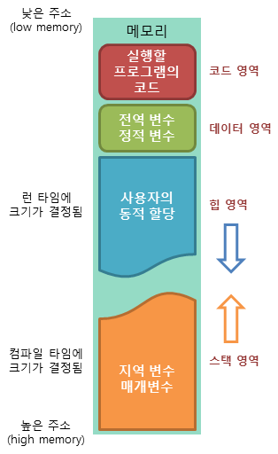
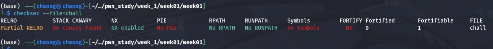
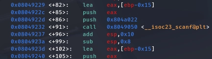


<article class="page sans notion-pwn-article" id="3e1ccf0f-0989-80dd-8495-c88e4be9abab">
<figure dir="ltr" id="3e1ccf0f-0989-8042-a2e4-cd085fd5b43b">
<a data-notion-file="week01.zip" data-notion-file-alias="week01.zip" href="/assets/files/notion-pwn/01/week01.zip">week01.zip</a>
</figure><aside class="block-color-gray_background callout" data-notion-callout="" data-notion-callout-background="gray_background" dir="ltr" id="3e1ccf0f-0989-807c-b616-c72ff8d51def" style="white-space:pre-wrap;display:flex">
<h2 class="" dir="auto" id="3e2ccf0f-0989-8015-89ef-f23da2e67f08"><strong>실습 &amp; 과제 (스크린샷 및 근거 설명에 대한 보고서 형식)</strong></h2><ul class="bulleted-list" dir="auto" id="3e2ccf0f-0989-804e-92b3-fee78b86f120"><li style="list-style-type:disc"><code>chall</code> 바이너리 분석<ul class="bulleted-list" dir="auto" id="3e2ccf0f-0989-80c9-b2da-d12b03072621"><li style="list-style-type:circle">주어진 파일에 대해 다음 정보를 직접 확인 해본다.<ul class="bulleted-list" dir="auto" id="3e2ccf0f-0989-8071-974a-cc62e16cb694"><li style="list-style-type:square">32bit / 64bit 여부<ul class="bulleted-list" dir="auto" id="3e2ccf0f-0989-8072-8751-e2d6e37b6558"><li style="list-style-type:disc">PIE 여부<ul class="bulleted-list" dir="auto" id="3e2ccf0f-0989-807c-ae02-ebc1abce9999"><li style="list-style-type:circle">NX 여부</li></ul><ul class="bulleted-list" dir="auto" id="3e2ccf0f-0989-80b9-b589-d9a03e1792c9"><li style="list-style-type:circle">Stack Canary 여부</li></ul><ul class="bulleted-list" dir="auto" id="3e2ccf0f-0989-80f6-85b7-f03bf4f6ee66"><li style="list-style-type:circle">RELRO 여부</li></ul></li></ul></li></ul><ul class="bulleted-list" dir="auto" id="3e2ccf0f-0989-80f6-8d0b-f120a09605ca"><li style="list-style-type:square">GDB를 통해 해당 바이너리를 디버깅해본다.<ul class="bulleted-list" dir="auto" id="3e2ccf0f-0989-8037-b6f5-d8d400102e15"><li style="list-style-type:disc"><code>main</code> 함수의 어셈블리를 확인한다.<ul class="bulleted-list" dir="auto" id="3e2ccf0f-0989-8014-ac03-c5d4aba7d19f"><li style="list-style-type:circle"><code>scanf</code> 가 실행되기 직전에 breakpoint를 걸어본다.</li></ul><ul class="bulleted-list" dir="auto" id="3e2ccf0f-0989-808d-8b30-d3b6f821d0f3"><li style="list-style-type:circle">위에서 설정한 breakpoint 지점에서 register 값이랑 stack 에 담겨있는 내용을 확인해본다.</li></ul><ul class="bulleted-list" dir="auto" id="3e2ccf0f-0989-8088-a037-f8263d9aa530"><li style="list-style-type:circle"><del><code>number</code></del><del> 변수의 위치가 스택 상에서 어디에 있는지 찾는다.</del></li></ul></li></ul></li></ul><ul class="bulleted-list" dir="auto" id="3e2ccf0f-0989-8096-ac3b-c5cb3cef73ad"><li style="list-style-type:square">주어진 프로그램에서 요구하는 문자열을 자동으로 입력하는 pwntools 스크립트를 작성한다.</li></ul></li></ul></li></ul><ul class="bulleted-list" dir="auto" id="3e2ccf0f-0989-80e3-a658-c08c52957929"><li style="list-style-type:disc">Docker로 주어진 <code>sekurity_pwn_01</code> 바이너리 분석<ul class="bulleted-list" dir="auto" id="3e2ccf0f-0989-80e6-8f99-dcfbf90cb73d"><li style="list-style-type:circle">제공된 docker 폴더에서 <code>Dockerfile</code>을 이용해서 실습 환경을 직접 빌드하고 <code>nc</code>를 통해서 해당 프로그램에 접속해본다.<ul class="bulleted-list" dir="auto" id="3e2ccf0f-0989-8051-a2c1-dbe5336ead2e"><li style="list-style-type:square">docker container에 <code>gdbserver</code>를 설치하고, 해당 프로그램에 remote를 하여 디버깅을 해본다.<ul class="bulleted-list" dir="auto" id="3e2ccf0f-0989-80cb-b844-e2a57271d50b"><li style="list-style-type:disc"><del><code>number</code></del><del> 변수의 위치가 스택 상에서 어디에 있는지 찾는다.</del></li></ul></li></ul><ul class="bulleted-list" dir="auto" id="3e2ccf0f-0989-802c-a3e2-c7ec4dc64c18"><li style="list-style-type:square">위에서 작성한 pwntools 스크립트를 docker를 타깃으로 재구성 해본다.</li></ul></li></ul></li></ul>
</aside>

정리정리…

메모리 상에서의 스택 (스택 메모리)
<figure class="image" data-notion-image="image.png" dir="ltr" id="3e2ccf0f-0989-801c-83fe-c40f56a45042" style="text-align:center"><figcaption>메모리 구조</figcaption></figure><ul class="bulleted-list" dir="auto" id="3e2ccf0f-0989-80f5-8254-ced37f9dc976"><li style="list-style-type:disc">컴퓨터 프로그램이 실행될 때 함수 호출과 관련된 임시 데이터(지역 변수, 매개변수 등)를 자동으로 저장하는 메모리 영역</li></ul><ul class="bulleted-list" dir="auto" id="3e2ccf0f-0989-8006-9b08-c191ded4fed9"><li style="list-style-type:disc">스택은 높은 주소에서 낮은 주소로 “자란다” (힙은 반대)</li></ul><ul class="bulleted-list" dir="auto" id="3e2ccf0f-0989-807b-bf61-c8f160d29c76"><li style="list-style-type:disc">esp는 스택의 최상단(낮은 주소)를 가리킴<ul class="bulleted-list" dir="auto" id="3e2ccf0f-0989-80f2-bf9b-c4faebb66659"><li style="list-style-type:circle">변함 → 낮은 주소로 자라기 때문</li></ul></li></ul><ul class="bulleted-list" dir="auto" id="3e2ccf0f-0989-80be-a6de-de61ac027969"><li style="list-style-type:disc">ebp는 스택의 최하단(높은 주소)를 가리킴<ul class="bulleted-list" dir="auto" id="3e2ccf0f-0989-8022-9ad4-c29379e1d553"><li style="list-style-type:circle">변하지 않음</li></ul></li></ul>

<h2 class="" dir="auto" id="3e2ccf0f-0989-8013-b9af-c610f8088ba5">chall 바이너리 분석</h2><h3 class="" dir="auto" id="3e2ccf0f-0989-80eb-9aa2-d62bb1161e31">chall.c</h3>
주어진 c 코드는 다음과 같습니다.
<link crossorigin="anonymous" href="https://cdnjs.cloudflare.com/ajax/libs/prism/1.29.0/themes/prism.min.css" integrity="sha512-tN7Ec6zAFaVSG3TpNAKtk4DOHNpSwKHxxrsiw4GHKESGPs5njn/0sMCUMl2svV4wo4BK/rCP7juYz+zx+l6oeQ==" referrerpolicy="no-referrer" rel="stylesheet"/><pre class="code code-wrap" data-notion-code-syntax="c" id="3e2ccf0f-0989-80b4-999a-f871a7a8d1de"><code class="language-c" style="white-space:pre-wrap;word-break:break-all">// gcc -o chall chall.c -fno-stack-protector -fno-pie -no-pie

#include &lt;stdio.h&gt;
#include &lt;string.h&gt;

void init() {
  setvbuf(stdin, 0, 2, 0);
  setvbuf(stdout, 0, 2, 0);
}

int main() {
  char str[9] = { 0 };
  int number = 0x123;

  init();

  printf("Please Type [seKUrity]\n");
  printf("&gt; ");
  scanf("%8s", str);

  printf("Your Input: %s\n", str);
  if (strncmp(str, "seKUrity", 8) == 0) {
    printf("Success!\n");
  } else {
    printf("Failed!\n");
  }
}</code></pre>
초기화 후 사용자로부터 입력값을 받는데 이때 사용자가 입력한 값이 “seKUrity”라는 문자열과 일치하면 Success!를, 틀리면 Failed!를 출력하는 코드입니다.
<h3 class="" dir="auto" id="3e1ccf0f-0989-802d-bb2f-e82fec36415f">32bit / 64bit 여부</h3>
file chall을 입력하여 몇 bit인지 확인할 수 있습니다.
<figure class="image" data-notion-image="image%201.png" dir="ltr" id="3e1ccf0f-0989-80fe-acc6-f20444f079de"></figure>
PIE, NX, Stack Canary, RELRO는 checksec 명령어를 사용하여 확인할 수 있습니다.

checksec를 입력하여 확인한 결과 chall 파일에 적용된 보호 기법은 다음과 같습니다.
<figure class="image" data-notion-image="212e00ab-571c-4f07-a577-b8a1e96a7ae1.png" dir="ltr" id="3e1ccf0f-0989-803e-8a46-e422dde5fdd2"></figure><h4 class="" dir="auto" id="3e1ccf0f-0989-807f-96bc-f60b520faacf">PIE → no</h4><ul class="bulleted-list" dir="auto" id="3e2ccf0f-0989-80e9-a6ee-c28c8f05ce46"><li style="list-style-type:disc">PIE(Position Independent Executable)</li></ul><ul class="bulleted-list" dir="auto" id="3e2ccf0f-0989-8059-81f5-c42eb610ad0d"><li style="list-style-type:disc">메모리에서 코드 영역 자체의 메모리 주소를 무작위화하는 기법</li></ul><h4 class="" dir="auto" id="3e1ccf0f-0989-80e1-989f-d69230d19a8d">NX → enabled</h4><ul class="bulleted-list" dir="auto" id="3e2ccf0f-0989-8083-b4ad-ebd1f82010db"><li style="list-style-type:disc">NX(Non-Executable)</li></ul><ul class="bulleted-list" dir="auto" id="3e2ccf0f-0989-801b-8ca8-fa7fa81a9aed"><li style="list-style-type:disc">스택에 악성 코드를 주입하고 거기로 실행 흐름을 옮겨 실행하는 공격(=Shellcode Injection)을 방어하는 기법</li></ul><h4 class="" dir="auto" id="3e1ccf0f-0989-80e2-955b-c4d55a51e081">Stack Canary → not found</h4><ul class="bulleted-list" dir="auto" id="3e2ccf0f-0989-8019-ad27-d978aeeef24c"><li style="list-style-type:disc">Stack Canary</li></ul><ul class="bulleted-list" dir="auto" id="3e2ccf0f-0989-8016-859d-f9a76265b10d"><li style="list-style-type:disc">스택의 지역 변수와 리턴 주소 사이에 임의의 값(Canary)을 삽입하는 기법 → 완충제 같은 느낌</li></ul><ul class="bulleted-list" dir="auto" id="3e2ccf0f-0989-8096-9f39-d8e6144335fb"><li style="list-style-type:disc">BOF로 인해 리턴 주소가 덮어쓰일 때 카나리도 변조됨 → 함수 종료 시 카나리 변조 여부를 확인하여 변조 감지 시 프로그램 강제 종료</li></ul><h4 class="" dir="auto" id="3e1ccf0f-0989-80b1-92a1-d89a2d239054">RELRO → partial RELRO</h4><ul class="bulleted-list" dir="auto" id="3e2ccf0f-0989-8047-98ee-fce7d710325a"><li style="list-style-type:disc">RELRO(Relocation Read-Only)</li></ul><ul class="bulleted-list" dir="auto" id="3e2ccf0f-0989-80d0-9524-dbbd6bd7c428"><li style="list-style-type:disc">GOT(Global Offset Table) 영역을 보호하는 기법</li></ul><ul class="bulleted-list" dir="auto" id="3e2ccf0f-0989-8007-9deb-d406c41d1a53"><li style="list-style-type:disc">Partial RELRO와 GOT overwrite를 원천 차단하는 Full RELRO 존재</li></ul><h3 class="" dir="auto" id="3e1ccf0f-0989-8003-8fae-c8bf4dc4a1d3">GDB를 통해 바이너리 디버깅</h3><h4 class="" dir="auto" id="3e2ccf0f-0989-8067-a2f6-fb6d903c06eb">main 함수의 어셈블리 확인</h4>
gdb chall 입력 후 gdb를 실행했습니다.

main 함수 어셈블리 확인을 위해 disassemble main을 입력하면 다음과 같이 main 함수 부분의 어셈블리가 터미널에 출력됩니다.
<figure class="image" data-notion-image="image%202.png" dir="ltr" id="3e1ccf0f-0989-80fd-a60b-cd325565a36e"></figure><h4 class="" dir="auto" id="3e1ccf0f-0989-80c9-bdbe-fd1a30a02946">scanf 직전에 br 걸기</h4>

시행착오

여기서 &lt;__isoc23_scanf@plt&gt; 라는 심볼을 볼 수 있습니다. 이것은 c 언어의 scanf 함수가 컴파일 될 때 생성되는 내부 심볼이라고 합니다.

즉, main 함수의 scanf 함수가 컴파일 될 때 &lt;__isoc23_scanf@plt&gt; 로 변환됩니다.
<figure class="image" data-notion-image="8ee92d69-4b0d-40b7-b023-20d1fe7e7bf2.png" dir="ltr" id="3e2ccf0f-0989-80ec-9659-cfc191acc25e"></figure>
scanf 함수가 있는 주소는 0x08049232입니다. 주어진 과제는 scanf 직전에 br 걸기이므로 scanf 함수 직전 주소인 0x0804922d라는 주소에 br를 걸어야겠다고 생각했습니다. → <mark class="highlight-red" data-notion-highlight="red">틀렸습니다.</mark>

gdb에 다음과 같이 입력하면 br이 걸립니다. (b *[주소])
<pre class="code code-wrap" data-notion-code-syntax="bash" id="3e2ccf0f-0989-80d7-87ab-c175f0f213c8"><code class="language-bash" style="white-space:pre-wrap;word-break:break-all">b *0x0804922d</code></pre>
i b (info breakpoint)를 입력하여 br이 어디 걸렸는지 확인할 수도 있습니다.
<figure class="image" data-notion-image="image%203.png" dir="ltr" id="3e2ccf0f-0989-805c-a341-cf765da7cfad"></figure><h4 class="" dir="auto" id="3e1ccf0f-0989-807a-a0e5-ca532e72ca8d">위에서 설정한 breakpoint 지점에서 register와 stack에 담겨있는 값을 확인</h4>
gdb에서 r을 입력해 실행합니다.
<figure class="image" data-notion-image="image%204.png" dir="ltr" id="3e2ccf0f-0989-8016-8cf8-d2c09de79c4a"></figure>
i r (info register)를 입력해 현재 레지스터 값을 확인합니다.
<figure class="image" data-notion-image="image%205.png" dir="ltr" id="3e2ccf0f-0989-8026-83cf-e0c450a4bdb8"></figure>
si를 눌러 scanf 함수 진입(?)
<figure class="image" data-notion-image="image%206.png" dir="ltr" id="3e2ccf0f-0989-80b0-a0b9-c3b1cb3e10af"></figure>

<figure class="image" data-notion-image="image%207.png" dir="ltr" id="3e2ccf0f-0989-8037-acb1-ebd49639c2bc"></figure>
scanf 직전 주소와 scnaf 주소의 레지스터 값을 비교해보니 esp와 eip만 바뀌었습니다.

scanf 함수가 있는 줄에 br을 걸고 실행하면, scanf 함수가 실행되지 않은 상태이므로 scanf 직전이라고 할 수 있습니다. <del>전에 생각했던 건 틀린…</del>

scanf 함수가 있는 주소는 0x08049232입니다.

gdb에 b *0x08049232를 입력하여 br을 설정한 후 r(run)을 입력했습니다.
<figure class="image" data-notion-image="image%208.png" dir="ltr" id="3e2ccf0f-0989-8080-87cc-ddf72b3a384f"></figure>
scanf에 br이 걸려있으므로 gdb가 scanf 함수 직전에 멈췄습니다.
<h4 class="" dir="auto" id="3e2ccf0f-0989-80c0-bda0-f338eb2a8c39">위에서 설정한 breakpoint 지점에서 register 값이랑 stack에 담겨있는 내용을 확인</h4>
i r (info register) 명령어로 레지스터 값을 확인할 수 있습니다.
<figure class="image" data-notion-image="image%209.png" dir="ltr" id="3e2ccf0f-0989-8044-8d12-fa3291b5e375"></figure>
x 명령어로 stack에 담겨있는 내용을 확인할 수 있습니다.

x 명령어는 다음과 같은 형식으로 쓰입니다.
<pre class="code code-wrap" data-notion-code-syntax="bash" id="3e2ccf0f-0989-80e5-8816-f5d656ee7e41"><code class="language-bash" style="white-space:pre-wrap;word-break:break-all">x/[출력할 개수][출력 포맷][단위 크기] [메모리 주소]</code></pre>
스택을 가리키는 레지스터인 esp와 ebp가 가리키는 주소에 담겨있는 내용을 출력했습니다.
<pre class="code code-wrap" data-notion-code-syntax="bash" id="3e2ccf0f-0989-80b5-9558-c0ec66b362c5"><code class="language-bash" style="white-space:pre-wrap;word-break:break-all">x/10wx $esp -&gt; esp로부터 4바이트(w, 32bit) 크기로 10개의 데이터를 16진수(x)로 출력
x/10wx $ebp -&gt; ebp로부터 4바이트(w, 32bit) 크기로 10개의 데이터를 16진수(x)로 출력</code></pre>
출력 결과는 다음과 같습니다.
<figure class="image" data-notion-image="image%2010.png" dir="ltr" id="3e2ccf0f-0989-8094-8afe-c2eb2e289480"></figure><h4 class="" dir="auto" id="3e2ccf0f-0989-80f3-8c9c-f87781b7d4a7"><del>number 변수의 위치가 스택 상에서 어디에 있는지 찾기 → 다음에…</del></h4>

<figure class="image" data-notion-image="image%2011.png" dir="ltr" id="3e2ccf0f-0989-8007-8f82-ff0708ff3357"></figure>

<figure class="image" data-notion-image="image%2012.png" dir="ltr" id="3e2ccf0f-0989-8007-873f-f94287b7863c"></figure>

<h3 class="" dir="auto" id="3e1ccf0f-0989-80fc-9fcb-eed93b0e9c9d">주어진 프로그램에서 요구하는 문자열을 자동으로 입력하는 pwntools 스크립트 작성</h3>
코드 실행 시 터미널 상의 현재 작업 경로를 제대로 확인해야 합니다… 현재 작업 경로 확인 안 하고 실행했다가 계속 chall 파일을 찾을 수 없다는 오류가…
<pre class="code code-wrap" data-notion-code-syntax="python" id="3e2ccf0f-0989-806a-9b4b-c382d483c1b4"><code class="language-python" style="white-space:pre-wrap;word-break:break-all">from pwn import *

p = process("chall") # chall 파일에 대한 자동화 코드를 쓸 것이기 때문에 process() 사용

p.recvuntil(b'&gt; ') # 바이너리로부터 데이터를 "&gt; "까지 읽어옴
p.sendline(b'seKUrity') # seKUrity 입력 후 개행한 데이터를 바이너리에 보냄

p.interactive() # 바이너리 파일과 상호작용</code></pre>
자동화 코드 실행 결과는 다음과 같습니다.
<figure class="image" data-notion-image="image%2013.png" dir="ltr" id="3e2ccf0f-0989-8053-ac74-c4743a849ff9"></figure><h2 class="" dir="auto" id="3e2ccf0f-0989-8097-b78b-e8464b9bc70c">Docker로 주어진 sekurity_pwn_01 바이너리 분석</h2><h3 class="" dir="auto" id="3e2ccf0f-0989-8055-b84c-edccb54cfa99">sekurity_pwn_01.c</h3>
주어진 c 코드는 다음과 같습니다.
<pre class="code code-wrap" data-notion-code-syntax="c" id="3e2ccf0f-0989-809f-8d6e-f406d4f029bd"><code class="language-c" style="white-space:pre-wrap;word-break:break-all">// gcc -o sekurity_pwn_01 sekurity_pwn_01.c -fno-stack-protector

#include &lt;stdio.h&gt;
#include &lt;string.h&gt;

void init() {
  setvbuf(stdin, 0, 2, 0);
  setvbuf(stdout, 0, 2, 0);
}

int main() {
  char str[9] = { 0 };

  init();

  printf("Please Type [seKUUUrity]\n");
  printf("&gt; ");
  scanf("%10s", str);

  printf("Your Input: %s\n", str);
  if (strncmp(str, "seKUUUrity", 10) == 0) {
    printf("Success!\n");
  } else {
    printf("Failed!\n");
  }
}</code></pre><h3 class="" dir="auto" id="3e2ccf0f-0989-80cb-9b51-e6f32bf84586">제공된 docker 폴더에서 Dockerfile을 이용해서 실습 환경을 직접 빌드하고 nc를 통해서 해당 프로그램에 접속</h3>
다음 명령어를 입력하여 sekurity_pwn_01 바이너리를 빌드합니다.
<pre class="code code-wrap" data-notion-code-syntax="jsx" id="3e3ccf0f-0989-802f-bff6-f4c933799bf7"><code class="language-jsx" style="white-space:pre-wrap;word-break:break-all">docker build -t sekurity_pwn_01 .</code></pre><figure class="image" data-notion-image="image%2014.png" dir="ltr" id="3e3ccf0f-0989-80db-ad03-cffc55c3e649"></figure>
도커 이미지를 생성함과 동시에 도커 컨테이너를 실행합니다.
<pre class="code code-wrap" data-notion-code-syntax="jsx" id="3e3ccf0f-0989-806c-9cb2-f3388da51713"><code class="language-jsx" style="white-space:pre-wrap;word-break:break-all">docker run -d -p 8080:7182 --name pwn01_container sekurity_pwn_01</code></pre><figure class="image" data-notion-image="image%2015.png" dir="ltr" id="3e3ccf0f-0989-80ee-b542-e43666e15d7d"></figure>
다음 명령어를 입력하여 도커 컨테이너에 진입합니다.
<pre class="code code-wrap" data-notion-code-syntax="bash" id="3e2ccf0f-0989-805c-8eb0-ea173fa568c1"><code class="language-bash" style="white-space:pre-wrap;word-break:break-all">docker exec -it &lt;컨테이너_이름_또는_ID&gt; bash
-&gt; docker exec -it pwn01_container bash</code></pre><figure class="image" data-notion-image="image%2016.png" dir="ltr" id="3e2ccf0f-0989-80b0-aa20-ff3d5433093f"></figure>
다른 터미널을 열어
<pre class="code code-wrap" data-notion-code-syntax="bash" id="3e3ccf0f-0989-804c-a2d6-c35151a1739a"><code class="language-bash" style="white-space:pre-wrap;word-break:break-all">nc localhost 8080</code></pre>
명령어를 입력해 위에서 생성한 서버에 접속할 수 있습니다.
<figure class="image" data-notion-image="image%2017.png" dir="ltr" id="3e3ccf0f-0989-80f2-b8d6-cbc8ad10a692"></figure><h4 class="" dir="auto" id="3e2ccf0f-0989-80bd-b921-ed21fa71f06d">docker container에 gdbserver를 설치하고, 해당 프로그램에 remote를 하여 디버깅</h4>
도커 컨테이너에 진입하여
<pre class="code code-wrap" data-notion-code-syntax="bash" id="3e3ccf0f-0989-8077-8382-f59c63d07dad"><code class="language-bash" style="white-space:pre-wrap;word-break:break-all">apt-get update</code></pre>
를 입력하여 gdbserver 설치를 위한 준비를 하려 했는데 권한 부족으로 막혔습니다.
<figure class="image" data-notion-image="image%2018.png" dir="ltr" id="3e3ccf0f-0989-80fc-885f-c5a2a9a2c4d3"></figure>
루트 권한으로 도커 컨테이너에 다시 접속했습니다.
<pre class="code code-wrap" data-notion-code-syntax="bash" id="3e3ccf0f-0989-806d-9df4-c25cd388ee85"><code class="language-bash" style="white-space:pre-wrap;word-break:break-all">docker exec -u root -it pwn01_container bash</code></pre><figure class="image" data-notion-image="image%2019.png" dir="ltr" id="3e3ccf0f-0989-80e4-8163-f1667f0245f9"></figure>
다음 명령어로 업데이트 하려 했는데 이번엔 다른 부분이 걸렸습니다.

네트워크 탓에 발생한 오류라고 합니다. 아마 학교 와이파이라 그런 것 같았습니다.
<pre class="code code-wrap" data-notion-code-syntax="bash" id="3e3ccf0f-0989-8007-8f4c-cb85cade5f2b"><code class="language-bash" style="white-space:pre-wrap;word-break:break-all">apt-get update</code></pre><figure class="image" data-notion-image="image%2020.png" dir="ltr" id="3e3ccf0f-0989-8031-803c-e669a0f4ca44"></figure>
핫스팟으로 다시 접속해 같은 명령어를 입력하니 됐습니다.
<figure class="image" data-notion-image="image%2021.png" dir="ltr" id="3e3ccf0f-0989-80f5-a0be-dc63dc1997aa"></figure>
다음 명령어로 도커 컨테이너에 gdbserver를 설치했습니다.
<pre class="code code-wrap" data-notion-code-syntax="bash" id="3e3ccf0f-0989-80bf-bd6f-cba4deee14ff"><code class="language-bash" style="white-space:pre-wrap;word-break:break-all">apt-get install -y gdb gdbserver</code></pre><figure class="image" data-notion-image="image%2022.png" dir="ltr" id="3e3ccf0f-0989-8059-992d-ed4b2e915ca1"></figure>
다음 명령어를 입력해 도커 컨테이너에서 sekurity_pwn_01 바이너리에 대한 gdbserver를 열었습니다.
<pre class="code code-wrap" data-notion-code-syntax="bash" id="3e3ccf0f-0989-8096-8ad9-d8ea092c00f2"><code class="language-bash" style="white-space:pre-wrap;word-break:break-all">gdbserver 0.0.0.0:9999 ./sekurity_pwn_01</code></pre>
0.0.0.0으로 입력한 이유는 모든 주소에서 접속을 받기 위함입니다.
<figure class="image" data-notion-image="image%2023.png" dir="ltr" id="3e3ccf0f-0989-80a9-9d55-eee0c760bcde"></figure>
다음 명령어로 생성한 도커 컨테이너의 실제 IP 주소를 출력합니다.
<figure class="image" data-notion-image="image%2024.png" dir="ltr" id="3e3ccf0f-0989-8062-9dbc-fd20bb00f6c0"></figure>
172.17.0.2 인 걸 알 수 있습니다. 그럼 gdb에 접속할 때 172.17.0.2:9999로 접속하면 됩니다.

새 터미널을 열어 gdb ./sekurity_pwn_01 입력 후 sekurity_pwn_01 바이너리를 실행합니다.
<figure class="image" data-notion-image="image%2025.png" dir="ltr" id="3e3ccf0f-0989-80d7-8ebc-d1ecd223f834"></figure>
또한 터미널 상에는 입력한 명령어가 보이지 않지만, target remote 172.17.0.2:9999를 입력하여 도커 컨테이너 안에서 연 gdbserver로 진입했습니다.
<figure class="image" data-notion-image="image%2026.png" dir="ltr" id="3e3ccf0f-0989-8039-9032-f4558eb1ae59"></figure>
remote 서버에 접속하여 디버깅 해봤습니다.

접속 환경만 달라졌을 뿐 사용하는 건 같습니다.
<figure class="image" data-notion-image="image%2027.png" dir="ltr" id="3e3ccf0f-0989-807e-9f53-e937f8f4bbb7"><figcaption>disassemble main 입력했을 때 나오는 화면</figcaption></figure>
remote로 접속했을 땐 r 명령어가 작동되지 않습니다 (유레카)
<figure class="image" data-notion-image="image%2028.png" dir="ltr" id="3e3ccf0f-0989-8066-b5d5-c76387ced108"></figure>
<del><strong>number 변수의 위치가 스택 상에서 어디에 있는지 찾기 → 다음에…</strong></del>
<h4 class="" dir="auto" id="3e2ccf0f-0989-803a-a7e2-c263c954fae5">위에서 작성한 pwntools 스크립트를 docker를 타깃으로 재구성</h4>
pwntools를 활용한 자동화 코드를 다음과 같이 작성했습니다.
<pre class="code code-wrap" data-notion-code-syntax="python" id="3e3ccf0f-0989-808a-b59a-cd4d8b6d6dff"><code class="language-python" style="white-space:pre-wrap;word-break:break-all">from pwn import *

r = remote('127.0.0.1', 8080)

r.recvuntil(b'&gt; ')
r.sendline(b'seKUUUrity')

r.interactive()</code></pre>
도커 컨테이너 생성 당시 열어둔 포트가 8080이므로 127.0.0.1:8080으로 접속해야 합니다.

앞서 사용했던 서버(172.17.0.2:9999)는 gdbserver용이기 때문에 혼동해선 안 됩니다.

작성한 자동화 코드를 실행하면 다음과 같은 결과가 나옵니다.
<figure class="image" data-notion-image="image%2029.png" dir="ltr" id="3e3ccf0f-0989-80b5-a7a1-c1d5d5743709"></figure>
</article>

