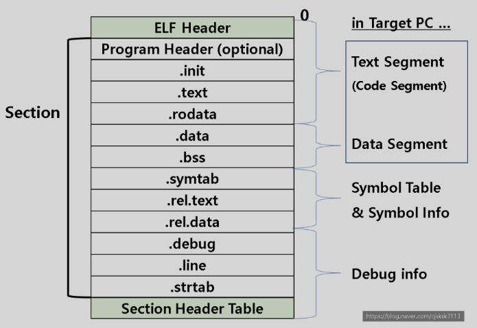
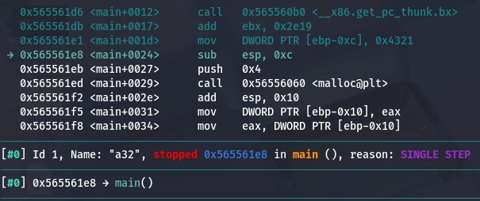
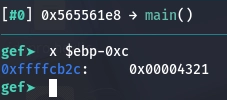
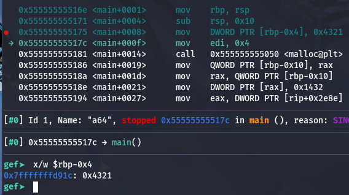
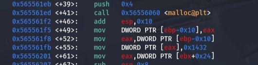
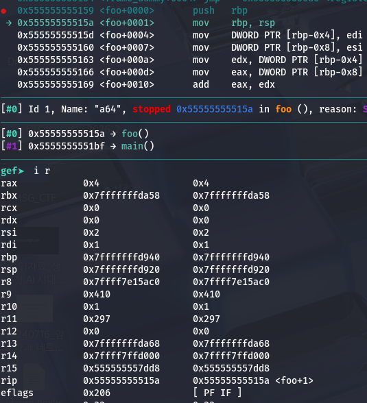
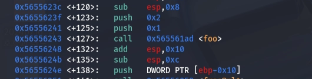
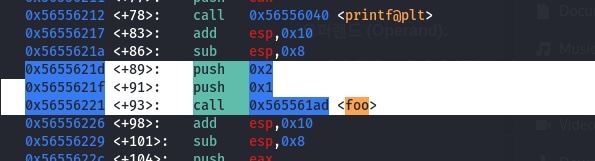


<article class="page sans notion-pwn-article" id="3e3ccf0f-0989-809f-bac9-dd4b5c4df602">
<aside class="block-color-gray_background callout" data-notion-callout="" data-notion-callout-background="gray_background" dir="ltr" id="3e3ccf0f-0989-805d-9103-f96d41368c4a" style="white-space:pre-wrap;display:flex">
<h2 class="" dir="auto" id="3e3ccf0f-0989-8090-854d-f88c147f10ec"><strong>실습</strong></h2><ul class="bulleted-list" dir="auto" id="3e3ccf0f-0989-8070-8629-f1636485619d"><li style="list-style-type:disc">다음 조건에 맞는 C 프로그램을 직접 작성한다.<ol class="numbered-list" dir="auto" id="3e3ccf0f-0989-80e4-9747-ffe9428044e8" start="1" type="1"><li>전역 <code>int</code> 변수를 선언하고 <code>0x1234</code>로 초기화한다.<ol class="numbered-list" dir="auto" id="3e3ccf0f-0989-80a7-8194-c9fc2538a30f" start="1" type="a"><li>지역 <code>int</code> 변수를 선언하고 <code>0x4321</code>로 초기화한다.</li></ol><ol class="numbered-list" dir="auto" id="3e3ccf0f-0989-80b8-9bfc-cbec9e7b09a8" start="2" type="a"><li><code>malloc()</code>으로 <code>int</code> 크기의 Heap 메모리를 할당하고 <code>0x1432</code>를 저장한다.</li></ol><ol class="numbered-list" dir="auto" id="3e3ccf0f-0989-8096-961b-cc9fb8ab4a39" start="3" type="a"><li>두 정수를 인자로 받아 합을 반환하는 <code>foo()</code> 함수를 작성한다.</li></ol></li></ol></li></ul><ul class="bulleted-list" dir="auto" id="3e3ccf0f-0989-8028-b383-e8a9d0b21ef4"><li style="list-style-type:disc">작성한 프로그램을 32bit와 64bit로 각각 컴파일한 뒤 GDB를 이용하여 다음을 확인한다.<ul class="bulleted-list" dir="auto" id="3e3ccf0f-0989-8034-896c-e41ebccb2e75"><li style="list-style-type:circle">전역 변수가 위치한 메모리 영역<ul class="bulleted-list" dir="auto" id="3e3ccf0f-0989-804d-9374-e82d704ea88b"><li style="list-style-type:square">지역 변수가 위치한 메모리 영역</li></ul><ul class="bulleted-list" dir="auto" id="3e3ccf0f-0989-8071-a343-cd1bd8a17bf5"><li style="list-style-type:square"><code>malloc()</code>으로 할당한 데이터의 위치</li></ul><ul class="bulleted-list" dir="auto" id="3e3ccf0f-0989-808e-948f-c5f7f8d6df9b"><li style="list-style-type:square">함수 호출 전후 Stack의 변화<ul class="bulleted-list" dir="auto" id="3e3ccf0f-0989-80f2-be9c-fd12fe2f1bbf"><li style="list-style-type:disc">Return Address의 위치</li></ul><ul class="bulleted-list" dir="auto" id="3e3ccf0f-0989-801c-a965-ee679c1d90d2"><li style="list-style-type:disc"><code>RSP/ESP</code>, <code>RBP/EBP</code>, <code>RIP/EIP</code>의 변화</li></ul><ul class="bulleted-list" dir="auto" id="3e3ccf0f-0989-80f4-8fd4-c61f404ae782"><li style="list-style-type:disc"><code>foo()</code> 함수에 인자가 전달되는 과정</li></ul><ul class="bulleted-list" dir="auto" id="3e3ccf0f-0989-80c5-860a-ded2ab6bb63d"><li style="list-style-type:disc"><code>foo()</code>의 반환값이 전달되는 과정</li></ul><ul class="bulleted-list" dir="auto" id="3e3ccf0f-0989-8005-9652-d33a763eecbe"><li style="list-style-type:disc"><del>동일 프로그램에서 ASLR 활성화 여부에 따른 주소 변화</del></li></ul><ul class="bulleted-list" dir="auto" id="3e3ccf0f-0989-802b-84fd-eaacf7f6b969"><li style="list-style-type:disc">32bit와 64bit 바이너리의 Stack Frame 차이</li></ul></li></ul></li></ul></li></ul>
</aside>

모르는 거 정리

<ul class="bulleted-list" dir="auto" id="3e9ccf0f-0989-809b-be07-e8d0f580d3c4"><li style="list-style-type:disc">ELF(Executable and Linkable Format)<ul class="bulleted-list" dir="auto" id="3e9ccf0f-0989-8039-829a-eeb73d922eab"><li style="list-style-type:circle">리눅스 및 유닉스 계열 OS에서 사용하는 표준 바이너리 파일 형식</li></ul><ul class="bulleted-list" dir="auto" id="3e9ccf0f-0989-803f-875d-f1daa0c2a20e"><li style="list-style-type:circle">윈도우의 .exe와 비슷</li></ul></li></ul><ul class="bulleted-list" dir="auto" id="3e9ccf0f-0989-8055-bcf0-f6177f066c50"><li style="list-style-type:disc"><a href="https://blog.naver.com/techref/222221877148">ELF section</a><figure class="image" data-notion-image="image.png" dir="ltr" id="3e9ccf0f-0989-8056-a3b1-c9a09bdafd03"></figure><ul class="bulleted-list" dir="auto" id="3e9ccf0f-0989-8066-b3fb-fda6dc695181"><li style="list-style-type:circle">ELF 파일 내용을 데이터 유형에 따라 분류해놓은 것</li></ul><ul class="bulleted-list" dir="auto" id="3e9ccf0f-0989-80ba-b32f-d653899ad264"><li style="list-style-type:circle">.init., .text, .rodata, .data 등이 있음</li></ul><ul class="bulleted-list" dir="auto" id="3e9ccf0f-0989-8093-b369-fa67ba87d94c"><li style="list-style-type:circle">메모리 영역과는 다름</li></ul></li></ul><ul class="bulleted-list" dir="auto" id="3e9ccf0f-0989-8028-a1df-e5ed7d2dd823"><li style="list-style-type:disc"><a href="https://sonseungha.tistory.com/462#google_vignette">ELF segment</a><ul class="bulleted-list" dir="auto" id="3e9ccf0f-0989-8052-bb5d-e804347e3b36"><li style="list-style-type:circle">위와 같은 section들의 집합</li></ul></li></ul><ul class="bulleted-list" dir="auto" id="3ebccf0f-0989-805f-95fb-f575ff7c95c2"><li style="list-style-type:disc">32비트와 64비트의 차이점<ul class="bulleted-list" dir="auto" id="3ebccf0f-0989-802a-a440-d315abf4fc7a"><li style="list-style-type:circle">함수의 인자를 저장할 때 32비트는 push 0x01, push 0x02 이런 식으로 스택에 저장하는데 64비트는 mov rdi, 0x01 / mov rsi, 0x02 이런 식으로 레지스터에 저장함.</li></ul><ul class="bulleted-list" dir="auto" id="3ebccf0f-0989-8001-89c9-f05f1881ec39"><li style="list-style-type:circle">왜냐, 32비트는 레지스터도 적고 레지스터에 저장할 수 있는 값의 범위도 작음. 그래서 그냥 스택에 저장.</li></ul><ul class="bulleted-list" dir="auto" id="3ebccf0f-0989-80ee-88be-f26c3a9920c9"><li style="list-style-type:circle">반면에, 64비트는 레지스터 짱많구 레지스터에 저장할 수 있는 값의 범위도 넓음. 주어진 자원을 효율적으로 사용하기 위해 레지스터에 저장.</li></ul></li></ul>

모르겠다고 이제 알겠어

이걸 알려면 저걸 알아야 하고 저걸 알려면 이걸 알아야 합니다. 포너블은 그런 분야입니다. 포너블 츄라이~~

<strong>전제 조건</strong>

코드 :
<link crossorigin="anonymous" href="https://cdnjs.cloudflare.com/ajax/libs/prism/1.29.0/themes/prism.min.css" integrity="sha512-tN7Ec6zAFaVSG3TpNAKtk4DOHNpSwKHxxrsiw4GHKESGPs5njn/0sMCUMl2svV4wo4BK/rCP7juYz+zx+l6oeQ==" referrerpolicy="no-referrer" rel="stylesheet"/><pre class="code code-wrap" data-notion-code-syntax="c" id="3eaccf0f-0989-8094-84f8-f48fdc516412"><code class="language-c" style="white-space:pre-wrap;word-break:break-all">#include &lt;stdio.h&gt;
#include &lt;stdlib.h&gt;

int a = 0x1234; // 전역 변수 선언 및 초기화

int foo(int x, int y) { // foo() 함수
    return x + y;
}

int main() {
    int b = 0x4321; // 지역 변수 선언 및 초기화

    int *p = malloc(sizeof(int)); // 동적 할당
    *p = 0x1432; // 힙 메모리에 값 저장

    printf("%d", a);
    printf("%d", foo(1, 2));
    foo(1, 2);

    free(p);
}</code></pre>
상황

: main 함수에서 foo 함수를 실행하는 것…. 이때 foo 함수에서 일어나는 함수 프롤로그와 함수 에필로그를 알아보자…
<h3 class="" dir="auto" id="3eaccf0f-0989-8084-8060-c47a258786aa">함수 호출(call)</h3><pre class="code code-wrap" data-notion-code-syntax="bash" id="3eaccf0f-0989-8034-85a2-f3d23aab66bc"><code class="language-bash" style="white-space:pre-wrap;word-break:break-all">call 함수주소 &lt;함수명&gt;</code></pre>
call

: 현재 명령어의 다음 주소를 스택에 저장. 이때 현재 명령어는 main 함수에서 call 다음으로 실행될 명령어. 함수 에필로그에서 ret 명령어 실행 시, main 함수 내의 call 다음 명령어로 이동.
<pre class="code code-wrap" data-notion-code-syntax="bash" id="3eaccf0f-0989-8006-80a7-ecc0a1cd3d10"><code class="language-bash" style="white-space:pre-wrap;word-break:break-all">0x56556243 &lt;+127&gt;:	call   0x565561ad &lt;foo&gt;
0x56556248 &lt;+132&gt;:	add    esp,0x10 -&gt; 이 부분을 스택에 저장.</code></pre>
위 코드에서 보면 add 명령어 실행 부분을 스택에 저장. → <mark class="highlight-gray" data-notion-highlight="gray">foo 함수가 끝나면 add 부분으로 돌아가야 하는데 스택에 저장한 값을 어떻게 빼내는 거지? 그니까 어디에 저장되는 거지? → 아니 하영아 함수 에필로그에서 pop ebp를 하잔아.</mark>

<mark class="highlight-gray" data-notion-highlight="gray">음 add 명령어 실행 부분을 스택에 저장한다는 건 main 함수의 스택에 저장한다는 건가</mark>

<mark class="highlight-gray" data-notion-highlight="gray">흠… call 명령어가 실행 중인 상태라고 했을 때 현재 eip를 스택에 저장한다는 건가…? 근데 call을 하면 함수를 호출하는 거라 함수 내부로 들어가는 게 아닌가…? 그럼 foo 함수 내부에 있는 첫 명령어가 현재 eip가 되는 거 아닌가?</mark>
<ol class="numbered-list" dir="auto" id="3ebccf0f-0989-807f-ae49-ed9e201ef712" start="1" type="1"><li>call &lt;foo&gt;<ol class="numbered-list" dir="auto" id="3ebccf0f-0989-80fa-aef4-d88559e35017" start="1" type="a"><li>call이 실행되면(근데 call이 실행되면 함수를 호출하니까 call 실행 중…?이라고 해야 하나) call 바로 다음 주소(반환 주소(ret), foo 함수가 끝나고 돌아올 주소.)를 스택 프레임에 저장함.</li></ol><ol class="numbered-list" dir="auto" id="3ebccf0f-0989-80a6-9c4a-dbe91c4c3807" start="2" type="a"><li>그럼 esp는 ret을 담고 있는 메모리의 주소를 가리키고 있을 거임.</li></ol><figure class="image" data-notion-image="image%201.png" dir="ltr" id="3ebccf0f-0989-802b-a1ba-c58245771c66" style="text-align:center"></figure></li></ol><h3 class="" dir="auto" id="3eaccf0f-0989-8050-a8f3-c6f204e099ff">함수 프롤로그</h3>
: 
<pre class="code code-wrap" data-notion-code-syntax="bash" id="3eaccf0f-0989-80a8-8507-cf4e0aead44b"><code class="language-bash" style="white-space:pre-wrap;word-break:break-all">push ebp
mov ebp, esp</code></pre>
<code>push ebp</code>

: main 함수의 ebp를 스택에 저장 → foo 함수가 실행될 때 ebp에 새로운 값이 들어가게 됨. 이때 main 함수의 ebp를 백업해두지 않으면 foo 함수가 끝나고 다시 돌아올 수 없음 따라서 push ebp를 해 main 함수의 ebp를 스택에 저장해두는 것

샤갈 저 알았어요 push ebp를 하면 esp = esp - 4 → [esp] = ebp 라는 작업이 수행되는 거임.

push ebp를 하면….. main 함수의 ebp를 esp가 가리키게 되는 거임. 저장되는 거
<ol class="numbered-list" dir="auto" id="3ebccf0f-0989-805d-9f19-ee579759bbc9" start="1" type="1"><li>push ebp<ol class="numbered-list" dir="auto" id="3ebccf0f-0989-8070-8144-c8e5770c85eb" start="1" type="a"><li>main함수의 스택 프레임이 있을 거임. 스택 프레임은 거꾸로 자리니까 main 함수 스택 프레임의 아래에 ebp의 주소가 저장됨.</li></ol><ol class="numbered-list" dir="auto" id="3ebccf0f-0989-80cb-b1f9-c4faad9b2057" start="2" type="a"><li>main ebp addr는 편의상 절케 적은 것… 지금 ebp는 main 함수에 있는데 이 ebp의 주소를 스택에 저장하는 것. 글구 esp는 이전 함수(엄밀히 말하면 sfp긴 한데 편의상 이전 함수라고 하겟음)의 ebp 주소가 저장되어 있는 메모리를 가리키고 있음.</li></ol><ol class="numbered-list" dir="auto" id="3ebccf0f-0989-801d-96f6-f67c87f8e026" start="3" type="a"><li>그러니가 esp가 가리키는 곳에 이전 함수 ebp 주소가 저장되어 있는 것</li></ol><figure class="image" data-notion-image="image%202.png" dir="ltr" id="3ebccf0f-0989-806f-907e-fda716cbed75" style="text-align:center"></figure></li></ol>
<code>mov ebp, esp</code>

: 
<ol class="numbered-list" dir="auto" id="3ebccf0f-0989-8011-8463-f4425cd14c6c" start="1" type="1"><li>mov ebp, esp<ol class="numbered-list" dir="auto" id="3ebccf0f-0989-805c-b463-c4de495c635e" start="1" type="a"><li>ebp를 지금 esp가 가리키고 있는 위치로 옮겨주는 거임.</li></ol><ol class="numbered-list" dir="auto" id="3ebccf0f-0989-80b7-9f54-e5b0ad33a21f" start="2" type="a"><li>ebp가 foo 함수부에 재설정되었으므로 이제 foo 함수 내용을 수행할 수 있듬</li></ol><figure class="image" data-notion-image="image%203.png" dir="ltr" id="3ebccf0f-0989-8010-8542-f4bcb30c2c0b" style="text-align:center"></figure></li></ol>
적어두진 않았지만 mov ebp, esp 수행 후 sub esp, 0x30 이런 명령어가 실행될 때가 있음.

이건 지역 변수들의 공간을 미리 확보해두는 작업임. 스택은 거꾸로 자라니까 esp - 0x30 하여 메모리 공간을 확보해주는 것.

이 작업을 수행하지 않으면 다른 값들을 메모리에 저장할 때 ebp-0x02 이런 식으로 접근하여 해당 공간에 값을 넣을 텐데… 그러면 할당된 지역 변수들의 값이 덮어씌어지게 됨. 이럼 않되,
<h3 class="" dir="auto" id="3eaccf0f-0989-801a-af44-dc49b4ba8b10">함수 에필로그</h3>
: 
<pre class="code code-wrap" data-notion-code-syntax="bash" id="3eaccf0f-0989-80fe-8e3c-cfb749503203"><code class="language-bash" style="white-space:pre-wrap;word-break:break-all">mov esp, ebp
pop ebp
pop eip
jmp eip -&gt; pop eip랑 jmp eip는 ret 명령어임. 근데 eip 자체가 다음에 실행할 명령어의 위치를 가리키니까 jmp eip라는 건... 좀 이상하긴 함</code></pre><ol class="numbered-list" dir="auto" id="3ebccf0f-0989-808e-9770-f73c7039a986" start="1" type="1"><li>mov esp, ebp<ol class="numbered-list" dir="auto" id="3ebccf0f-0989-80c8-b766-d45b99cdd5ab" start="1" type="a"><li>foo 함수의 내용을 막 다 수행했을 거임.<figure class="image" data-notion-image="image%204.png" dir="ltr" id="3ebccf0f-0989-80c8-8e7a-f5b5025c0936" style="text-align:center"></figure></li></ol><ol class="numbered-list" dir="auto" id="3ebccf0f-0989-8078-b305-cfacb07997c8" start="2" type="a"><li>ebp는 기준점이니까 바뀌지 않고, esp만 움직였을 텐데 이 esp의 위치를 ebp의 위치와 같게 해주는 거임</li></ol><figure class="image" data-notion-image="image%205.png" dir="ltr" id="3ebccf0f-0989-8085-8cf4-d756169a0819" style="text-align:center"></figure></li></ol><ol class="numbered-list" dir="auto" id="3ebccf0f-0989-80ce-8e6f-cb88c1377bb3" start="2" type="1"><li>pop ebp<ol class="numbered-list" dir="auto" id="3ebccf0f-0989-800b-a4fb-c413f214e645" start="1" type="a"><li>지금 esp와 ebp가 가리키고 있는 곳은 이전 함수의 ebp 주소를 저장해둔 곳임.</li></ol><ol class="numbered-list" dir="auto" id="3ebccf0f-0989-80d9-958b-cd9f4cc09286" start="2" type="a"><li>저 공간 안에 이전 함수 ebp의 주소!! 가 있겠지. 저 주소를 빼다 현재 ebp에 넣어주는 거임. 그럼 ebp는 이전 함수로 다시 가는 거임.</li></ol><ol class="numbered-list" dir="auto" id="3ebccf0f-0989-8078-96bf-cca603bc943a" start="3" type="a"><li>그리구 pop을 했으니 esp 주소도 바뀜. 지금 esp는 복귀 주소를 저장한 공간을 가리키고 있음.</li></ol><figure class="image" data-notion-image="image%206.png" dir="ltr" id="3ebccf0f-0989-8028-986b-d049d079af57" style="text-align:center"></figure></li></ol><ol class="numbered-list" dir="auto" id="3ebccf0f-0989-8004-8dba-e717f3f3efa3" start="3" type="1"><li>pop eip<ol class="numbered-list" dir="auto" id="3ebccf0f-0989-80b7-a1b0-f537b663ed46" start="1" type="a"><li>esp는 ret을 저장한 곳을 가리키는 중이라고 했음.</li></ol><ol class="numbered-list" dir="auto" id="3ebccf0f-0989-8068-915d-d2d835d85c2d" start="2" type="a"><li>아까 위에서 말했듯 pop은 해당 공간이 저장하고 있는 값을 피연산자에 넣어주는 거임.</li></ol><ol class="numbered-list" dir="auto" id="3ebccf0f-0989-80c8-bbf7-dfc046853008" start="3" type="a"><li>그러니가 복귀 주소(맨 처음 call 설명할 때 말했던 거… call 다음에 실행할 명령어의 주소)를 eip에 넣는 작업임.</li></ol>

</li></ol>

<h2 class="" dir="auto" id="3e9ccf0f-0989-803d-9abb-d3c1373417e5">1. 조건에 맞는 C 프로그램 작성</h2><ol class="numbered-list" dir="auto" id="3e9ccf0f-0989-800a-9a25-ceb8827f4d9f" start="1" type="1"><li>전역 <code>int</code> 변수를 선언하고 <code>0x1234</code>로 초기화한다.</li></ol><ol class="numbered-list" dir="auto" id="3e9ccf0f-0989-80cc-a127-d8e03f808c99" start="2" type="1"><li>지역 <code>int</code> 변수를 선언하고 <code>0x4321</code>로 초기화한다.</li></ol><ol class="numbered-list" dir="auto" id="3e9ccf0f-0989-80f9-bc92-d85b376f8bf9" start="3" type="1"><li><code>malloc()</code>으로 <code>int</code> 크기의 Heap 메모리를 할당하고 <code>0x1432</code>를 저장한다.</li></ol><ol class="numbered-list" dir="auto" id="3e9ccf0f-0989-80ca-a98d-f8f6623ce4f0" start="4" type="1"><li>두 정수를 인자로 받아 합을 반환하는 <code>foo()</code> 함수를 작성한다.</li></ol>
&lt;에러가 발생한 코드&gt;
<pre class="code code-wrap" data-notion-code-syntax="c" id="3e9ccf0f-0989-805b-be8b-e02f332ca5ae"><code class="language-c" style="white-space:pre-wrap;word-break:break-all">#include &lt;stdio.h&gt;
#include &lt;stdlib.h&gt;

int a = 0x1234;

int foo(int x, int y) {
    return x + y;
}

int main() {
    int b = 0x4321;

    int *p = malloc(sizeof(int));
    p = 0x1432;

    free(p);
}</code></pre>
main 함수 부분에 선언된 p는 정수형 데이터를 가리키는 포인터입니다. 반면에 p에 대입하려 한 값의 자료형은 그냥 정수입니다.

int *에 int를 대입하려 해서 오류가 발생했습니다…

<del>자료형을 맞추자.</del>

&lt;정상 작동한 코드&gt;
<pre class="code code-wrap" data-notion-code-syntax="c" id="3e9ccf0f-0989-80bb-a180-ff69676796a0"><code class="language-c" style="white-space:pre-wrap;word-break:break-all">#include &lt;stdio.h&gt;
#include &lt;stdlib.h&gt;

int a = 0x1234; // 전역 변수 선언 및 초기화

int foo(int x, int y) { // foo() 함수
    return x + y;
}

int main() {
    int b = 0x4321; // 지역 변수 선언 및 초기화

    int *p = malloc(sizeof(int)); // 동적 할당
    *p = 0x1432; // 힙 메모리에 값 저장

    printf("%d", a);
    printf("%d", foo(1, 2));
    foo(1, 2);

    free(p);
}</code></pre><h2 class="" dir="auto" id="3e9ccf0f-0989-8084-9bcc-eb1ceec5794b">2. 작성한 프로그램을 32bit와 64bit로 각각 컴파일한 뒤 GDB를 이용하여 다음 항목 확인</h2>
 c코드를 32bit로 컴파일 하는 명령어는 다음과 같습니다.
<pre class="code code-wrap" data-notion-code-syntax="bash" id="3e9ccf0f-0989-8014-bbf4-f496b0b81f46"><code class="language-bash" style="white-space:pre-wrap;word-break:break-all">gcc -m32 -o [생성할 파일명] [컴파일할 파일명].c</code></pre>
c코드를 64bit로 컴파일 하는 명령어는 다음과 같습니다.
<pre class="code code-wrap" data-notion-code-syntax="bash" id="3e9ccf0f-0989-80a8-8abd-c192757f4d62"><code class="language-bash" style="white-space:pre-wrap;word-break:break-all">gcc -m64 -o [생성할 파일명] [컴파일할 파일명].c</code></pre>
gdb로 각각 분석해보겠습니다.
<h3 class="" dir="auto" id="3e9ccf0f-0989-8005-8725-d38204ed4bb9">2-1. 전역 변수가 위치한 메모리 영역</h3>
전역 변수는 메모리 상에서 data와 bss 영역에 저장됩니다.
<figure class="image" data-notion-image="image%207.png" dir="ltr" id="3e9ccf0f-0989-80a4-924f-ebbb06e49921"></figure>
그 중 초기값이 있는 전역 변수는 data 영역, 초기값이 없는 전역 변수는 bss 영역에 저장됩니다.

제가 작성한 코드에서의 전역 변수는 초기값이 있기 때문에 data 영역에 저장되었을 겁니다.
<h4 class="" dir="auto" id="3e9ccf0f-0989-80f5-9d9f-f1776c594b47">32bit</h4>
프로그램이 실행 중인 상태가 아니면 전역 변수가 할당되지 않기 때문에 먼저 <code>b main</code>으로 break point를 main 함수 시작점에 걸고 <code>run</code> 명령어를 입력하여 실행했습니다.

main 함수 시작점에서 멈춰있는 상태입니다.
<figure class="image" data-notion-image="image%208.png" dir="ltr" id="3eaccf0f-0989-80e8-96fa-c917dc6e6b46"></figure>
gdb에서 현재 프로세스의 전역 변수를 출력할 수 있는 명령어는 <code>info variables</code>입니다.

<code>info variables</code>를 입력하여 모든 전역 변수를 출력했습니다.
<figure class="image" data-notion-image="image%209.png" dir="ltr" id="3eaccf0f-0989-806b-bbc8-fa2f2fa20015"></figure>
제가 작성한 c 코드에서 선언한 전역 변수명은 a였습니다.

확인해보니 <code>0x56559018</code>번지에 전역 변수가 존재합니다.

x 명령어로 a에 할당된 내용을 출력해보겠습니다.

<code>x 0x56559018</code> 를 입력하니 전역 변수에 제가 코드 상에 입력한 값<code>(0x1234)</code>이 들어있다는 걸 확인할 수 있었습니다.
<figure class="image" data-notion-image="image%2010.png" dir="ltr" id="3eaccf0f-0989-807c-9c32-c161f6bb6140"></figure><h4 class="" dir="auto" id="3e9ccf0f-0989-8064-ac7b-f5fa88ffddcb">64bit</h4>
64비트로 컴파일한 바이너리를 gdb로 실행하였습니다.

br을 main에 걸고 r 후 main 함수를 디스어셈블했습니다.
<figure class="image" data-notion-image="image%2011.png" dir="ltr" id="3f0ccf0f-0989-8024-8556-e187a7c2dd8f"></figure>
32비트와 다르게 주소가 뚱쭝합니다. 디스어셈블 내용 또한 짧습니다.

info variables 명령어로 전역 변수인 a가 선언된 곳은 0x0000555555558028입니다.
<figure class="image" data-notion-image="image%2012.png" dir="ltr" id="3f0ccf0f-0989-806d-b75d-ddc8d62b19d9"></figure>
저 위치에 실제로 제가 넣어준 값(0x1234)이 들어있는지 확인해보겠습니다.
<figure class="image" data-notion-image="image%2013.png" dir="ltr" id="3f0ccf0f-0989-8060-8103-dd8123addf00"></figure>
0x1234라는 제가 전역 변수 a에 넣은 값이 있습니다.
<h3 class="" dir="auto" id="3e9ccf0f-0989-8014-b789-d3c8a2d6fe8f">2-2. 지역 변수가 위치한 메모리 영역</h3>
지역 변수는 메모리 상에서 stack 영역에 위치합니다.
<figure class="image" data-notion-image="image%207.png" dir="ltr" id="3e9ccf0f-0989-80e8-8736-f9809842493c"></figure><h4 class="" dir="auto" id="3e9ccf0f-0989-8076-8db5-dc39bbeb1ec2">32bit</h4>
gdb로 파일 실행 후 disas main 명령어로 지역 변수가 저장되있는 함수인 main 함수의 어셈블리를 봤습니다.
<figure class="image" data-notion-image="image%2014.png" dir="ltr" id="3eaccf0f-0989-80f6-b721-d8756c2e539d"></figure>
(아직 프로그램을 실행하지 않은 상태라 왼쪽에 있는 주소값이 저런 거임)

표시한 부분을 보면 <code>ebp-0xc</code>라는 주소에 0x4321이라는 값을 복사하고 있음을 알 수 있습니다.
<pre class="code code-wrap" data-notion-code-syntax="bash" id="3eaccf0f-0989-8090-81b1-e6baa46fddde"><code class="language-bash" style="white-space:pre-wrap;word-break:break-all">mov [피연산자1], 피연산자2 -&gt; 피연산자1의 주소에 직접 접근해 피연산자 값을 넣겠다라는 뜻</code></pre>
이 부분이 지역 변수 선언부입니다.

DWORD(or BYTE or WORD or QWORD) PTR은 참조할 메모리의 크기가 4바이트임을 지정하는 지시자입니다. 보통 DWORD PTR [] 형태로 쓰이며, DWORD는 크기 지정, PTR은 뒤에 오는 대괄호 안에 있는 주소에 직접 접근하여 값을 읽거나 쓸 수 있습니다. (포인터 같은…?)
<figure class="image" data-notion-image="image%2015.png" dir="ltr" id="3eaccf0f-0989-801a-a51b-c1688f2b9e5f"></figure>
br을 main에 걸고 실행하여 ebp-0xc 주소의 메모리 영역에 0x4321이라는 값이 저장되어 있는지 확인해보겠습니다.

<code>b main</code>실행 후 <code>run</code>하였습니다.

<code>ni</code>을 실행해 변수에 <code>0x4321</code>을 대입하는 부분 다음까지 실행했습니다.
<figure class="image" data-notion-image="6856e4b0-bcd8-4193-9117-fab24ef2b982.png" dir="ltr" id="3eaccf0f-0989-8068-8312-c453a3dc5ab7"></figure>
<code>x $ebp-0xc</code> 를 통해 ebp-0xc 주소의 메모리 영역에 있는 값을 확인하면 다음과 같습니다.
<figure class="image" data-notion-image="cc60a386-120c-4130-8d80-d8abe8fdc635.png" dir="ltr" id="3eaccf0f-0989-80c6-ac3c-fc170f026071"></figure><h4 class="" dir="auto" id="3e9ccf0f-0989-806a-a50e-ea7d2606d455">64bit</h4>
디스어셈블된 main 함수를 보면 rbp-0x4 주소에 접근하여 0x4321이라는 값을 넣고 있습니다.
<figure class="image" data-notion-image="image%2016.png" dir="ltr" id="3f0ccf0f-0989-8090-916a-f98b6363229c"></figure>
실제로 rbp-0x4에 제가 선언한 지역 변수의 값이 들어갔는지 확인해보겠습니다.
<figure class="image" data-notion-image="Screenshot_From_2026-10-05_13-58-47.png" dir="ltr" id="3f0ccf0f-0989-8060-a126-f0f5add1e5e7"></figure>
지역 변수를 할당하는 명령어 실행 후 rbp-0x4에 접근하여 안에 든 값을 확인해보니 0x4321이 있었습니다.
<h3 class="" dir="auto" id="3e9ccf0f-0989-80bf-8065-efc125294334">2-3. <code>malloc()</code>으로 할당 받은 주소(위치)</h3><h4 class="" dir="auto" id="3e9ccf0f-0989-80f2-bbc7-f3483e8ab9a3">32bit</h4>
br을 main에 건 후 r을 입력하여 실행하였습니다.

그 후 <code>disas main</code> 명령어로 main 함수 부분을 어셈블리로 출력했습니다.
<figure class="image" data-notion-image="image%2017.png" dir="ltr" id="3eaccf0f-0989-80d8-9605-e0160efbd791"></figure>
0x565561ed에서 malloc 함수를 호출하는 작업을 수행하고 있습니다.
<figure class="image" data-notion-image="b994a9bc-4f98-4886-be1a-6141084ffbb1.png" dir="ltr" id="3eaccf0f-0989-80b1-87b0-f7f617df934d"></figure>
malloc 함수는 void *를 반환하는 함수입니다.

제 코드 상에는 <code>int *p = malloc(sizeof(int));</code> 로 작성되어 있습니다.

이때 malloc 함수의 반환값은 p에 저장되는데, 어셈블리에서 반환값은 eax 레지스터에 저장됩니다.

디스어셈블 내용을 보면 <code>DWORD PTR [ebp-0x10], eax</code>로 <code>(ebp 주소) - 0x10</code> 한 위치에 eax의 값을 대입하고 있습니다.

ni 명령어로 어셈블리 코드를 한 줄씩 실행하여 eax 값이 반환되는 지점 바로 직후까지 실행했습니다.
<figure class="image" data-notion-image="image%2018.png" dir="ltr" id="3eaccf0f-0989-8012-9bae-c97dad3440a4"></figure>
<code>x $ebp-0x10</code> 명령어로 malloc() 함수가 반환한 주소를 출력합니다.
<figure class="image" data-notion-image="image%2019.png" dir="ltr" id="3eaccf0f-0989-8069-a403-f062a6b23ff6"></figure>
malloc 함수가 반환한 주소는 <code>0x5655a1e0</code>입니다.

정리하자면, x $ebp-0x10 명령어를 실행했을 때의 출력 결과에서 왼쪽에 0xffffcb28은 포인터 변수 p의 주소입니다. 오른쪽의 0x5655a1e0은 포인터 변수 p가 가리키는 주소입니다. 즉, malloc 함수가 반환한 주소입니다.

<code>&amp;p ⇒ 0xffffcb28</code>

<code>p ⇒ 0x5655a1e0</code>
<figure class="image" data-notion-image="image%2020.png" dir="ltr" id="3eaccf0f-0989-8040-a64d-e27e2bd15acf"></figure><h4 class="" dir="auto" id="3e9ccf0f-0989-80f2-8495-ee23d0c17677">64bit</h4><figure class="image" data-notion-image="image%2021.png" dir="ltr" id="3f0ccf0f-0989-80bb-99d6-e099b2fde289"></figure>
mov QWORD PTR [rbp-0x10], rax에서 malloc 함수의 반환값이 저장된 rax 값(즉, malloc 함수의 반환값)을 rbp-0x10 위치에 직접 접근하여 값을 넣습니다.
<figure class="image" data-notion-image="image%2022.png" dir="ltr" id="3f0ccf0f-0989-809e-a23f-e8b9f2b6abcd"></figure>
mov QWORD PTR [rbp-0x10], rax 명령어 실행 후 rbp-0x10 의 값을 확인해보겠습니다.

현재 br은 다음 부분에 걸려있습니다.
<figure class="image" data-notion-image="image%2023.png" dir="ltr" id="3f0ccf0f-0989-80b8-a719-dfc8ec9ed82d"></figure>
이 시점에서 rax 값은 다음과 같습니다.
<figure class="image" data-notion-image="image%2024.png" dir="ltr" id="3f0ccf0f-0989-80ac-beb2-fc9300982d83"></figure>
이제 call 0x555555555050 <a href="mailto:malloc@plt">malloc@plt</a> 실행 후 rax를 출력해보겠습니다.
<figure class="image" data-notion-image="image%2025.png" dir="ltr" id="3f1ccf0f-0989-808d-bdfa-dd5b910a1a6a"></figure>
malloc으로 할당 받은 위치는 0x555555559310입니다.
<h3 class="" dir="auto" id="3e9ccf0f-0989-8083-88a1-d8f4d240b801">2-4. 함수 호출 전후 Stack의 변화 - foo()</h3><h3 class="" dir="auto" id="3e9ccf0f-0989-8077-8eb8-f68babf2ab93">2-4-1. Return Address의 위치 - foo()</h3>
함수의 Return Address(반환 주소)는 그 함수가 종료된 바로 다음에 실행될 명령어의 주소입니다.

즉, main 함수 내에서 foo 함수가 실행이 될 텐데 main 함수 상의 foo 함수 다음에 실행될 명령어가 foo 함수의 반환 주소입니다.
<h4 class="" dir="auto" id="3e9ccf0f-0989-8014-94bd-ff57aa73ede1">32bit</h4>
따라서 표시한 부분이 foo 함수의 Return Address의 위치가 됩니다.
<figure class="image" data-notion-image="image%2026.png" dir="ltr" id="3efccf0f-0989-8081-b9a4-f3305128f851"></figure>
실제로 그렇게 작동하는지 gdb에서 알아보겠습니다.

현재 bp가 foo 함수에 걸려있어 함수 실행 직전에 멈춰있습니다.
<figure class="image" data-notion-image="image%2027.png" dir="ltr" id="3efccf0f-0989-8006-8a9c-c0001cfa0b09"></figure>
info frame이라는 명령어로 현재 함수의 스택 프레임을 볼 수 있습니다.

스택에 저장된 eip가 0x56556226임을 알 수 있습니다. 이 주소가 foo 함수 종료 후 실행될 명령어 즉, foo 함수의 Return Address입니다.
<figure class="image" data-notion-image="image%2028.png" dir="ltr" id="3efccf0f-0989-80a0-9073-e74fdbb3e4d2"></figure><h4 class="" dir="auto" id="3e9ccf0f-0989-8086-b8b0-c2724a5a78f2">64bit</h4>
main 함수에서 foo 함수를 호출하는 부분입니다.

foo 함수의 Return Address는 call 0x555555555159 &lt;foo&gt;하는 명령어 바로 다음 부분인 0x00005555555551bf가 반환 주소입니다.
<figure class="image" data-notion-image="image%2029.png" dir="ltr" id="3f1ccf0f-0989-8016-8fdf-c8e556617246"></figure>
foo 함수의 내용입니다. push rbp에 br을 걸어 반환 주소를 확인해보겠습니다.
<figure class="image" data-notion-image="image%2030.png" dir="ltr" id="3f1ccf0f-0989-8055-9d00-d83f3b30b616"></figure>
foo 함수 진입 후 스택에 저장된 Return Address의 주소가 아까 확인했던 주소인 0x00005555555551bf임을 알 수 있습니다.
<figure class="image" data-notion-image="image%2031.png" dir="ltr" id="3f1ccf0f-0989-80b3-8b43-d1a45b5e0251"></figure><h3 class="" dir="auto" id="3e9ccf0f-0989-80f9-bb9e-fba7b7fb8137">2-4-2. <code>RSP/ESP</code>, <code>RBP/EBP</code>, <code>RIP/EIP</code>의 변화</h3>
<strong>rsp/esp 레지스터</strong>
<ul class="bulleted-list" dir="auto" id="3efccf0f-0989-8072-ba58-ef3cc08cd12e"><li style="list-style-type:disc">stack pointer 레지스터</li></ul><ul class="bulleted-list" dir="auto" id="3efccf0f-0989-80ff-94a0-fc1b5a545824"><li style="list-style-type:disc">stack의 최상단(낮은 주소)를 가리키는 레지스터</li></ul>
<strong>rbp/ebp 레지스터</strong>
<ul class="bulleted-list" dir="auto" id="3efccf0f-0989-80b4-a18d-d33141e75108"><li style="list-style-type:disc">base pointer 레지스터</li></ul><ul class="bulleted-list" dir="auto" id="3efccf0f-0989-8020-9e15-f0a8e7bc821a"><li style="list-style-type:disc">기준이 되는 레지스터</li></ul><ul class="bulleted-list" dir="auto" id="3efccf0f-0989-80bd-8db4-e8ca26d676f9"><li style="list-style-type:disc">변하지 않음</li></ul>
<strong>rip/eip 레지스터</strong>
<ul class="bulleted-list" dir="auto" id="3efccf0f-0989-8092-8b15-ec743aafee0b"><li style="list-style-type:disc">instruction pointer</li></ul><ul class="bulleted-list" dir="auto" id="3efccf0f-0989-8028-9a17-d7d30b99056d"><li style="list-style-type:disc">다음에 실행될 명령어의 위치를 가리키는 레지스터</li></ul>
foo 함수를 통해 각 레지스터들이 어떻게 변하는지 관찰해보겠습니다.
<h4 class="" dir="auto" id="3e9ccf0f-0989-80f9-bcf2-ce2b856c7b4e">32bit</h4>
br을 main 함수의 call foo 하는 부분에서부터 걸고 ni하여 foo 함수에 진입하였습니다.

현재 gdb 화면을 보면 push ebp 전에 멈춰있는 것을 알 수 있습니다.
<figure class="image" data-notion-image="image%2032.png" dir="ltr" id="3efccf0f-0989-8024-bab1-e51575318e0f"></figure>
아직 push ebp를 실행하지 않았기 때문에 eip 레지스터는 다음에 push ebp를 실행하기 위해 해당 명령어의 위치를 가리키고 있습니다.

ebp와 esp 레지스터는 아직 함수 프롤로그 시작 전이므로 main 함수의 ebp와 esp 주소입니다.

함수 프롤로그 이후 foo 함수의 스택 프레임이 생성되고, ebp와 esp 주소가 main 함수의 스택 프레임을 가리키고 있다 foo 함수의 스택 프레임을 가리키게 될 것입니다.

ni를 실행해 push ebp를 실행했습니다. push ebp로 main 함수의 ebp를 스택에 저장했습니다. 저장만 하였으므로 ebp의 값은 변하지 않았습니다.

esp는 ebp가 저장된 스택의 주소를 가리키고 있습니다.

eip는 다음에 실행할 명령어인 mov ebp, esp 명령어의 주소를 가리키고 있습니다.
<figure class="image" data-notion-image="image%2033.png" dir="ltr" id="3efccf0f-0989-8053-b387-dd0df69801ce"></figure>
ni를 입력해 mov ebp, esp 명령어를 실행했습니다.

ebp가 가리키는 주소를 esp와 같도록 하는 명령입니다.

따라서 main 함수의 스택 프레임의 어딘가를 가리키던 ebp가 esp와 같아지며 foo 함수의 스택 프레임을 가리키게 됩니다.
<figure class="image" data-notion-image="image%2034.png" dir="ltr" id="3efccf0f-0989-8012-a4c8-ebc1fbb48760"></figure>
pop ebp 전까지 esp와 ebp엔 변화가 없고, 다음 실행 명령어를 가리키는 레지스터인 eip 값만 변합니다.
<figure class="image" data-notion-image="image%2035.png" dir="ltr" id="3efccf0f-0989-8028-9c44-f25372a2cdfa"></figure>
pop ebp 명령어를 실행하였습니다.

esp가 가리키던 스택에 저장되어 있던 ebp 주소가 pop되어 ebp 레지스터에 들어가게 됩니다. 따라서 foo 함수의 base pointer 역할을 하던 ebp가 다시 main 함수의 base를 가리키게 됩니다.

esp 또한 pop ebp를 하였으므로 가리키는 주소가 변하였습니다.
<figure class="image" data-notion-image="image%2036.png" dir="ltr" id="3efccf0f-0989-8031-bfdc-dff256b3f980"></figure>
ret 명령어를 실행하여 foo 함수의 반환 주소(0x56556226)으로 점프했습니다.
<figure class="image" data-notion-image="image%2037.png" dir="ltr" id="3efccf0f-0989-805f-a853-fbf05025ccdc"></figure><h4 class="" dir="auto" id="3e9ccf0f-0989-800d-968c-f10e7daa2203">64bit</h4>
call foo를 하기 전의 rsp/esp, rbp/ebp, rip/eip입니다.
<figure class="image" data-notion-image="image%2038.png" dir="ltr" id="3f1ccf0f-0989-80f5-ad89-cb7bde2716ef"></figure>
ni를 실행하여 foo 함수의 프롤로그 직전까지 오니 rip가 push ebp를 수행하는 주소를 가리키고 있습니다.

rbp는 여전히 main 함수의 rbp입니다.
<figure class="image" data-notion-image="image%2039.png" dir="ltr" id="3f1ccf0f-0989-8046-b681-c91ff00a3d60"></figure>
info frame으로 스택에 저장된 rip의 주소를 확인했습니다.

foo 함수 다음에 실행될 반환 주소가 저장되어 있습니다.
<figure class="image" data-notion-image="image%2040.png" dir="ltr" id="3f1ccf0f-0989-80b9-84e1-cad7e706ab3e"></figure>
push rbp 이후입니다.

rbp는 변하지 않고, push 하였기 때문에 rsp가 -8 되었습니다. rip는 다음 실행 명령어를 가리키고 있습니다.
<figure class="image" data-notion-image="Screenshot_From_2026-10-06_12-09-18.png" dir="ltr" id="3f1ccf0f-0989-80a6-bf88-cb190b08a594"></figure>
mov rbp, rsp 이후 main 함수에 있던 rbp가 foo 함수를 가리키게 되었습니다.

rbp와 rsp가 가리키는 주소는 동일합니다.
<figure class="image" data-notion-image="image%2041.png" dir="ltr" id="3f1ccf0f-0989-803a-93d7-eb77f2e1f4f2"></figure>
함수 내용을 실행하고 함수 에필로그에서 pop rbp를 하여 foo의 기준이 되었던 rbp를 스택에 저장해둔 이전 함수(main) rbp 주소를 다시 넣어줬습니다.
<figure class="image" data-notion-image="image%2042.png" dir="ltr" id="3f1ccf0f-0989-802d-8f41-fa1f67f332f1"></figure>
그 후 ret을 하여 rip는 foo 함수 다음으로 실행할 명령어를 가리키고 있고, rsp 또한 main 함수의 최상단을 가리키게 됩니다.
<figure class="image" data-notion-image="image%2043.png" dir="ltr" id="3f1ccf0f-0989-8013-bbcb-d7bb0b332bd5"></figure><h3 class="" dir="auto" id="3e9ccf0f-0989-809e-abbd-c5e441f51cbc">2-4-3. <code>foo()</code> 함수에 인자가 전달되는 과정</h3><h4 class="" dir="auto" id="3e9ccf0f-0989-801f-a57e-fe5b064fba22">32bit</h4>
disas main으로 main 함수를 어셈블리 코드로 봤습니다.
<figure class="image" data-notion-image="image%2017.png" dir="ltr" id="3eaccf0f-0989-80c6-9439-e673fb39309b"></figure>
push 0x2와 push 0x1에서 foo 함수에 인자를 전달하는 거 같습니다.
<figure class="image" data-notion-image="99426f8b-6fb9-465b-aaa9-3207da38ddd0.png" dir="ltr" id="3eaccf0f-0989-8067-852f-e5ccd7a65214"></figure>
foo 함수에 인자를 전달하는 방식은 스택에 push하여 전달하는 방식으로 cdecl 함수 호출 규약입니다.

gdb 실행하고 br을 main과 사진 상에 표시한 부분과 foo함수 주소(0x565561ad)에 걸어줬습니다.
<figure class="image" data-notion-image="Screenshot_From_2026-09-29_21-44-30.png" dir="ltr" id="3eaccf0f-0989-80b3-9c30-e9d4af7e7a38"></figure>
push 0x2 명령어 실행 후 스택에 2라는 값이 인자로 들어갔을 겁니다.
<figure class="image" data-notion-image="image%2044.png" dir="ltr" id="3efccf0f-0989-8043-8b85-ce8d93a659c0"></figure>
push 명령어를 썼으므로 현재 esp가 가리키는 곳에 인자로 들어간 값이 존재할 거라 생각해 출력해봤습니다.

esp의 위치가 0xffffcb44이기에 x/w 0xffffcb44 명령어로 해당 위치에 있는 값을 출력해보니 인자로 전달된 0x2가 출력됐습니다.
<figure class="image" data-notion-image="image%2045.png" dir="ltr" id="3efccf0f-0989-802c-a333-f22aa336deb2"></figure>
0x1 또한 같은 방식으로 출력할 수 있습니다.
<figure class="image" data-notion-image="image%2046.png" dir="ltr" id="3efccf0f-0989-8018-aa52-d7b65c6e6d32"></figure><h4 class="" dir="auto" id="3e9ccf0f-0989-8000-bcd6-db5a75cf2d57">64bit</h4>
64비트에선 함수에 인자를 레지스터를 통해 전달합니다.

함수 호출 규약에서 fastcall 방식은 함수의 인자를 레지스터를 통해 전달하는 방식입니다. 이때 사용되는 레지스터는 <a href="https://oo7-0310.tistory.com/117">리눅스 기준 rdi, rsi, rdx, rcx, r8, r9 순대로 사용</a>됩니다.

main 함수를 디스어셈블하면 mov esi, 0x2와 mov edi, 0x1 명령어로 레지스터를 통해 함수에 인자를 전달하는 걸 볼 수 있습니다.
<figure class="image" data-notion-image="image%2047.png" dir="ltr" id="3f1ccf0f-0989-8093-835a-c9c50f414b1d"></figure>
실제로 확인해보겠습니다.

mov esi, 0x2를 실행하였습니다.
<figure class="image" data-notion-image="image%2048.png" dir="ltr" id="3f1ccf0f-0989-8098-a47d-ff19df17abbe"></figure>
p 명령어로 esi의 값을 출력해보니 인자가 저장되어 있습니다.
<figure class="image" data-notion-image="image%2049.png" dir="ltr" id="3f1ccf0f-0989-8064-8928-c495a69b66e5"></figure>
mov edi, 0x1 실행 후 p 명령어로 edi에 전달된 인자값을 확인했습니다.
<figure class="image" data-notion-image="image%2050.png" dir="ltr" id="3f1ccf0f-0989-801f-b1e6-c78439a77dd3"></figure><h3 class="" dir="auto" id="3e9ccf0f-0989-8037-8021-fbd1bb81da08">2-4-4. <code>foo()</code>의 반환값이 전달되는 과정</h3>
함수의 반환값은 rax/eax 레지스터에 저장됩니다.

foo 함수에서 반환값이 어떻게 전달되는지 보겠습니다.
<h4 class="" dir="auto" id="3e9ccf0f-0989-8017-a754-f7fd6872cb8b">32bit</h4>
foo 함수를 디스어셈블한 내용입니다.
<figure class="image" data-notion-image="image%2051.png" dir="ltr" id="3f0ccf0f-0989-8059-9809-d749da744e79"></figure>
함수 프롤로그 수행 후 __x86.get_pc_thunk.ax 함수를 호출합니다.

그 후 add 명령어로 0x2e3f라는 값을 eax에 저장합니다. 아마 __x86.get_pc_thunk.ax 함수와 관련된 것 같습니다.

mov edx,DWORD PTR [ebp+0x8] 로 ebp+0x8 주소에 저장된 값에 접근하여 edx 레지스터에 넣습니다.

ebp+0x8에 저장되어 있던 값은 앞전에 인자 전달 과정에서 확인했던 foo 함수에 전달된 인자인 0x1이었습니다.

0x1이라는 인자를 edx 레지스터에 넣어줬습니다.
<figure class="image" data-notion-image="image%2052.png" dir="ltr" id="3f0ccf0f-0989-8030-88e0-c1cee7330b74"></figure>
mov eax,DWORD PTR [ebp+0xc] 로 ebp+0xc 주소에 저장된 값에 접근하여 eax 레지스터에 넣습니다.

여기서도 eax 레지스터에 0x2라는 인자값을 넣어줬습니다.
<figure class="image" data-notion-image="image%2053.png" dir="ltr" id="3f0ccf0f-0989-808c-be8c-fb98ac1b86d1"></figure>
add eax, edx로 eax+edx 연산한 값을 eax에 넣습니다.

따라서 eax에는 0x3이라는 값이 들어있습니다. 이것이 foo 함수의 반환값이 됩니다.
<figure class="image" data-notion-image="image%2054.png" dir="ltr" id="3f0ccf0f-0989-802b-87b6-fa89cff87d03"></figure>
i r 명령어로 다시 확인했습니다.

eax에 0x3이 들어있습니다.
<figure class="image" data-notion-image="image%2055.png" dir="ltr" id="3f0ccf0f-0989-800a-8227-ef422be68325"></figure><h4 class="" dir="auto" id="3e9ccf0f-0989-8045-ae6e-ead71eb23a7f">64bit</h4>
foo 함수를 디스어셈블한 내용입니다.
<figure class="image" data-notion-image="image%2056.png" dir="ltr" id="3f1ccf0f-0989-8013-a913-cefb662311db"></figure>
다음 부분에서 레지스터로 전달받은 인자를 edx, eax 레지스터로 옮깁니다.
<pre class="code code-wrap" data-notion-code-syntax="jsx" id="3f1ccf0f-0989-801c-b202-d9c9a65e3a31"><code class="language-jsx" style="white-space:pre-wrap;word-break:break-all">0x000055555555515d &lt;+4&gt;:	mov    DWORD PTR [rbp-0x4],edi
0x0000555555555160 &lt;+7&gt;:	mov    DWORD PTR [rbp-0x8],esi
0x0000555555555163 &lt;+10&gt;:	mov    edx,DWORD PTR [rbp-0x4]
0x0000555555555166 &lt;+13&gt;:	mov    eax,DWORD PTR [rbp-0x8]</code></pre>
그 후
<pre class="code code-wrap" data-notion-code-syntax="jsx" id="3f1ccf0f-0989-80e3-85fa-e36ee76da4f6"><code class="language-jsx" style="white-space:pre-wrap;word-break:break-all">0x0000555555555169 &lt;+16&gt;:	add    eax,edx</code></pre>
위 명령어로 eax + edx 연산을 수행하여 함수의 반환값을 저장하는 eax에 연산 결과를 저장합니다.

add eax, edx 이후 eax에 0x1 + 0x2 연산을 수행한 0x3이 저장되어 있는 것을 확인할 수 있습니다.
<figure class="image" data-notion-image="image%2057.png" dir="ltr" id="3f1ccf0f-0989-8000-997b-dd1faf4d9b31"></figure><h3 class="" dir="auto" id="3e9ccf0f-0989-809d-af59-c6bcbe827e77">2-4-5. 32bit와 64bit 바이너리의 Stack Frame 차이</h3><h4 class="" dir="auto" id="3e9ccf0f-0989-8039-b145-e558a0e49122">32bit vs 64bit</h4>
32비트와 64비트를 구분하는 기준은 레지스터의 크기로 정해집니다.

32bit에서 레지스터의 크기는 32bit이고, 64bit에서 레지스터의 크기는 64bit입니다. 엄밀히 말하면 eax와 같은 e로 시작하는 레지스터의 크기가 32bit이고 rax와 같은 r로 시작하는 레지스터의 크기는 64bit입니다.

앞선 2번 실습 문제를 풀며 봤듯이 스택에 값을 넣을 때 32bit는 4바이트씩 쌓고, 64bit는 8바이트씩 쌓습니다.

같은 함수에 대해 같은 시작점에서 함수를 실행했다고 하면 32bit에선 4바이트씩, 64bit에선 8바이트씩 주소가 -되며 스택에 값이 쌓일 것입니다.

</article>

