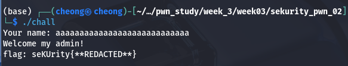
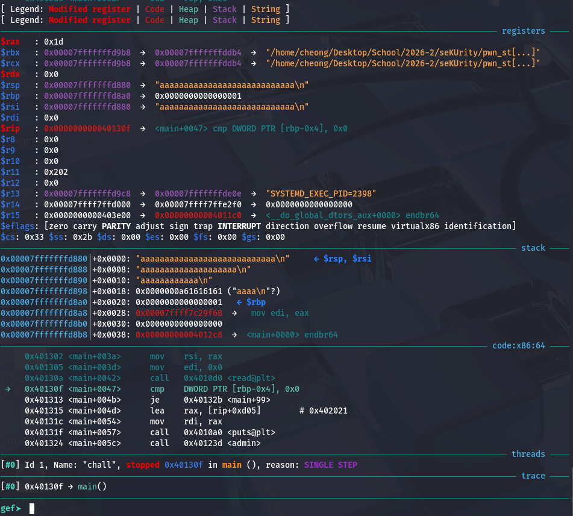
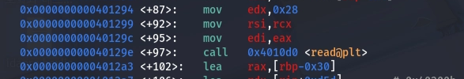
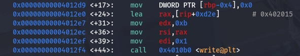
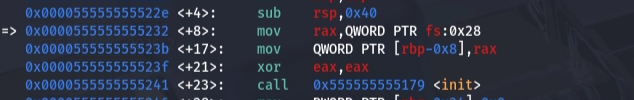
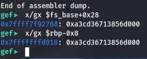


<article class="page sans notion-pwn-article" id="3f1ccf0f-0989-80b4-826c-d52a2eb058ff">
<figure dir="ltr" id="3f1ccf0f-0989-80b6-b0cd-f9b8ebdb62e7">
<a data-notion-file="week03.zip" data-notion-file-alias="week03.zip" href="/assets/files/notion-pwn/03/week03.zip">week03.zip</a>
</figure><aside class="block-color-gray_background callout" data-notion-callout="" data-notion-callout-background="gray_background" dir="ltr" id="3f1ccf0f-0989-80ab-bc75-d09966f89b0e" style="white-space:pre-wrap;display:flex">
<h2 class="" dir="auto" id="3f1ccf0f-0989-80f9-ad1a-ff786ab3a751"><strong>목표</strong></h2><ul class="bulleted-list" dir="auto" id="3f1ccf0f-0989-803b-8d13-f1364725a791"><li style="list-style-type:disc">Buffer Overflow가 발생하는 원인을 분석하고, Stack Buffer Overflow를 이용해 인접 데이터와 실행 흐름에 영향을 줄 수 있으며 Stack Canary의 동작 원리와 한계를 설명할 수 있다.</li></ul>

<h2 id="3f1ccf0f-0989-8044-bc46-c8c814669924" style="display:inline-block"><strong>학습 내용</strong></h2>

<ul class="bulleted-list" dir="auto" id="3f1ccf0f-0989-80ad-a858-f1ca2b0c1f5a"><li style="list-style-type:disc">Buffer Overflow<ul class="bulleted-list" dir="auto" id="3f1ccf0f-0989-80e6-91e9-f5ff51d0a09b"><li style="list-style-type:circle">Buffer의 개념<ul class="bulleted-list" dir="auto" id="3f1ccf0f-0989-8012-b1b1-f4e4664a57c4"><li style="list-style-type:square">Buffer의 크기를 초과하는 입력이 발생하는 원인</li></ul><ul class="bulleted-list" dir="auto" id="3f1ccf0f-0989-806d-bab3-de8978c37358"><li style="list-style-type:square">안전하지 않은 입력 처리의 예<ul class="bulleted-list" dir="auto" id="3f1ccf0f-0989-80e8-a8a3-d06972945f36"><li style="list-style-type:disc"><code>gets</code><ul class="bulleted-list" dir="auto" id="3f1ccf0f-0989-801a-9e24-c5bfbff24d96"><li style="list-style-type:circle">크기를 제한하지 않은 <code>scanf("%s")</code></li></ul><ul class="bulleted-list" dir="auto" id="3f1ccf0f-0989-8043-bd80-da4ef2cb58b2"><li style="list-style-type:circle">잘못된 크기를 전달한 <code>read</code></li></ul></li></ul></li></ul><ul class="bulleted-list" dir="auto" id="3f1ccf0f-0989-80ca-b9d9-fb32254ebb64"><li style="list-style-type:square">Buffer Overflow와 Stack Buffer Overflow의 차이</li></ul></li></ul></li></ul><ul class="bulleted-list" dir="auto" id="3f1ccf0f-0989-80df-ae45-f3e3247e1f29"><li style="list-style-type:disc">Stack Buffer Overflow<ul class="bulleted-list" dir="auto" id="3f1ccf0f-0989-801d-92e8-d31c1bfb68f7"><li style="list-style-type:circle">Stack에서 지역 변수가 배치되는 방식<ul class="bulleted-list" dir="auto" id="3f1ccf0f-0989-8023-933d-dffece5aa95e"><li style="list-style-type:square">인접한 지역 변수의 변조</li></ul><ul class="bulleted-list" dir="auto" id="3f1ccf0f-0989-8006-bb22-fbc92a238966"><li style="list-style-type:square">Saved RBP 변조</li></ul><ul class="bulleted-list" dir="auto" id="3f1ccf0f-0989-802f-b70c-f185d6c9f4cb"><li style="list-style-type:square">Return Address 변조 가능성</li></ul><ul class="bulleted-list" dir="auto" id="3f1ccf0f-0989-80ea-8d76-e78de39b9ccf"><li style="list-style-type:square">Return Address까지의 Offset 계산</li></ul></li></ul></li></ul><ul class="bulleted-list" dir="auto" id="3f1ccf0f-0989-8055-9db2-c1abe19e08aa"><li style="list-style-type:disc">Stack Canary<ul class="bulleted-list" dir="auto" id="3f1ccf0f-0989-8080-adf9-c07663a238a2"><li style="list-style-type:circle">Stack Canary의 목적<ul class="bulleted-list" dir="auto" id="3f1ccf0f-0989-808b-82af-eb95adde23b7"><li style="list-style-type:square">Stack Frame 내부 Canary의 위치</li></ul><ul class="bulleted-list" dir="auto" id="3f1ccf0f-0989-80ab-9ee9-ee09db21cf02"><li style="list-style-type:square">함수 종료 시 Canary 검증 과정</li></ul><ul class="bulleted-list" dir="auto" id="3f1ccf0f-0989-80e6-afd1-f88d2468c55e"><li style="list-style-type:square"><code>__stack_chk_fail</code></li></ul><ul class="bulleted-list" dir="auto" id="3f1ccf0f-0989-8082-9071-dc59f57f0faf"><li style="list-style-type:square"><code>stack smashing detected</code></li></ul><ul class="bulleted-list" dir="auto" id="3f1ccf0f-0989-802e-8698-c0d9a88dc154"><li style="list-style-type:square">Canary가 Buffer Overflow 자체를 방지하는 것이 아니라 실행 흐름 변조를 탐지하는 방식</li></ul><ul class="bulleted-list" dir="auto" id="3f1ccf0f-0989-807f-804d-d8378e6ed327"><li style="list-style-type:square">Canary가 노출될 경우 보호가 우회될 수 있는 이유</li></ul></li></ul></li></ul>

<h2 class="" dir="auto" id="3f1ccf0f-0989-801e-b620-d72f10781f90"><strong>실습</strong></h2><ul class="bulleted-list" dir="auto" id="3f1ccf0f-0989-8034-a024-c32854fa8ec7"><li style="list-style-type:disc">실습 1 (<code>sekurity_pwn_02/chall</code>) — 다른 이웃한 변수 변조<ul class="bulleted-list" dir="auto" id="3f1ccf0f-0989-8068-95c2-ff2d14701bd3"><li style="list-style-type:circle">Buffer Overflow를 발생시켜 <code>is_admin</code>의 값을 변경하고 flag를 획득한다.<ul class="bulleted-list" dir="auto" id="3f1ccf0f-0989-8004-b14a-e0f70bae5186"><li style="list-style-type:square">nc를 통해 문제 서버에 접속한다.<link crossorigin="anonymous" href="https://cdnjs.cloudflare.com/ajax/libs/prism/1.29.0/themes/prism.min.css" integrity="sha512-tN7Ec6zAFaVSG3TpNAKtk4DOHNpSwKHxxrsiw4GHKESGPs5njn/0sMCUMl2svV4wo4BK/rCP7juYz+zx+l6oeQ==" referrerpolicy="no-referrer" rel="stylesheet"/><pre class="code code-wrap" data-notion-code-syntax="python" id="3f1ccf0f-0989-807d-856c-ecddd8642147"><code class="language-python" style="white-space:pre-wrap;word-break:break-all">nc sekurity.o-r.kr 409</code></pre></li></ul></li></ul></li></ul><ul class="bulleted-list" dir="auto" id="3f1ccf0f-0989-807f-9931-d71c80c492c7"><li style="list-style-type:disc">실습 2(<code>canary.c</code>)— Stack Canary<ul class="bulleted-list" dir="auto" id="3f1ccf0f-0989-8072-9094-cce9c273eadd"><li style="list-style-type:circle">동일한 프로그램을 다음 두 조건으로 각각 컴파일한다.<ul class="bulleted-list" dir="auto" id="3f1ccf0f-0989-80d0-9912-dc24266f0e06"><li style="list-style-type:square">Stack Canary 비활성화 ⇒ 직접 컴파일한다.<ul class="bulleted-list" dir="auto" id="3f1ccf0f-0989-80bc-9f6c-decb91b68d03"><li style="list-style-type:disc">Stack Canary 활성화 ⇒ <code>canary</code> 바이너리를 써도 된다.<ul class="bulleted-list" dir="auto" id="3f1ccf0f-0989-80e9-a67f-f5004b99b215"><li style="list-style-type:circle">동일한 Stack Buffer Overflow를 발생시키고 프로그램의 동작 차이를 확인한다.</li></ul><ul class="bulleted-list" dir="auto" id="3f1ccf0f-0989-80d1-9ace-fd7e51c12e8d"><li style="list-style-type:circle">GDB에서 다음을 직접 확인한다.<ul class="bulleted-list" dir="auto" id="3f1ccf0f-0989-80ea-8c3c-fd980e70c467"><li style="list-style-type:square">Buffer<ul class="bulleted-list" dir="auto" id="3f1ccf0f-0989-8041-8c45-e22723f0bea9"><li style="list-style-type:disc">Canary</li></ul><ul class="bulleted-list" dir="auto" id="3f1ccf0f-0989-80ce-b61b-f1d5c65b84eb"><li style="list-style-type:disc">Saved RBP</li></ul><ul class="bulleted-list" dir="auto" id="3f1ccf0f-0989-80b0-bbe8-eeffd5b2e053"><li style="list-style-type:disc">Return Address</li></ul><ul class="bulleted-list" dir="auto" id="3f1ccf0f-0989-80f6-987a-f876c1622129"><li style="list-style-type:disc">Stack Canary 활성화 바이너리의 경우 gdb에서 canary 값을 확인한다.</li></ul></li></ul></li></ul></li></ul></li></ul></li></ul></li></ul><ul class="bulleted-list" dir="auto" id="40cccf0f-0989-8048-91e4-e782ce34dcba"><li style="list-style-type:disc">실습 2(<code>canary.c</code>)— Stack Canary<ul class="bulleted-list" dir="auto" id="40cccf0f-0989-8036-afd8-d9edd135510d"><li style="list-style-type:circle">동일한 프로그램을 다음 두 조건으로 각각 컴파일한다.<ul class="bulleted-list" dir="auto" id="40cccf0f-0989-80a8-9062-e353dc27c0c4"><li style="list-style-type:square">Stack Canary 비활성화 ⇒ 직접 컴파일한다.<ul class="bulleted-list" dir="auto" id="40cccf0f-0989-8087-a4d6-c6f8c2cd97c0"><li style="list-style-type:disc">Stack Canary 활성화 ⇒ <code>canary</code> 바이너리를 써도 된다.</li></ul></li></ul><ul class="bulleted-list" dir="auto" id="40cccf0f-0989-80a1-9213-e6bfc9bae39b"><li style="list-style-type:square">동일한 Stack Buffer Overflow를 발생시키고 프로그램의 동작 차이를 확인한다.</li></ul><ul class="bulleted-list" dir="auto" id="40cccf0f-0989-80b3-ae0e-c658c4f4c9d7"><li style="list-style-type:square">Stack Canary 활성화 바이너리의 경우 gdb에서 canary 값과 canary 위치를 확인한다.</li></ul><ul class="bulleted-list" dir="auto" id="40cccf0f-0989-8078-aa4f-e8676e63a88b"><li style="list-style-type:square">Stack Canary 비활성화 바이너리와 활성화 바이너리의 어셈블리 코드를 비교해보고 다른 점을 찾고, 이를 통해 Stack Canary가 어떻게 세팅이 되고 이용되는지 확인한다.에서 canary 값을 확인한다.</li></ul></li></ul></li></ul><ul class="bulleted-list" dir="auto" id="3f1ccf0f-0989-80c8-9e17-cca8b87db6bf"><li style="list-style-type:disc"><del>실습 3(</del><del><code>canary</code></del><del> ) - Canary Leak (카나리 노출)</del><ul class="bulleted-list" dir="auto" id="3f1ccf0f-0989-80b7-b446-fc99902a6d71"><li style="list-style-type:circle"><del>pwntools를 통해 Stack Canary를 출력(노출)시키고, 이 과정을 보고서에 정리한다.</del></li></ul></li></ul>
</aside>

이론 (실습하다 모를 때 정리할 것들…)

<h3 class="" dir="auto" id="3f1ccf0f-0989-80a8-8fe7-f5c0d67390e7"><mark class="highlight-yellow" data-notion-highlight="yellow">1. Buffer Overflow</mark></h3><h4 class="" dir="auto" id="3f1ccf0f-0989-801f-9106-fb0a0aa39081"><mark class="highlight-yellow" data-notion-highlight="yellow">1-1. Buffer의 개념</mark></h4>
Buffer란, 작업 처리 속도에 차이가 있는 두 개 이상의 대상이 입출력을 수행할 때, 두 대상의 작업 처리 속도의 차이를 줄여주기 위해 사용하는 임시 저장 공간입니다.

예) 동영상 진행 현황을 알려주는 빨간 bar와 이 빨간 bar보다 앞에 있는 회색 bar. 이떄 회색 bar가 buffer입니다.

<mark class="highlight-yellow" data-notion-highlight="yellow"><strong>1-1-1. Buffer의 크기를 초과하는 입력이 발생하는 원인</strong></mark>

<mark class="highlight-gray" data-notion-highlight="gray">→BOF가 발생하는 원인을 적으라는 건가</mark>

<mark class="highlight-gray" data-notion-highlight="gray">입력 받을 수 있는 값을 사전에 미리 적어두지 않아서…? → 프로그래머 실수. 흠 근데 C에선 크기 적어놔도 초과해서 입력할 수 있지 않나</mark>

<mark class="highlight-gray" data-notion-highlight="gray">예를 들면, int a[10]라는 배열에 개행까지 포함해서 총 9개의 정수형 값을 넣을 수 있는데 scanf로 받을 때 그 제한을 두지 않는다든가? → BOF가 발생하면 왜 위험하지? → 할당 받지 않은 영역의 메모리까지 침범하면 그 영역에 어떤 값이 들어있는지 모르는데 그 값을 손상시킬 수 있음</mark>

BOF(Buffer Overflow)란, 프로그램이 입력 받을 수 있는 한계치보다 입력값을 더 많이 받아, 메모리에 저장할 수 있는 범위를 초과하는 것입니다.

BOF가 발생하는 이유
<ol class="numbered-list" dir="auto" id="3f1ccf0f-0989-80fb-a9f4-f8d310835dfd" start="1" type="1"><li></li></ol>
<mark class="highlight-yellow" data-notion-highlight="yellow"><strong>1-1-2. 안전하지 않은 입력 처리의 예</strong></mark>
<ul class="bulleted-list" dir="auto" id="3f1ccf0f-0989-80bc-ba94-f1944394d8cb"><li style="list-style-type:disc"><mark class="highlight-yellow" data-notion-highlight="yellow"><strong>gets</strong></mark><ul class="bulleted-list" dir="auto" id="3f1ccf0f-0989-8076-8476-c03cb33b48ce"><li style="list-style-type:circle"><mark class="highlight-yellow" data-notion-highlight="yellow"><strong>크기를 제한하지 않은 scanf(”%s”)</strong></mark></li></ul><ul class="bulleted-list" dir="auto" id="3f1ccf0f-0989-80fa-b04d-ff84f6836c01"><li style="list-style-type:circle"><mark class="highlight-yellow" data-notion-highlight="yellow"><strong>잘못된 크기를 전달한 read</strong></mark></li></ul></li></ul>
<mark class="highlight-yellow" data-notion-highlight="yellow"><strong>1-1-3. Buffer Overflow와 Stack Buffer Overflow의 차이</strong></mark>
<h3 class="" dir="auto" id="3f1ccf0f-0989-8074-9c10-e0e89bc01ac0"><mark class="highlight-yellow" data-notion-highlight="yellow">2. Stack Buffer Overflow</mark></h3><h4 class="" dir="auto" id="3f1ccf0f-0989-8069-bde1-d30c51c0a1f9"><mark class="highlight-yellow" data-notion-highlight="yellow">2-1. Stack에서 지역 변수가 배치되는 방식</mark></h4>
<mark class="highlight-yellow" data-notion-highlight="yellow"><strong>2-1-1. 인접한 지역 변수의 변조</strong></mark>

<mark class="highlight-yellow" data-notion-highlight="yellow"><strong>2-1-2. Saved RBP 변조</strong></mark>

<mark class="highlight-yellow" data-notion-highlight="yellow"><strong>2-1-3. Return Address 변조 가능성</strong></mark>

<mark class="highlight-yellow" data-notion-highlight="yellow"><strong>2-1-4. Return Address까지의 Offset 계산</strong></mark>
<h3 class="" dir="auto" id="3f1ccf0f-0989-8055-a32f-d1ef583ba188"><mark class="highlight-yellow" data-notion-highlight="yellow">3. Stack Canary</mark></h3><h4 class="" dir="auto" id="3f1ccf0f-0989-8058-93e2-e6ce21376c65"><mark class="highlight-yellow" data-notion-highlight="yellow">3-1. Stack Canary의 목적</mark></h4>
<mark class="highlight-yellow" data-notion-highlight="yellow"><strong>3-1-1. Stack Frame 내부 Canary의 위치</strong></mark>

<mark class="highlight-yellow" data-notion-highlight="yellow"><strong>3-1-2. 함수 종료 시 Canary 검증 과정</strong></mark>

<mark class="highlight-yellow" data-notion-highlight="yellow"><strong>3-1-3. </strong></mark><mark class="highlight-yellow" data-notion-highlight="yellow"><code><strong>__stack_chk_fail</strong></code></mark><mark class="highlight-yellow" data-notion-highlight="yellow"><strong> </strong></mark>

<mark class="highlight-yellow" data-notion-highlight="yellow"><strong>3-1-4. </strong></mark><mark class="highlight-yellow" data-notion-highlight="yellow"><code><strong>stack smashing detected</strong></code></mark>

<mark class="highlight-yellow" data-notion-highlight="yellow"><strong>3-1-5. Canary가 Buffer Overflow 자체를 방지하는 것이 아니라 실행 흐름 변조를 탐지하는 방식</strong></mark>

<mark class="highlight-yellow" data-notion-highlight="yellow"><strong>3-1-6. Canary가 노출될 경우 보호가 우회될 수 있는 이유</strong></mark>

<strong>Ret이 아니라 이전 caller의 rbp가 담긴 주소, 즉 SFP만 덮어쓰면 어떻게 될까</strong> → 어떻게 되는데
<ol class="numbered-list" dir="auto" id="406ccf0f-0989-801d-a325-e039e3634529" start="1" type="1"><li>덮어쓴 뒤의 leave, ret (에필로그) 과정 생각해보기</li></ol><ol class="numbered-list" dir="auto" id="406ccf0f-0989-80be-a052-fa502029b0ba" start="2" type="1"><li>이 상태에서 한 번 더 에필로그를 진행한다고 가정해보기</li></ol>
2 부연설명

a &gt; 안에 b 함수 &gt; 안에 c 함수 순으로 실행한다면

c에서 sfp - b 함수의 rbp - 를 덮고 에필로그를 진행한 뒤,

b 함수 에필로그를 진행한다면?

알았음.

전제 조건 : c 함수에서 b의 ebp가 덮임.

&lt;c 함수 에필로그 과정&gt;

mov esp, ebp : c 함수의 esp가 ebp로 이동 pop ebp : b의 ebp가 덮였으므로 변조된 b의 ebp가 이상한 데를 가리키게 됨 ret : c의 ret 주소(b 함수에서 c 함수 실행 후 실행될 명령어의 주소)로 이동
<ul class="bulleted-list" dir="auto" id="40accf0f-0989-8050-b09a-fd33d3640479"><li style="list-style-type:disc">&gt; 여기까진 딱히 문제 발생...? 없음.</li></ul>
&lt;b 함수 에필로그 과정&gt;

mov esp, ebp : 현재 b 함수의 ebp가 이상한 데를 가리키고 있는 상황에서 esp도 ebp와 똑같은 데를 가리킴. pop ebp : esp가 가리키고 있는 곳의 값을 pop 해서 b의 sfp 즉, a 함수의 ebp에 넣어줌 -&gt; a의 ebp 변조 ret : pop 했으므로 esp는 현재 가리키고 있는 이상한 데서 4바이트 줄어들겠지.(여전히 이상한 데일 거임.) -&gt; a 함수가 b 함수 호출 후 실행될 명령어가 달라짐.

⇒ 이렇게 되면 Stack Pivoting이 발생한다고 함.

<h2 class="" dir="auto" id="3f1ccf0f-0989-806e-81e3-cb7bdd7c80e2">실습 1 (<code>sekurity_pwn_02/chall</code>) - 다른 이웃한 변수 변조</h2><h3 class="" dir="auto" id="3f1ccf0f-0989-802e-8f8c-feed7cf439bd">1-1. Buffer Overflow를 발생시켜 <code>is_admin</code>의 값을 변경하고 flag를 획득</h3>
nc 서버에 접속하여 문제 풀기

주어진 chall.c 내용은 다음과 같습니다.
<pre class="code code-wrap" data-notion-code-syntax="c" id="3f3ccf0f-0989-80bd-b7cc-c49d86d3ee19"><code class="language-c" style="white-space:pre-wrap;word-break:break-all">// gcc chall.c -o chall -fno-stack-protector -no-pie

#include &lt;stdio.h&gt;
#include &lt;stdlib.h&gt;
#include &lt;fcntl.h&gt;
#include &lt;unistd.h&gt;

void init() {
  setvbuf(stdin, 0, 2, 0);
  setvbuf(stdout, 0, 2, 0);
}

void admin() {
  int fd;
  char flag[40] = { 0, };
  fd = open("./flag", O_RDONLY);
  read(fd, flag, 40);

  printf("flag: %s\n", flag);
  exit(0);
}

int main() {
  init();

  char name[0x10];
  int is_admin = 0;

  write(1, "Your name: ", 11);
  read(0, name, 100);

  if (is_admin) {
    printf("Welcome my admin!\n");
    admin();
  } else {
    printf("Who are you?\n");
  }

  return 0;
}</code></pre>
admin() 함수를 보겠습니다.
<pre class="code code-wrap" data-notion-code-syntax="jsx" id="405ccf0f-0989-80df-b4ba-f8a592006e7b"><code class="language-jsx" style="white-space:pre-wrap;word-break:break-all">void admin() {
  int fd;
  char flag[40] = { 0, };
  fd = open("./flag", O_RDONLY);
  read(fd, flag, 40);

  printf("flag: %s\n", flag);
  exit(0);
}</code></pre>
open() 함수에서 현재 경로에 있는 flag 파일을 읽기 권한으로 엽니다.

그 후 read() 함수로 파일 디스크립터 fd가 가리키는 파일을 읽습니다. flag에 할당된 메모리 버퍼의 주소에 읽은 데이터를 저장하고, 최대 40 바이트만큼 데이터를 읽을 수 있습니다.

그 후 printf()로 읽어들인 데이터가 저장된 버퍼의 주소에 접근하여 데이터를 출력합니다.

main() 함수를 보겠습니다.
<pre class="code code-wrap" data-notion-code-syntax="jsx" id="405ccf0f-0989-80ec-91b0-d40361d09d65"><code class="language-jsx" style="white-space:pre-wrap;word-break:break-all">int main() {
  init();

  char name[0x10];
  int is_admin = 0;

  write(1, "Your name: ", 11);
  read(0, name, 100);

  if (is_admin) {
    printf("Welcome my admin!\n");
    admin();
  } else {
    printf("Who are you?\n");
  }

  return 0;
}</code></pre>
버퍼 초기화 후, name 문자열에 0x10(10진수로 16)만큼 크기를 할당합니다.

is_admin은 0으로 초기화 되었습니다.

read() 함수에서 파일 디스크립터 0(표준 입력)으로 name 변수에 100 바이트만큼 값을 입력 받습니다.

if문을 보면 is_admin이 True(1)일 때 Welcome my admin!을 출력하고 아니라면 Who are you?를 출력합니다.

현재 is_admin은 0으로 초기화되어 있기 때문에 is_admin을 1로 바꿔줘야 한다고 생각했습니다.

name에 할당된 크기는 0x10인데 막상 read() 함수로 name에 최대로 입력 받을 수 있는 크기는 100이므로 BOF가 발생할 수 있을 거라 생각했습니다.

일단 chall 바이너리를 실행해 0x10 이상의 값들을 입력해보겠습니다.

<mark class="highlight-gray" data-notion-highlight="gray">(서버에 접속하여 입력한 것이 아니고 로컬에서 한 거라 플래그가seKUrity{**READCTED**}임)</mark>

임의의 값 a를 28개(또는 그 이상) 입력하니 플래그가 노출되었습니다.
<figure class="image" data-notion-image="image.png" dir="ltr" id="405ccf0f-0989-804b-9550-cb7e257bd598"></figure>
왜 이런 결과가 나왔는지 GDB로 더 자세히 분석해보겠습니다.

main 함수에 br을 걸고 실행 후, disas main을 했습니다.
<figure class="image" data-notion-image="image%201.png" dir="ltr" id="405ccf0f-0989-80a0-9a4c-c7e4b5c3ae79"></figure>
main 함수의 read 함수에서 값 입력 받을 때, a를 28개 입력 후 변화
<figure class="image" data-notion-image="Screenshot_From_2026-10-27_05-26-20.png" dir="ltr" id="405ccf0f-0989-80c8-aa52-cde54ac87b6d"></figure>
admin의 주소인 0x40123d에도 br을 걸었습니다. admin 함수의 어셈블리를 분석해보겠습니다.

flag 파일의 파일 디스크립터가 어느 레지스터에 저장되어 있는지를 먼저 파악해야겠다고 생각했습니다.

<code>fd = open("./flag", O_RDONLY);</code> 와 대응되는 어셈블리 코드를 찾기 어려워서 read() 함수에 fd가 인자로 들어가니 read() 함수에 들어가는 인자를 보면 쉬울 거 같았습니다.
<figure class="image" data-notion-image="image%202.png" dir="ltr" id="405ccf0f-0989-805f-a410-f9a307628553"></figure>
mov edi, eax 를 보아 eax에 fd가 저장되어 있고, 그 값을 edi에 복사하는 거 같습니다.
<figure class="image" data-notion-image="a23a8070-023b-48c9-abd8-8181c7234dec.png" dir="ltr" id="405ccf0f-0989-80d2-b33b-f231864c7bd5"></figure>
main 함수에서 admin 함수 진입 후 레지스터 상태
<figure class="image" data-notion-image="image%203.png" dir="ltr" id="405ccf0f-0989-80d1-b781-f577318ad545"></figure>
admin 함수의 함수 프롤로그 이후 레지스터 상태
<figure class="image" data-notion-image="image%204.png" dir="ltr" id="405ccf0f-0989-809b-a442-c63169342300"></figure>
아 admin 함수까지 분석할 필요는 없었네. 움냠냠….

main 함수단에서 name 변수에 할당된 메모리 영역을 초과하여 다른 영역까지 다른 값으로 채워지게 해, is_admin이 1로 바뀌는 과정을 보면 될 거 같습니다.

name 변수 바로 다음에 is_admin 변수가 선언되어 있고, if 문에선 is_admin이 0이냐 1이냐로 수행 명령어가 갈립니다. 조건문에선 0이 아닌 값(1, 5, 999 등)들은 전부 True(참, 1)으로 해석하므로, name 변수에 임의의 값을 할당된 메모리 영역(0x10)보다 더 많이 입력하여 name 변수 바로 다음에 선언된 is_admin = 0 (false)로 선언된 걸 True로 바꿀 수 있을 것입니다.

AGIAIN MAIN FUNCTION…

name 배열이 선언되는 부분을 먼저 찾아야 할 거 같습니다.
<figure class="image" data-notion-image="image%201.png" dir="ltr" id="406ccf0f-0989-80db-b9d6-d75b8864bde4"></figure>
다음 부분에서 write() 함수에 인자를 넣는 작업인 <code>mov edi,0x1</code> <code>mov rsi,rax</code> <code>mov edx,0xb</code>를 제외한 위의 두 명령어가 name과 is_admin 변수 선언부라고 생각했습니다. 그 중 <code>mov DWORD PTR [rbp-0x4],0x0</code>이 is_admin 선언부라고 생각했습니다.
<figure class="image" data-notion-image="265cf3eb-ffbf-4b49-badd-0b4258229284.png" dir="ltr" id="406ccf0f-0989-8021-a93b-dc7b1ee3e229"></figure>
<code>mov DWORD PTR [rbp-0x4],0x0</code> 명령어 수행 후 <code>x/w $rbp-0x4</code> 명령어를 입력해 rbp-0x4에 저장된 값을 출력했습니다.
<figure class="image" data-notion-image="image%205.png" dir="ltr" id="406ccf0f-0989-8050-8cef-e36c7ddb9333"></figure>
<code>is_admin = 0;</code> 라는 c 코드와 같이 0x0이 들어 있는 걸 확인할 수 있습니다.

이후 read 함수에서 read 함수에서 a를 28개(또는 그 이상)을 입력하였습니다.
<figure class="image" data-notion-image="image%206.png" dir="ltr" id="406ccf0f-0989-80d3-98bb-d3758529669e"></figure>
그 후, <code>x/w $rbp-0x4</code>에 저장된 값을 출력하니 0xa가 들어있는 걸 확인할 수 있습니다.

is_admin이 0xa이므로, 0 이외의 값이기 때문에 조건문에서 True로 해석됩니다.
<figure class="image" data-notion-image="image%207.png" dir="ltr" id="406ccf0f-0989-8006-8168-d7a179223c66"></figure>
aaaaaaa……..가 정상적으로 쓰인 모습.

admin() 함수가 실행되어 플래그가 출력됐다는 것을 알 수 있습니다.
<figure class="image" data-notion-image="image%208.png" dir="ltr" id="406ccf0f-0989-80df-83d0-ff9404d5ee0b"></figure>
실제 문제 서버에 접속하여 확인해봤습니다.

nc <a href="http://sekurity.o-r.kr/">sekurity.o-r.kr</a> 409로 서버 접속 후 임의의 값 a를 28개(또는 그 이상)을 입력하니 플래그가 출력되었습니다.
<figure class="image" data-notion-image="image%209.png" dir="ltr" id="406ccf0f-0989-8082-976f-ec7a560c3f38"></figure><h4 class="" dir="auto" id="406ccf0f-0989-807d-9172-f7e5e7f07bdc"><mark class="highlight-teal" data-notion-highlight="teal">FLAG : seKUrity{my_name_is_buffer_over_flow!}</mark></h4><h2 class="" dir="auto" id="3f1ccf0f-0989-80de-9e26-e3cfb076a62a">실습 2 (<code>canary.c</code>) - Stack Canary</h2>
canary.c 코드
<pre class="code code-wrap" data-notion-code-syntax="c" id="40cccf0f-0989-80cb-9556-e7a047c3c9c2"><code class="language-c" style="white-space:pre-wrap;word-break:break-all">// gcc canary.c -o canary -no-pie

#include &lt;stdio.h&gt;
#include &lt;stdlib.h&gt;
#include &lt;unistd.h&gt;

void init() {
  setvbuf(stdin, 0, 2, 0);
  setvbuf(stdout, 0, 2, 0);
}

void win() {
  execve("/bin/sh", NULL, NULL);
}

int main() {
  init();
  char buf[0x28];

  for (int i = 0; i &lt; 2; i++) {
    printf("Input something: ");
    read(0, buf, 0x100);
    printf("buf: %s\n", buf);
  }

  return 0;
}</code></pre>
다음 init() 함수와 win() 함수를 보겠… init()은 그냥 초기화하는 함수입니다.

setvbuf() 함수를 잘 모르니까 일단 넘어가겠. 초기화 함수인 것만 알면 되겠지.
<pre class="code code-wrap" data-notion-code-syntax="jsx" id="40cccf0f-0989-80d1-8418-cb7c29189a8c"><code class="language-jsx" style="white-space:pre-wrap;word-break:break-all">void win() {
  execve("/bin/sh", NULL, NULL);
}</code></pre>
win() 함수를 보겠습니다. 이것도 굳이 알아야 할까. main 함수에서 이 함수 호출하는 부분이 없네…

아니 일단 봐
<pre class="code code-wrap" data-notion-code-syntax="jsx" id="40cccf0f-0989-8029-bcc9-f70b10a831cc"><code class="language-jsx" style="white-space:pre-wrap;word-break:break-all">void win() {
  execve("/bin/sh", NULL, NULL);
}</code></pre>
execve() 함수는 현재 실행 중인 프로세스의 메모리 공간을 새로운 프로그램으로 교체하여 실행하는 시스템 콜이라고 합니다. (그게 뭔데)

execve() 함수의 첫 번째 인자로 filename이 들어가는데

어…

음… 그냥 실행 중인 파일 말고… 다른 걸 실행한다는 거잖음? 그 다른 게 /bin/sh인 거고? 음냐음냐 일단 넘어가.

main() 함수를 보겠습니다.

문자열 buf에 0x28만큼의 크기가 할당되어 있습니다.
<pre class="code code-wrap" data-notion-code-syntax="c" id="40cccf0f-0989-802e-967b-c743b26ae448"><code class="language-c" style="white-space:pre-wrap;word-break:break-all">int main() {
  init();
  char buf[0x28];

  for (int i = 0; i &lt; 2; i++) {
    printf("Input something: ");
    read(0, buf, 0x100);
    printf("buf: %s\n", buf);
  }

  return 0;
}</code></pre>
<mark class="highlight-yellow" data-notion-highlight="yellow">[사전 작업] 2-1. Stack Canary 비활성화 (직접 컴파일)</mark>

<mark class="highlight-yellow" data-notion-highlight="yellow">[사전 작업] 2-2. Stack Canary 활성화 (canary 바이너리 사용 가능)</mark> 칼리라 그냥 컴파일 해도 카나리 비활성화 되는 건가… 왜 이러는데. <code>gcc -o [출력파일명] [소스코드.c] -fstack-protector-strong</code> 이거였나 <code>gcc -o [출력파일명] [소스코드.c] -fstack-protector-all</code> 이걸로 컴파일했던 거 같음
<h3 class="" dir="auto" id="3f2ccf0f-0989-80af-9008-f3571a424acd">Stack Buffer Overflow 발생시키고 프로그램의 동작 차이 확인</h3><h3 class="" dir="auto" id="3f2ccf0f-0989-803d-ba36-d637be0799da">GDB에서 다음을 직접 확인</h3><h4 class="" dir="auto" id="40cccf0f-0989-80cb-9cba-df6563a8d42f">Stack Canary 활성화 바이너리</h4>
<strong>Canary 위치 확인</strong>

Canary 원본값은 TLS(Thread Local Storage)라는 영역에 저장됩니다. 이 원본값을 스택 상에서 사용하기 위해 fs_base 레지스터를 통해 스택 영역에 복사하여 사용합니다.

스택에서의 카나리는 함수 프롤로그 과정 이후 할당됩니다.

b main 후 r 하고 disas main 한 화면
<figure class="image" data-notion-image="image%2010.png" dir="ltr" id="40cccf0f-0989-8055-b097-e60523693d2e"></figure>
해당 어셈블리 코드에서 TLS 영역의 원본 카나리 값을 복사하는 부분은 다음 부분입니다.

mov rax, QWORD PTR fs:0x28 명령어를 수행해 fs_base + 0x28<mark class="highlight-gray" data-notion-highlight="gray">(주의, fs 레지스터가 아니고 fs_base 레지스터임)</mark> 의 원본 카나리 값이 저장된 TLS 영역에 접근하여 rax 레지스터에 복사합니다. 그 후, mov QWORD PTR [rbp-0x8], rax 명령어를 수행해 rax 레지스터에 저장된 복사된 카나리 값을 [rbp-0x8] 번지에 복사합니다. <mark class="highlight-gray" data-notion-highlight="gray">(이때 바로 fs_base + 0x28 에서 rbp-0x8로 복사하지 않는 이유는 메모리 to 메모리 연산이 불가능하기 때문)</mark>
<figure class="image" data-notion-image="e4367f74-bcbf-4209-8916-db990b348dfa.png" dir="ltr" id="40cccf0f-0989-809f-b62e-f03ab154ea4b"></figure>
그럼 rbp-0x8과 fs_base+0x28에 저장된 메모리 내용을 출력하여 카나리 값을 확인해보겠습니다.

mov QWORD PTR [rbp-0x8], rax 명령어까지 실행한 후…
<figure class="image" data-notion-image="image%2011.png" dir="ltr" id="40cccf0f-0989-803c-bc2d-ee9d30f8b061"></figure>
x/gx $fs_base+0x28 명령어와 x/gx $rbp-0x8 명령어를 입력하면 두 값 모두 같은 카나리 값이 쓰인 걸 확인할 수 있고, 스택 상에서 카나리가 쓰인 위치는 rbp-0x8 즉, 0x7fffffffd918에 쓰인 걸 알 수 있습니다. <mark class="highlight-gray" data-notion-highlight="gray">(이때 x/w 명령어를 써선 안돼… 64비트 바이너리이기 때문… x/w 명령어를 쓰면 메모리 내용을 4바이트까지 출력하므로 카나리 값이 달라보일 수 있음. x/g(giant word) 명령어를 써서 꼭 메모리 내용을 8바이트까지 출력해야 함.)</mark>
<figure class="image" data-notion-image="400cb741-eeca-4532-a861-54d8e877d446.png" dir="ltr" id="40cccf0f-0989-8070-bf4b-c4ec35c3f26a"></figure><h4 class="" dir="auto" id="40cccf0f-0989-8029-ae77-ef3345d8cbac">Stack Canary 비활성화 바이너리 vs Stack Canary 활성화 바이너리 코드 비교</h4>
<strong>Stack Canary가 어떻게 세팅이 되고 이용되는지 확인</strong>

좌 : 카나리 비활성화 바이너리 어셈블리

우 : 카나리 활성화 바이너리 어셈블리

<figure class="image" data-notion-image="image%2012.png" dir="ltr" id="40cccf0f-0989-8050-a7a5-ee8fbe6e1f22"></figure>

<figure class="image" data-notion-image="image%2013.png" dir="ltr" id="40cccf0f-0989-8034-a830-c087a291f742"></figure>

카나리 활성화 바이너리의 경우 표시한 부분이 카나리 비활성화 바이너리와 차이가 있음.

함수 프롤로그 다음 
<figure class="image" data-notion-image="image%2014.png" dir="ltr" id="40cccf0f-0989-8055-bf96-e232c016bb3a"></figure>

<figure class="image" data-notion-image="image%2015.png" dir="ltr" id="40cccf0f-0989-80d6-adf8-de4688242033"></figure>
함수 에필로그 전에 mov rdx, QWORD PTR [rbp-0x8] 하여 rbp-0x8 영역에 저장되어 있는 스택 카나리 값을 rdx 레지스터에 복사합니다.

그 후, sub rdx, QWORD PTR fs:0x28 명령어 수행 후 fs_base - 0x28 에 저장되어 있는 원본 카나리 값과 rdx 레지스터에 복사된 카나리 값을 sub(빼기) 연산하여 그 연산한 결과를 rdx 레지스터에 저장합니다.

카나리 활성화 바이너리에서 카나리 영역을 침범했을 때 eflags 부분을 보면 ZF(피연산자 비교 결과가 같으면 1로 설정됨)가 없는 걸 볼 수 있습니다. (eflags는 플래그가 1로 설정된 플래그만 보여줌)
<figure class="image" data-notion-image="image%2016.png" dir="ltr" id="40cccf0f-0989-80fc-9022-eb242d671868"></figure>
즉, 이 연산 결과가 0이면 프로그램은 카나리가 변조되지 않았다 판단합니다.

반면에, 이 연산 결과가 0이 아니면 프로그램은 카나리가 변조되었다 판단합니다. → 그 후 __stack_chk_fail@plt<mark class="highlight-gray" data-notion-highlight="gray">(카나리 보호 기법이 적용된 바이너리에서 스택 오버플로우가 탐지되었을 때 호출되는 함수)</mark> 라는 함수를 실행하고 프로그램을 종료합니다.

직접 gdb에서 확인해보겠습니다.

현재 TLS 영역에 저장된 원본 카나리값과 rbp-0x8 영역에 복사된 카나리값이 같은 걸 알 수 있습니다.
<figure class="image" data-notion-image="image%2017.png" dir="ltr" id="40dccf0f-0989-8033-b4a6-cd4cd04aa82d"></figure>
gdb를 실행하여 buf 문자열에 할당된 0x28(십진수 : 40)이라는 크기보다 입력값을 덜 작성하여 카나리가 변조되지 않았을 경우를 보겠습니다.

read() 함수에서 a 문자를 입력하였습니다.

mov rdx, QWORD PTR [rbp-0x8] 명령어 수행 이후, rdx, rbp-0x8, fs_base+0x28 에 저장된 값들을 확인한 결과 사본 카나리, 원본 카나리 전부 같았습니다. <mark class="highlight-gray" data-notion-highlight="gray">(카나리 영역을 침범하지 않았으니까)</mark>
<figure class="image" data-notion-image="image%2018.png" dir="ltr" id="40dccf0f-0989-806e-8866-f7d8da2c44d8"></figure>
sub rdx, QWORD PTR fs:0x28 수행 후 ZF가 1로 설정되어 있습니다. (피연산자들끼리 비교 연산한 결과 두 피연산자가 같다는 뜻) rdx 레지스터에 저장된 값 또한 0x0이므로, 카나리가 변조되지 않았다고 판단할 수 있습니다.
<figure class="image" data-notion-image="image%2019.png" dir="ltr" id="40dccf0f-0989-80f3-9d8b-d44d71a7846f"></figure>
카나리 활성화 바이너리에서 카나리 영역을 침범하지 않았을 때 함수 에필로그 이후 뜨는 것
<figure class="image" data-notion-image="image%2020.png" dir="ltr" id="40cccf0f-0989-80a3-83fa-c264279aee90"></figure>
한 번 더 ni
<figure class="image" data-notion-image="image%2021.png" dir="ltr" id="40cccf0f-0989-8032-87f4-cf82ec5cc0ea"></figure>
여기서 한 번 더 ni 하면 끝남

카나리 영역을 침범했을 경우를 보겠습니다.

스택에 카나리 세팅 후 상태는 다음과 같습니다.
<figure class="image" data-notion-image="image%2022.png" dir="ltr" id="40dccf0f-0989-80f7-9330-f0caa9b07a6b"></figure>
이후 buf 문자열에 할당된 0x28 크기보다 더 많은 값을 입력하여 스택 버퍼 오버플로우를 발생시켜 스택 카나리를 변조하겠습니다.

임의의 값 a를 엄청 입력하였습니다.

mov rdx, QWORD PTR [rbp-0x8] 명령 수행 후 fs_base+0x28에 저장된 원본 카나리값, rbp-0x8와 rdx에 저장된 복사된 카나리 값이 서로 다른 걸 확인할 수 있습니다.
<figure class="image" data-notion-image="image%2023.png" dir="ltr" id="40dccf0f-0989-80d4-9c52-d7af3a7eaf65"></figure>
sub rdx, QWORD PTR fs:0x28 명령 수행 후 rdx 레지스터 값과 ZF 에 할당된 값을 보면, rdx는 원본 카나리 값과 다르기에 비교 연산 결과가 같지 않아 ZF가 0으로 할당되었습니다.

즉, 스택 카나리 영역이 침범되었다고 판단할 수 있습니다.
<figure class="image" data-notion-image="image%2024.png" dir="ltr" id="40dccf0f-0989-8077-b32d-e0183cb791fb"></figure>
카나리 영역이 침범 → 스택 오버플로우 발생 → __stack_chk_fail@plt 함수 실행 후 프로그램 종료
<figure class="image" data-notion-image="image%2025.png" dir="ltr" id="40cccf0f-0989-8056-b264-c7c6ebb649b7"></figure>
한 번 더 ni 하면 끝남
<figure class="image" data-notion-image="image%2026.png" dir="ltr" id="40cccf0f-0989-80de-9bbd-df0d9bde186f"></figure><h2 class="" dir="auto" id="3f2ccf0f-0989-804f-b582-e25e66153be1"><del>실습 3 (</del><del><code>canary</code></del><del> ) - Canary Leak (카나리 노출)</del></h2><h3 class="" dir="auto" id="3f2ccf0f-0989-8085-bf5f-f35db90230f0"><del>pwntools를 통해 Stack Canary 출력</del></h3><h2 class="" dir="auto" id="3f3ccf0f-0989-8015-89ea-cafa887674cc">추가 실습</h2>
와…~ 추가 실습 받았어요…!

zip 파일 압축을 푸니 c 파일 하나 없는… 그냥 바이너리만 덜렁 있었던…

실행 권한도 없길래 chmod +x &lt;파일명&gt; 해서 실행 권한 줬습니다.
<figure class="image" data-notion-image="image%2027.png" dir="ltr" id="3f3ccf0f-0989-80c8-9da2-ec2dbc317d2c"></figure>
setvbuf라는 함수 익숙합니다. 시스템 프로그래밍 시간에 봤음.

일단 br을 건 부분부터 ni하며 실행 하면서 어디서 사용자로부터 입력값을 받는지 확인해보겠습니다.

call read를 하기 전에 입력값을 받는 거 같습니다.
<figure class="image" data-notion-image="image%2028.png" dir="ltr" id="3f3ccf0f-0989-80dc-8e24-e97f4f7fcfbd"></figure>
bof 문제니까 임의의 값을 왕창 입력해주겠습니다.

흠 실패. 암것도 안 일어남. 
<figure class="image" data-notion-image="image%2029.png" dir="ltr" id="3f3ccf0f-0989-80e6-b19f-ee1ffb5e9d35"></figure>

</article>

